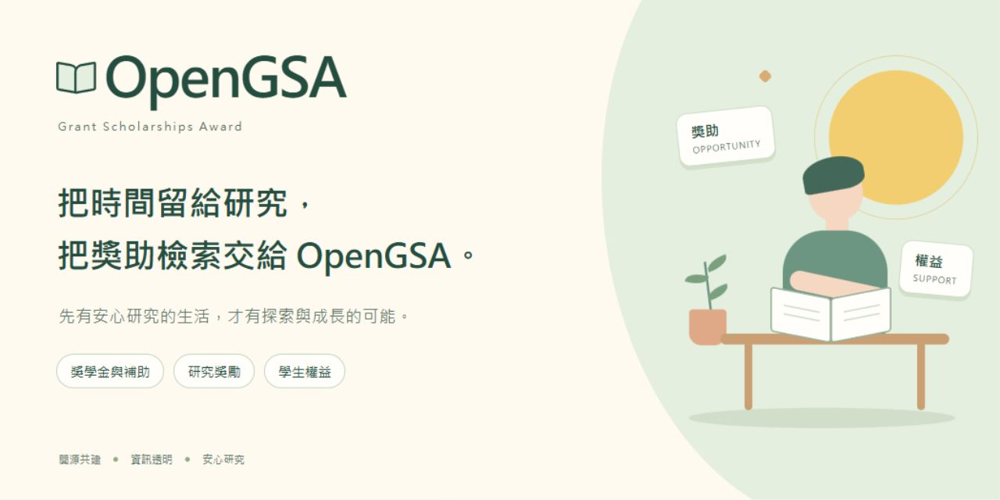

# OpenGSA

**Grant Scholarships Award**

**把時間留給研究，把獎助檢索交給 OpenGSA。**

整理臺灣碩博士生的獎學金、研究獎勵、出國補助、就學與生活支持，以及 RA／TA 權益與求助入口，讓學生看懂資格、掌握期限並查到正式依據。

先有安心研究的生活，才有探索與成長的可能。讓獎助資訊透明，讓學生有選擇，讓權益有依據。

---

## 🚀 最新專案狀態 (Latest Status)

> **公開預覽網站即時發布中**：**[https://matt-ye.github.io/opengsa/](https://matt-ye.github.io/opengsa/)**  
> **全庫方案覆蓋規模**：**236 方案**（1-to-1 精確時程政策覆蓋，`undetermined = 0`，覆蓋率 100%）  
> **測試防線**：278 項 Python 單元測試 PASS · 57 項前端整合測試 PASS · GitHub Actions CI/CD 100% PASS

### 1. 全庫七大獎助資源板塊 (236 方案)
OpenGSA 目前收錄跨越教育階段、公部門、民間企業與高等教育學府的完整資源光譜：
1. **碩博士研究生與核心研究獎助 (64 方案)**：國科會博士生研究獎學金、教育部產學博班、校長獎學金、傑出論文成果獎等。
2. **K-12 各級教育與公部門助學 (25 方案)**：學產基金、教育部清寒弱勢助學、地方政府急難救助金等（[專題報告](docs/K12-SCHOLARSHIP-LANDSCAPE-AND-SOURCE-CHAINS.md)）。
3. **學生身分軟硬體、雲端與 AI Perks (28 方案)**：GitHub Student Pack、Notion AI、JetBrains、AWS Educate 等（[專題報告](docs/STUDENT-SOFTWARE-HARDWARE-AND-AI-PERKS.md)）。
4. **企業、民間基金會與學會獎助 (85 方案)**：台積電、鴻海獎學鯨、行天宮、宗倬章、各專門學會獎助等（[專題報告](docs/ENTERPRISE-SCHOLARSHIP-LANDSCAPE-AND-SOURCE-CHAINS.md)）。
5. **醫學與特定專業出國/論文獎助 (2 方案)**：臺大醫學院學生出國補助辦法、醫學院研究生優秀著作獎（[專題報告](docs/MED-SCHOLARSHIPS-AUDIT.md)）。
6. **全台跨校大專校院代表性研究生獎助 (24 方案)**：清華、交大、成大、政大、中央、中山、中興、中正、師大、臺北大學等 24 所代表性高教學府（[專題報告](docs/TAIWAN-UNIVERSITIES-SCHOLARSHIP-EXPANSION.md)）。
7. **中央跨部會法定助學、算力與全國學會論文獎 (8 方案)**：原民會、農業部、勞動部、退輔會就學補助，Azure for Students 算力點數，資訊學會 (IICM)、人工智慧學會 (TAAI)、電腦學會 (CSROC) 碩博士最佳論文獎。

---

### 2. 全台 78 所公私立大學校院名冊盤查 (U001～U078)
- 盤查全台 78 所大專校院學務處生輔組、助學系統與博碩士研究生加碼機制。
- 建立全量來源台帳：[`data/source-expansion/university-source-inventory.json`](data/source-expansion/university-source-inventory.json)，編配代碼 **`U001`～`U078`**。
- 詳見專題調研：[全台大專校院獎助擴展報告](docs/TAIWAN-UNIVERSITIES-SCHOLARSHIP-EXPANSION.md)。

---

### 3. 臺大 11 個學院出國出訪補助深度調研
- 盤查文學院、理學院、社會科學院、醫學院、工學院、生物資源暨農學院、管理學院、公共衛生學院、電機資訊學院、法律學院、生命科學院及國際事務處 (OIA) 的出國研修、國際會議發表與出訪獎助。
- 梳理各院設置辦法、補助額度（1.5 萬至 6 萬元）、受理截點（固定梯次 vs 隨到隨審）與出國成果報告義務。
- 詳見專題報告：[臺大 11 學院暨校級出國出訪補助全景](docs/NTU-COLLEGE-OVERSEAS-GRANTS.md)。

---

### 4. 通用資訊鏈（Universal Source Chains）五節點拓撲
OpenGSA 解決過去獎助資訊「只有單一網址、缺漏法源母法與申請系統」的斷鏈痛點，建立五節點標準拓撲：
$$\text{Anchor (母法設置辦法)} \xrightarrow{\text{rule}} \text{Call (當期徵件公告)} \xrightarrow{\text{portal}} \text{Form (申請表件/系統)} \xrightarrow{\text{intake}} \text{Intake (生輔組/系所窗口)} \xrightarrow{\text{result}} \text{Result (名冊公示)}$$

- **大專校院資訊鏈批次**：[`data/source-chain-batches/batch-university.json`](data/source-chain-batches/batch-university.json)（72 份文件節點、48 條邊）。
- **全庫拓撲擴展與掃描稽核報告**：[全庫 236 方案拓撲擴展與 Actions 掃描稽核](docs/TOPOLOGY-EXPANSION-AND-SCAN-AUDIT.md)。
- **通用拓撲架構規格書**：[全庫跨資源通用資訊鏈架構規劃](docs/UNIVERSAL-SOURCE-CHAIN-TOPOLOGY.md)（定義高教型、公部門法定型、企業雙軌型、學生 Perks 型與研討會型五大原型）。
- **離線資訊鏈地圖**：[資訊鏈互動樹狀圖](docs/source-chains/source-chain-map.html) · [Obsidian Canvas](docs/source-chains/source-chain-map.canvas)。

---

### 5. 四分頁職責重新定位與輕量 URL 狀態同步
- **Tab 1（獎助探索與快篩）**：支援卡片清單與全域甘特圖切換；升級**全教育階段學歷篩選**（大學部、高中職、國中小幼兒、碩博）與**出國出訪綜合總覽**，卡片附一鍵【⭐ 收藏至個人時程】與【📄 查看完整條文】（[篩選升級說明](docs/FILTER-EXPANSION-AND-VISIBILITY.md)）。
- **Tab 2（方案詳情與條件比對）**：支援全庫 236 方案獨立切換；新增**雙方案並排比對（Side-by-Side）**，精確比對資格、給付、兼領限制與期限。
- **Tab 3（我的時程與行動規劃）**：專屬個人時間軸，專注渲染收藏方案，附待辦核銷進度統計與研討會個人補助試算。
- **Tab 4（權益防線與法規指南）**：提供雙軌五級救濟地圖、各校 TA/RA 給付行情比對與從屬性自測工具（[權益頁說明](docs/RIGHTS-PAGE-UPDATE.md)）。
- **輕量 URL 狀態同步（State in URL）**：`URLSearchParams` 雙向同步分頁、搜尋字、篩選、比對清單，支援深層連結與頁首「📋 分享此畫面」一鍵複製。

---

### 6. GitHub Actions 自動化巡檢與增量保護機制
- **四大執行軌道**：
  - `gov` 軌道（週二、五 09:17 UTC+8）：公部門與法定助學
  - `enterprise` 軌道（週一、四 09:17 UTC+8）：企業、基金會與學會
  - `other` 軌道（週三、六 09:17 UTC+8）：學生 Perks、AI 工具與大專校院生輔組
  - `consolidation` 軌道（週日 09:17 UTC+8）：全庫時程聚合校驗
- **增量閘門 (Incremental Diff Gate)**：未異動來源直接判定 `SKIP_UNCHANGED`（**0 HTTP / 0 Token**），嚴格落實 `model_mode=off`。

---

## 參與與回報

- **[開啟公開預覽網站](https://matt-ye.github.io/opengsa/)**
- **[提供使用回饋](https://github.com/matt-ye/opengsa/issues/new?template=preview-feedback.yml)**
- **[回報新獎助來源](https://github.com/matt-ye/opengsa/issues/new?template=source-submission.yml)**（歡迎提供各大學、企業或基金會之公開獎助依據）

---

點擊展開過往歷史版本與研究紀錄（PR #1～#49）

- **2026-11-04 全庫四大批次來源萃取與時程政策整併（PR #50～#53）**：全庫萃取架構上線，204 筆候選方案與政策達成 1-to-1 精確覆蓋。
- **2026-11-03 時間重萃與甘特圖投影（PR #42～#48）**：母頁 HTML＋子頁＋公告 PDF 無損彙整；跨 Chunk Map-Reduce 合成並對接甘特圖 Layout A。
- **2026-11-02 權益頁重大更新與雙按鈕（PR #40、PR #41）**：第四頁改為「重點總覽／聘任與給付／法規與保障／求助與自測」，頁首新增回饋與回報按鈕。
- **2026-11-02 原始來源逐項檢核閉包（PR #37、PR #38）**：485 個原始 URL 完整檢核，256 個可讀、111 個受限，57 個來源進待審建卡，累計 912 HTTP、模型 0。
- **2026-11-01 資訊鏈基線與甘特圖 Layout A（PR #31、PR #32）**：左欄選取管理與資格篩選，時間控制集中圖表工具列；甘特圖全局顯示已有名額範例。
- **2026-10-31 來源掃描與進階驗證防線（PR #24～#27）**：scanner-2 / document-ir-2 整合，15 項對抗測試，HTML 表格脈絡與局部重萃。
- **2026-10-30 候選審查工作台與雙軌模型架構（PR #20）**：候選預覽工作台、8 組 API 查核、排程維持 `model_mode=off`。
- **2026-10-29 MVP 介面與公開預覽啟動（PR #1、PR #2）**：建立四分頁原型與 GitHub Pages 自動部署流程。

