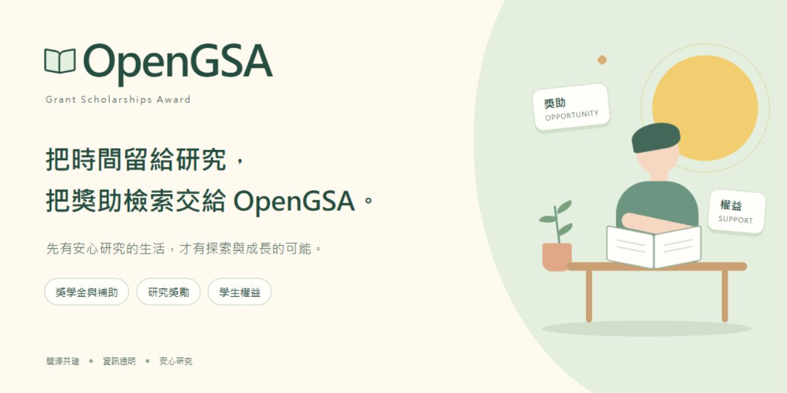
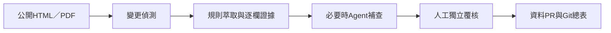
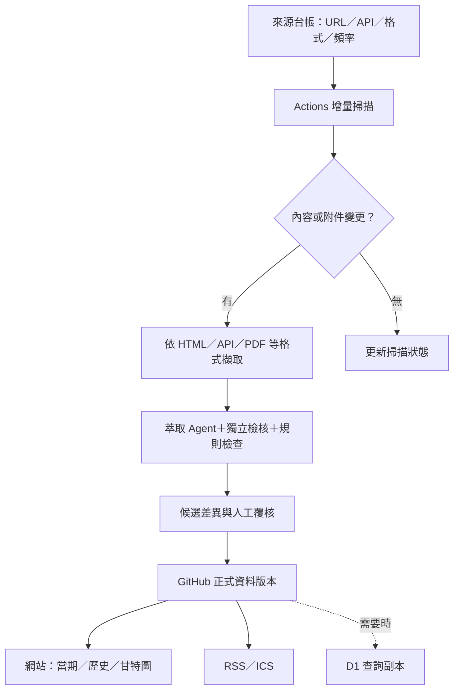

# OpenGSA

**Grant Scholarships Award**

**把時間留給研究，把獎助檢索交給 OpenGSA。**

整理臺灣碩博士生的獎學金、研究獎勵、出國補助、就學與生活支持，以及 RA／TA 權益與求助入口，讓學生看懂資格、掌握期限並查到正式依據。

先有安心研究的生活，才有探索與成長的可能。讓獎助資訊透明，讓學生有選擇，讓權益有依據。

## 目前狀態

本專案處於**公開預覽、資料基礎待覆核階段**。已有四分頁、清單／甘特圖、研討會多方案規劃、獨立權益入口、10筆草稿、17筆引用來源，以及低頻公開來源差異掃描；尚無完整資格引擎或已覆核正式資料集。正式資料契約及發布門檻仍待完成，原型及草稿不代表任何人已符合資格。

**[開啟公開預覽](https://matt-ye.github.io/opengsa/)** · [提供試用回饋](https://github.com/matt-ye/opengsa/issues/new?template=preview-feedback.yml)

預覽預設為合成排程，也可切換來源草稿；兩者都不是即時可申請清單。個人輸入只留本次瀏覽，重整即重設；回饋使用公開GitHub Issue，請勿提交個資或私人申訴。預覽與正式服務的驗收分開，建置與部署見[公開預覽說明](docs/DEPLOYMENT.md)。

v0.8研討會可選國科會、臺大醫學院、傑出人才發展基金會或自填院系方案，按「加入／更新甘特圖」後同步詳情與個人時間軸；同場多補助分列，準備建議及試算與正式申請日期分開。[來源查核與操作說明](docs/CONFERENCE-SOURCES.md)。

第一階段先做「全國性方案＋臺大試點」，再依資料維護量能逐步擴校。海外方案先保留少數來源占位。

來源掃描採臺北時間週二、週五09:17，另可手動執行；目前六個正文目標及允許的文字PDF只產生待覆核報告，不直接改網站。每次檢查robots，PDF不長期存放；教務處因轉載條款只保留雜湊與定位。模型呼叫0次。[看掃描狀態](https://github.com/matt-ye/opengsa/actions/workflows/scan-sources.yml) · [操作與限制](docs/SCANNER.md)。

## 規劃中的功能

- 依用途查找獎學金、研究支持、成果獎、會議與境外活動、學費、急難及住宿資源。
- 五組必要標籤：**來源、身分、年級限制、兼領、清寒限定**。
- 分開顯示資格結果、受理狀態與資料完整度；未知不等於符合或不限。
- 區分資助、轉知、承辦、收件、推薦與審查單位，以及申請者與受益者。
- 本機收藏、申請準備時間軸及日曆匯出。
- 可追溯版本的法規、適用給付依據與保密求助入口。

## 資料如何成為學生可用的資訊

以下兩圖呈現整體資料流程。有限公開HTML／文字PDF掃描與候選報告已實作；Agent、完整資格結構化、自動資料PR、RSS／ICS與D1尚未啟用。API只在確認官方端點及存取規則後納入，Agent依需要使用，D1為可選查詢副本。

### 萃取與覆核流程

先確認每個欄位的來源證據，再由人工獨立覆核；未通過的候選內容不直接進入正式資料。

### 掃描、版本與發布全貌

來源台帳記錄URL、存取方式、資料格式與更新頻率。當期、歷史與甘特圖從同一份正式資料產生，避免維護多份互相矛盾的表格；無變更時只更新掃描狀態。

未通過覆核或掃描失敗時保留既有正式版本並標示待確認，不把解析缺漏當成方案下架。PDF只暫存處理，Git保留結構化內容、短證據及版本；學生的個人條件與研討會輸入不進掃描流程。

完整規格見[首批來源與Actions／資料萃取設計](docs/INGESTION-POC.md)及[長期維運與訂閱提案](docs/OPERATIONS-PLAN.md)。流程圖以README內的Mermaid文字維護，可隨設計調整。

## 從這裡開始

| 文件 | 用途 |
|---|---|
| [目前計畫](docs/PLAN.md) | 已核可範圍、階段、下一步與驗收 |
| [公開預覽與部署](docs/DEPLOYMENT.md) | GitHub Pages發布、公開回饋、成品邊界、測試與回復 |
| [長期維運與訂閱提案](docs/OPERATIONS-PLAN.md) | GitHub／D1分工、來源擷取、Agent檢核、成本、RSS與ICS；尚未啟用 |
| [首批來源及Actions設計](docs/INGESTION-POC.md) | 原始管線提案；完整資格結構化、Agent與自動資料PR仍待完成 |
| [自動來源掃描](docs/SCANNER.md) | 已實作的六頁試點、低頻排程、robots／版權限制、文字PDF、待覆核報告與故障保留 |
| [專案縮圖原始設計](docs/design/social-preview.html) | 已核可圖稿的可修改HTML；GitHub Social preview由使用者自行上傳 |
| [四頁線框與流程](docs/design/README.md) | 搜尋、詳情、時間軸、權益入口；可開啟HTML審閱稿 |
| [資料契約草案](docs/DATA-CONTRACT.md) | 欄位、狀態、日期、引用及檢查方式 |
| [10筆樣本查核表](docs/PILOT-REVIEW.md) | 草稿差異、來源台帳與未完成覆核 |
| [合成資格情境](docs/ELIGIBILITY-CASES.md) | 博士五年級候選人、碩士生與外籍博士的預期行為 |
| [分類、標籤及來源](docs/TAXONOMY-AND-SOURCES.md) | 資源類別、關鍵字、來源種子、PDF 發現、五組 tag |
| [理念與 FAO 參考](docs/MISSION-AND-FAO.md) | Slogan、學生權益原則與參考網站觀察 |
| [權益依據與學校補充](docs/RIGHTS-SOURCES.md) | 國科會研究人力保障、勞動法規底線、臺大及實踐大學來源與版本 |
| [資料政策](docs/DATA-POLICY.md) | 來源、覆核、版本、存取限制與隱私 |
| [歷史完整 handoff](docs/reference/HANDOFF.md) | 完整規格參考；舊階段與數量目標以目前計畫為準 |

執行資料檢查與10個防誤判測試的方法見[資料契約](docs/DATA-CONTRACT.md#可執行檢查)。它們只檢查資料結構與引用，不是資格引擎或官方內容正確性的驗證。

## 貢獻與授權

請先閱讀 [貢獻指南](CONTRIBUTING.md)。公開 issue 僅用於產品、公開來源與資料更正，**請勿張貼私人申訴、學號、證件、帳戶、薪資單或私人往來**。

程式碼、測試與建置腳本採 [MIT](LICENSE)；團隊原創文件與可授權的資料編輯部分採 [CC BY 4.0](LICENSES/CC-BY-4.0.txt)。第三方文件、網站內容及資料各保留原授權，不因被列入來源就統一重授權。詳見 [授權範圍](LICENSES/README.md)。

目前沒有公布可接收私人個案或敏感附件的窗口。本專案提供資訊與正式求助入口，不代替主管機關或專業人員作資格核定、法律責任或申訴結果判斷。
