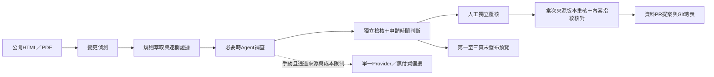
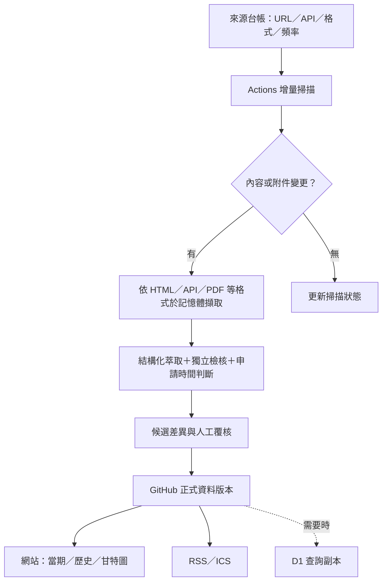

# OpenGSA

**Grant Scholarships Award**

**把時間留給研究，把獎助檢索交給 OpenGSA。**

整理臺灣碩博士生的獎學金、研究獎勵、出國補助、就學與生活支持，以及 RA／TA 權益與求助入口，讓學生看懂資格、掌握期限並查到正式依據。

先有安心研究的生活，才有探索與成長的可能。讓獎助資訊透明，讓學生有選擇，讓權益有依據。

## 目前狀態

2026-11-02權益頁更新支線：依使用者核可改為「重點總覽／聘任與給付／法規與保障／求助與自測」，補五類聘任查核路徑、分清給付性質的比較表與三份GitHub延伸文件；跨主題連結會顯示目標，研討會入口會展開，並修復最低工資舊網址。實作與逐項連結紀錄見[權益頁更新](docs/RIGHTS-PAGE-UPDATE.md)。此為PR40上的堆疊PR，待覆核合併後部署，候選及真人核准台帳不變。這項核可取代下段表格「待使用者確認」的歷史狀態。

2026-11-02頁首參與入口支線：四個分頁右側新增「提供回饋」與「提供獎助來源」按鈕；後者使用獨立GitHub Issue表單，必填名稱與公開網址，其餘對象／年度可留空。回報經人工查核，不自動建卡或啟用掃描。表單須在此PR合併至預設分支後才會在GitHub生效；本支線尚未部署。PR39已合併部署，第四頁薪資／權益表的歷史查核與恢復建議仍待使用者確認，本輪不改表格。

2026-11-02已部署：[64筆雷達可用性改善](docs/RADAR-DISCOVERY-IMPROVEMENTS.md)補工具／AI／算力快捷入口，將文件／方案切換收進進階。方案來源依單位文字／方案名稱分類，56筆可辨識、8筆待查，並顯示判斷依據；不拿轉知學校當出資者。限量19HTTP／模型0重萃7個來源，修復跨年度及結束時刻，新增兩個當年「公告年份推估」淺色參考區間；不當官方起訖或受理核定。候選仍64筆pending；PR39已合併，Pages部署成功。

2026-11-02使用者已核可整合PR32、37、38及64筆雷達摘要，依序合併後沿用既有Pages流程更新公開預覽；實際部署成功以[Actions](https://github.com/matt-ye/opengsa/actions/workflows/pages.yml)為準。這是來源摘要公開，所有候選仍pending，不代填逐筆完整資料核准。下方「公開19筆／不合併／不部署」是此次核可前的階段紀錄；正式pilot10筆、真人台帳、模型0、新增來源停用與PR34不動的界線維持。下一輪優先[簡化呈現方式、補快捷入口與改善萃取覆蓋](docs/VERIFIED-SOURCE-CARDS.md#下一輪優先順序)。

2026-11-02建卡資料支線：原始來源盤查完成後，另以PR37為基礎匯入**64筆待審摘要／58組暫定方案**（本輪61筆＋保留3筆）。14筆自動檢核通過、50筆有缺漏，全部pending；不是64個已核定可申請獎學金。來源與資訊鏈版本防護、篩選同步及合成資格試算見[本批建卡說明](docs/VERIFIED-SOURCE-CARDS.md)；[完整資訊鏈樹狀圖](docs/source-chains/source-chain-map.html)已更新。公開站仍為19筆，須經PR審查、合併與部署才會更新；正式pilot10筆與真人台帳不變。新增來源排程維持停用，模型0，不自動發布。

2026-11-02：[原始來源逐項檢核](docs/ORIGINAL-SOURCE-VERIFICATION.md)已覆蓋485個原始URL；本輪367個目標中256個可讀、111個仍有存取／渲染／格式／網址限制，未冒充正文通過。57個來源可進待審建卡，累計912HTTP、模型0。[逐項查詢](docs/source-expansion/original-source-verification.html)與JSON已保存；後續建卡另開資料PR，公開19筆、pilot及真人台帳不因本次來源PR更新。

2026-11-01完成全來源擴展的第一輪與集中修補：**367個範圍內原始URL均有處置，另讀取／處置56個新發現子來源**；全程634次HTTP、模型0。入口、辦法及受阻頁面不硬轉卡片。本批22筆待審候選（10筆自動檢核通過、12筆通過自動檢核但有缺漏）；與保留的5份舊文件合成**27筆／21組暫定方案的隔離預覽**。不是新增27個獎學金，也不是全部資訊鏈已閉合。公開站仍維持19筆，正式pilot10筆draft與真人核准台帳未改。

**[本輪結果、待辦與重現方式](docs/SOURCE-EXPANSION-RUN.md)** · [資訊鏈樹狀圖HTML](docs/source-expansion/results.html) · [全部來源處置JSON](data/source-expansion/run-2026-11-01.json) · [原始完整來源目錄](docs/source-expansion/catalog.html)

來源JSON與網頁圖維持主流程。Obsidian已棄用；PR34依使用者要求保留原樣。本輪原先疊於PR32，現依上方最新核可整合PR32、37、38；後續掃描仍不自動合併或發布。新增排程產物為雷達資料patch與離線預覽artifact，Actions權限仍唯讀、不代開或合併資料PR。

來源資訊鏈第一批基線（PR32，保留當時數量）

PR #28、#29、#31已合併，PR31的A版工具列與資訊鏈時間軸已部署至GitHub Pages。當前工作為資訊鏈排查第一批，獨立待審，不自動改寫公開期限。

新增[第一批排查與資料結構](docs/SOURCE-CHAIN-BATCH-01.md)、[離線樹狀圖HTML](docs/source-chains/source-chain-map.html)及[Obsidian Canvas](docs/source-chains/source-chain-map.canvas)。總索引涵蓋13方案／19候選；本批重新讀取3方案的10個指定來源，規則仍pending。

- 保留19筆雷達候選／17份原文件／13組方案；正式pilot仍10筆draft，人工台帳仍空。
- 新增共用JSON文件、關係與17個有來源hash／定位的日期事件；6個地方公告完成程式萃取，三個單位已有完整區間。不是全部19筆已完成資訊鏈。
- 第一頁採已核可的A版：左欄整合選取管理與資格篩選，時間控制集中圖表工具列；白底網格圖例預設收合。預設甘特圖，圖內上下／水平捲動，固定標題與日期軸；保留清單切換。全局並列電信所、農化系與政治所等已有時程範例，不需選系所；圖下及滑鼠提示標明適用單位，參考年度仍可切換。實際起訖、公告流程與淺色歷史底帶分層，第二三頁同步，未知資格不因日期增加而自動通過。
- 手動Actions新增`source_chains`，零模型、無Secrets、有限公開GET；只產生待審artifact，不自動回寫網站。既有週二／五掃描與模型off不變。

[規劃、操作、實作及限制](docs/SOURCE-CHAINS-AND-TIMELINE.md) · [19筆完整探索](docs/SOURCE-CHAIN-RESEARCH-2026-11-01.md) · [驗收紀錄](data/audits/source-chains-2026-11-01.json)

**[開啟公開預覽](https://matt-ye.github.io/opengsa/)** · [提供回饋](https://github.com/matt-ye/opengsa/issues/new?template=preview-feedback.yml)

雷達為有依據的來源摘要，尚非即時資格核定。個人條件與研討會輸入只留本次瀏覽；完整資料仍須獨立覆核。往年／常態區間僅供準備參考，實際資格、起訖及程序以主辦及受理單位最新公告為準。

過往階段與驗收紀錄（下列數字及未合併描述保留為當時狀態）

2026-11-01萃取更新：19筆完成受限重抓與完整規則重萃，保留給付、來源版本及受阻附件。19筆有可讀對象資訊（含2筆明標制度線索）、16筆收件／轉送、8筆時間資訊；學位未知可留空，不再預設博士。153項Python／45項Node通過。另以5個待納入官方來源分兩輪隔離驗證：第一輪失敗案例後用於校準，第二輪仍暴露正文／資格辨識缺口，未混入公開清單。[通用指令、重現方式、結果與限制](docs/GENERALIZABLE-EXTRACTION.md)。這是最新狀態，下方數字保留前階段紀錄；PR28、29已合併；公開部署狀態以Actions為準。

2026-11-01雷達版：既有19份文件可直接查看摘要，亦可彙整13組方案；未知與確定篩選分區、核心資訊清晰度及逐筆「回報問題」已接上。名稱去除流程附註；12筆保留收件／轉送、7筆顯示分層時間，未知縮為黃色警示與「不明，請見來源↗」。[顯示落差原因與下一輪萃取](docs/RADAR-FIELD-DISPLAY.md) · [雷達操作、發布邊界與測試](docs/RADAR-VIEW.md)。143項Python／45項Node及Chrome19筆操作通過；正式pilot10筆與真人台帳未改，雷達摘要不代表個人資格核定。本PR合併及部署後才更新公開網址。

2026-11-01本版整合PR #22–#27：維運與資助研究經更正後納入，文件準備／進階萃取與候選審查共用最新版本。全套140項Python／39項Node測試通過；review-1.1.0新增操作說明、中文缺漏及審查篩選。[需要你審核的項目與操作](docs/CURRENT-REVIEW-CHECKLIST.md) · [維運與成本提案](docs/LONG-TERM-ARCHITECTURE-AND-OPERATIONS.md) · [開源資助與擴展提案](docs/OPENAI-CODEX-FUND-APPLICATION-AND-EXPANSION.md)。19筆候選仍待審，合併程式不代表發布資料。

2026-10-31進階驗證補上15項對抗測試，修正HTML行內文字、表格定位、共用分支限制及局部時程。17文件／19候選已依新版本完整重掃，維持8通過／11有缺漏，沒有已知欄位退步；全套140項Python／38項Node通過。仍全部待審、0模型呼叫。[進階測試與限制](docs/ADVANCED-EXTRACTION-TESTS.md)。

2026-10-31整合PR #24～#26後，已接上統一文件區塊、HTML表格／章節脈絡、完整請求分段及指定欄位規則重萃。17份實際文件／19筆候選已重跑，8通過／11有缺漏，仍全部待審。[目前實作與限制](docs/PREPARED-EXTRACTION.md) · [後續規劃](docs/FIELD-SCOPED-EXTRACTION-PLAN.md) · [PR #25研究整合](docs/BLOCKED-SOURCES-AND-DEFUDDLE-STUDY.md)。模型能力／正確Token計數器未核對時會延期，排程仍off。

本專案處於**公開預覽、結構化候選萃取與檢核管線已建立、正式資料仍待人工獨立覆核階段**。已有四分頁、清單／甘特圖、研討會多方案規劃、獨立權益入口、10筆草稿、17筆引用來源、低頻公開來源差異掃描，以及「爬取結果 → 有版本候選 Schema → 結構化萃取（規則優先＋可替換模型 Adapter）→ 獨立檢核 → 申請時間與資格判斷 → 候選差異覆核報告」管線；正式資料契約簽核及發布門檻仍待完成，結構驗證通過、模型輸出或原型試算均不代表官方資格已核定。

**[開啟公開預覽](https://matt-ye.github.io/opengsa/)** · [提供試用回饋](https://github.com/matt-ye/opengsa/issues/new?template=preview-feedback.yml)

預覽預設為合成排程，也可切換來源草稿；兩者都不是即時可申請清單。個人輸入只留本次瀏覽，重整即重設；回饋使用公開GitHub Issue，請勿提交個資或私人申訴。預覽與正式服務的驗收分開，建置與部署見[公開預覽說明](docs/DEPLOYMENT.md)。

v0.8研討會可選國科會、臺大醫學院、傑出人才發展基金會或自填院系方案，按「加入／更新甘特圖」後同步詳情與個人時間軸；同場多補助分列，準備建議及試算與正式申請日期分開。[來源查核與操作說明](docs/CONFERENCE-SOURCES.md)。

第一階段先做「全國性方案＋臺大試點」，再依資料維護量能逐步擴校。海外方案先保留少數來源占位。

來源掃描採臺北時間週二、週五09:17，另可手動執行；目前來源台帳中已啟用的正文目標及允許的文字PDF在記憶體完成結構化萃取、七項獨立檢核（含 `coverage_ok` 與 `passed_with_gaps`）、學生窗口時間判斷與 `data/pilot.json` 差異比對，只產生待覆核報告，不直接改寫網站正式資料。每次檢查robots，PDF不長期存放；教務處因轉載條款只保留雜湊與定位，且絕不送往外部模型（`hash_only_bytes_sent = 0`）。雙軌模型 Adapter（`extract` 補缺＋`audit` 交叉盤查）於排程預設關閉（`model_mode=off`、呼叫0次），僅支援手動觸發或本機評估。[看掃描狀態](https://github.com/matt-ye/opengsa/actions/workflows/scan-sources.yml) · [操作與限制](docs/SCANNER.md)。

本輪已全數合併 PR #16～#21（包含起訖與準備提醒帶、AI 工具補助台帳、可靠性修正、申請管道 Schema 與 8 組 API 實測）。來源設定共16筆，其中13筆啟用、3筆暫停；「啟用」不保證每次都可擷取，最近實測狀態見[掃描文件](docs/SCANNER.md)。10筆網站資料仍是待覆核草稿，人工處置台帳已清除合成紀錄。

8組Repository Secrets已接線，模型預設與官方額度宣稱已重新盤查；僅Groq完成小量JSON推論，其他服務的目錄成功不等於金鑰／免費推論全部可用。看[API查核及操作](docs/API-AUDIT.md)與[本輪修正及驗收](docs/RELIABILITY-AUDIT.md)。排程維持規則模式，不啟用自動付費備援。

PR #18的17筆AI資源已進行來源分流與更正，見[查核結果](docs/PR18-RESOURCE-REVIEW.md)。申辦方式新增紙本／電子、親簽與收件判準；欄位不適用須有依據才標N/A，不能把未知或資格不符改成N/A。掃描仍先產生候選，經覆核、資料PR及部署後，第一至三頁才共用新快照，見[判斷與更新流程](docs/APPLICATION-PROCESS.md)。

臺北／新竹AI工具補助已推進為兩筆[具名候選](data/candidates/README.md)，確定性萃取、分支與程序檢核已接入掃描；仍pending，不改10筆正式草稿。[推進與驗收紀錄](docs/AI-TOOLS-CANDIDATES.md)。

2026-10-31已盤點145個來源／參考網址，13個具名來源的17份文件已匯入19筆待審候選（8筆自動檢核通過、11筆有缺漏）；正式資料仍10筆。入口發現、欄位萃取與人工核准分開驗收，詳見[來源全盤檢查](docs/SOURCE-COVERAGE-AUDIT.md)及[逐項來源清單](docs/SOURCE-LINKS-2026-10-31.md)。

## 已有與後續功能

候選[審查工作台](docs/REVIEW-WORKSPACE.md)已接上：逐欄差異與短證據、第一至三頁未發布預覽、人工處置意向下載，以及來源版本重新核驗後的資料 PR 提案匯出。Actions 可手動選 `review_workspace` 產生離線 artifact，不使用 Secrets 或模型。正式總表仍10筆、人工覆核台帳仍空；產生提案不會自動更新公開卡片。

- 依用途查找獎學金、研究支持、成果獎、會議與境外活動、學費、急難及住宿資源。
- 五組必要標籤：**來源、身分、年級限制、兼領、清寒限定**。
- 分開顯示資格結果、受理狀態與資料完整度；未知不等於符合或不限。
- 區分資助、轉知、承辦、收件、推薦與審查單位，以及申請者與受益者。
- 本機收藏、申請準備時間軸及日曆匯出。
- 可追溯版本的法規、適用給付依據與正式求助入口；保密條件須向各窗口確認。

## 資料如何成為學生可用的資訊

以下兩圖呈現整體資料流程。有限公開HTML／文字PDF掃描、有版本候選 Schema (`schema/candidate.schema.json`)、結構化規則萃取與可替換模型 Adapter (`scripts/extract_candidates.py`)、獨立檢核 (`scripts/verify_candidates.py`)、申請時間與 P1 資格判斷 (`scripts/evaluate_deadlines.py`) 及候選差異覆核報告 (`scripts/review_candidates.py`) 已實作；外部模型預設關閉，自動資料PR、RSS／ICS與D1尚未啟用。API只在確認官方端點及存取規則後納入，D1為可選查詢副本。

### 萃取與覆核流程

先確認每個欄位的來源證據，再經獨立檢核與人工獨立覆核；未通過的候選內容維持 `pending`，不直接進入正式資料。

### 掃描、版本與發布全貌

來源台帳記錄URL、存取方式、資料格式與更新頻率。當期、歷史與甘特圖從同一份正式資料產生，避免維護多份互相矛盾的表格；無變更時只更新掃描狀態。

未通過覆核或掃描失敗時保留既有正式版本並標示待確認，不把解析缺漏當成方案下架。PDF只暫存處理，Git保留結構化內容、短證據及版本；學生的個人條件與研討會輸入不進掃描流程。

完整規格見[首批來源與Actions／資料萃取設計](docs/INGESTION-POC.md)及[長期維運與訂閱提案](docs/OPERATIONS-PLAN.md)。流程圖以README內的Mermaid文字維護，可隨設計調整。

## 從這裡開始

| 文件 | 用途 |
|---|---|
| [目前計畫](docs/PLAN.md) | 已核可範圍、階段、下一步與驗收 |
| [候選審查工作台](docs/REVIEW-WORKSPACE.md) | 未發布預覽、人工處置、重新核驗與資料 PR 草稿流程 |
| [公開預覽與部署](docs/DEPLOYMENT.md) | GitHub Pages發布、公開回饋、成品邊界、測試與回復 |
| [長期維運與訂閱提案](docs/OPERATIONS-PLAN.md) | GitHub／D1分工、來源擷取、Agent檢核、成本、RSS與ICS；D1與訂閱尚未啟用 |
| [首批來源及Actions設計](docs/INGESTION-POC.md) | 管線設計與已落地之結構化萃取、獨立檢核及差異覆核模組對照 |
| [API查核與模型台帳](docs/API-AUDIT.md) | Secret對應、模型目錄、額度／效期、手動實測與成本限制 |
| [自動來源掃描](docs/SCANNER.md) | 已實作的來源台帳試點、低頻排程、結構化候選萃取、獨立檢核與故障保留 |
| [專案縮圖原始設計](docs/design/social-preview.html) | 已核可圖稿的可修改HTML；GitHub Social preview由使用者自行上傳 |
| [四頁線框與流程](docs/design/README.md) | 搜尋、詳情、時間軸、權益入口；可開啟HTML審閱稿 |
| [資料契約草案](docs/DATA-CONTRACT.md) | 正式草稿與候選資料 Schema、欄位、狀態、日期、引用及檢查方式 |
| [10筆樣本查核表](docs/PILOT-REVIEW.md) | 草稿差異、來源台帳與未完成覆核 |
| [合成資格情境](docs/ELIGIBILITY-CASES.md) | 博士五年級候選人（P1）、碩士生（P2）與外籍博士（P3）的規則比對與時間視窗驗收 |
| [分類、標籤及來源](docs/TAXONOMY-AND-SOURCES.md) | 資源類別、關鍵字、來源種子、PDF 發現、五組 tag |
| [理念與 FAO 參考](docs/MISSION-AND-FAO.md) | Slogan、學生權益原則與參考網站觀察 |
| [權益依據與學校補充](docs/RIGHTS-SOURCES.md) | 國科會研究人力保障、勞動法規底線、臺大及實踐大學來源與版本 |
| [資料政策](docs/DATA-POLICY.md) | 來源、覆核、版本、存取限制與隱私 |
| [歷史完整 handoff](docs/reference/HANDOFF.md) | 完整規格參考；舊階段與數量目標以目前計畫為準 |

執行資料檢查、Python與Node測試的方法見[資料契約](docs/DATA-CONTRACT.md#可執行檢查與測試)。結構檢查與自動檢核通過不取代人工獨立覆核，亦不代表官方資格已核定。

## 貢獻與授權

請先閱讀 [貢獻指南](CONTRIBUTING.md)。公開 issue 僅用於產品、公開來源與資料更正，**請勿張貼私人申訴、學號、證件、帳戶、薪資單或私人往來**。

程式碼、測試與建置腳本採 [MIT](LICENSE)；團隊原創文件與可授權的資料編輯部分採 [CC BY 4.0](LICENSES/CC-BY-4.0.txt)。第三方文件、網站內容及資料各保留原授權，不因被列入來源就統一重授權。詳見 [授權範圍](LICENSES/README.md)。

目前沒有公布可接收私人個案或敏感附件的窗口。本專案提供資訊與正式求助入口，不代替主管機關或專業人員作資格核定、法律責任或申訴結果判斷。

2026-10-31後續核可：先穩定本批再擴張。已修正給付重複、週期與身分、院別範圍及文件層級N/A；工作台新增方案文件分組及review-text.md文字審查清單。最新8筆通過、11筆有缺漏，仍全部待審。詳見[本批穩定化與擴張門檻](docs/CANDIDATE-STABILITY.md)。
