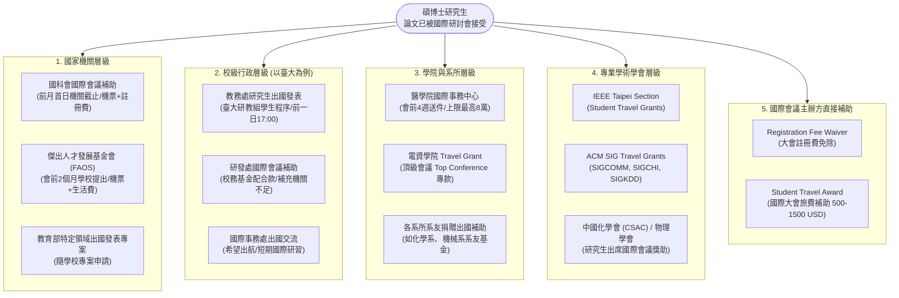
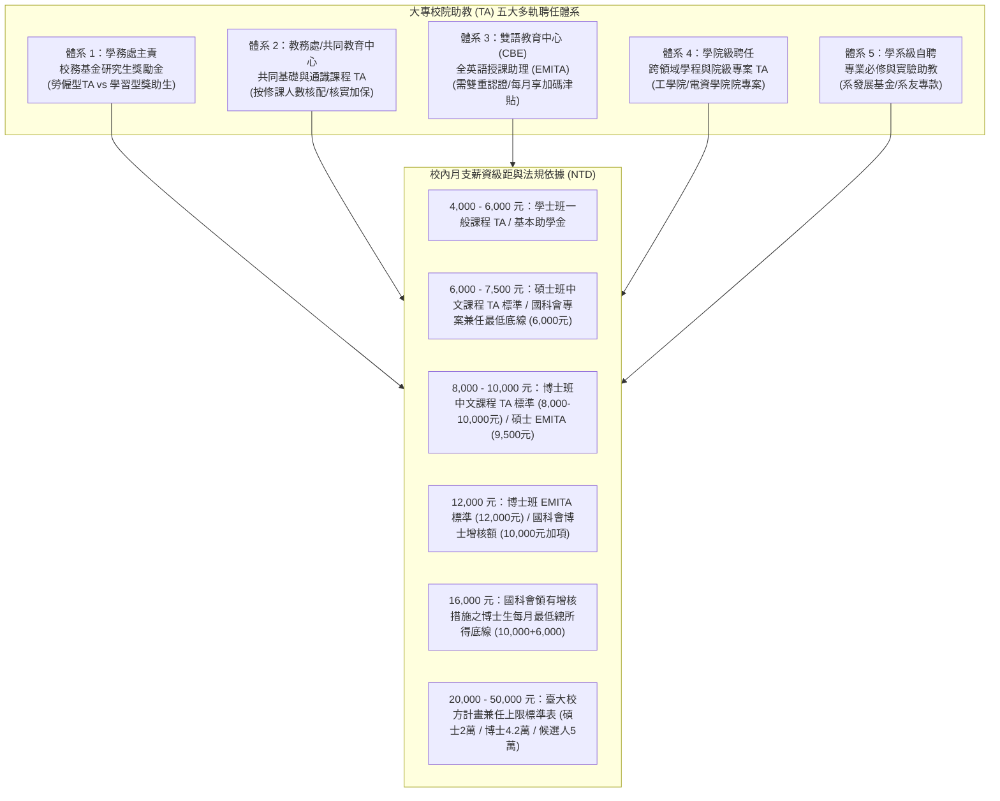

# OpenGSA 學術生涯進階路徑、研討會出國、專屬身分獎助、榮譽推薦與助教工讀體系總覽

> 2026-10-30狀態：本文件為搜尋種子與擴展規劃，未逐項覆核的金額及聘任條件不得作為當期保障或申請結論。現行介面已撤下未查證的TA／EMITA薪資級距，依當期辦法及契約核對；法律摘要見[法源摘要](RIGHTS-AND-LEGAL-FRAMEWORK.md)。


> 文件性質：學術生涯垂直進階與校園助教工讀深度盤點（2026-10-30 規劃版）。
> 本文件深入盤點：學生參與研討會之多層次補助網絡、國科會千里馬與雙聯學位計畫；依「碩士、博士、博士候選人、博士後研究員」四大學術階梯之專屬獎助；斐陶斐榮譽學會、優秀青年與各級榮譽推薦機制；以及助教（TA）多軌聘任制度（學務處聘、教務處聘、EMITA、學院聘、系聘）、薪資級距（4,000 至 50,000 元）與校內工讀體系。

---

## 1. 學生研討會出國補助、千里馬計畫與雙聯學位深度網絡

研討會出國發表與跨國移動是碩博士生學術發表的關鍵環節。補助體系依出資主體分為「國家機關」、「大學校級」、「學院與系所」、「專業學術學會」與「國際會議主辦方」五層網絡：



### 1.1 研討會出國補助各層級比對表

| 層級類別 | 補助機構 / 方案名稱 | 申請時間與程序 | 補助項目與額度上限 | 兼領與限制條款 |
|---|---|---|---|---|
| **國家機關** | **國科會 (NSTC)**<br/>補助研究生出席國際會議作業要點 | 會議舉行首日所屬月份之**前一個月首日**機構彙送（臺大校內為前一日 17:00）；可於四週前補交接受函 | 往返經濟艙機票、會議註冊費、生活費（按國科會標準按日計） | 每一學年度以補助一次為限；同會議不得重複支領其他全額機票補助 |
| **國家機關** | **傑出人才發展基金會 (FAOS)**<br/>優秀學生出國開會補助 | **會前兩個月**由學校公文函報；接受函為必備文件 | 機票費、部分生活費與會議註冊費（依地區定額核算） | 具中華民國國籍之在學碩博士生；**學生校內收件日未知，須向各校生輔組確認** |
| **校級** | **臺大教務處 / 研發處**<br/>研究生出席國際會議補助方案 | 搭配國科會申請；若未獲國科會核定，依校內規定轉入校方補助程序 | 補助差額機票或定額補助（通常約 10,000–30,000 元） | 需優先提出國科會申請；校方補助屬差額或備援性質 |
| **學院級** | **臺大醫學院國際事務中心**<br/>研究生國際會議出國補助 | **會前四週送達**醫學院國際事務中心；檢附接受函與摘要 | 補助往返機票與註冊費（單一專案上限依辦法辦理） | 限醫學院在學生，同性質校內外會議獎助領取最高額時受兼領限制 |
| **學院級** | **電資學院 / 工學院**<br/>頂尖會議 (Top Conference) Travel Grant | 各學院獨立公告，多數要求為 CCF A 類、CORE A* 或頂級旗艦會議 | 提供專額機票或註冊費加碼（15,000–50,000 元） | 限第一作者且口頭發表 (Oral Presentation) 優先 |
| **學術學會** | **IEEE / ACM / 國內專業學會**<br/>Student Travel Awards | 隨論文接受通知由大會網站或各學會網站提出申請 | 補助 500 至 1,500 美元抵用金或直接免除大會註冊費 | 限學會學生會員 (Student Member) 且具備發表論文者 |

---

### 1.2 國科會千里馬計畫（補助博士生赴國外研究）深入規範

* **法規依據**：《國家科學及技術委員會補助博士生赴國外研究作業要點》。
* **申請對象與資格**：
  1. 具中華民國國籍，且戶籍設於國內。
  2. 現就讀國內公私立大學校院**在學一年（含）以上之博士生**。
  3. 經就讀學校評估可於畢業前完成國外研究。
  4. 排除條款：曾領取此要點補助公費者，不得再次提出申請。
* **國外機構與期程**：
  - 國外學術研究機構（排除中國大陸、香港及澳門地區）。
  - 補助期限為 **7 個月至 12 個月**（以月計，不可任意分段或展延，除懷孕特殊情形外）。
* **補助額度與核撥**：
  - 以一年新臺幣 **90 萬元** 為計算標準（按實際在國外日數等比例計算核撥）。
* **申請日程與程序**：
  - 每年固定於 **6 月 1 日至 7 月 31 日中午 12:00** 於國科會「學術研發服務網」開放個人線上填報，再由各大學於期限內造冊彙送國科會。
* **衍生雙邊三明治合作計畫**：
  - **台德三明治計畫 (Sandwich Program)**：國科會與德國學術交流總署 (DAAD) 合作，赴德研修 6 至 18 個月。
  - **台法幽蘭計畫 (Orchid Program)**：國科會與法國在台協會合作，支持台法雙邊實驗室聯合培育。

---

### 1.3 赴境外研修雙聯學位（Dual Degree / Double Degree）獎助

* **制度意涵**：學生同時註冊於國內大學與外國合作頂尖大學，於兩校修讀完成學分與研究後，分別取得兩校各自頒發之碩士或博士學位。
* **主要獎助來源**：
  1. **校級雙聯學位獎學金**（以臺大為例）：
     - 法規：《國立臺灣大學赴境外研修雙聯學位獎助學金設置要點》（國際處統籌）。
     - 補助項目：往返機票、學雜費補助差額與生活津貼（依赴訪國家與兩校合約每學期數萬至十餘萬元）。
     - 申請時程：分第 1 學期（秋季出國，約 6–7 月收件）與第 2 學期（春季出國，約 10–11 月收件）。
  2. **教育部跨國雙聯學程補助**：
     - 教育部國際及兩岸教育司專案補助大專校院推動雙聯學制獎助生。
  3. **外國合作姐妹校專屬全額/半額學費減免**：
     - 例如日本京都大學、筑波大學、法國索邦大學、美國天普大學等，雙邊協議常免除外國校方之國際學生高額學費。

---

## 2. 學術階梯專屬身分獎項與獎助（碩士、博士、博士候選人、博士後研究員）

OpenGSA 拒絕將「研究生」混為單一標籤，依修業階段分流為四大階梯：

```mermaid
flowchart LR
    M["1. 碩士班階段<br/>(Master's Student)"] --> D["2. 博士班在學階段<br/>(PhD Student)"]
    D --> C["3. 博士候選人階段<br/>(PhD Candidate)"]
    C --> P["4. 博士後研究學者<br/>(Postdoctoral Fellow)"]

    subgraph M_GRANTS["碩士專屬"]
        M1["各大專門學會優秀碩士論文獎"]
        M2["中技社科技創意獎學金 (15萬)"]
        M3["富邦人壽/管科會碩士論文獎"]
        M4["宋作楠先生碩士論文獎"]
    end

    subgraph D_GRANTS["博士專屬"]
        D1["國科會/教育部博士生研究獎學金 (4萬/月)"]
        D2["台積電博士獎學金 (50萬/年, 至多5年)"]
        D3["聯發科技博士生獎學金 (3.5-5萬/月)"]
        D4["各校頂尖博士培育專案"]
    end

    subgraph C_GRANTS["博士候選人專屬"]
        C1["中研院人文社會博士候選人培育 (5萬/月)"]
        C2["蔣經國基金會留學生博士論文獎 (15k-25k USD)"]
        C3["Fulbright 博士論文研究獎助 (赴美研習)"]
        C4["臺大專題兼任助理頂額上限 (50,000元/月)"]
    end

    subgraph P_GRANTS["博士後專屬"]
        P1["國科會延攬博士後研究學者 (起薪約65k)"]
        P2["中研院院長特聘博士後 (85k-90k+研究費)"]
        P3["臺大遠學計畫博士後出國研究分支"]
        P4["各大學卓越博士後研究學者專案"]
    end

    M -.-> M_GRANTS
    D -.-> D_GRANTS
    C -.-> C_GRANTS
    P -.-> P_GRANTS
```



### 2.1 四大身分階梯特徵與代表性方案對照表

| 學術階梯 | 身分定義與門檻 | 代表性專屬獎助 / 論文獎 | 給付金額與形式 | 關鍵檢核條件與限制 |
|---|---|---|---|---|
| **碩士班**<br/>(`master`) | 正式註冊在學之碩士班研究生（含碩一至碩二/碩三） | • 宋作楠碩士論文獎<br/>• 富邦人壽管科會管理碩士論文獎<br/>• 中華民國資訊學會/台灣經濟學會優秀碩士論文獎<br/>• 財團法人中技社創意獎學金 | 論文獎首獎 **10 至 15 萬元**；中技社創意獎 **15 萬元**（個人或團隊） | 限碩士應屆畢業論文；排除在職專班；中技社排除其他民間獎學金兼領 |
| **博士班**<br/>(`phd_student`) | 經入學考試或逕行修讀錄取之博士班在學生 | • 國科會博士生研究獎學金（甄選類/核配類）<br/>• 教育部博士生獎學金補助<br/>• 台積電博士獎學金<br/>• 聯發科博士生研究獎學金<br/>• 電資學院頂尖博士培育 | **每月 35,000 至 50,000 元**，獎勵期間 **3 至 5 年** | 排除全職有給職工作者；國科會與教育部兩大政府方案互斥；台積電需教授推薦 |
| **博士候選人**<br/>(`phd_candidate`) | 已修畢博士規定學分、**通過博士候選人資格考 (Qualifying Exam)** 且正式立案者 | • 中研院人文社會科學博士候選人培育計畫<br/>• 蔣經國國際學術交流基金會留學生博士論文獎學金<br/>• Fulbright 博士論文研究獎助 (Dissertation Research)<br/>• 臺大計畫兼任助理上限（候選人提升至 50,000 元） | 中研院 **50,000 元/月**（為期 1 年）；蔣經國基金會 **15,000–25,000 美元**；臺大上限 5 萬元 | 必須檢附就讀學校出具之「博士候選人資格證明書」；蔣經國基金會限論文撰寫最後一年 |
| **博士後研究員**<br/>(`postdoc`) | 已獲國內外博士學位，於大學或研究機構從事全職博士後專題研究者 | • 國科會補助延攬博士後研究學者<br/>• 中央研究院博士後研究學者計畫（一般博士後 vs **院長特聘博士後**）<br/>• 臺大遠學計畫（博士後研究人員赴國外移地研究分支） | 一般博士後月支約 **65,000 至 70,000 元**；院長特聘約 **85,000 至 90,000+ 元**，另享研究專案經費 | 屬全職研究聘僱；年終獎金 1.5 個月；遠學博士後分支不可套用博士生移地研究標準 |

---

## 3. 甄選與推薦制度之獎勵、榮譽學會與優秀青年

本類別屬於「學業卓越、品德楷模、社會貢獻」之榮譽遴選機制，通常不開放個人自由投件，須經各級單位審查委員會排序推薦：

### 3.1 中華民國斐陶斐榮譽學會 (The Phi Tau Phi Scholastic Honor Society)

* **學會宗旨**：選拔賢能，獎勵學術研究，崇德敬業。
* **推薦機制與法定名額比例**（依全國學會章程嚴格限制）：
  1. **博士班**：凡大學校院應屆博士畢業生品學兼優者，得推薦應屆畢業生人數之 **10%（百分之十）**，不足一人者以一人計。
  2. **碩士班**：凡大學校院應屆碩士畢業生品學兼優者，每一學院得推薦應屆畢業生人數之 **3%（百分之三）**，不足一人者以一人計。
  3. **學士班**：凡大學校院應屆學士畢業生品學特優者，每一學院得推薦應屆畢業生人數之 **1%（百分之一）**，不足一人者以一人計。
  4. **傑出校友**：對學術研究或社會有特優貢獻者，每校每年推薦 1 至 3 人。
* **獎勵性質與價值**：
  - 頒發斐陶斐榮譽會員證書、學會金質徽章，並於畢業典禮公開授證表揚。
  - **現金獎勵性質**：學會官方本身**不發放常態性現金獎學金**；然而獲選斐陶斐會員在學術界為極高榮譽資歷，在申請國科會博士後、教職、海外博士班或部分校內專款獎學金時具備顯著加分效益。

---

### 3.2 優秀青年遴選機制（校級優秀青年 vs 全國大專優秀青年）

| 遴選等級 | 主辦機構 / 法規依據 | 遴選資格門檻 | 推薦審查流程 | 獎勵與表揚形式 |
|---|---|---|---|---|
| **校級優秀青年**<br/>（以國立臺灣大學為例）| 臺大學務處生輔組<br/>《國立臺灣大學優秀青年遴選辦法》 | 1. 當年度臺大在學生（含研究生）<br/>2. 前一學期學業 GPA $\ge$ **2.93**<br/>3. 在學期間**無任何懲處紀錄**<br/>4. 具體事蹟：學術研究卓越、熱心公益社會楷模、社團領袖貢獻等 | 各教學單位、教職員工生推薦 $\to$ 學院複審並排定順序 $\to$ 校級「優秀青年遴選評審委員會」決選 | 於校慶典禮公開表揚，頒發當選證書與獎牌（部分專案配合校友捐款提供獎額） |
| **全國 / 縣市大專優秀青年** | 中國青年救國團主辦<br/>全國大專優秀青年表揚籌備委員會 | 1. 全國大專校院在學生（含博碩士生）<br/>2. 品學兼優，積極參與社會服務、國家重大專案或特殊才藝發光 | 各大學學務處依分配名額甄選校內代表 $\to$ 提報主辦單位彙審 | 每年於 3 月青年節全國表揚大會接受表揚，頒發榮譽獎座與證書 |

---

### 3.3 榮譽獎項分流：校長獎、院長獎、利他獎、書卷獎之界線

| 獎項名稱 | 適用學制對象 | 核心遴選標準 | 是否提供獎金 | OpenGSA 篩選與標籤防呆規則 |
|---|---|---|---|---|
| **研究生校長獎** | 碩士生、博士生應屆畢業生 | 學位論文品質、學術發表、修業成績頂尖（各系所推薦前 1–2 名） | 頒發校長獎獎牌，部分學院系所自籌獎金 | 標記為 `A3:成果與榮譽`；嚴格要求應屆畢業資格 |
| **各學院院長獎** | 該學院專屬碩博士及學士生 | 該學院各系所成績名列前茅或學位論文卓越者 | 頒發獎狀與獎牌，部分學院配合企業獎金 | 限本院系學生；跨院不適用 |
| **學生利他獎** | 全校在學生（含研究生） | 關懷社會、熱心公益、扶助弱勢、同儕互助足為典範者 | 每名頒發獎狀與獎金（如臺大通常為數千至 1 萬元） | 著重社會服務與品德，非以學術論文為單一導向 |
| **書卷獎** | **僅限學士班學生**（各系每學期前 5%） | 該學期修習學分成績排序第一至三名 | 頒發獎狀與獎學金 | **嚴禁向碩博士研究生顯示推薦**；資格引擎強制排除碩博學籍 |

---

## 4. 助教（TA）多軌聘任體系、EMITA 與薪資級距深度解析

研究生擔任教學助理（Teaching Assistant, TA）是重要的經濟支持來源。校內 TA 並非單一預算來源，而是跨越多個行政處室的複雜多軌體系：



### 4.1 五大多軌聘任體系比較

| 聘任體系 | 主責單位 | 經費性質與來源 | 聘用關係與保障 | 考核與認證門檻 |
|---|---|---|---|---|
| **體系 1：學務處研究生獎勵金** | 學務處生輔組統籌，各學院與學系訂定分配細則 | 校務基金撥付各系所研究生獎勵金點數 | 分為**勞僱型**（依勞動基準法投保勞健保與提繳勞退）與**附服務負擔獎助生**（學習型） | 各系所依修課人數、指導教授點數分配；陸生與在職專班通常排除 |
| **體系 2：共同基礎與通識 TA** | 教務處教發中心、共同教育中心 | 校方專案教學改善計畫經費 | 全數採**勞僱型**；每學期核簽勞動契約，依核定時數申報薪資 | 須參與教務處辦理之「基礎教學助理研習會」並取得認證證書 |
| **體系 3：全英語授課助理 (EMITA)** | 雙語教育中心 (CBE) 跨單位主辦 | 行政院大專校院學生雙語化學習計畫 (BEST) 專款 | **勞僱型**加保；按月依高等級距核撥，工時上限 40 小時/月 | **強制門檻**：須完整通過線上課程＋實體工作坊，取得「全英語授課教學助理認證」 |
| **體系 4：學院級專案 TA** | 各學院院辦（如工學院、電資學院） | 學院發展基金、五年五百億/高教深耕學院專案 | 勞僱型兼任助理 | 支援跨系所核心專案、大一院核心工科物理/微積分輔導 |
| **體系 5：學系自聘實驗/課輔 TA** | 各系所系辦公室 | 學系自籌款、系友捐款專戶 | 勞僱型兼任助理或工讀金 | 具備該專業科目修課 A 或 A+ 成績，帶領實驗室實作安全 |

---

### 4.2 薪資級距與法規基準精準解析 (Salary Tiers)

校園各類給付金額並非隨意設定，背後具有嚴格的法令底線、政策加碼或預算控制上限：

| 薪資級距 (NTD) | 制度來源與典型對象 | 法律屬性與意義 | 注意事項與例外 |
|---|---|---|---|
| **4,000 – 6,000 元/月** | • 學士班中文授課教學助理 (4,000–6,000 元)<br/>• 研究生獎勵金基礎點數津貼 | 校內參考額度；若屬勞僱型，其約定工作時數換算時薪不得低於最低工資（2026年 196元/時） | 實際工時、工資與加班須依契約及適用法規核對，不由給付額度倒推可要求工時 |
| **6,000 – 7,500 元/月** | • **碩士班中文授課教學助理標準** (6,000–7,500 元)<br/>• **國科會專題計畫兼任助理法定最低底線**（6,000 元） | 依國科會《補助專題研究計畫研究人力約用注意事項》第四點第二款第二目：學生兼任人員每月**至少 6,000 元** | 計畫主持人不可擅自調低至 6,000 元以下；此為兼任學生之法定基本地板 |
| **7,000 元/月** | • **學士班 EMITA (全英語授課教學助理)** | 雙語教育中心法定基準，高於一般學士 TA 1,000–3,000 元 | 需取得 EMI-TA 認證方可領取該級距 |
| **8,000 – 10,000 元/月** | • **博士班中文授課教學助理標準** (8,000–10,000 元)<br/>• **碩士班 EMITA** (9,500 元/月) | 博士生專業教學付出之常態給付標準 | 每位學生同一學期至多兼任二門課（可按倍數支領） |
| **10,000 元/月 (增核項)** | • **國科會博士生研究人力費用增核措施之「增核額」** | 國科會 113.7.15 原函明定：每月專案加額 10,000 元，**專款專用** | **不可將 10,000 元當作博士生唯一總所得**；增核額必須外加於原助理費用之上 |
| **12,000 元/月** | • **博士班 EMITA (全英語授課教學助理)** | 雙語教育中心最高教學津貼級距 | 工時上限每月 40 小時，平均時薪大幅高於基本工資 |
| **16,000 元/月 (總額底線)** | • **國科會獲增核博士生兼任助理之每月「總所得底線」** | 原函與 FAQ 第 2 題明定：**領有增核措施之博士生，每月合計總額至少 16,000 元** | 原兼任 6,000 元 ＋ 增核 10,000 元 ＝ 16,000 元最低保障，嚴禁巧立名目挪用 |
| **20,000 – 50,000 元/月 (上限)**| • 臺大校方計畫兼任助理及研究獎助生每月支給上限表：<br/>  - 碩士生：上限 20,000 元（特殊至 24,000 元）<br/>  - 博士生（未獲候選人）：上限 42,000 元<br/>  - **博士候選人：上限 50,000 元** | 校方為防止計畫兼任過勞或資源集中所訂之**最高上限 (Cap)** | **上限不是必給保證**；同一委補助單位多個計畫合計不可超標 |

---

### 4.3 校內工讀機會與勞動基準法保障

* **主辦窗口**：學務處生活輔導組「校內學生工讀」專區、各行政處室（教務處、圖書館、計算機中心、體育館、研發處）。
* **法規保障與薪資計算**：
  - 全數屬於**勞動基準法正式勞僱關係**，受最低工資法嚴格保護。
  - **時薪制工讀生**：每小時不得低於勞動部公告之最低工資時薪（2024 年 183 元、2025 年 190 元、**2026 年 196 元**）。
  - **月薪制全職工讀生**：每月不得低於法定基本工資（2024 年 27,470 元、2025 年 28,590 元、**2026 年 29,500 元**）。
  - **法定公提福利**：依進用依據與身分確認各項社會保險；適用勞退新制者由雇主另提繳至少6%，僑外生須分流新／舊制。
* **排斥性與兼職規定**：
  - 領取特定高額獎學金（如教育部博士生獎學金、台積電博士獎學金）時，合約常明確約定「不得從事與學術研究無關之校內外兼職或工讀」；學生接案前須先檢驗現有受獎合約，避免遭撤銷受獎資格。

---

## 5. 擴充檢索關鍵字矩陣與排除條款防呆更新

為支援爬蟲與確定性規則解析器之自動辨識，提煉下列進階關鍵字：

```
[B1] 研討會出國與跨國移動 (Conference & Mobility Deep)
  關鍵字：出席國際學術會議、travel grant、會議註冊費減免、口頭發表補助、壁報發表補助、千里馬計畫、台德三明治、台法幽蘭、雙聯學位、境外研修雙聯學位
  排除/防呆：會前兩個月學校提出不等於學生截止；接受函為必備文件；未獲國科會核定前不啟動校方差額補助。

[B2] 學術階梯專屬身分 (Career Stage-Specific)
  關鍵字：碩士論文獎、富邦人壽管科會論文獎、宋作楠碩士論文獎、博士候選人培育計畫、留學生博士論文獎學金、博士候選人資格考、博士後研究學者、院長特聘博士後
  排除/防呆：碩士論文獎限應屆畢業碩士；博士候選人必須具備資格考通過證明；博士後專案嚴禁向在學博士生推薦。

[B3] 榮譽學會與優秀青年 (Honors & Nominations)
  關鍵字：斐陶斐榮譽學會、斐陶斐會員、10%推薦比例、3%推薦比例、1%推薦比例、國立臺灣大學優秀青年、大專優秀青年、研究生校長獎、學生利他獎
  排除/防呆：斐陶斐官方無現金獎學金；書卷獎嚴格限學士班，碩博士直接過濾；優秀青年需無懲處紀錄與 GPA 門檻。

[B4] 助教體系與薪資級距 (TA Ecosystem & Salary Tiers)
  關鍵字：教學助理、TA、EMI教學助理、EMITA、雙語教育中心、研究生獎勵金、勞僱型助教、附服務負擔獎助生、6000元兼任底線、10000元增核額、16000元博士最低總額、50000元候選人上限
  排除/防呆：10,000 元為增核加項，不能當唯一總所得；6,000 元是國科會兼任助理底線，非通用獎學金；未獲認證者不可領取 EMITA 級距。
```

---

## 6. 後續開發與交付清單 (Action Items)

- [x] 完成研討會五層補助網絡、國科會千里馬與雙聯學位之機制梳理。
- [x] 建立碩士、博士、博士候選人、博士後研究員四大身分階梯專屬獎助之精準分流對照表。
- [x] 確立斐陶斐榮譽學會推薦比例（博10%、碩3%、學1%）、優秀青年與各級榮譽獎項遴選規範。
- [x] 完整解析助教（TA）五大聘任體系（學務處、教務處、EMITA、學院、學系）與薪資級距（4,000 至 50,000 元）之法律依據。
- [x] 產出專案文檔 [`docs/ACADEMIC-CAREER-AND-ASSISTANTSHIPS.md`](ACADEMIC-CAREER-AND-ASSISTANTSHIPS.md)，並與 [`docs/PLAN.md`](PLAN.md) 及 [`docs/RIGHTS-SOURCES.md`](RIGHTS-SOURCES.md) 整合。
- [ ] 於下階段更新 `schema/candidate.schema.json`，納入 `academic_stage: [master, phd_student, phd_candidate, postdoc]` 欄位驗證。
