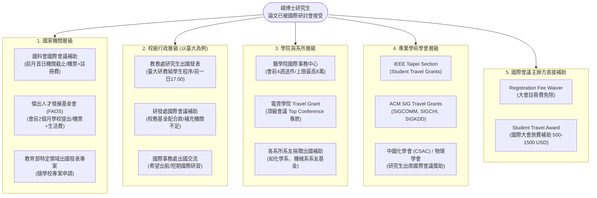

# OpenGSA 學術生涯進階路徑、研討會出國、專屬身分獎助、榮譽推薦與助教工讀體系總覽

> 2026-10-30狀態：本文件為搜尋種子與擴展規劃，未逐項覆核的金額及聘任條件不得作為當期保障或申請結論。現行介面已撤下未查證的TA／EMITA薪資級距，依當期辦法及契約核對；法律摘要見[法源摘要](RIGHTS-AND-LEGAL-FRAMEWORK.md)。


> 2026-11-02更新：§4已按官方依據重整並對應網頁，尚待獨立人工覆核；§1–3與§5中的方案、數字及限制仍是歷史搜尋種子，不能因本次更新視為已逐項確認。

> 文件性質：學術生涯垂直進階與校園助教工讀深度盤點（2026-10-30 規劃版）。
> 本文件深入盤點：學生參與研討會之多層次補助網絡、國科會千里馬與雙聯學位計畫；依「碩士、博士、博士候選人、博士後研究員」四大學術階梯之專屬獎助；斐陶斐榮譽學會、優秀青年與各級榮譽推薦機制；以及助教（TA）多軌聘任制度（學務處聘、教務處聘、EMITA、學院聘、系聘）、薪資級距（4,000 至 50,000 元）與校內工讀體系。

---

## 1. 學生研討會出國補助、千里馬計畫與雙聯學位深度網絡

研討會出國發表與跨國移動是碩博士生學術發表的關鍵環節。補助體系依出資主體分為「國家機關」、「大學校級」、「學院與系所」、「專業學術學會」與「國際會議主辦方」五層網絡：



### 1.1 研討會出國補助各層級比對表

| 層級類別 | 補助機構 / 方案名稱 | 申請時間與程序 | 補助項目與額度上限 | 兼領與限制條款 |
|---|---|---|---|---|
| **國家機關** | **國科會 (NSTC)**<br/>補助研究生出席國際會議作業要點 | 會議舉行首日所屬月份之**前一個月首日**機構彙送（臺大校內為前一日 17:00）；可於四週前補交接受函 | 往返經濟艙機票、會議註冊費、生活費（按國科會標準按日計） | 每一學年度以補助一次為限；同會議不得重複支領其他全額機票補助 |
| **國家機關** | **傑出人才發展基金會 (FAOS)**<br/>優秀學生出國開會補助 | **會前兩個月**由學校公文函報；接受函為必備文件 | 機票費、部分生活費與會議註冊費（依地區定額核算） | 具中華民國國籍之在學碩博士生；**學生校內收件日未知，須向各校生輔組確認** |
| **校級** | **臺大教務處 / 研發處**<br/>研究生出席國際會議補助方案 | 搭配國科會申請；若未獲國科會核定，依校內規定轉入校方補助程序 | 補助差額機票或定額補助（通常約 10,000–30,000 元） | 需優先提出國科會申請；校方補助屬差額或備援性質 |
| **學院級** | **臺大醫學院國際事務中心**<br/>研究生國際會議出國補助 | **會前四週送達**醫學院國際事務中心；檢附接受函與摘要 | 補助往返機票與註冊費（單一專案上限依辦法辦理） | 限醫學院在學生，同性質校內外會議獎助領取最高額時受兼領限制 |
| **學院級** | **電資學院 / 工學院**<br/>頂尖會議 (Top Conference) Travel Grant | 各學院獨立公告，多數要求為 CCF A 類、CORE A* 或頂級旗艦會議 | 提供專額機票或註冊費加碼（15,000–50,000 元） | 限第一作者且口頭發表 (Oral Presentation) 優先 |
| **學術學會** | **IEEE / ACM / 國內專業學會**<br/>Student Travel Awards | 隨論文接受通知由大會網站或各學會網站提出申請 | 補助 500 至 1,500 美元抵用金或直接免除大會註冊費 | 限學會學生會員 (Student Member) 且具備發表論文者 |

---

### 1.2 國科會千里馬計畫（補助博士生赴國外研究）深入規範

* **法規依據**：《國家科學及技術委員會補助博士生赴國外研究作業要點》。
* **申請對象與資格**：
  1. 具中華民國國籍，且戶籍設於國內。
  2. 現就讀國內公私立大學校院**在學一年（含）以上之博士生**。
  3. 經就讀學校評估可於畢業前完成國外研究。
  4. 排除條款：曾領取此要點補助公費者，不得再次提出申請。
* **國外機構與期程**：
  - 國外學術研究機構（排除中國大陸、香港及澳門地區）。
  - 補助期限為 **7 個月至 12 個月**（以月計，不可任意分段或展延，除懷孕特殊情形外）。
* **補助額度與核撥**：
  - 以一年新臺幣 **90 萬元** 為計算標準（按實際在國外日數等比例計算核撥）。
* **申請日程與程序**：
  - 每年固定於 **6 月 1 日至 7 月 31 日中午 12:00** 於國科會「學術研發服務網」開放個人線上填報，再由各大學於期限內造冊彙送國科會。
* **衍生雙邊三明治合作計畫**：
  - **台德三明治計畫 (Sandwich Program)**：國科會與德國學術交流總署 (DAAD) 合作，赴德研修 6 至 18 個月。
  - **台法幽蘭計畫 (Orchid Program)**：國科會與法國在台協會合作，支持台法雙邊實驗室聯合培育。

---

### 1.3 赴境外研修雙聯學位（Dual Degree / Double Degree）獎助

* **制度意涵**：學生同時註冊於國內大學與外國合作頂尖大學，於兩校修讀完成學分與研究後，分別取得兩校各自頒發之碩士或博士學位。
* **主要獎助來源**：
  1. **校級雙聯學位獎學金**（以臺大為例）：
     - 法規：《國立臺灣大學赴境外研修雙聯學位獎助學金設置要點》（國際處統籌）。
     - 補助項目：往返機票、學雜費補助差額與生活津貼（依赴訪國家與兩校合約每學期數萬至十餘萬元）。
     - 申請時程：分第 1 學期（秋季出國，約 6–7 月收件）與第 2 學期（春季出國，約 10–11 月收件）。
  2. **教育部跨國雙聯學程補助**：
     - 教育部國際及兩岸教育司專案補助大專校院推動雙聯學制獎助生。
  3. **外國合作姐妹校專屬全額/半額學費減免**：
     - 例如日本京都大學、筑波大學、法國索邦大學、美國天普大學等，雙邊協議常免除外國校方之國際學生高額學費。

---

## 2. 學術階梯專屬身分獎項與獎助（碩士、博士、博士候選人、博士後研究員）

OpenGSA 拒絕將「研究生」混為單一標籤，依修業階段分流為四大階梯：

```mermaid
flowchart LR
    M["1. 碩士班階段<br/>(Master's Student)"] --> D["2. 博士班在學階段<br/>(PhD Student)"]
    D --> C["3. 博士候選人階段<br/>(PhD Candidate)"]
    C --> P["4. 博士後研究學者<br/>(Postdoctoral Fellow)"]

    subgraph M_GRANTS["碩士專屬"]
        M1["各大專門學會優秀碩士論文獎"]
        M2["中技社科技創意獎學金 (15萬)"]
        M3["富邦人壽/管科會碩士論文獎"]
        M4["宋作楠先生碩士論文獎"]
    end

    subgraph D_GRANTS["博士專屬"]
        D1["國科會/教育部博士生研究獎學金 (4萬/月)"]
        D2["台積電博士獎學金 (50萬/年, 至多5年)"]
        D3["聯發科技博士生獎學金 (3.5-5萬/月)"]
        D4["各校頂尖博士培育專案"]
    end

    subgraph C_GRANTS["博士候選人專屬"]
        C1["中研院人文社會博士候選人培育 (5萬/月)"]
        C2["蔣經國基金會留學生博士論文獎 (15k-25k USD)"]
        C3["Fulbright 博士論文研究獎助 (赴美研習)"]
        C4["臺大專題兼任助理頂額上限 (50,000元/月)"]
    end

    subgraph P_GRANTS["博士後專屬"]
        P1["國科會延攬博士後研究學者 (起薪約65k)"]
        P2["中研院院長特聘博士後 (85k-90k+研究費)"]
        P3["臺大遠學計畫博士後出國研究分支"]
        P4["各大學卓越博士後研究學者專案"]
    end

    M -.-> M_GRANTS
    D -.-> D_GRANTS
    C -.-> C_GRANTS
    P -.-> P_GRANTS
```



### 2.1 四大身分階梯特徵與代表性方案對照表

| 學術階梯 | 身分定義與門檻 | 代表性專屬獎助 / 論文獎 | 給付金額與形式 | 關鍵檢核條件與限制 |
|---|---|---|---|---|
| **碩士班**<br/>(`master`) | 正式註冊在學之碩士班研究生（含碩一至碩二/碩三） | • 宋作楠碩士論文獎<br/>• 富邦人壽管科會管理碩士論文獎<br/>• 中華民國資訊學會/台灣經濟學會優秀碩士論文獎<br/>• 財團法人中技社創意獎學金 | 論文獎首獎 **10 至 15 萬元**；中技社創意獎 **15 萬元**（個人或團隊） | 限碩士應屆畢業論文；排除在職專班；中技社排除其他民間獎學金兼領 |
| **博士班**<br/>(`phd_student`) | 經入學考試或逕行修讀錄取之博士班在學生 | • 國科會博士生研究獎學金（甄選類/核配類）<br/>• 教育部博士生獎學金補助<br/>• 台積電博士獎學金<br/>• 聯發科博士生研究獎學金<br/>• 電資學院頂尖博士培育 | **每月 35,000 至 50,000 元**，獎勵期間 **3 至 5 年** | 排除全職有給職工作者；國科會與教育部兩大政府方案互斥；台積電需教授推薦 |
| **博士候選人**<br/>(`phd_candidate`) | 已修畢博士規定學分、**通過博士候選人資格考 (Qualifying Exam)** 且正式立案者 | • 中研院人文社會科學博士候選人培育計畫<br/>• 蔣經國國際學術交流基金會留學生博士論文獎學金<br/>• Fulbright 博士論文研究獎助 (Dissertation Research)<br/>• 臺大計畫兼任助理上限（候選人提升至 50,000 元） | 中研院 **50,000 元/月**（為期 1 年）；蔣經國基金會 **15,000–25,000 美元**；臺大上限 5 萬元 | 必須檢附就讀學校出具之「博士候選人資格證明書」；蔣經國基金會限論文撰寫最後一年 |
| **博士後研究員**<br/>(`postdoc`) | 已獲國內外博士學位，於大學或研究機構從事全職博士後專題研究者 | • 國科會補助延攬博士後研究學者<br/>• 中央研究院博士後研究學者計畫（一般博士後 vs **院長特聘博士後**）<br/>• 臺大遠學計畫（博士後研究人員赴國外移地研究分支） | 一般博士後月支約 **65,000 至 70,000 元**；院長特聘約 **85,000 至 90,000+ 元**，另享研究專案經費 | 屬全職研究聘僱；年終獎金 1.5 個月；遠學博士後分支不可套用博士生移地研究標準 |

---

## 3. 甄選與推薦制度之獎勵、榮譽學會與優秀青年

本類別屬於「學業卓越、品德楷模、社會貢獻」之榮譽遴選機制，通常不開放個人自由投件，須經各級單位審查委員會排序推薦：

### 3.1 中華民國斐陶斐榮譽學會 (The Phi Tau Phi Scholastic Honor Society)

* **學會宗旨**：選拔賢能，獎勵學術研究，崇德敬業。
* **推薦機制與法定名額比例**（依全國學會章程嚴格限制）：
  1. **博士班**：凡大學校院應屆博士畢業生品學兼優者，得推薦應屆畢業生人數之 **10%（百分之十）**，不足一人者以一人計。
  2. **碩士班**：凡大學校院應屆碩士畢業生品學兼優者，每一學院得推薦應屆畢業生人數之 **3%（百分之三）**，不足一人者以一人計。
  3. **學士班**：凡大學校院應屆學士畢業生品學特優者，每一學院得推薦應屆畢業生人數之 **1%（百分之一）**，不足一人者以一人計。
  4. **傑出校友**：對學術研究或社會有特優貢獻者，每校每年推薦 1 至 3 人。
* **獎勵性質與價值**：
  - 頒發斐陶斐榮譽會員證書、學會金質徽章，並於畢業典禮公開授證表揚。
  - **現金獎勵性質**：學會官方本身**不發放常態性現金獎學金**；然而獲選斐陶斐會員在學術界為極高榮譽資歷，在申請國科會博士後、教職、海外博士班或部分校內專款獎學金時具備顯著加分效益。

---

### 3.2 優秀青年遴選機制（校級優秀青年 vs 全國大專優秀青年）

| 遴選等級 | 主辦機構 / 法規依據 | 遴選資格門檻 | 推薦審查流程 | 獎勵與表揚形式 |
|---|---|---|---|---|
| **校級優秀青年**<br/>（以國立臺灣大學為例）| 臺大學務處生輔組<br/>《國立臺灣大學優秀青年遴選辦法》 | 1. 當年度臺大在學生（含研究生）<br/>2. 前一學期學業 GPA $\ge$ **2.93**<br/>3. 在學期間**無任何懲處紀錄**<br/>4. 具體事蹟：學術研究卓越、熱心公益社會楷模、社團領袖貢獻等 | 各教學單位、教職員工生推薦 $\to$ 學院複審並排定順序 $\to$ 校級「優秀青年遴選評審委員會」決選 | 於校慶典禮公開表揚，頒發當選證書與獎牌（部分專案配合校友捐款提供獎額） |
| **全國 / 縣市大專優秀青年** | 中國青年救國團主辦<br/>全國大專優秀青年表揚籌備委員會 | 1. 全國大專校院在學生（含博碩士生）<br/>2. 品學兼優，積極參與社會服務、國家重大專案或特殊才藝發光 | 各大學學務處依分配名額甄選校內代表 $\to$ 提報主辦單位彙審 | 每年於 3 月青年節全國表揚大會接受表揚，頒發榮譽獎座與證書 |

---

### 3.3 榮譽獎項分流：校長獎、院長獎、利他獎、書卷獎之界線

| 獎項名稱 | 適用學制對象 | 核心遴選標準 | 是否提供獎金 | OpenGSA 篩選與標籤防呆規則 |
|---|---|---|---|---|
| **研究生校長獎** | 碩士生、博士生應屆畢業生 | 學位論文品質、學術發表、修業成績頂尖（各系所推薦前 1–2 名） | 頒發校長獎獎牌，部分學院系所自籌獎金 | 標記為 `A3:成果與榮譽`；嚴格要求應屆畢業資格 |
| **各學院院長獎** | 該學院專屬碩博士及學士生 | 該學院各系所成績名列前茅或學位論文卓越者 | 頒發獎狀與獎牌，部分學院配合企業獎金 | 限本院系學生；跨院不適用 |
| **學生利他獎** | 全校在學生（含研究生） | 關懷社會、熱心公益、扶助弱勢、同儕互助足為典範者 | 每名頒發獎狀與獎金（如臺大通常為數千至 1 萬元） | 著重社會服務與品德，非以學術論文為單一導向 |
| **書卷獎** | **僅限學士班學生**（各系每學期前 5%） | 該學期修習學分成績排序第一至三名 | 頒發獎狀與獎學金 | **嚴禁向碩博士研究生顯示推薦**；資格引擎強制排除碩博學籍 |

---

## 4. 聘任管道與給付比較（2026-11-02 補核）

本節取代舊的「4,000–50,000元薪資階梯」：不同經費的最低要求、原則區間、方案標準、上限與增核額須分開讀。以下為官方依據摘要，尚未代填獨立人工覆核；不是個別給付核定。網頁「權益與求助」分成重點總覽、聘任與給付、法規與保障、求助與自測，詳見[介面與連結查核](RIGHTS-PAGE-UPDATE.md)。

### 4.1 五類聘任查核路徑（以臺大為例）

五類是查找分類，並非互斥的正式制度。EMITA可經教務處、國際處或共教中心核定；學院及系所自聘仍須逐案取得公告及聘約，不能直接套用一般TA或國科會的標準。

| 路徑 | 從哪裡查 | 應確認事項 | 來源 |
| --- | --- | --- | --- |
| 研究生獎勵金 | 所屬系所／學院、生輔組 | 獎助金或勞僱型津貼、分配細則及聘約 | [校級辦法摘要 ↓](RIGHTS-SOURCES.md) |
| 教務處／共教中心 TA | 開課或教學單位 | 員額核定、認證、課程、工時與約定給付 | [教務處 FAQ Q1、Q3（PDF） ↗](https://www.aca.ntu.edu.tw/WebUPD/aca/SecretariatService/教學助理業務常見Q%26A_24081312354518131.pdf) · [115-1 通識 TA 說明 ↗](https://cge.ntu.edu.tw/News_Content_n_68409_s_264301.html) |
| EMITA 全英語教學助理 | 雙語教育中心及核定教學單位 | 英語／認證資格、補助名額與實際核定標準 | [培訓入口 ↗](https://cbe.ntu.edu.tw/archives/15) · [實施計畫（PDF） ↗](https://cbe.ntu.edu.tw/files/0ada7b2f164e1adc) |
| 學院專案聘任 | 所屬學院當期公告或承辦 | 專案是否存在、經費、身分與契約；未逐案確認 | [查找方向（規劃文件，非聘任公告） ↗](https://github.com/matt-ye/opengsa/blob/main/docs/ACADEMIC-CAREER-AND-ASSISTANTSHIPS.md) |
| 系所自聘／實驗課輔 | 系所辦公室或開課單位 | 實際招募、預算及聘任條件；未逐案確認 | [查找方向（規劃文件，非聘任公告） ↗](https://github.com/matt-ye/opengsa/blob/main/docs/ACADEMIC-CAREER-AND-ASSISTANTSHIPS.md) |

### 4.2 給付比較：依制度與身分分列

| 聘任／方案 | 適用對象與金額 | 給付性質 | 條件與限制 | 官方來源／版本 |
| --- | --- | --- | --- | --- |
| 臺大一般教務處 TA | 學士 4,000–6,000／碩士 6,000–7,500／博士 8,000–10,000 元／月 | 原則給付區間 | 限本制度核定；給付及工時須書面約定，工時與最低工資另核。 | [辦法第4條（PDF） ↗](https://www.dlc.ntu.edu.tw/wp-content/uploads/教務處教學助理制度獎勵金實施辦法.pdf) 111.6.2發布；第4條111.8.1施行。 |
| 臺大 EMITA | 學士 7,000／碩士 9,500／博士 12,000 元／月 | 方案原則標準 | 實施計畫列原則標準；教務處 FAQ Q3 稱上限可調升至此額。須符合資格及核定，不是博士生通用下限。 | [實施計畫參、伍（PDF） ↗](https://cbe.ntu.edu.tw/files/0ada7b2f164e1adc) · [FAQ Q3 ↗](https://www.aca.ntu.edu.tw/WebUPD/aca/SecretariatService/教學助理業務常見Q%26A_24081312354518131.pdf) 111.5.27通過；金額條款111.8.1施行。 |
| 國科會學生兼任人員 | 至少 6,000 元／月 | 計畫給付最低要求 | 限注意事項約用的學生兼任人員；僱傭關係另核適用工資與工時。 | [國科會詳細表 ↓](RIGHTS-SOURCES.md) 注意事項第4點。 |
| 國科會博士生增核 | 增核 10,000 元／月；領有增核者合計至少 16,000 元／月 | 增核額＋附條件總額底線 | 須核計畫、約用與增核資格；不是所有博士生自動適用，也不自行與校方上限相加。 | [原函、FAQ 與適用分支 ↓](RIGHTS-SOURCES.md) 113.7.15原函／FAQ第2題。 |
| 臺大計畫兼任／研究獎助生 | 大專 12,000／碩士 20,000／博士未具候選資格 42,000／博士候選人 50,000 元／月 | 支給上限 | 本表適用計畫；同一委補助單位合計。上限不是最低額，也不是保證實領。 | [上限標準表（PDF） ↗](https://ord.ntu.edu.tw/WebUPD/ordntu/pm/國立臺灣大學計畫兼任助理及研究獎助生每月支給上限標準表_23121516034949938.pdf) 112.12.15施行。 |
| 國科會計畫專任人員 | 專科至少 30,400／學士至少 36,300／碩士級以上至少 41,500 元／月 | 專任最低要求 | 在學原則不得擔任，進修例外另核；候選人資格不等於專任聘任。 | [注意事項第3、4點 ↓](RIGHTS-SOURCES.md) 113.10.22修正；該次第4點修正114.1.1生效。 |
| 適用最低工資的勞僱工作／工讀 | 2026年時薪至少 196 元；全時按月計酬至少 29,500 元 | 法定工資底線 | 須核計酬及正常工時條件；不可用津貼額倒推可要求工時，其他年度另查。 | [勞動部最低工資問答 ↗](https://www.mol.gov.tw/1607/28690/2282/2284/2290/7121/) 115.1.1起金額；問答更新2026.4.21。 |

一般TA依111.6.2發布辦法第4條及教務處FAQ Q3；EMITA依111.5.27通過計畫參、伍及FAQ Q3，計畫金額條款自111.8.1施行。FAQ的「上限可調升」與計畫的「為原則」一併保留，不擴張為博士生通用最低額。校方兼任上限表自112.12.15施行，碩士欄為20,000元；本輪原表未見舊規劃所寫24,000元例外，故不保留該說法。

### 4.3 校內工讀與權益查核

工讀機會依實際招募單位公告；契約、工作內容、工時、計酬、保險及兼領條款須分別確認。不能因職稱就判定全部工作屬同一僱傭型態，或把TA月額換算成可要求工時。適用工資、保險與退休制度見[法源與身分說明](RIGHTS-AND-LEGAL-FRAMEWORK.md)，官方來源與版本見[來源台帳](RIGHTS-SOURCES.md)。

---

## 5. 擴充檢索關鍵字矩陣與排除條款防呆更新

為支援爬蟲與確定性規則解析器之自動辨識，提煉下列進階關鍵字：

```
[B1] 研討會出國與跨國移動 (Conference & Mobility Deep)
  關鍵字：出席國際學術會議、travel grant、會議註冊費減免、口頭發表補助、壁報發表補助、千里馬計畫、台德三明治、台法幽蘭、雙聯學位、境外研修雙聯學位
  排除/防呆：會前兩個月學校提出不等於學生截止；接受函為必備文件；未獲國科會核定前不啟動校方差額補助。

[B2] 學術階梯專屬身分 (Career Stage-Specific)
  關鍵字：碩士論文獎、富邦人壽管科會論文獎、宋作楠碩士論文獎、博士候選人培育計畫、留學生博士論文獎學金、博士候選人資格考、博士後研究學者、院長特聘博士後
  排除/防呆：碩士論文獎限應屆畢業碩士；博士候選人必須具備資格考通過證明；博士後專案嚴禁向在學博士生推薦。

[B3] 榮譽學會與優秀青年 (Honors & Nominations)
  關鍵字：斐陶斐榮譽學會、斐陶斐會員、10%推薦比例、3%推薦比例、1%推薦比例、國立臺灣大學優秀青年、大專優秀青年、研究生校長獎、學生利他獎
  排除/防呆：斐陶斐官方無現金獎學金；書卷獎嚴格限學士班，碩博士直接過濾；優秀青年需無懲處紀錄與 GPA 門檻。

[B4] 助教體系與薪資級距 (TA Ecosystem & Salary Tiers)
  關鍵字：教學助理、TA、EMI教學助理、EMITA、雙語教育中心、研究生獎勵金、勞僱型助教、附服務負擔獎助生、6000元兼任底線、10000元增核額、16000元博士最低總額、50000元候選人上限
  排除/防呆：10,000 元為增核加項，不能當唯一總所得；6,000 元須限國科會注意事項的學生兼任身分，非通用獎學金；未獲認證者不可領取 EMITA 級距。
```

---

## 6. 後續開發與交付清單 (Action Items)

- [x] 完成研討會五層補助網絡、國科會千里馬與雙聯學位之機制梳理。
- [x] 建立碩士、博士、博士候選人、博士後研究員四大身分階梯專屬獎助之精準分流對照表。
- [x] 確立斐陶斐榮譽學會推薦比例（博10%、碩3%、學1%）、優秀青年與各級榮譽獎項遴選規範。
- [x] 2026-11-02按官方依據重整五類聘任查核路徑與給付比較，區分最低額、原則區間、方案標準、上限及增核；學院／系所自聘不推定已驗證。
- [x] 產出專案文檔 [`docs/ACADEMIC-CAREER-AND-ASSISTANTSHIPS.md`](ACADEMIC-CAREER-AND-ASSISTANTSHIPS.md)，並與 [`docs/PLAN.md`](PLAN.md) 及 [`docs/RIGHTS-SOURCES.md`](RIGHTS-SOURCES.md) 整合。
- [ ] 於下階段更新 `schema/candidate.schema.json`，納入 `academic_stage: [master, phd_student, phd_candidate, postdoc]` 欄位驗證。
