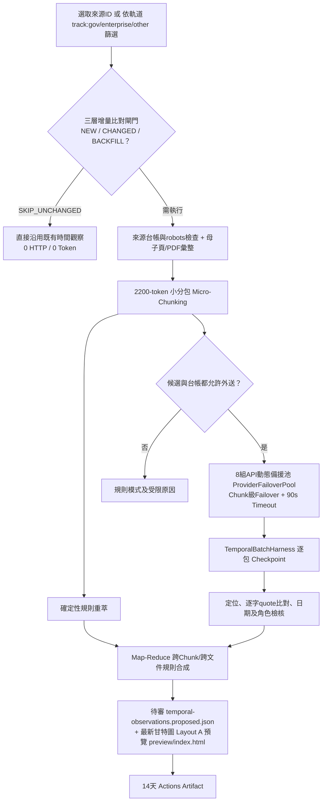

# 用 GitHub Actions 執行時間重萃、8 組 API 動態備援池、Map-Reduce 與甘特圖整合

2026-11-03，接續 PR #44，分四階段（PR #45 ～ PR #48）完成最外層三軌排程與三層增量比對、8 組 API 動態備援池與 2,200-token 小分包 `TemporalBatchHarness`、跨文件／跨分包 Map-Reduce 時間規則合成與最新甘特圖對接，以及 GitHub Actions 45 分鐘長時續傳快取整合。

---

## 一、最外層三軌分流與三層增量比對閘門（Step 1 / PR #45）

為避免每次巡檢重跑全部來源或單次執行超時，最外層由 [`scripts/temporal_tracks.py`](../scripts/temporal_tracks.py) 實作三軌分流與三層增量比對閘門：

> 下表的分軌只在手動觸發 `temporal_replay` 時生效。cron 排程只跑 `scan` job，不分軌道，也不經過這裡的增量閘門。

| 排程軌道 (`schedule_track`) | 巡檢日 | 涵蓋來源類型 | 現有 64 筆候選分布 | 目前待補 (`RUN_BACKFILL`) | 已穩定跳過 (`SKIP_UNCHANGED`) |
|---|---|---|---:|---:|---:|
| `gov` | 每週二、週五 | 公部門與政府機關獎助（教育部、國科會、中研院、勞動部、地方政府等） | 30 筆 | 15 筆 | 15 筆 |
| `enterprise` | 每週一、週四 | 企業、基金會與學會獎助（台積電、鴻海、行天宮、宗倬章、FAOS、Fellowship 等） | 7 筆 | 4 筆 | 3 筆 |
| `other` | 每週三、週六 | AI工具、學生軟硬體優惠、國際研討會、校內院系與其他專案補助 | 27 筆 | 13 筆 | 14 筆 |
| **合計** | **週一至週六** | **全專案 58 個 `source_id` / 64 筆候選** | **64 筆** | **32 筆** | **32 筆** |

### 三層增量比對閘門（Incremental Diff Gate）
1. **Gate 1（候選與綁定狀態）**：檢查 `candidate_sha256` 與 URL 是否為新增（`RUN_NEW`）或變更。
2. **Gate 2（內容雜湊與完成狀態）**：若遠端 `raw_sha256` 及附件雜湊未變，且先前已完成時間規則分型（非 `undetermined`），直接判定 `SKIP_UNCHANGED`（**0 次源站重複解析、0 Token 消耗**）；僅在 `RUN_NEW`、`RUN_CHANGED` 或 `RUN_BACKFILL`（尚待補齊）時才執行。
3. **Gate 3（Chunk 級別快取比對 `diff_document_chunks`）**：多頁或長文切包後，針對同一來源版本已完成的 `chunk_id` 直接重用快取，只對新變動或未完成的分包呼叫模型。

---

## 二、8 組 API 動態備援池、2,200-Token 小分包與 `TemporalBatchHarness`（Step 2 / PR #46）

由 [`scripts/temporal_model.py`](../scripts/temporal_model.py) 與 [`scripts/extract_candidates.py`](../scripts/extract_candidates.py) 實作：

1. **8 組 API 動態備援池 (`ProviderFailoverPool`)**：
   - 支援 `groq` (`qwen/qwen3.8-27b`)、`gemini` (`gemini-3.5-flash-lite`)、`cerebras` (`gpt-oss-120b`)、`mistral` (`mistral-small-latest`)、`sambanova` (`Meta-Llama-3.3-70B-Instruct`)、`openrouter` (`google/gemma-4-26b-a4b-it:free`)、`siliconflow` (`Qwen/Qwen2.5-7B-Instruct`，國際站 `api.siliconflow.com` / `region=com`)、`nvidia` (`openai/gpt-oss-20b`)。
   - **Chunk 級別無縫切換**：單一 Chunk 遭遇 `429`、`TimeoutError`、`5xx` 時，當前 Provider 標記冷卻（絕不對同一 429 端點連續重試），立即切換下一順位健康 Provider 完成該 Chunk。
2. **Free-Tier 安全小分包 (`Micro-Chunking <= 2,200 Input Tokens`) 與 90s Timeout**：
   - `input_limit = 2200`（扣除 `safety_tokens = 200` 後單包有效上限 `2,000` tokens）、`output_reserve = 600` tokens、HTTP `timeout = 90s`。
   - 精簡時間模式之 `rule_summary` 並限制 `background` 共享上下文預算，徹底消除 Groq 8,000 TPM 429 撞牆與 `shared_context_exceeds_budget`。
3. **解除 PII `[REDACTED]` 遮蔽死鎖**：
   - 頁面內含聯絡電話／Email（已遮蔽為 `[REDACTED]`）或「登入系統」、「得獎公告」字樣時，在時間欄位範圍（`schedule.*`）下不再誤觸 `source_sanitization_requires_review` 拒審。
4. **`TemporalBatchHarness` 五大 Lifecycle Hooks 與原子 Checkpoint**：
   - `pre_batch_hook`、`pre_source_hook`、`on_chunk_hook`、`post_source_hook`、`post_batch_hook`，每包完成即原子寫入 `checkpoint.json`。

---

## 三、多網站／母子頁＋PDF 彙整、Map-Reduce 整合與最新甘特圖對接（Step 3 / PR #47）

1. **多網站與附件文本無損彙整 (`aggregate_source_documents`)**：
   - 支援將母頁 HTML、關聯子頁與同站公告 PDF 附件彙整為統一區塊流，保留各自 `url`、`revision_id` 與 `raw_sha256` 供 `schema/time-policy.schema.json` 驗證。
2. **跨 Chunk 與跨文件 Map-Reduce 整合 (`reconcile_verified_claims_to_policy` & `merge_parent_and_child_policies`)**：
   - 跨包或跨母子文件分別萃出 `application_start` 與 `student_deadline` 時，自動合成為 **`fixed_window`**。
   - 同頁多梯次截止日保留全部梯次並標記為 **`mixed`**。
   - 學院彙送（`college_deadline`）與機構截止（`institution_deadline`）轉為行政里程碑（`◇`）。
3. **對接最新甘特圖（Gantt Layout A）與第 6 欄規則表 (`docs/design/prototype.js`)**：
   - 將通過本地逐字引文核驗之規則寫入待審預覽 `temporal-observations.proposed.json` 與 `preview/index.html`（正式資料維持不變）。

---

## 四、GitHub Actions 45 分鐘長時續傳與操作方式（Step 4 / PR #48）

> 2026-11-10：此圖部分過時，現行流程與模型節點、局部 ReAct 的規劃見 [AGENTIC-EXTRACTION-ARCHITECTURE.md](AGENTIC-EXTRACTION-ARCHITECTURE.md)。



Actions → **Scan public sources** → **Run workflow**：

| 輸入 | 說明 |
|---|---|
| `operation` | `temporal_replay` |
| `temporal_source_ids` | `taipei-ai-tools,hsinchu-ai-tools` 或 `track:gov` / `track:enterprise` / `track:other` / `auto` |
| `schedule_track` | `auto`（依星期自動對應軌道）或 `gov` / `enterprise` / `other` / `all` |
| `incremental_only` | `true`（預設開啟，僅執行 `NEW` / `CHANGED` / `BACKFILL`） |
| `temporal_attachments` | `false`；需要同站公告 PDF 才開啟 |
| `model_provider` | `auto_pool`（預設，動態調度 8 組免費 API 備援池）或指定單一 Provider |
| `model_mode` | `both`；僅規則則 `off` |

```powershell
gh workflow run scan-sources.yml --ref feat/temporal-step4-verification-and-workflows -f operation=temporal_replay -f temporal_source_ids=taipei-ai-tools,hsinchu-ai-tools -f schedule_track=other -f incremental_only=true -f model_provider=auto_pool -f model_mode=both
```
