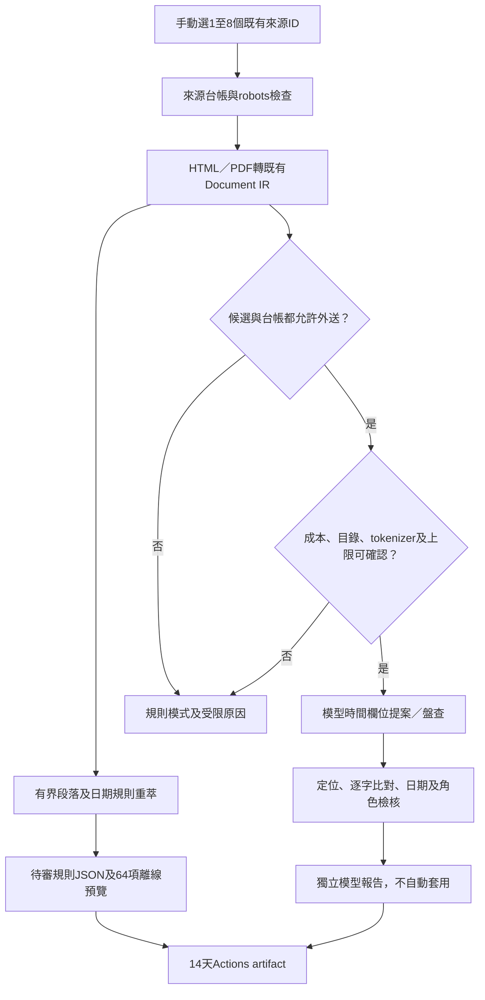

# 用GitHub Actions執行時間重萃及API盤查

2026-11-03，接續PR44。沿用`Scan public sources` workflow，新增手動`temporal_replay`操作；不建立新的雲端服務。來源GET與原文處理在Actions runner記憶體進行，GitHub Secrets只供所選模型provider使用。本輪小量API已獲使用者核可；不合併／部署網站，不開排程模型。

## 流程與操作



模型不裁定資格或核准公開資料。日期與原文一致仍可能有年度上限、個人期限或系所角色限制，故先保留待審提案；不把API成功當成所有欄位正確或網站已更新。

Actions → **Scan public sources** → **Run workflow**：

| 輸入 | 小批測試 |
|---|---|
| Branch | 本次PR分支；合併後可選main |
| operation | `temporal_replay` |
| temporal_source_ids | `taipei-ai-tools,hsinchu-ai-tools` |
| temporal_attachments | `false`；需要同站公告PDF才開啟 |
| model_provider | `groq` |
| model_mode | `both`；僅規則則`off` |
| probe | 此操作不使用 |

```powershell
gh workflow run scan-sources.yml --ref feat/actions-temporal-extraction -f operation=temporal_replay -f temporal_source_ids=taipei-ai-tools,hsinchu-ai-tools -f model_provider=groq -f model_mode=both
```

workflow已在預設分支註冊，可透過CLI選PR分支的workflow內容，無須先合併網站。GitHub網頁選單可能仍顯示main舊版，合併workflow後才會顯示新選項。[GitHub手動執行說明](https://docs.github.com/en/actions/how-tos/manage-workflow-runs/manually-run-a-workflow)、[CLI ref選項](https://cli.github.com/manual/gh_workflow_run)。

時間工作只由repo擁有者在本repo分支手動觸發，不接受PR／fork／schedule事件。只在模型步驟注入所選Secret，安裝依賴時沒有key。權限維持`contents: read`，沒有commit或部署步驟。

## 模型與成本

- [本輪Actions目錄查核](https://github.com/matt-ye/opengsa/actions/runs/41617991323)已確認Groq key可取得目錄，含`qwen/qwen3.8-27b`；目錄成功不等於推論已成功。
- 目前只有Groq此模型配置時間路徑能力；其他provider維持目錄查核或規則fallback，不因Secret存在就啟用未知成本推論。
- [Groq官方模型文件](https://console.groq.com/docs/model/qwen/qwen3.8-27b)列context 131,042、輸出上限16,384 tokens。此流程採6000輸入預算、1200輸出預留；官方tokenizer計算訊息內容，另留模板及安全餘量，實際tokens以API usage為準。
- 僅下載[Qwen官方固定版本tokenizer JSON](https://huggingface.co/Qwen/Qwen3.8-27B/blob/72a217afab8029b39e4af1c7273a829995a3dbaf/tokenizer.json)並驗SHA256；不下載權重、不執行遠端程式。`tokenizers==0.23.3`只供手動模型工作，公開站及一般測試不需要。
- 沿用分段及共享例外條文；整個欄位任務無法在預算內完成就延期，不將部分結果稱為完整。純聯絡段可排除並計數；混有期限／例外的聯絡段不能自行刪改後外送。
- 每次最多4次推論、20次源站HTTP，provider目錄另計。401／402／403／429停止後續模型，不重試、不換付費模型。Groq沿既有使用者免費帳戶政策，不宣稱對所有帳戶免費；未經帳務證明的美元成本保持null。

## 來源與產物

候選目前62筆`hash_only`、2筆`short_excerpt`；台帳雖有9筆`short_excerpt`，也不覆蓋候選較保守的限制。先測候選與台帳皆允許的臺北／新竹兩筆。教務處等受限原文仍禁止外送，生輔組人工限制未解除。

這次Action是獨立新輪，最多20源站HTTP；舊輪200HTTP保留於baseline摘要與repo原台帳，不歸零冒充同一輪。未重萃的紀錄保留自身觀察時間，不能宣稱本輪重掃64項。

完成後下載`temporal-review-<run_id>`：

- `summary.md`：來源HTTP、模型呼叫、受限／延期及模型準備狀態。
- `report.json`：模型版本、usage、欄位提案、證據hash及拒絕數；不含key、原始提示或模型原始回應。
- `temporal-observations.proposed.json`：規則結果與舊基線合併的待審表；模型提案未套入。
- `preview/index.html`：與規則待審表同步的64項離線預覽。

artifact保留14天；原文、PDF、tokenizer及模型快取不在其中。要進repo／網站須另審差異及提交資料PR，本輪不自動發布。

既有`operation=scan`未接這次能力／tokenizer配置時仍可能退回規則；要測本輪時間流程請選`temporal_replay`。不是已完成所有欄位或所有provider的自動萃取。
