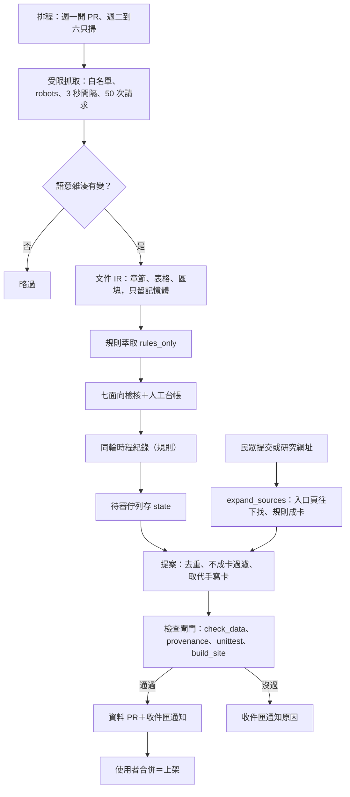
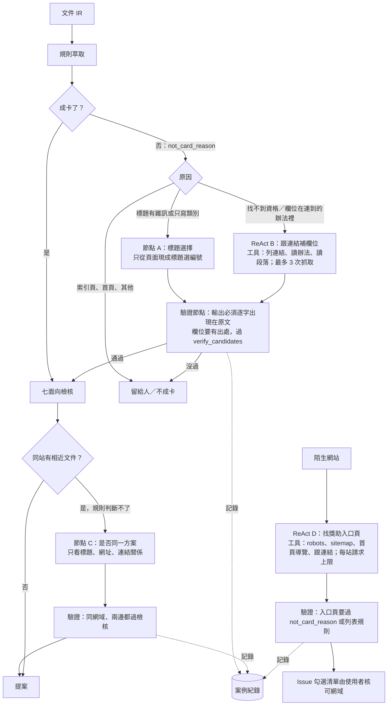
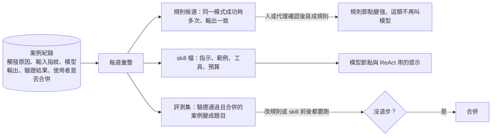

# 萃取架構：規則、模型節點與局部 ReAct（2026-11-10）

這份文件做三件事：
1. 檢視舊流程圖哪些已經過時。
2. 畫出現行的實際流程。
3. 說明模型節點和局部 ReAct 要放在哪，以及成功案例怎麼累積成規則、skill 和評測集。

使用者 2026-11-09 決定把模型列入規劃（見 `docs/TODO.md`）。

## 1. 舊流程圖的狀態

| 流程圖 | 位置 | 狀態 |
|---|---|---|
| 欄位計畫→Token 預算→分段→單一模型任務 | `docs/FIELD-SCOPED-EXTRACTION-PLAN.md` 第 10 節 | **部分實作、排程走不到** |
| 現行流程（區塊→欄位計畫→規則→模型分段） | `docs/PREPARED-EXTRACTION.md` | 大致正確，但排程路徑走不到模型分支 |
| 管線與權限邊界 | `docs/INGESTION-POC.md` | 部分過時 |
| Micro-Chunking 長時續傳 | `docs/ACTIONS-TEMPORAL-EXTRACTION.md` | 部分過時，只對應手動 `temporal_replay` |
| 審核工作台 | `docs/REVIEW-WORKSPACE.md` | 部分過時 |
| 全庫四階段 | `docs/FULL-LIBRARY-EXTRACTION-PLAN.md` | 歷史紀錄，不是現行流程 |

### 欄位計畫流程圖

**已實作：**
- 分段：`document_ir.pack_requests`。
- 背景加分段、呼叫預算、越界就拒絕：`extract_candidates.run_dual_track`。
- 局部重萃：`extraction_scope.compile_scope` 和 `prepare_candidates`。

**排程走不到：**
- `create_model_adapter_from_env` 建出的 adapter 沒有 `model_limits`。
- 所以 `run_dual_track` 一開始就回 `model_capabilities_required`（`extract_candidates.py:703`）。
- 結果是即使打開模型模式，排程也一次都不會呼叫模型。只有手動的 `temporal_replay` 會用 `temporal_model.build_model_limits` 補上限制。

**沒找到實作：** 圖中的「需補查→回到欄位計畫」迴圈。

### 管線與權限邊界流程圖

圖裡寫「人工建 PR」，現在已經自動化：`open_data_pr.py` 套用提案、跑檢查、推分支，在收件匣 Issue 留言。

圖中沒有的部分：
- 主要的新卡來源 `expand_sources` 和 `run_source_intake`（純規則）。
- 推送前的檢查閘門。

### Micro-Chunking 流程圖

- 圖寫 1500 token，程式是 `MICRO_CHUNK_INPUT_LIMIT = 2200`（`temporal_model.py:45`，同檔第 44 行的註解還寫 1500）。
- 排程裡的時程萃取另有一條純規則的 `temporal_reextract.same_round_record(s)`，圖中沒有。

## 2. 現行的實際流程

模型呼叫目前只出現在兩處：手動的 `temporal_replay`，以及離線的 `evaluate_extraction_benchmark.py`。

## 3. 模型節點與局部 ReAct 放在哪

原則：
- 規則節點先跑，失敗時才用條件邊轉到模型。
- 模型後面一定接驗證節點，出處對不上原文就丟掉。
- 依問題分兩種：
  - **單次判斷節點**：一次受限呼叫，從現成選項裡挑，或回答是／否。比較便宜，結果也容易驗證。
  - **局部 ReAct 子圖**：需要多步探索時才用，模型反覆「想→用工具→看結果」，步數和請求數都有上限。

| 節點 | 類型 | 處理的問題 | 送給模型的內容 |
|---|---|---|---|
| A 標題選擇 | 單次判斷 | 標題雜訊、只寫類別 | 頁面上現成的標題字串，不送內文 |
| B 跟連結補欄位 | 局部 ReAct | 公告沒寫資格或截止，寫在連到的辦法或 PDF | 被允許的段落；`hash_only` 的來源不送 |
| C 是否同一方案 | 單次判斷 | 同站兄弟頁（輔仁公告和簡介）規則分不出來 | 標題、網址、連結關係 |
| D 找入口頁 | 局部 ReAct | 陌生網站的探索（第 2 階段） | 連結文字、頁面標題 |

開始用之前要先補的缺口：
- 模型 adapter 要帶上 `model_limits`，否則節點 B 會跟現在的排程一樣被直接跳過。
- 型號以 `status/model-catalog.json` 為準。

## 4. 成功案例怎麼累積成規則、skill 和評測集

模型權重不會因為執行而改變。會累積的是我們從案例裡整理出來的東西。

- **案例紀錄**：每次呼叫模型都記一筆，包括觸發原因（`not_card_reason`）、輸入雜湊、模型與型號、輸出、驗證結果，以及之後使用者是否合併。依輸入雜湊快取，重跑不再呼叫。
- **規則候選**：同一種模式成功夠多次、輸出又一致，就整理成「建議新增的規則」。例如模型總是挑「名稱：」後面那一行，就寫成規則。之後這類情況不必再叫模型，成本降低，結果也固定。
- **skill 檔**：每個節點各有一份，放在 repo 版本控管，例如 `skills/title-choice/SKILL.md`，內容是指示、從驗證通過的案例挑出的範例、可用工具和預算。看失敗案例來修改它，改了就要跑評測集。
- **評測集**：`data/eval/page-expectations.json` 持續加入驗證過的案例。另外加一份模型節點的評測，量準確率、呼叫次數，以及有多少已經轉成規則。

## 5. 實作順序

1. **節點 A（標題選擇）的離線實驗**：`scripts/experiment_title_choice.py`。量測模型比規則好多少，好的話接進流程。
2. **案例紀錄格式與每週彙整**：先在離線實驗裡用。
3. **補上 `model_limits`**：讓 adapter 從 `status/model-catalog.json` 和 `data/model-providers.json` 取得限制。
4. **ReAct B（跟連結補欄位）**：先離線，用評測集量測。
5. **ReAct D（找入口頁）**：併入第 2 階段的大專校院探索。`AGENTS.md` 提到的 78 校名冊可以當種子。
6. **節點 C（是否同一方案）**。

每一步都先離線量測，使用者同意後才接進排程。

## 6. 節點 A 的第一次實驗結果（2026-11-10）

- **做法**：`scripts/experiment_title_choice.py`，用 Groq 的 `qwen/qwen3.8-27b`（免費額度）。對評測集 29 個 HTML 頁面，把頁面上現成的標題字串列成選項，請模型只回答編號，可以回答 0 表示「都不是方案名稱」。共 29 次呼叫，有快取。
- **結果**：15 頁模型和規則選的一樣，14 頁不一樣。不一樣的 14 頁由沒有上下文的代理盲評（不知道哪個來自模型），對照表只留在本機：

| 結果 | 頁數 |
|---|---|
| 規則較好 | 5（其中 3 頁是模型回答「都不是」，但規則選的「Figma for Education」「Notion for Education」「YouTube Premium 學生方案」其實可用） |
| 模型較好 | 2（Spotify：規則選了促銷句；輔仁：規則選了單位名稱「學務處生活輔導組」） |
| 兩者都可以 | 2 |
| 兩者都不行 | 5（頁面本來就沒有方案名稱，例如 Coursera 首頁、轉址頁） |

- **結論**：節點 A 不全面開啟，整體不比規則好，而且太常回答「都不是」。模型贏的情況有共同條件：規則選到的是促銷句或單位名稱。

下一版只在這種情況才呼叫模型，而且規則標題可用時不准回答「都不是」。這就是「從案例找出該叫模型的條件」：條件寫成規則，模型只處理剩下的少數情況。

- **實驗瑕疵**：腳本只讀第一頁、不跟轉址，所以 Azure 那頁讀到的是轉址頁「Object moved」。下一版要跟轉址。
