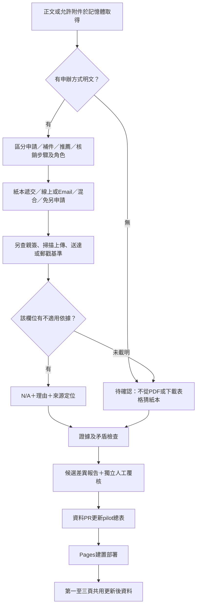

# 申請方式、N/A與卡片更新流程

## 三個不同概念

- **待確認**：來源沒寫、解析不到、附件受限，或尚不能判斷。
- **N/A 不適用**：來源明示該欄位不適用，須保存理由、引用與證據。例如免另行申請的學生截止；不限學籍資源的年級／候選人條件。
- **不符合資格**：條件適用，但個人不符合。不能用N/A隱藏年齡、設籍或學籍限制。

rolling申請、未公布結果、沒有抓到期限、一般學生不需候選人資格，都不自動改N/A。若N/A與已知日期／必備資格衝突，自動檢核拒絕。

## 契約

候選與pilot新增向後相容選填欄位：

| 欄位 | 內容 |
|---|---|
| application_method.mode | paper／electronic／hybrid／automatic／unknown／not_applicable |
| channels | paper／post／in_person／portal／email；可以多個途徑 |
| paper_delivery | required／not_required／unknown／not_applicable；指實際遞交，非是否曾列印 |
| handwritten_signature | 親簽要求，與遞交紙本分開 |
| deadline_basis | received／postmark／online_submission／unknown／not_applicable |
| note／refs | 說明與正式來源定位 |
| steps[].application_method | 各角色、各階段自己的申辦方式，不以機構電子申請取代學生校內方式 |
| field_applicability | application_start／student_deadline／result_date／candidate_qualification／year_limit各自的status、reason及refs |

hybrid只表示偵測到紙本與電子途徑，仍需人工確認是擇一或全部必要。英文及特殊表格格式可能超出目前規則；保留unknown交覆核，不自稱支援所有網站。新方式與N/A納入候選內容雜湊，修改後需重新核准；逐欄來源證據、120字摘錄及hash_only禁止外送政策不變。

## 第二、三頁會怎樣更新

會跟正式資料一起更新，但**掃描後不會立即覆寫公開卡片**。規則／Agent先產生候選，核對證據、日期與適用性，再經獨立人工覆核及資料PR。pilot.json合併並通過Pages建置後，第一頁、第二頁詳情、第三頁卡片共用新快照；已開分頁需重新整理。

本輪已串接：萃取 → 驗證 → 差異與內容雜湊 → candidate轉pilot → makeDrafts → 詳情／時間軸。第二頁顯示整體及各步驟方式；第三頁卡片新增給付摘要與申辦方式，依N/A調整準備待辦；甘特圖及文字日期表也分開顯示N/A。沒有根據的欄位繼續待確認。

回歸測試會檢查新資料透傳、改內容使核准雜湊改變、無證據N/A攔截、N/A不被歸入受理中／待確認、NA不能遮蔽日期與資格；不把合成測試覆核寫進正式台帳。實際新資源的查核與五頁實測見[PR18查核](PR18-RESOURCE-REVIEW.md)。
