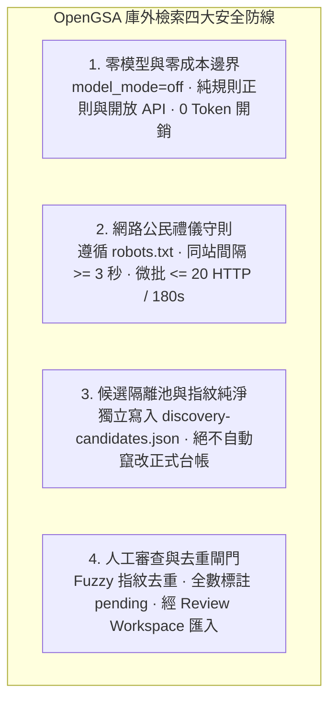
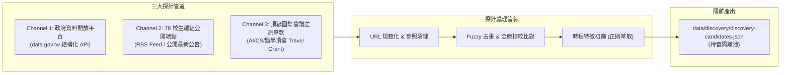
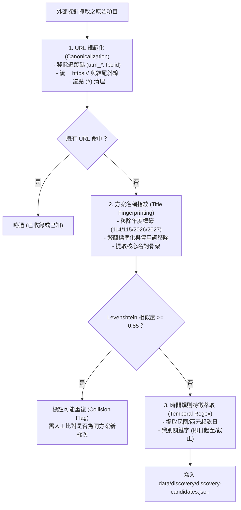
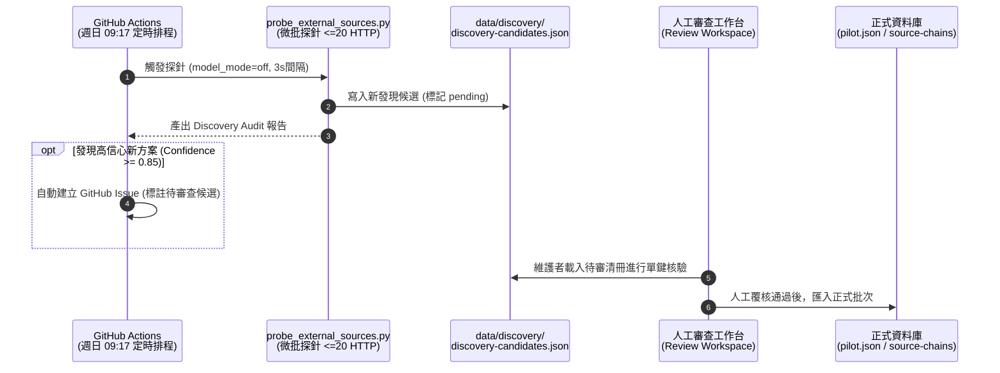

# OpenGSA 自動庫外資源檢索規劃架構書 (Autonomous External Discovery Probe)

> **文檔定位**：本規劃書記錄 OpenGSA 邁向主動式、自動化庫外資源發現的完整系統設計。依據使用者決策，規劃以低頻公開探針、開放資料 API 與生輔組公告監聽為核心的發現架構，嚴格恪守公民科技開源倫理、微批 HTTP 限制、零模型成本與候選隔離池防線。

---

## 1. 規劃背景與系統使命

OpenGSA 截至目前已完成全庫 **236 項獎助學金與學生福利資源**的結構化收錄，並建立 100% 精確的時程政策投影與五層資訊鏈拓撲。然而，目前庫內資料的維護模式主要依賴：
1. 既有固定 URL 清冊（`scan-sources.json` 包含 13 個核心排程來源）之定期內容雜湊監控。
2. 專案維護者或社群成員透過 GitHub Issue 主動提報之獎助來源。

### 面臨的邊界瓶頸：
- **新設方案被動**：各部會（如國科會、教育部、數位部）每年新出台之專案獎助、企業新設立之急難救助金，若無人提報則無法即時納入。
- **校園生輔動態盲區**：全台 78 所大專校院生輔組每學期定期刊登數以百計的民間機構委託代辦獎學金，公告生命週期極短（通常僅 2~3 週），依賴手動巡檢極易壓線錯失。
- **研討會專款更新滯後**：國際頂級學術會議（NeurIPS、CVPR、ACL 等）之 Student Travel Grant 與 Diversity Support 每年隨主辦單位異動更新網址，需主動捕捉當年度申請入口。

### 探針核心使命：
設計一套**自主低頻庫外資源探針（Autonomous External Discovery Probe）**，在不對外部伺服器造成負擔、不產生任何 AI 模型費用、不違反任何隱私規範的前提下，自主感知並檢索庫外潛在獎助機會，自動匯流至「待審隔離池」，大幅降低公民社群維護成本。

---

## 2. 核心原則與倫理防線（Ethical & Engineering Guardrails）



1. **零模型與零成本邊界（Zero Model Cost）**：
   - 探針全流程堅持純代碼與規則引擎（Deterministic Rules-only），不呼叫任何外部商業 LLM API（`model_mode=off`），避免產生不可預期之推論費用。
2. **網路公民禮儀（Politeness & Rate Limits）**：
   - 嚴格檢查並遵守目標站點之 `robots.txt`。
   - 對同一個網域/伺服器的請求間隔必須嚴格限制為 **$\ge 3$ 秒**。
   - 單次探針執行設定嚴格微批上限：**$\le 20$ HTTP 請求**，腳本執行總時間強制逾時上限為 **180 秒**。
   - 遇到 HTTP 429（Too Many Requests）、403（Forbidden）或 503（Service Unavailable）時立即終止該站檢索，嚴禁連續重試或暴力輪詢。
3. **實體隔離與資料純淨（Sandbox Isolation）**：
   - 探針挖掘成果一律僅寫入隔離資料夾：`data/discovery/discovery-candidates.json`。
   - **絕對禁止**自動寫入或修改正式台帳檔案：
     - `data/pilot.json`（正式示範台帳）
     - `data/source-inventory.json`（全量來源清冊）
     - `data/source-chains.json`（通用資訊鏈拓撲）
   - 所有自動挖掘出之新候選，初始狀態一律標註為 `review_status: "pending"`，查核狀態標記 `evidence_status: "raw_probe"`，絕不假稱真人覆核或官方核准。
4. **真實個資與機密保護**：
   - 僅檢索公開網頁文字、官方發布之開放資料與無須登入之公開附件。
   - 嚴禁刺探任何需登入權限之校務系統或私人雲端硬碟。

---

## 3. 三大探索來源管道設計（Three Discovery Channels）



### Channel 1：政府資料開放平台（data.gov.tw）API 探針
- **資料特性**：政府開放資料平台具備開放資料授權、零反爬阻礙、標準 JSON/CSV 格式，且由教育部、國科會、衛福部、原民會等主管機關直接更新維護。
- **檢索目標資料集代碼範例**：
  - 教育部「大專校院弱勢助學計畫助學金統計與公告」
  - 農業部「農漁民子女就學獎助學金申辦資訊」
  - 原住民族委員會「原住民族學生獎助學金要點與名單公告」
  - 新竹縣/市、臺中市、高雄市等地方政府「清寒優秀學生獎學金」開放端點。
- **探針行為**：
  - 定期透過 `GET https://data.gov.tw/api/v2/rest/dataset/...` 取得最新中繼資料。
  - 對比資料集之 `modified`（最後修改日期），若有異動才下載內容並解析新公告。

### Channel 2：全台大專校院生輔組/學務處公開端點探針
- **資料基礎**：立足於 PR #58～#60 已盤點之全台 78 所公私立大學來源代碼表（`U001`～`U078`）。
- **探針行為分流**：
  1. **RSS / Atom 原生端點（優先級最高）**：
     - 部分大專校院學務處提供標準 RSS 推播（如成大、清大、臺科大、中央）。
     - 直接請求 RSS XML，解析 `<item>` 之 `<title>` 與 `<pubDate>`。
  2. **靜態 HTML 最新公告列表（嚴格受控微批）**：
     - 針對無 RSS 之主要大學生輔組公告首頁，僅抓取前 5 筆最新標題與連結。
     - 關鍵字白名單觸發過濾：`["獎助", "獎學金", "急難", "生活助學", "優秀著作", "出國補助", "研討會補助"]`。
     - 若未命中關鍵字則直接跳過，不進入內頁，極小化 HTTP 流量。

### Channel 3：頂級國際會議差旅專款探針（Conference Travel Grants）
- **鎖定領域**：人工智慧、計算機科學與生醫頂會（NeurIPS, ICML, ICLR, CVPR, ICCV, ACL, KDD, SIGGRAPH）。
- **探針行為**：
  - 監控各大會議官網常設路徑：`/{year}/attending/travel-awards`、`/grants`、`/student-travel-support`。
  - 檢測網頁是否已更新當年度年份（如 `2026`、`2027`）與收件截止日期（`Deadline`）。
  - 對接 OpenGSA 既有之「研討會補助試算機」邏輯，提供會議倒推日程之即時更新種子。

---

## 4. 結構化比對與去重演算法（Deduplication & Anti-Collision）

為防止重複收錄相同方案（如先前曾出現之重複學生福利資源），探針內建三道標準化與去重檢驗：



### 演算法指標規範：
1. **URL 規範化（URL Canonicalization）**：
   - 移除所有行銷追蹤參數：`utm_source`, `utm_medium`, `utm_campaign`, `ref`, `fbclid`, `gclid`。
   - 統一通訊協定為小寫 `https://`，規範主機名稱與路徑，去除尾隨重複斜線。
2. **名稱語意指紋（Title Fingerprint）**：
   - 正則剔除年度與梯次雜訊：`r"(11[3-6]學?年?度?|202[4-7]年?|第[一二三1-3]梯次?)"`。
   - 計算與全庫既有 236 方案名稱之 Levenshtein Distance（編輯距離）與 Jaccard Similarity。
   - 若相似度 $\ge 0.85$，標註 `potential_duplicate_of: "<candidate_id>"`，防止同一福利重複建卡。
3. **時程關鍵字萃取（Temporal Heuristics）**：
   - 識別日期模式：`YYYY/MM/DD`、`YYYY-MM-DD`、`民國\d+年\d+月\d+日`。
   - 識別截止修飾詞：`至...止`、`前送達`、`逾期不予受理`。

---

## 5. 探針工作流架構與命令稿規格（CLI Interface）

規劃實作之核心命令稿：`scripts/probe_external_sources.py`（預計於實作 PR 建立）

### 命令列介面設計：
```bash
# 預設執行：對三大管道進行微批安全探索（不超過 20 HTTP，不超過 180 秒）
python scripts/probe_external_sources.py

# 僅針對特定管道進行探索
python scripts/probe_external_sources.py --channel data-gov
python scripts/probe_external_sources.py --channel universities --limit 10
python scripts/probe_external_sources.py --channel conferences

# 模擬執行（Dry-Run：印出發現之項目，不寫入檔案）
python scripts/probe_external_sources.py --dry-run

# 輸出報告模式（產生 Markdown 審查摘要）
python scripts/probe_external_sources.py --report docs/audits/discovery-audit-latest.md
```

### 輸出資料格式規範（`data/discovery/discovery-candidates.json` Schema v1.0）：
```json
{
  "$schema": "https://json-schema.org/draft/2020-12/schema",
  "version": "1.0.0-discovery",
  "probed_at": "2026-11-06T00:00:00Z",
  "probe_policy": {
    "model_mode": "off",
    "http_limit": 20,
    "interval_seconds": 3.0,
    "timeout_seconds": 180
  },
  "stats": {
    "total_scanned": 15,
    "new_candidates_found": 3,
    "potential_duplicates": 1,
    "http_requests_used": 18
  },
  "candidates": [
    {
      "discovery_id": "disc-gov-moe-20261106-001",
      "channel": "data-gov",
      "raw_title": "115學年度大專校院弱勢學生助學金申辦期程",
      "canonical_title": "大專校院弱勢學生助學金",
      "source_url": "https://depart.moe.edu.tw/ED2200/News_Content.aspx?n=...",
      "announcer": "教育部高等教育司",
      "detected_dates": {
        "start": "2026-09-01",
        "end": "2026-10-20",
        "raw_text": "115年9月1日至10月20日"
      },
      "potential_duplicate_of": null,
      "confidence_score": 0.92,
      "review_status": "pending",
      "audit_trail": {
        "http_status": 200,
        "content_hash": "e3b0c44298fc1c149afbf4c8996fb92427ae41e4649b934ca495991b7852b855",
        "matched_keywords": ["弱勢助學", "大專校院", "申請截止"]
      }
    }
  ]
}
```

---

## 6. 人工審查閘門與 GitHub Actions 巡檢整合



1. **GitHub Actions 自動化低頻巡檢**：
   - 設定獨立之工作流 `.github/workflows/discovery-probe.yml`。
   - 僅於**每週日 09:17（臺北時間）**低頻觸發一次，避免頻繁發送請求。
   - 執行環境嚴格設置 `MODEL_MODE: "off"`，不傳遞任何 API Key。
2. **審查通知機制（Issue Notification）**：
   - 當探針偵測到高信心度（Confidence $\ge 0.85$）且非重複之全新方案時，自動透過 `actions/github-script` 發起專屬標籤之 GitHub Issue（`kind: discovery-candidate`），供維護者查核。
3. **無縫對接審查工作台（Review Workspace）**：
   - 候選清冊可直接被 `scripts/build_review_workspace.py` 載入。
   - 維護者在桌面審查台可直觀預覽條文原文、確認官方辦法 PDF，勾選確認後一鍵生成資料 PR，正式閉環至五層資訊鏈。

---

## 7. 驗收標準與防線指標

- [ ] **獨立隔離性**：探針運作過程中，`data/pilot.json`、`source-inventory.json`、`source-chains.json` 資料指紋維持 0 變更。
- [ ] **網路公民規範**：所有外連遵循 robots.txt，同站間隔 $\ge 3$ 秒，微批請求數嚴格 $\le 20$。
- [ ] **零模型開銷**：全流程 `model_calls == 0`，無外部推論調用。
- [ ] **測試覆蓋率**：提供完善之單元測試（`tests/test_external_discovery.py`），覆蓋 URL 規範化、名稱模糊比對、時程關鍵字萃取與例外終止處理。
