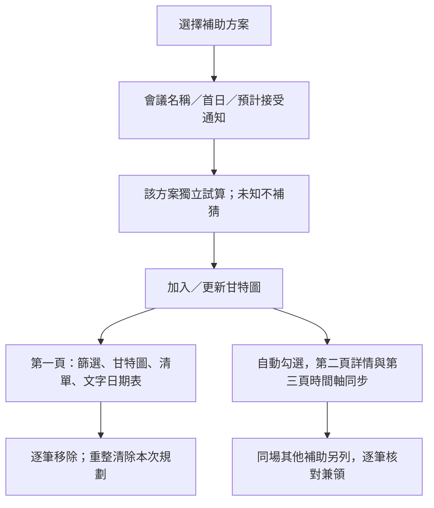

# 研討會補助與個人甘特圖

2026-10-29初查，全部待獨立覆核。方案台帳在[conference-programs.json](../data/conference-programs.json)，不同於10筆代表資料的既有Schema；本次不啟用爬蟲或API。來源清單新增醫學院與基金會兩筆制度入口，不視為兩筆當期開放機會。

| 方案／來源 | 初查與程序差異 | 原型如何處理 |
|---|---|---|
| [國科會／臺大研教組](https://www.aca.ntu.edu.tw/w/aca/GAADService_21071211044877383) | [作業要點](https://law.nstc.gov.tw/LawContent.aspx?id=FL038260)第4點與校內程序：前月首日機構彙送、臺大前一日17:00；接受函可註明四週前補送 | 保留既有基準試算，未校正例假日及院系更早期限 |
| [醫學院國際事務中心](https://www.mc.ntu.edu.tw/oia/Fpage.action?muid=1961&fid=1296) | 國際會議分支為院內在學生，會前四週送達；有發表及文件要求。領取最高額度時限制同性質獎助兼領 | 獨立試算四週送件，未查得補送條款，不移用國科會補送規則；八萬元屬其他活動分支，不當作會議補助上限 |
| [傑出人才發展基金會（FAOS）](https://www.faos.org.tw/Application/ApplicatStud.html) | 學校負責人於會前兩個月申請，接受函為必要文件；國籍及其他資格須核對 | 只算機構曆月基準，學生校內期限未知；不把兩月改成60天，不推定跨機關可兼領 |
| [醫學院研發分處](https://rd.mc.ntu.edu.tw/bomrd/ntu2/form0.asp?pno=25&LTPno=47) | 混合專家學者、團隊、會議舉辦、國衛院計畫主持人及報銷等入口 | 列其他來源參考，先辨別申請角色，不直接當成研究生個人補助 |
| 其他院系所／學會 | 當期規則、學生送件與兼領另查 | 可自填方案名稱及待核日期；不填日期也可加入會議節點 |

醫學院國際事務頁的HTTP文字抽取只見導覽，已用瀏覽器渲染正文確認第三點（一）、第六點及正文更新2026/08/20。不可將網站頁尾2025/12/24當成正文版本。研發分處正文負責人日期2025/11/14，與全站更新日分開。FAOS頁示113/05/29修訂，另有註冊費適用114/01/01後申請的註記，兩者都保留，不臆定新版生效日。

## 使用流程

同名、同會議日、同方案採相同個人ID；重新按加入會更新日期與緩衝，不重複新增。自填院系名稱不同則分列。改輸入只改試算，須按「加入／更新」才變更既有圖列；清空表單保留已加入規劃，移除按鈕才刪除該列及其勾選／待辦。

加入後切換為甘特圖並涵蓋所有已知日期，將該方案日期帶入可視區。個人規劃跨合成／來源模式保留，但不改寫任何合成或正式資料；兩模式的其他選取仍各自隔離。若現有篩選藏住新項目，會提示並提供「清除篩選並查看甘特圖」，不默默改篩選。

虛線色帶代表個人建議準備期，空心節點代表試算或自填；官方申請起日與補助結果日仍留未知。預計收到論文接受通知不是補助結果公布日。FAOS曆月換算遇月底採該月末日作規劃基準，須另洽承辦確認，不能當作正式送件期限。

姓名、會議及院系輸入僅本次記憶體；不寫入Git、URL、localStorage、模型、日誌或伺服器。這裡的五組tag只協助整理，個人列的學位分類不等於已確認符合方案資格。

## 驗證

新增測試涵蓋方案分流、同場穩定ID、無官方起日／結果日、四週送件與補送差異、機構與學生期限、曆月跨年及月底、未知院系日期、來源清單檢索與嵌入同源。23項Node原型測試及13項Python測試通過；正式資格、資料及無障礙驗收仍待後續完成。
