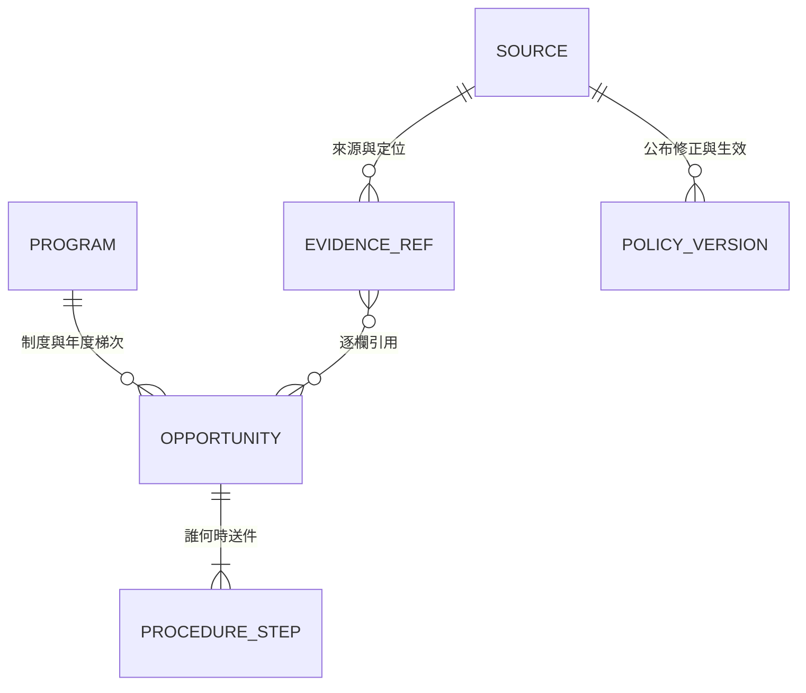

# 資料契約 0.1.0-draft

狀態：待使用者確認的階段 A 契約。機器規格為 [JSON Schema](../schema/pilot.schema.json)，樣本為 [pilot.json](../data/pilot.json)。此版本不宣告產品引擎或正式資料庫已完成。

## 最小模型



目前用一個 JSON 檔管理；Program 僅用穩定 program_key 表示，不另建資料表。ProcedureStep 內嵌於機會，證據是 source ID＋定位；先不用 API、帳號或資料庫。四個既有文件中的長期實體仍屬後續提案。

| 區塊 | 必填內容 | 用途與限制 |
|---|---|---|
| 根層 | schema_version、as_of、publication_status | 快照日期不是每筆的申請年度；本版固定為草稿 |
| sources | ID、官方 URL、來源層級、存取、觀察日、定位、維護者、檢查頻率、下一步 | checked_on 代表本輪查看，不代表獨立覆核；owner 未指派可為 null |
| opportunities | 穩定 ID、program_key、類型、scope、cycle | 每個年度／梯次／分支分筆；同一制度不重複算成不同全國方案 |
| participants | applicant、beneficiary、awardee、payee | 學生、學校、單位分開；未知不猜學生就是收款人 |
| organizations | funder、announcer、receiver | 每欄為原創摘要及證據；不同層級收件放 steps |
| eligibility | 學位、學校範圍、身分、年級、候選人、其他條件 | 不是完整可執行規則語言；複合條件保留可追溯文字，之後再做引擎 |
| compatibility／hardship | 狀態、說明、證據 | 五組標籤的必要來源，不允許省略或以空字串代表不限 |
| benefit | 原創摘要及證據 | 本輪不拆成可計算金額；幣別、頻率與限制先保留文字，禁止拿來自動算月收入 |
| steps | 行為主體、動作、期限、證據 | 校內學生期限、學院推薦、機關系統、備函分開 |
| application | state、as_of、reason、refs | 可知狀態須有證據，不能由制度仍存在推論正在受理 |
| evidence_status／review | 可建草稿或不完整、編輯者、獨立覆核 | 來源完整度與覆核完成度分開 |
| open_questions | 至少一項具體查核任務 | 缺欄位不靠舊年度、猜測或登入摘要補齊 |
| policy_versions | source、公布日、修正日、生效起迄、說明 | null 表示未知，不等於無期限；此版僅示範三筆版本紀錄，並非完整法規庫 |

## 五組 tag 從資料產生，不維護第二套規則

| 使用者看到的標籤 | 欄位來源 | 顯示原則 |
|---|---|---|
| 來源 | organizations＋sources.authority | 例「資助：國科會／轉知：臺大」；不能用轉知單位冒充資助方 |
| 身分 | eligibility.degrees／institution／identity／candidate | 學位、國籍、入學管道、在職與候選人分開，不能只留一個「博士」 |
| 年級限制 | eligibility.year_limit | unknown＝待確認，unlimited＝有明示不限依據，range＝含基準日 |
| 是否可兼領 | compatibility | allowed／conditional／prohibited／unknown；allowed 也只對已查範圍生效 |
| 是否清寒限定 | hardship | required／not_exclusive／unknown；清寒優先而非限定須在 note 說明 |

原始來源沒寫限制時，不自動轉成「不限年級」「可兼領」「非清寒限定」。身分資料暫存文字，不能用關鍵字命中當成資格通過。分類代碼是階段 A 的代表樣本子集，總分類仍以 [分類文件](TAXONOMY-AND-SOURCES.md) 為準。

## 三軸狀態

資格結果由未來的比對程序產生，不寫死在機會資料：

- criteria：meets_recorded_rules／not_met／needs_information／needs_manual_review。符合已記錄條件不等於核定得獎；規則不完整不得產生前者。
- application：open／closed／not_yet_open／unknown。關閉的機會仍可探索、收藏歷史，但不進「現在可申請」清單。
- evidence：sufficient_for_draft／incomplete，另顯示 review.status。sufficient_for_draft 不等於完成獨立覆核。

例：醫學院優秀著作獎可顯示「公告摘要顯示受理中／資格待人工核對／資料不完整」。不因 open 抹去後兩項。所有 draft 候選只能在清楚標示的預覽資料中出現，不能用於正式肯定推薦。

## 日期與程序

deadline.kind 僅有 date、datetime、relative、unknown。日期是 ISO 8601；時區固定 Asia/Taipei；datetime 必須含 +08:00。來源只有日期時不得補 23:59。

- date：只有日期；未確認確切收件時間，當日不得宣稱仍開放至午夜。
- datetime：依來源的確切時分；不能把機關期限當學生期限。
- relative：value=null，note 保留條文算法；沒事件日期不能生成截止日。
- unknown：value=null，note 解釋待查內容；制度快照不能自動做成「全年開放」。

closed／open 是本快照人工編輯的觀察值，尚無自動時鐘判定。產品版應由明確學生窗口計算並保留當日不確定性；本輪檢查不聲稱能核實狀態正確性。

國科會會議案以「會議首日所屬月份的前一個月1日」為機關最遲彙送日，遇例假日依條文順延；不是減30天。學生仍須查校內更早期限。受理日期和證明補件日期也要分開。

## 甘特圖所需的契約補充提案

互動原型版本0.2與資料契約版本0.1是不同版號。本節記錄使用者新增的時程需求，尚未加入現有JSON Schema；正式實作前補齊欄位與來源覆核。

| 時程欄位 | 需要記錄的事實 | 顯示規則 |
|---|---|---|
| 申請開始 | 所屬年度／梯次／收件程序、開始日期與精度、證據 | 未知不從公告發布日推算；沒有起日不畫完整色帶 |
| 申請截止 | 引用既有steps的特定學生程序，不另維護第二個日期 | 學生、學院、機關及備函各自呈現，不能任取最晚一天 |
| 結果公布 | 預定日／實際公布日／待確認、對應梯次及來源 | 預定日用不同圖例；過了預定日不自動轉為實際公布 |
| 其他程序 | 校內推薦、機關送件等事件及行為主體 | 獨立節點，不回填為學生截止 |

每一個時間陳述仍須有source＋locator、date／datetime／未知的精度、時區、適用範圍及覆核狀態。結果可能只有預計月份或區間，後續schema應可保留區間而非補成某一天；本輪互動原型只示範明確日期與未知值。

今天線採裝置的Asia/Taipei日期，與資料查核日、年度及學生個人準備日分開。甘特圖以日為單位，不能因此抹掉正式截止的確切時分。日期缺漏或相對事件未知時仍保留清單列與文字說明。

本輪正式樣本沒有新增猜測日期。真實草稿模式只讀既有steps中的學生截止與其他程序，起日和結果日皆保留待確認；完整色帶及結果日關係用明示合成資料演示。

## 法規版本及更新

修正日不自動等於生效日；部分條款可有自己的有效期間。例：TA 辦法第四點另載111年8月1日起實施，不能套給整份辦法。

Git 保存本輪原創摘要的差異，policy_versions 保存已明示的日期。下一步要補個別條款定位、適用事件與版本關係，才做工資或救濟時限運算。暫不把整份第三方法規複製進庫，也不以本輪三筆紀錄宣稱完成版本追蹤。

來源排程欄位只記建議頻率；automation=not_enabled，crawl_permission=not_reviewed。待條款／robots／授權檢查、維護者指派後才另行實作公開來源差異偵測。401／403／429 或登入頁不得繞過；可讀不等於可全文再散布。

## 可執行檢查

需 Python 3.10 以上；以標準 venv 安裝唯一開發驗證依賴。版本依 [jsonschema 官方套件資訊](https://pypi.org/project/jsonschema/4.26.0/) 核對；不安裝網站套件。

```powershell
python -m venv work/venv
work/venv/Scripts/python -m pip install -r requirements-dev.txt
work/venv/Scripts/python scripts/check_data.py
work/venv/Scripts/python -m unittest discover -s tests -v
```

檢查欄位形狀、日期格式、重複 ID、引用、五組 tag 必要欄、未知年級表示、摘要來源不得升級完整、獨立覆核及單位申請分流。**檢查通過不證明外站內容、個人資格或法律結論正確，也不取代獨立覆核。** 未來網站、資格引擎、日曆匯出、WCAG 檢查須在產品版另測。

## 確認重點

1. 接受這個最小欄位集合與明確未知值。
2. 接受目前金額與複合資格只作摘要，不自動計算收入或肯定推薦。
3. 接受三軸狀態與單位申請分流，確認後再把高頻條件轉成可執行規則。
4. 確認四頁線框；正式資料仍需獨立覆核及維護者。
