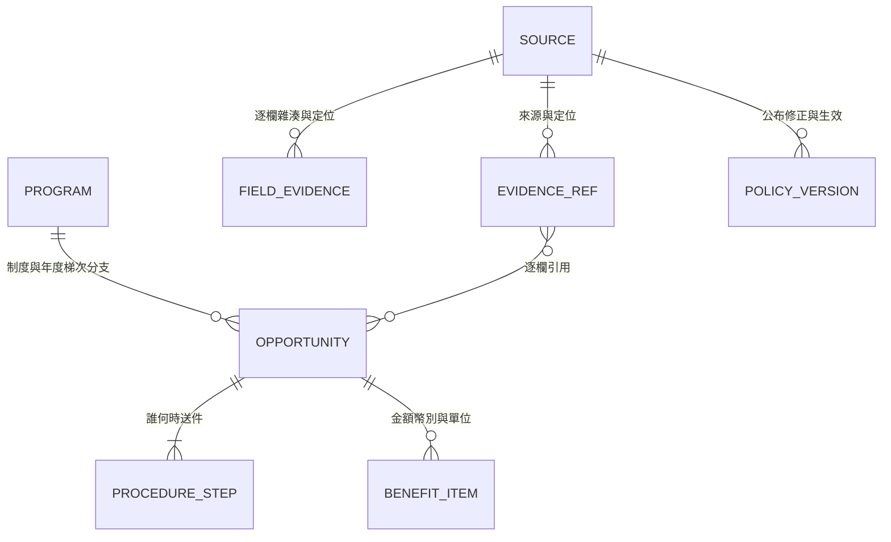

# 資料契約 0.1.0-draft 與候選契約 1.1.0-candidate

狀態：正式草稿快照採 [`schema/pilot.schema.json`](../schema/pilot.schema.json) (`0.1.0-draft`)，樣本為 [`data/pilot.json`](../data/pilot.json)；爬取與結構化萃取之待覆核候選採 [`schema/candidate.schema.json`](../schema/candidate.schema.json) (`1.1.0-candidate`，向下相容 `1.0.0-candidate`)。兩份 Schema 均由 `scripts/check_data.py` 與 `scripts/verify_candidates.py` 驗證，未完成人工獨立覆核之候選不得自動覆寫 `data/pilot.json`。

## 最小模型與候選擴充



1. **正式草稿契約 (`schema/pilot.schema.json`, `0.1.0-draft`)**：管理網站預覽讀取之 10 筆代表草稿與 17 筆去重來源。
2. **結構化候選契約 (`schema/candidate.schema.json`, `1.1.0-candidate`)**：沿用 `pilot.schema.json` 核心概念，並針對雙軌結構化萃取 (`extract` + `audit`)、獨立檢核與申請時間判斷擴充版本化欄位：

| 區塊 | 必填內容 | 用途與限制 |
|---|---|---|
| 根層 | `schema_version` (`1.1.0-candidate`)、`as_of`、`timezone` (`Asia/Taipei`)、`official_data_modified` (`false`) | 確保候選輸出絕不直接改寫正式網站資料 |
| `cycle` | `kind`（含 `policy_snapshot`）、`label`、`year_system`、`year`、`term_or_round`、`branch` | 嚴格區分學年度／曆年、梯次、方案分支與法規條文快照 (`policy_snapshot`)，禁止將新舊年度或互斥分支混成一筆 |
| `participants` | `applicant`、`beneficiary`、`awardee`、`payee` | 區分學生申請 (`student`) 與學校／單位申請 (`institution` / `unit`) |
| `eligibility` | `degrees`、`institution`（學校、學院、系所）、`year_limit`、`candidate`、`nationality`、`employment_status`、`negated_conditions`、`identity` | 明示否定條件（如排除在職生、不得重複請領），未知維持 `unknown`；`identity` 綁定含學制關鍵字區塊並附 `field_evidence` |
| `benefit` | `summary`、`items`（`amount_min`、`amount_max`、`currency`、`unit`、`basis`、`duration_months_min/max`）、`refs` | 金額必須具備幣別與發放單位（`per_month`、`lump_sum`、`total_range` 等），拒絕無單位裸數字；摘要依實際金額動態產生 |
| `compatibility`／`hardship` | `mode`、`prohibited_schemes`、`overlap_period_rule`、`note`、`refs` | 未明示可兼領時一律保留 `unknown` 或 `conditional`，不得當作 `allowed` |
| `schedule` | `application_start`、`steps`（區分 `student`、`department`、`college`、`university`、`institution`、`supplement`）、`result_date`、`relative_rule` | 學生截止與學院／學校／機關期限分層，支援固定日期與事件相對規則 |
| `policy_version` | `promulgated_on`、`amended_on`、`effective_from`、`effective_to`、`note`、`refs` | 公布日、修正日與生效日分開；修正日不得自動複製為生效日 |
| `field_evidence` | `field_path`、`source`、`revision_id`、`locator`、`evidence_mode`、`excerpt`、`excerpt_sha256`、`source_block_sha256`、`extraction_method`、`rule_and_model_agreed` | 每個非 `unknown` 萃取欄位強制具備 `field_evidence`，可回查原文段落／PDF頁碼雜湊；`hash_only` 來源強制 `excerpt: null` |
| `gaps_and_conflicts` | `missing_fields`、`conflicts`、`open_questions` | 來源內部衝突或雙軌 `disagree` 自動攔截，不靜默擇一覆蓋 |
| `verification` | `status`（含 `passed_with_gaps`）、`checks`（7項布林指標，含 `coverage_ok`）、`errors`、`warnings`、`audit_findings`、`model_self_claim_ignored` (`true`) | 七面向獨立檢核結果；忽略 Agent 自信宣告，缺關鍵附件或金額時標示 `passed_with_gaps` |
| `review` | `status` (`pending` / `reviewed` / `rejected`)、`editor`、`independent_reviewer`、`promotion_ready` | 未經非原編輯者獨立覆核，強制維持 `pending` 且 `promotion_ready=false` |

## 五組 tag 從資料產生，不維護第二套規則

| 使用者看到的標籤 | 欄位來源 | 顯示原則 |
|---|---|---|
| 來源 | organizations＋sources.authority | 例「資助：國科會／轉知：臺大」；不能用轉知單位冒充資助方 |
| 身分 | eligibility.degrees／institution／identity／candidate | 學位、國籍、入學管道、在職與候選人分開，不能只留一個「博士」 |
| 年級限制 | eligibility.year_limit | unknown＝待確認，unlimited＝有明示不限依據，range＝含基準日 |
| 是否可兼領 | compatibility | allowed／conditional／prohibited／unknown；allowed 也只對已查範圍生效 |
| 是否清寒限定 | hardship | required／not_exclusive／unknown；清寒優先而非限定須在 note 說明 |

原始來源沒寫限制時，不自動轉成「不限年級」「可兼領」「非清寒限定」。

## 三軸狀態與獨立檢核

資格與時間結果由 [`scripts/evaluate_deadlines.py`](../scripts/evaluate_deadlines.py) 依規則與觀察日計算，結構與證據由 [`scripts/verify_candidates.py`](../scripts/verify_candidates.py) 獨立檢核：

- `criteria`：`meets_recorded_rules`／`not_met`／`needs_information`／`needs_manual_review`。符合已記錄條件不等於官方核定得獎；只要缺個人條件或來源尚未完成獨立覆核，即不會產生無保留的肯定推薦。
- `application`：`open`／`closed`／`not_yet_open`／`unknown`。僅以**學生適用收件窗口**判斷；機關彙送日、學院送校日或備函日不得冒充學生截止日。
- `verification` & `evidence`：`passed_automated_checks`／`passed_with_gaps`／`needs_context`／`conflict_detected`／`failed_automated_checks`，並與 `review.status` 分開顯示。

## 日期與程序規則（`Asia/Taipei`）

`deadline.kind` 僅有 `date`、`datetime`、`relative`、`unknown`。日期是 ISO 8601；時區固定 `Asia/Taipei` (`+08:00`)。

- `date`：只有年月日；當日提示「當日截止，收件時間待核」（`same_day_time_unconfirmed=true`），**嚴禁自造 `23:59` 午夜截止**。
- `datetime`：依來源明示的確切時分（如 `17:00`、`08:00`、`12:00`）；原文無時間字樣時不得捏造時分。
- `relative`：`value=null`，搭配 `schedule.relative_rule` 記錄條文算法；無會議日期時維持 `unknown` (`missing_conference_start`)。
- `unknown`：`value=null`，說明待查內容；制度快照或過期公告不得自動推算下一期日期 (`next_cycle_inferred=false`)。
- 缺起日處理：已知未來學生截止日但缺申請起日 (`application_start`) 時，預設回傳 `unknown` (`missing_application_start`)，不從公告發布日臆測已開始受理。
- 來源過期檢查：若引用來源之 `checked_on` 距評估日超過設定鮮度天數，標記 `source_stale=true` 並退回 `unknown`。

## 可執行檢查與測試

需 Python 3.10 以上及 Node：

```powershell
python -m pip install -r requirements-dev.txt
python scripts/check_data.py
python scripts/scan_sources.py --check-config
python -m unittest discover -s tests -v
node --test tests/prototype.test.cjs
python scripts/build_site.py dist/handoff-check
```

- `python scripts/check_data.py`：驗證 `schema/pilot.schema.json`、`schema/candidate.schema.json` 與 `data/pilot.json` 結構、引用、日期精度與獨立覆核規則。
- `python -m unittest discover -s tests -v`：執行全部Python資料契約、掃描、萃取、覆核與建置測試。
- `node --test tests/prototype.test.cjs`：執行全部Node原型互動與研討會時程測試。

**重要限制**：結構檢查、規則萃取與自動檢核通過不證明外站內容、個人資格或法律結論已獲官方核定，亦不取代人工獨立覆核。

## 本輪契約補強（2026-10-30）

pilot保留0.1.0-draft版本並加向後相容的選填欄位：eligibility國籍／就業狀態、否定條件、畢業及既領補助規則；benefit.items；compatibility禁止方案／重疊期間；policy_version與field_evidence。candidate.mode可保留unknown，institution未知不可當任何學校。

result保留date／datetime／month／range／unknown、certainty、end_value與refs；month／range不畫成精確單日結果節點。start可附refs且須區分confirmed、tentative、inferred、unknown；推定日期不使窗口自動open。supplement程序角色不再丟失。起日及結果的逐欄證據與年度錨點強制檢核；匯出不能重貼觀察日期。

scan-reviews採獨立1.1.0 Schema，required reason不接受舊note；applied須source_id、candidate_id與內容SHA-256，非原編輯者、有效且非未來覆核日期及passed_automated_checks才可匯出。缺上下文、gaps、衝突或內容改動後一律不得提升；目前正式覆核台帳為空。完整操作見[SCANNER.md](SCANNER.md)。

自動檢核涵蓋已實作的證據／數值／角色檢查，並非語意與法規完整性證明。程式尚未逐一結構化所有院系或領域限制，保留人工覆核與needs_information，不宣稱完全自動資格判定。

## 申辦方式與欄位適用性更新（2026-10-30）

候選及pilot新增application_method與field_applicability，紙本遞交、親簽上傳及截止判準分開。N/A須有理由、引用及完整上下文；缺來源仍待確認，不以N/A隱藏日期或必要資格。第二頁顯示整體與各步驟方式，第三頁同步給付摘要及申辦方式；覆核與資料PR部署後才更新公開內容。詳見[判斷與更新流程](APPLICATION-PROCESS.md)。

## AI工具候選補充

新增research_tools類別、tool_subscription種類、local範圍；expense_period（starts_on／ends_on／note／refs）保留可認列支出期間，不作學生收件窗口。兩份契約與候選轉pilot均保留此欄位，納入核准雜湊。候選根層model_usage依實際用量摘要提供選填型別，未知屬性仍拒絕。check_data.py另檢查data/candidates的來源綁定及120字摘錄預算；完整原文不在CI取回。
