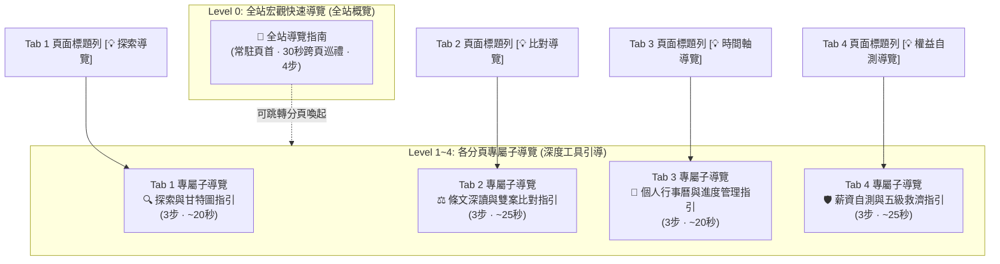

# OpenGSA 多層級導覽體系架構與落地規格規劃書 (Tour Hierarchy & Trigger Strategy)

> **文件狀態**：規劃提案（供 2026-11-05 早晨與維護者核對確認）  
> **關聯調研**：依據已合併之 [`docs/UI-UX-ONBOARDING-AND-SKILLS-STUDY.md`](UI-UX-ONBOARDING-AND-SKILLS-STUDY.md) 與 `Toutour` 反模式防禦規範  
> **核心邊界**：預設不主動彈窗干擾、零依賴純靜態、可跳過、記憶狀態；全站導覽與各頁子導覽職責分明。

---

## 一、 導覽整體層級架構（Tour Hierarchy Overview）

為解決使用者反饋「全站導覽僅為鳥瞰，進到各分頁後具體工具仍需要針對性指引」之痛點，規劃「**1 組全站宏觀導覽（L0）＋ 4 組分頁專屬微導覽（L1～L4）**」之雙層架構：



---

## 二、 啟動時機與觸發規則矩陣（Trigger Matrix）

依循 `Toutour`「**主動防禦全螢幕阻斷式彈窗**」標準，全站與子導覽均落實**預設不主動彈出**，提供多元、自覺且非侵入式的喚醒管道：

| 導覽類別 | 預設狀態 | 手動按鈕位置 | 鍵盤快捷鍵 | 網址深度連結 (URL) | 情境喚醒時機 (Contextual) |
| :--- | :---: | :--- | :---: | :--- | :--- |
| **L0 全站宏觀導覽** | 隱藏 | 頁首導航列 `<button id="btn-tour">` | `?` 或 `Shift+/` | `#tour` 或 `?tour=all` | 首次造訪且未曾完成時，僅在按鈕旁顯示低調提示紅點（不阻斷頁面） |
| **L1 即時雷達子導覽** | 隱藏 | Tab 1 標題旁按鈕 `💡 探索指南` | `Alt+1` | `?tour=discover` | 點擊情境快篩卡後若無結果，於空狀態卡片提供「查看探索操作提示」連結 |
| **L2 詳情比對子導覽** | 隱藏 | Tab 2 標題旁按鈕 `💡 比對指南` | `Alt+2` | `?tour=compare` | 使用者初次勾選 2 個方案並點擊「切換至雙方案比對模式」時微提示喚起 |
| **L3 個人時程子導覽** | 隱藏 | Tab 3 標題旁按鈕 `💡 排程指南` | `Alt+3` | `?tour=timeline` | 使用者在 Tab 1 初次點擊「加入時間軸」時，在加入 Toast 旁提供「查看管理指引」入口 |
| **L4 權益自測子導覽** | 隱藏 | Tab 4 標題旁按鈕 `💡 權益自測指南`| `Alt+4` | `?tour=rights` | 首次點開「3 分鐘從屬性自測工具」或切換至救濟地圖時提供輕量按鈕引導 |

---

## 三、 各導覽步驟、長度與文案細部規格（Step Specifications）

嚴格約制：**各子導覽步驟數 $\le 3$ 步，閱讀總時長 $\le 25$ 秒**，專注於「此功能對我有何幫助」與「下一步該點哪裡」。

### 1. Level 0：全站宏觀快速導覽（Global Tour，4 步，約 30 秒）
*已實裝於 PR #56，定位為讓使用者 30 秒建立 OpenGSA 全局心智模型。*

| 步驟 | 標的 Selector | 標題 | 進度 | 引導引導文案核心 | 位置 |
| :---: | :--- | :--- | :---: | :--- | :---: |
| 1 | `#persona-bar` | 身分情境快篩 | 1 / 4 | 依就讀身分（博士生、清寒、AI工具、出國等）一鍵套用，迅速鎖定最符合您的方案。 | bottom |
| 2 | `#gantt-view` | 視覺甘特圖與提醒帶 | 2 / 4 | 掌握申請時間節奏：實心色帶為正式受理期；斜線色帶為截止前 30 天準備提醒帶；紅線為今天。 | bottom |
| 3 | `.nav-links[role='tablist']`| 四大職責分頁與比對 | 3 / 4 | 「找獎助」快速探索；「獎助詳情」支援雙方案並排比對；「我的時間軸」提供個人專屬行事曆！ | bottom |
| 4 | `#tab-rights` | 勞動權益防線與自測 | 4 / 4 | 研究生兼任助理薪資與智慧財產權益專案防線：提供工資自測、爭端救濟與公務申訴管道。 | bottom |

---

### 2. Level 1：Tab 1 即時雷達子導覽（Discover Sub-tour，3 步，約 20 秒）
*專注於「如何快速精準篩選海量獎助與看懂時間圖例」。*

| 步驟 | 標的 Selector | 標題 | 進度 | 引導文案草案 | 位置 |
| :---: | :--- | :--- | :---: | :--- | :---: |
| 1 | `aside.filter` | 多維度法規組合篩選 | 1 / 3 | 左側欄位支援按「出資來源」、「學位身分（碩博/候選人）」、「受理狀態」交叉篩選，條件可隨時還原。 | right / bottom |
| 2 | `#search-query` | 全域關鍵字與同義詞檢索 | 2 / 3 | 支援模糊搜尋與法規同義詞（輸入「論文」會自動搜尋「著作獎」；輸入「醫學院」精準命中院級專案）。 | bottom |
| 3 | `#chart-legend` | 時間圖例與系所範例提示 | 3 / 3 | 展開圖例可看懂校內/機關收件分層。甘特圖標記「以○○為例」之項目實際請以所屬系所最新公告為準。 | top |

---

### 3. Level 2：Tab 2 方案詳情與比對子導覽（Detail & Compare Sub-tour，3 步，約 25 秒）
*專注於「如何深讀單一條文與如何利用並排比對解決選擇困難」。*

| 步驟 | 標的 Selector | 標題 | 進度 | 引導文案草案 | 位置 |
| :---: | :--- | :--- | :---: | :--- | :---: |
| 1 | `#detail-view .card-top` | 方案出資與主責窗口深讀 | 1 / 3 | 清楚標示出資單位（國科會/教育部/企業）與實際受理窗口（系所/院/校總區），避免跑錯行政單位。 | bottom |
| 2 | `.compare-controls` | 啟用雙方案並排比對 | 2 / 3 | 勾選任意 2 個獎助方案後，可一鍵開啟並排對照檢視，自動比對月薪/總額、年級資格與兼領排除條款。 | bottom |
| 3 | `.source-note` | 官方原文佐證與回報按鈕 | 3 / 3 | 每一條規定均附有官方核對日期與公告原址。若發現官方已出新辦法，點擊「提供回饋」可一鍵回報。 | top |

---

### 4. Level 3：Tab 3 我的時間軸子導覽（Timeline & Progress Sub-tour，3 步，約 20 秒）
*專注於「如何管理個人辦理進度與倒推研討會時程」。*

| 步驟 | 標的 Selector | 標題 | 進度 | 引導文案草案 | 位置 |
| :---: | :--- | :--- | :---: | :--- | :---: |
| 1 | `#timeline-saved` | 個人收錄清單與送件 Checklist | 1 / 3 | 顯示您在第一頁勾選的專屬方案，支援「已備齊文件」、「已送系所」、「已核定」三階段待辦打勾記錄。 | bottom |
| 2 | `#conference-planner` | 國際研討會多方案倒推試算 | 2 / 3 | 輸入會議首日與預計收到接受函日期，系統自動倒推機關送件窗口與校內提前送件建議日。 | bottom |
| 3 | `#copy-share-link` | 一鍵保存與分享排程畫面 | 3 / 3 | 您的所有篩選與收錄設定均可編碼至 URL。點擊「📋 分享此畫面」即可保存書籤或分享給同實驗室夥伴！ | bottom |

---

### 5. Level 4：Tab 4 權益防線子導覽（Rights & Guidance Sub-tour，3 步，約 25 秒）
*專注於「兼任助理遭遇勞資爭議時的自我保護與求助路徑」。*

| 步驟 | 標的 Selector | 標題 | 進度 | 引導文案草案 | 位置 |
| :---: | :--- | :--- | :---: | :--- | :---: |
| 1 | `#rights-pay-group` | 勞動型 vs 學習型工資規範 | 1 / 3 | 查看 2026 最新最低時薪（196元）與博士兼任增核標準。凡具勞務對價與監督指揮者，依法雇主須提繳勞退且不得內扣。 | bottom |
| 2 | `#subordination-wizard` | 3 分鐘從屬性指標自我檢核 | 2 / 3 | 勾選您目前遇到的排班打卡、交辦報帳或請假扣薪情況，系統自動整理爭點與法規判準（僅本次瀏覽記憶，不存伺服器）。 | bottom |
| 3 | `#grievance-map` | 五級救濟地圖與蒐證要件 | 3 / 3 | 遇到欠薪或超時爭議？不必逐級走完！直接依事件性質尋求系所、學生申評會、地方勞工局或工會協助。 | top |

---

## 四、 狀態儲存與持久化鍵名設計（LocalStorage Key Namespace）

避免全站與各分頁狀態混淆，採用結構化命名空間：

```typescript
// LocalStorage 鍵名規範
const TOUR_STORAGE_KEYS = {
  global:   "opengsa_tour_completed",          // L0 全站導覽已完成 (true/false)
  discover: "opengsa_tour_tab_discover_seen",  // L1 探索子導覽已看過 (true/false)
  detail:   "opengsa_tour_tab_detail_seen",    // L2 詳情比對子導覽已看過 (true/false)
  timeline: "opengsa_tour_tab_timeline_seen",  // L3 個人時程子導覽已看過 (true/false)
  rights:   "opengsa_tour_tab_rights_seen",    // L4 權益防線子導覽已看過 (true/false)
};
```

---

## 五、 明早核對重點決策清單（Checklist for Alignment）

明早核對時，建議主要確認以下三項具體落實細節：

1. **子導覽觸發按鈕的外觀與位置**：
   - 方案 A（推薦）：放置於各頁主題 headline 的次標題旁，標示為輕量次級按鈕（如 `[ 💡 頁面指南 ]`），低調而不搶視覺。
   - 方案 B：整併於頁首控制列的次級下拉選單中（「🧭 導覽指南 ▾」展開「全站導覽 / 探索指南 / 詳情指南 / 時程指南 / 權益指南」）。
2. **各子導覽的步驟數量與節奏**：
   - 目前各規劃為精準的 3 步（耗時 20~25 秒），是否符合您的預期，或有特定頁面希望擴充/精簡？
3. **URL 參數驅動規格**：
   - 是否支援以 `?tour=discover`、`?tour=compare`、`?tour=timeline`、`?tour=rights` 直接作為外部教學文宣深層連結調閱？

---

*本規劃已完整建檔於專案文件庫，待明早與您核對定案後，即可接續開展第二階段子導覽代碼實作！*
