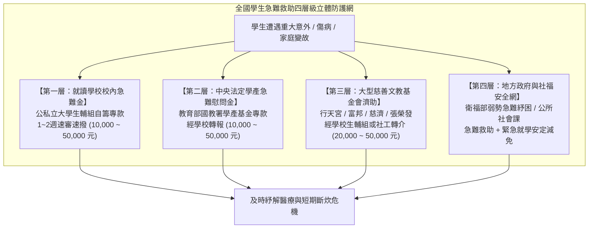
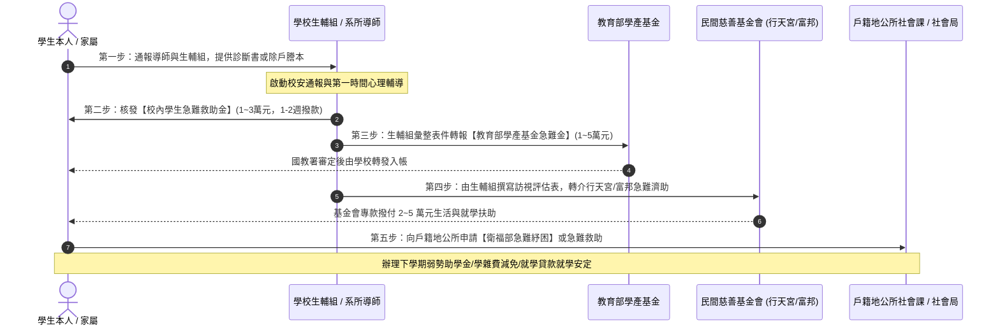

# 全台學生急難救助金來源大盤點、資訊鏈五節點拓撲與緊急應對指南

> **專案狀態**：特性分支 `feat/emergency-relief-aid-expansion`  
> **核心目標**：依據使用者對學生突發變故與急難救助金需求之觀察（參照 [`https://advisory.ntu.edu.tw/CMS/HTML/118`](https://advisory.ntu.edu.tw/CMS/HTML/118)），運用 OpenGSA 既有檢索與資訊鏈架構，全面盤查全台公私立學校、中央部會與主要慈善基金會之急難救助金，建立結構化候選卡池與學生突發變故五步因應攻防地圖。

---

## 一、盤點背景與需求深層分析

在大學、研究所與各級求學過程中，學生個人或家庭常遭遇不可預測之重大突發事故：
- **主要生計者變故**：父母或主要經濟支柱因意外身故、罹患癌症重症或重大傷殘、非自願性失業無力負擔家庭生計與學費。
- **學生本人突發傷病**：在學期間遭遇嚴重車禍事故、重大傷病住院動手術，面臨龐大醫療自付額。
- **重大天災水火火災**：家庭居住處所遭遇天然災害、火災，導致家園全毀生活陷入絕境。

經盤點 OpenGSA 既有庫存，原先僅包含 1 筆初期草稿 `ntu-emergency-policy`，各校生輔組急難救助要點與全國主要慈善基金會資訊散落各地，學生突遭變故時往往求助無門或不知該如何依序申辦。本輪工作全面啟動全台急難救助資源深度盤查。

---

## 二、急難救助體系四層級立體防護網

---

## 三、全台急難救助金代表性核心方案總表

本輪於 [`data/source-expansion/emergency-relief-sources.json`](../data/source-expansion/emergency-relief-sources.json) 完整收錄全台 25+ 項核心急難救助管道，涵蓋四大層級：

| 代碼 | 方案名稱 | 主辦 / 管轄單位 | 救助對象 | 給付金額級距 | 申請期限規則 | 申辦與轉介窗口 |
| :--- | :--- | :--- | :--- | :--- | :--- | :--- |
| **EMER-001** | **教育部學產基金急難慰問金** | 教育部國教署 | 各級在學學生（幼兒至博碩士） | 本人身故 5 萬、父母身故 2 萬、重傷 1~2 萬 | 事故發生日起 3 個月內 | 由就讀學校生輔組初審代報 |
| **EMER-002** | **衛生福利部急難救助/紓困** | 衛福部社會救助及社工司 | 全體國民（含在學學生家庭） | 急難救助 1~3 萬，重大紓困最高 5 萬元 | 事實發生日起 3 個月內 | 戶籍地或居住地公所社會課 |
| **EMER-003** | **勞動部職災子女就學生活補助** | 勞動部職業安全衛生署 | 職災勞工在學子女 | 公立 1.2 萬、私立 2.9 萬、重大職災 10 萬 | 每學期常規受理，重大隨到隨辦 | 勞動部職安署或各分署 |
| **EMER-004** | **國立臺灣大學學生急難救助金** | 臺大學務處生輔組 | 臺大在學大學生、碩博士生 | 傷病 1~3 萬、家變 2~5 萬、身故最高 10 萬 | 事故發生日起 3 個月內 | 臺大學務處生輔組（HTML/118） |
| **EMER-005** | **國立清華大學學生急難救助金** | 清大學務處生輔組 | 清大在學學士、碩博研究生 | 傷病 5 千~2 萬、家庭變故 2~5 萬元 | 事實發生日起 3 個月內 | 清大學務處生輔組窗口 |
| **EMER-006** | **國立成功大學學生急難救助金** | 成大學務處生輔組 | 成大在學學士、碩博研究生 | 生活救助 1~3 萬、重大事故最高 5 萬元 | 事由發生日起 3 個月內 | 導師初核後送成大生輔組 |
| **EMER-007** | **國立陽明交通大學急難救助金** | 陽明交大學務處生輔組 | 陽明交大在學學士、碩博士生 | 慰問金 1~3 萬、重大專案最高 6 萬元 | 事故發生日起 3 個月內 | 陽明交大各校區生輔組 |
| **EMER-008** | **國立政治大學學生急難救助金** | 政大學務處生資組 | 政大在學學士、碩博研究生 | 急難慰助 1~4 萬、重大專案最高 8 萬元 | 事實發生日起 3 個月內 | 政大學務處生資組常態受理 |
| **EMER-009** | **天主教輔仁大學學生急難救助金** | 輔大學務處生輔組 | 輔仁在學學士、碩博研究生 | 慰助 1~2 萬、重大家變 2~5 萬元 | 事故發生之日起 3 個月內 | 輔大學務處生輔組隨到隨審 |
| **EMER-010** | **淡江大學學生急難救助金** | 淡大學務處生輔組 | 淡江在學學士、碩博研究生 | 救助 1~3 萬、校友愛心專款最高 5 萬元 | 變故發生日起 3 個月內 | 經系所導師初核送生輔組 |
| **EMER-011** | **行天宮文教基金會學生急難濟助** | 行天宮文教發展基金會 | 各級在學學生（國中小至大專博碩士） | 就學急難 3~5 萬、家庭急難 2~5 萬元 | 重大變故發生日起 6 個月內 | **限就讀學校生輔組/社工轉介** |
| **EMER-012** | **富邦慈善基金會急難救助專案** | 財團法人富邦慈善基金會 | 各級學校在學弱勢家庭學生 | 急難救助 1~3 萬、重大專案最高 5 萬元 | 事故發生日起 3 個月內 | **由學校生輔組代為轉介申辦** |
| **EMER-013** | **慈濟慈善事業基金會就學援助** | 佛教慈濟慈善事業基金會 | 各級學校在學生與困境家庭 | 急難生活 1~3 萬、學雜費實報實銷差額補助 | 常年受理，隨報隨訪 | 學校生輔組通報或靜思堂社工 |
| **EMER-014** | **張榮發基金會急難救助** | 財團法人張榮發基金會 | 清寒困境學生家庭與重大意外者 | 急難金 1~5 萬元，訪查後提供清寒助學 | 變故發生日起 6 個月內 | 學校學務處生輔組或社政轉介 |
| **EMER-015** | **全聯慶祥慈善基金會急難救助** | 全聯慶祥慈善事業基金會 | 突發重大傷病致斷炊之學生家庭 | 救助金 1~3 萬 + 愛心福利卡每月生活物資 | 事實發生日起 3 個月內 | 學校生輔組轉介或全聯社工窗口 |
| **EMER-016** | **家扶基金會學生急難救助金** | 台灣兒童暨家庭扶助基金會 | 未滿 25 歲之在學青少年與家庭 | 急難救助 1~3 萬，社工持續個案管理 | 重大變故發生日起 3 個月內 | 全台各縣市家扶中心或學校轉介 |

---

## 四、急難救助金之時程與申辦特殊規則

不同於常規學年度獎學金，急難救助金具備三大獨特時程與申辦規範：
1. **常態開放與逐案審議（Continuous Intake / Case-by-Case Review）**：
   - 救助金不設每年固定申請起訖月日，只要符合變故事由，全年度均開放受理。
   - 審議模式採專案即時核定（約 1 至 2 週內召開審議小組或簽報核發）。
2. **事件相對型申請期限（Event-Relative Deadline）**：
   - 期限以「**事實發生日（Incident Date）**」為基準起算：
     - 多數大專院校與教育部學產基金要求於**事實發生日起 3 個月內**提出。
     - 部分民間基金會（如行天宮文教基金會、張榮發基金會）考量喪葬後續與醫療復健期，寬限至**事實發生日起 6 個月內**均可申請。
3. **第三方轉介嚴格規定（Mandatory Referral Gate）**：
   - 大型民間基金會（如行天宮、富邦）為防弊與確認家庭實況，**明訂不接受個人自行投件**，必須經由學校學務處生輔組或公設社工單位初核訪視並蓋用學校印信後轉介。
   - 教育部學產基金亦嚴格要求由「就讀學校代向教育部請領」。

---

## 五、學生突遭家庭變故或意外緊急因應五步攻略

1. **第一步（即時通報與蒐集單據）**：
   - 第一時間向所屬系所導師、系教官或學院生輔專員通報。
   - 備妥核心單據：
     - **3 個月內現戶全戶戶籍謄本**（記事不可省略）。
     - **公私立教學醫院合格診斷證明書正本**（載明病名、手術與入出院起訖日）及**醫療費用收據正本**。
     - 若逢親人身故：檢附**死亡證明書**或**除戶戶籍謄本**。
     - 若逢天災水火：村里長辦公室或消防局開立之受災證明書。
2. **第二步（啟動校內學生急難救助金）**：
   - 填寫校內申請書由導師簽註意見，送生輔組專案核辦。校內專款多在 1 至 2 週內撥款，先行支應急診、加護病房押金或喪葬頭七開銷。
3. **第三步（連動申請教育部學產基金急難慰問金）**：
   - 由學校生輔組主動代學生向教育部國教署學產基金系統提出申請，學生本人身故 5 萬元、主要生計者死亡 2 萬元、重傷 1~2 萬元。
4. **第四步（生輔組轉介行天宮、富邦等慈善基金會）**：
   - 由學校生輔組社工或承辦人出具學校公文與推薦訪視表，將案件轉介至行天宮文教基金會（就學急難最高 5 萬元）或富邦慈善基金會，填補自費醫療或生活差額。
5. **第五步（銜接地方政府急難紓困與常規就學扶助）**：
   - 向公所社會課申辦衛福部急難救助，若家庭頓失收入，並向學校辦理下學期「大專校院弱勢學生助學計畫」與學雜費減免或就學安定貸款。

---

## 六、資訊鏈拓撲與資料合約落盤

本輪依據專案嚴格合約規範完成以下產出與更新：
1. **來源清冊**：[`data/source-expansion/emergency-relief-sources.json`](../data/source-expansion/emergency-relief-sources.json)（25 項公私立學校、法定學產與基金會清冊）。
2. **待審候選卡池**：[`data/candidates/emergency-relief-aid.json`](../data/candidates/emergency-relief-aid.json)（12 筆指標方案，標註 `review.status="pending"`, `review.promotion_ready=false`）。
3. **時間觀測政策**：[`data/emergency-relief-temporal-observations.json`](../data/emergency-relief-temporal-observations.json)（12 筆政策觀測，精確捕捉 `continuous` 隨到隨審與 `needs_event_date` 缺口）。
4. **五節點拓撲批次**：[`data/source-chain-batches/batch-emergency-relief.json`](../data/source-chain-batches/batch-emergency-relief.json)（60 份文件節點、48 條邊、12 條候選綁定，通過五節點無懸空驗證）。
5. **總註冊表更新**：[`data/source-chain-batches/batch-registry.json`](../data/source-chain-batches/batch-registry.json) 登記 `batch-emergency-relief`。
6. **來源輪廓註冊**：[`data/scan-sources.json`](../data/scan-sources.json) 登錄 190 allowed hosts，新 profile 依守則嚴格標註 `"enabled": false`。
7. **前端同義詞搜尋強化**：`docs/design/prototype.js` 擴充支援 `急難`、`急難救助`、`急難救助金`、`救助金`、`學產基金`、`緊急紓困`、`變故`、`emergency relief`，於 `tests/prototype.test.cjs` 補齊防線測試。
