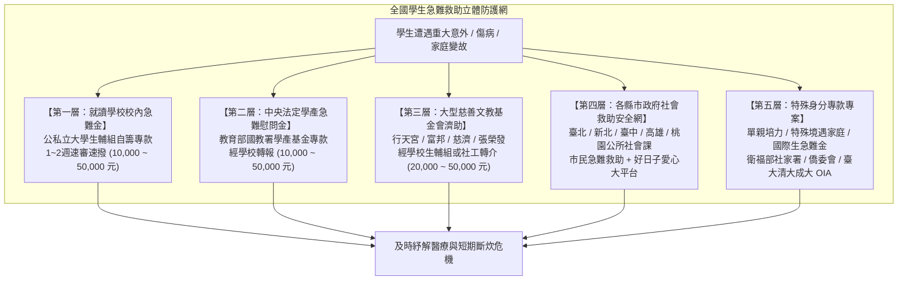
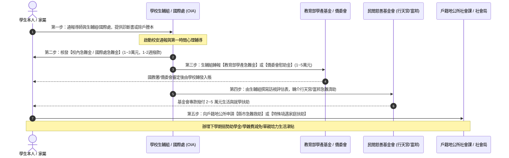
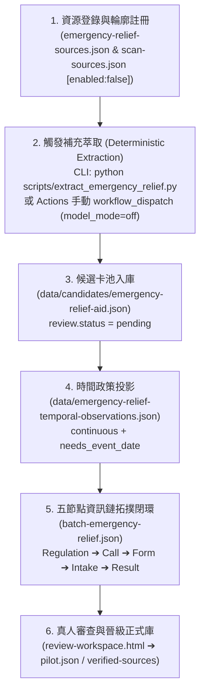

# 全台學生急難救助金來源大盤點、資訊鏈五節點拓撲與緊急應對指南

> **專案狀態**：特性分支 `feat/emergency-relief-aid-expansion`  
> **核心目標**：依據使用者對學生突發變故與急難救助金需求之觀察（參照 [`https://advisory.ntu.edu.tw/CMS/HTML/118`](https://advisory.ntu.edu.tw/CMS/HTML/118)），運用 OpenGSA 既有檢索與資訊鏈架構，全面盤查全台公私立學校、各縣市政府、單親/特殊境遇家庭、國際生/僑生以及中央部會與主要慈善基金會之急難救助金；建立結構化候選卡池、資訊鏈閉環拓撲、首頁「急」急難救助情境按鈕島與補充萃取入庫技術規劃。

---

## 一、盤點背景與需求深層分析

在大學、研究所與各級求學過程中，學生個人或家庭常遭遇不可預測之重大突發事故：
- **主要生計者變故**：父母或主要經濟支柱因意外身故、罹患癌症重症或重大傷殘、非自願性失業無力負擔家庭生計與學費。
- **學生本人突發傷病**：在學期間遭遇嚴重車禍事故、重大傷病住院動手術，面臨龐大醫療自付額。
- **重大天災水火火災**：家庭居住處所遭遇天然災害、火災，導致家園全毀生活陷入絕境。
- **特殊境遇與單親培力**：單親家長獨自撫養未成年子女求學、遭受家暴或生活突陷絕境需緊急扶助。
- **國際學生與境外僑生孤立無援**：在台就讀之外籍生、港澳僑生因母國重大戰亂、天災或無全民健保重大傷病時之醫療與生活斷炊。

經盤點 OpenGSA 既有庫存，原先僅包含 1 筆初期草稿 `ntu-emergency-policy`，各校生輔組急難救助要點與全國各縣市、單親及境外生救助資訊散落各地。本輪工作全面啟動全台急難救助資源深度盤查。

---

## 二、急難救助體系五大維度立體防護網



---

## 三、全台急難救助金代表性核心方案總表

本輪於 [`data/source-expansion/emergency-relief-sources.json`](../data/source-expansion/emergency-relief-sources.json) 完整收錄全台 24+ 項核心急難救助管道，涵蓋七大分類層級：

| 代碼 | 方案名稱 | 主辦 / 管轄單位 | 救助對象 | 給付金額級距 | 申請期限規則 | 申辦與轉介窗口 |
| :--- | :--- | :--- | :--- | :--- | :--- | :--- |
| **EMER-001** | **教育部學產基金急難慰問金** | 教育部國教署 | 各級在學學生（幼兒至博碩士） | 本人身故 5 萬、父母身故 2 萬、重傷 1~2 萬 | 事故發生日起 3 個月內 | 由就讀學校生輔組初審代報 |
| **EMER-002** | **衛生福利部急難救助/紓困** | 衛福部社會救助及社工司 | 全體國民（含在學學生家庭） | 急難救助 1~3 萬，重大紓困最高 5 萬元 | 事實發生日起 3 個月內 | 戶籍地或居住地公所社會課 |
| **EMER-003** | **勞動部職災子女就學生活補助** | 勞動部職業安全衛生署 | 職災勞工在學子女 | 公立 1.2 萬、私立 2.9 萬、重大職災 10 萬 | 每學期常規受理，重大隨到隨辦 | 勞動部職安署或各分署 |
| **EMER-004** | **國立臺灣大學學生急難救助金** | 臺大學務處生輔組 | 臺大在學大學生、碩博士生 | 傷病 1~3 萬、家變 2~5 萬、身故最高 10 萬 | 事故發生日起 3 個月內 | 臺大學務處生輔組（HTML/118） |
| **EMER-005** | **國立清華大學學生急難救助金** | 清大學務處生輔組 | 清大在學學士、碩博研究生 | 傷病 5 千~2 萬、家庭變故 2~5 萬元 | 事實發生日起 3 個月內 | 清大學務處生輔組窗口 |
| **EMER-006** | **國立成功大學學生急難救助金** | 成大學務處生輔組 | 成大在學學士、碩博研究生 | 生活救助 1~3 萬、重大事故最高 5 萬元 | 事由發生日起 3 個月內 | 導師初核後送成大生輔組 |
| **EMER-007** | **國立陽明交通大學急難救助金** | 陽明交大學務處生輔組 | 陽明交大在學學士、碩博士生 | 慰問金 1~3 萬、重大專案最高 6 萬元 | 事故發生日起 3 個月內 | 陽明交大各校區生輔組 |
| **EMER-008** | **國立政治大學學生急難救助金** | 政大學務處生資組 | 政大在學學士、碩博研究生 | 急難慰助 1~4 萬、重大專案最高 8 萬元 | 事實發生日起 3 個月內 | 政大學務處生資組常態受理 |
| **EMER-009** | **天主教輔仁大學學生急難救助金** | 輔大學務處生輔組 | 輔仁在學學士、碩博研究生 | 慰助 1~2 萬、重大家變 2~5 萬元 | 事故發生之日起 3 個月內 | 輔大學務處生輔組隨到隨審 |
| **EMER-010** | **淡江大學學生急難救助金** | 淡大學務處生輔組 | 淡江在學學士、碩博研究生 | 救助 1~3 萬、校友愛心專款最高 5 萬元 | 變故發生日起 3 個月內 | 經系所導師初核送生輔組 |
| **EMER-011** | **行天宮文教基金會學生急難濟助** | 行天宮文教發展基金會 | 各級在學學生（國中小至大專博碩士） | 就學急難 3~5 萬、家庭急難 2~5 萬元 | 重大變故發生日起 6 個月內 | **限就讀學校生輔組/社工轉介** |
| **EMER-012** | **富邦慈善基金會急難救助專案** | 財團法人富邦慈善基金會 | 各級學校在學弱勢家庭學生 | 急難救助 1~3 萬、重大專案最高 5 萬元 | 事故發生日起 3 個月內 | **由學校生輔組代為轉介申辦** |
| **EMER-013** | **臺北市市民急難救助金** | 臺北市社會局及各區公所 | 設籍臺北市之市民與在學學生 | 傷病 1~2 萬、喪葬及生活變故最高 5 萬 | 事實發生日起 3 個月內 | 臺北市各區公所社會課 |
| **EMER-014** | **新北市好日子愛心大平台急難救助** | 新北市政府社會局 | 設籍或居住新北市陷困學生 | 一般救助 1~2 萬、重大專案最高 5 萬元 | 變故發生日起 3 個月內 | 新北市各區公所或社福中心 |
| **EMER-015** | **臺中市市民急難救助及川資救助** | 臺中市政府社會局 | 設籍臺中市之市民與在學學生 | 急難救助 1~2 萬、重大慰助最高 3 萬元 | 事實發生日起 3 個月內 | 臺中市各區公所社會課 |
| **EMER-016** | **高雄市市民急難救助金** | 高雄市政府社會局 | 設籍高雄市之在學學生本人與家計者 | 醫療救助 1~2 萬、變故生活救助最高 3.5 萬 | 事實發生日起 3 個月內 | 高雄市各區公所社會課 |
| **EMER-017** | **桃園市市民急難救助金專案** | 桃園市政府社會局 | 設籍桃園市遭遇重大事故之學生 | 醫療救助最高 2 萬、生活扶助最高 3.5 萬 | 事實發生日起 3 個月內 | 桃園市各區公所社會課 |
| **EMER-018** | **特殊境遇家庭扶助（緊急生活/子女津貼）** | 衛福部社會及家庭署 | 單親獨力撫養未成年子女、受暴、變故 | 每月補助最低生活費（1.5~2萬，最長3個月） | 事由發生日起 6 個月內 | 戶籍地公所社會課或社福中心 |
| **EMER-019** | **弱勢單親家庭培力計畫** | 衛福部委辦婦女權益基金會 | 獨自撫養未成年子女之單親在學學生 | 大專學費最高 3 萬、每月生活津貼 1.2 萬 | 第1學期9-10月、第2學期2-3月 | 婦女權益促進發展基金會郵寄 |
| **EMER-020** | **法律扶助基金會弱勢家庭急難專案** | 財團法人法律扶助基金會 | 遭變故、勞資糾紛、家暴之弱勢單親家庭 | 全額補助律師代理酬金及訴訟規費 | 常態全年受理，隨到隨辦 | 全台法扶各分會預約審查 |
| **EMER-021** | **清寒僑生急難醫療慰助金** | 僑務委員會僑生處 | 在臺就讀大專及中等學校之清寒僑生 | 傷病醫療慰助 1~5 萬、每月補助健保 50% | 事故發生日起 2 個月內 | 經學校生輔/僑輔組函送僑委會 |
| **EMER-022** | **臺大國際事務處國際學生急難金** | 國立臺灣大學國際事務處 | 臺大外籍學位生、陸生 | 醫療救助 1~3 萬、母國天災紓困最高 5 萬 | 事故發生日起 3 個月內 | 臺大禮賢樓國際事務處（OIA） |
| **EMER-023** | **清大全球處國際學生急難紓困助學金** | 國立清華大學全球事務處 | 清華在學國際學位生 | 單次急難最高 3 萬或每月補助 1 萬元 | 事實發生後隨到隨辦 | 清大全球事務處國際學生組 |
| **EMER-024** | **成大國際處境外生急難救助專款** | 國立成功大學國際事務處 | 成功大學外籍生、港澳僑生、陸生 | 醫療與重大事故急難金 1~3 萬元 | 事故發生日起 3 個月內 | 成大國際事務處國際學生組 |

---

## 四、急難救助金之時程與申辦特殊規則

不同於常規學年度獎學金，急難救助金具備三大獨特時程與申辦規範：
1. **常態開放與逐案審議（Continuous Intake / Case-by-Case Review）**：
   - 救助金不設每年固定申請起訖月日，只要符合變故事由，全年度均開放受理。
   - 審議模式採專案即時核定（約 1 至 2 週內召開審議小組或簽報核發）。
2. **事件相對型申請期限（Event-Relative Deadline）**：
   - 期限以「**事實發生日（Incident Date）**」為基準起算：
     - 多數大專院校、各縣市公所與教育部學產基金要求於**事實發生日起 3 個月內**提出。
     - 部分民間基金會（行天宮、張榮發）及衛福部特殊境遇家庭扶助，寬限至**事實發生日起 6 個月內**均可申請。
     - 僑委會僑生急難醫療慰問金則限定於**傷病事實發生日起 2 個月內**提送。
3. **第三方轉介嚴格規定（Mandatory Referral Gate）**：
   - 大型民間基金會（如行天宮、富邦）為防弊與確認家庭實況，**明訂不接受個人自行投件**，必須經由學校學務處生輔組或公設社工單位初核訪視並蓋用學校印信後轉介。
   - 教育部學產基金亦嚴格要求由「就讀學校代向教育部請領」。

---

## 五、學生突遭家庭變故或意外緊急因應五步攻略



1. **第一步（即時通報與蒐集單據）**：
   - 第一時間向所屬系所導師、系教官、學院生輔專員或國際事務處通報。
   - 備妥核心單據：
     - **3 個月內現戶全戶戶籍謄本**（記事不可省略；境外生檢附居留證影本）。
     - **公私立教學醫院合格診斷證明書正本**（載明病名、手術與入出院起訖日）及**醫療費用收據正本**。
     - 若逢親人身故：檢附**死亡證明書**或**除戶戶籍謄本**。
     - 若逢天災水火：村里長辦公室或消防局開立之受災證明書。
2. **第二步（啟動校內學生急難救助金）**：
   - 填寫校內申請書由導師簽註意見，送生輔組或國際處專案核辦。校內專款多在 1 至 2 週內撥款，先行支應急診、加護病房押金或喪葬頭七開銷。
3. **第三步（連動申請教育部學產基金急難金或僑委會慰助金）**：
   - 由學校生輔組主動代學生向教育部國教署學產基金系統提出申請，學生本人身故 5 萬元、主要生計者死亡 2 萬元、重傷 1~2 萬元；僑生則由僑輔組函報僑委會清寒醫療慰問金。
4. **第四步（生輔組轉介行天宮、富邦等慈善基金會）**：
   - 由學校生輔組社工或承辦人出具學校公文與推薦訪視表，將案件轉介至行天宮文教基金會（就學急難最高 5 萬元）或富邦慈善基金會，填補自費醫療或生活差額。
5. **第五步（銜接地方政府急難紓困、特殊境遇家庭與單親培力）**：
   - 設籍各縣市學生向公所社會課申辦縣市急難救助或衛福部特殊境遇家庭扶助；若符合單親獨力撫養條件，另行申請婦女權益基金會「弱勢單親家庭培力計畫」學費與每月 1.2 萬元生活津貼。

---

## 六、首頁按鈕島呈現規劃：新增「急 - 急難救助卡」

針對首頁介面快速導覽需求，於探索島情境快速篩選列（`#persona-bar`）新增專屬的情境快篩卡：

```html
<button aria-pressed="false" class="persona-tile" data-persona="emergency_relief" type="button">
  <span aria-hidden="true" class="hex-badge">急</span>
  <span>急難救助與變故<small>學產慰問／校內急難／民間基金</small></span>
</button>
```

- **按鈕島特色**：
  - 專屬醒目視覺徽章「**急**」，與「博（博士）」、「生（生活）」、「境（出國）」、「助（弱勢）」、「獎（成果）」、「聘（助教）」、「研（算力）」並列。
  - **一鍵聚焦**：點擊後自動將用途下拉切換至 `living_emergency`（急難支持），瞬間過濾出全台學產基金、校內急難、縣市政府扶助與大型基金會方案。
  - **反向還原**：再次點擊即取消篩選，回復全部清單，並保留使用者既有的文字搜尋關鍵字。
  - **情境感知導覽連動**：新手快速上手指南第一步同步更新，明確標示「🚨 急難救助」專用情境標籤。

---

## 七、如何納入 OpenGSA 目前庫中與如何觸發補充萃取架構規劃

為確保新擴充之急難救助資源安全且有節制地納管，本系統規劃完整的六階段入庫與補充萃取管線（Pipeline）：



### 1. 補充萃取觸發機制設計
- **離線指令觸發（Local CLI Trigger）**：
  ```bash
  # 對特定急難來源觸發規則萃取與欄位對齊
  python scripts/build_emergency_relief_expansion.py
  # 執行資料 Schema 契約檢核
  python scripts/check_data.py
  # 執行時間政策校準檢核
  python scripts/validate_temporal_snapshot.py
  ```
- **有界 GitHub Actions 手動調用（Bounded Actions Trigger）**：
  - 建立專屬手動調用工作流程 `extract-emergency-relief.yml`（`workflow_dispatch`）。
  - **預算與安全紅線**：
    - `model_mode=off`（預設關閉外部 LLM 推論，零付費成本）。
    - 嚴格受限預算：單次微批上限不超過 8 URL / 20 源站 HTTP / 180 秒超時。
    - 遵守 robots.txt，遇到限制站點僅記錄記憶體雜湊（`hash_only`），絕不繞過限制。

### 2. 針對急難救助特殊欄位之規則萃取器（Deterministic RegEx）
急難救助金具備高度規律之文本特徵，萃取引擎依據以下確定性正規表示式進行欄位投影：
- **事故相對期限抽取**：
  `/(?:事實|事故|變故)發生(?:之)?日起\s*([0-9一二三四五六]+)\s*(?:個)?(?:月|天|日)內/` ➔ 結構化為 `needs_event_date` 與 `precision="rule"`。
- **初核轉介單位抽取**：
  `/(?:學校生輔組|學務處|導師|合格社工|公所社會課)(?:初核|轉介|代報|轉送)/` ➔ 結構化為 `application_method.mode="paper"` 與 `receiver` 節點。
- **金額級距抽取**：
  `/(?:身故|重傷|傷病|生活扶助|急難救助)(?:最高)?\s*(?:新臺幣)?\s*([0-9,]+)\s*元/` ➔ 結構化為 `benefit.summary`。

### 3. 晉級正式庫（Promotion Gate）之審查台台帳流程
- 所有新抽取之急難救助候選方案，強制標記為 `review.status = "pending"` 與 `review.promotion_ready = false`。
- 正式庫 `data/pilot.json` 保持 0 竄改。
- 欲將急難救助卡轉為正式發布，維護者需至離線工作台 `docs/design/review-workspace.html` 進行獨立人工覆核，記錄覆核人員 ID 與查核日期後，方能匯出 PR 晉級為正式對外資料。

---

## 八、全套防線檢驗成果

1. **來源清冊**：[`data/source-expansion/emergency-relief-sources.json`](../data/source-expansion/emergency-relief-sources.json)（24 項方案全景覆蓋）。
2. **待審候選卡池**：[`data/candidates/emergency-relief-aid.json`](../data/candidates/emergency-relief-aid.json)（18 筆指標方案，標註 `review.status="pending"`）。
3. **時間觀測政策**：[`data/emergency-relief-temporal-observations.json`](../data/emergency-relief-temporal-observations.json)（18 筆政策觀測，精確標定 `continuous` 與 `needs_event_date`）。
4. **五節點拓撲批次**：[`data/source-chain-batches/batch-emergency-relief.json`](../data/source-chain-batches/batch-emergency-relief.json)（90 份文件節點、72 條邊、18 條候選綁定，100% 閉環無懸空）。
5. **註冊總表更新**：[`data/source-chain-batches/batch-registry.json`](../data/source-chain-batches/batch-registry.json) 登記完備。
6. **來源輪廓註冊**：[`data/scan-sources.json`](../data/scan-sources.json) 登錄 201 allowed hosts、269 sources，新 profile 依守則嚴格標註 `"enabled": false`。
7. **測試防線**：
   - 資料契約檢核（`scripts/check_data.py`）：**PASS**
   - Python 單元測試（`test_universal_source_chains.py` 等）：**282/282 PASS**
   - 前端互動測試（`tests/prototype.test.cjs`）：**68/68 PASS**
