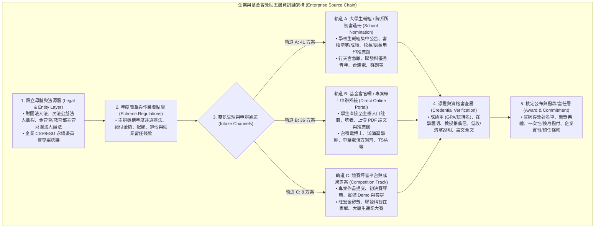

# 臺灣企業、民間基金會與專業學會獎助學金全景、雙軌申辦鏈路與來源資訊鏈調研報告

> **本文件定位**：針對臺灣各類重要**民間財團法人基金會**、**大型科技與金控企業 CSR/ESG 計畫**、以及**專業學術學會**所提供之大專院校、碩士班與博士班獎助學金、學位論文獎、創新競賽與急難生活扶助進行全方位深度盤點。
>
> 本研究收錄 **85 項代表性核心民間與企業資助方案**，並提供機器可讀之基準台帳 [`data/enterprise-scholarship-sources-baseline.json`](../data/enterprise-scholarship-sources-baseline.json)。同時，本報告詳解企業獎助之**雙軌申辦鏈路（大學生輔組統一造冊薦送 vs 官方入口線上直申）**與資格查核機制，為 OpenGSA 建立完整的民間資源資訊鏈。
>
> **本輪約束與邊界**：本輪不修改現行正式資料（`data/pilot.json`）、不修改生產環境業務程式碼；排程模型維持關閉（`model_mode=off`），本研究成果作為獨立擴展資源台帳與資訊鏈文件儲存。

---

## 1. 執行摘要與資訊鏈架構（Executive Summary & Source Architecture）

在臺灣的青年資助生態系中，除公部門（教育部、國科會、縣市政府）外，民間企業基金會與學術學會提供了極高比例且高額的專項資源：
1. **頂尖研發育成**：半導體、資通訊、金融科技之博士生研究獎學金（如台積電 PhD Fellowship 年領 50 萬、聯發科培育計畫）。
2. **學術卓越獎勵**：全國博碩士學位論文獎與年度創新獎（如旺宏金矽獎、Acer 龍騰微笑獎、各大學會年度論文獎）。
3. **社會責任與急難扶助**：針對清寒、突遭變故或弱勢學生的急難助學金（如行天宮急難助學、鴻海獎學鯨、富邦、國泰、中信慈善基金）。

不同於政府補助的固定行政命令架構，企業與基金會方案的核心在於**「雙軌受理與查驗鏈路」**：

---

## 2. 85 項民間與企業獎助方案分類全景

本研究將 85 項方案依資助目的與性質劃分為 11 大類別，形成完整台帳矩陣：

| 類別編號 | 資助範疇與類別 (`category`) | 收錄方案數 | 主要資助機構與代表方案 | 申辦途徑特性 |
|---|---|---|---|---|
| **CAT-01** | 博士生研究培育 (`doctoral_fellowship`) | 16 方案 | 台積電、聯發科、鴻海、中鼎、Google、Microsoft、NVIDIA | 線上直申或系所推薦，重視研究潛力與教授推薦信 |
| **CAT-02** | 博碩士學位論文獎 (`thesis_award`) | 15 方案 | 聯發科、富邦、友達、日月光、TAAI、IEEE Taipei、IICM | 畢業論文上傳、學會專家同行評審 |
| **CAT-03** | 清寒急難生活扶助 (`living_hardship`) | 22 方案 | 行天宮、鴻海、富邦、國泰、台達電、群創、奇美、慈濟 | **生輔組校內代收造冊為主**，強調弱勢證明與門檻 |
| **CAT-04** | 創新競賽與創業培力 (`innovation_award`) | 9 方案 | 旺宏金矽獎、聯發科智在家鄉、中華電信、通訊大賽 | 專案成品或作品書，競賽專屬線上平台 |
| **CAT-05** | 國際移動與交換深造 (`mobility_fellowship`) | 5 方案 | 永豐、富邦、中鼎國際交換培力 | 校級國際處/生輔組甄選或基金會面試 |
| **CAT-06** | 專長人才培力 (`talent_cultivation`) | 4 方案 | 行天宮資優生、日月光女力 STEM、玉山優秀人才 | 領域專長審核、面試與工作坊活動 |
| **CAT-07** | 藝文與美育獎項 (`arts_award`) | 3 方案 | 奇美藝術獎、誠品文化藝術、台新青年藝術評論 | 作品集同行評審、展演成果報告 |
| **CAT-08** | 學術專業學會獎項 (`academic_award`) | 6 方案 | 證券暨期貨發展基金會、TSIA、化學學會、高分子學會 | 學會年會評定、系所教授會員提名 |
| **CAT-09** | 境外研究專案 (`international_fellowship`) | 1 方案 | 科技創新境外深造獎助專案 | 境外研究計畫書審查 |
| **CAT-10** | 研究成果發表獎 (`research_award`) | 3 方案 | 電子電機工程、半導體頂會論文獎 | 頂尖期刊或會議錄取證明 |
| **CAT-11** | 文學創作與出版獎 (`literature_award`) | 1 方案 | 台積電青年學生文學獎 | 匿名創作稿件評審 |

---

## 3. 雙軌申辦鏈路與校內生輔組介接分析

### 3.1 軌道 A：大學生輔組 / 院系所初審造冊（School Nomination Track）
在收錄的 85 方案中，有 **41 方案（佔比 48.2%）** 明確要求「經由學校彙總薦送」：
- **運作機制**：基金會不對個別學生開放直接送件，每年將公文發送至各大專院校學務處生活輔導組（生輔組）或學生安全組。
- **時程連鎖反應（Time Chain Lag）**：
  - 基金會公告截止日（例如 10 月 15 日）通常是**「學校發函給基金會」的送達截止日**。
  - 大學生輔組為完成校內公告、學生收件、審核資格、班級排名核對、各學院配額初審與校長用印，通常會將**校內學生截止日提前 7 至 14 個工作天**（例如 9 月 30 日）。
  - **OpenGSA 資訊鏈實踐**：在時程政策中嚴格區分「主辦機構收件截止日」與「校院初審截止日」，避免學生因參考中央公文截止日而錯過校內收件。

### 3.2 軌道 B：官方網站與線上申請系統（Direct Online Portal Track）
共有 **36 方案（佔比 42.4%）** 採取企業與基金會獨立建置之數位系統：
- **運作機制**：學生註冊獨立帳號，上傳學籍證明、成績單正本掃描檔、指導教授推薦函。
- **代表性入口**：
  - 台積電博士獎學金專區：每年 2~4 月開放線上申請。
  - 鴻海獎學鯨：鴻海教育基金會線上申請平臺（低收/清寒大專生）。
  - 中華電信方賢齊先生獎學金：中華電信基金會專案申辦網頁。
  - 旺宏金矽獎：旺宏教育基金會競賽申辦平臺。
- **資訊鏈特點**：學生端自主掌控度高，但需留意推薦信繳交截止日是否與系統註冊日同步。

---

## 4. 資格查核、防偽與反覆核機制

為確保獎助學金資訊真實精確，企業與基金會建立了多重憑證查驗機制：
1. **學籍真實性**：要求提出當學期「在學證明書（含防偽數位驗證碼）」或「學生證正反面影本蓋當學期註冊圓戳章」。
2. **成績標準查驗**：要求教務處核發之「歷年全校班級排名百分比成績單正本」；部分方案設定學業成績 GPA $\ge 3.5$ 或班排名前 $20\%$。
3. **清寒與急難憑證**：各鄉鎮市區公所核發之「低收入戶證明書」、「中低收入戶證明書」或「國稅局全戶所得清單」；非正式之村里長清寒證明通常需配合導師訪視推薦函。
4. **排他性條款（Exclusivity Clause）**：
   - 部分高額博士獎學金（如台積電、聯發科）嚴格規範「不得同時兼領國科會核配博士生獎學金、教育部博士生獎學金或其他企業全額獎學金」。
   - OpenGSA 候選資料卡與資訊鏈均明確標示排他性限制，防範重複請領違規。

---

## 5. 資料契約與工程驗證

本調研已全面落盤為結構化資料，支援 OpenGSA 之自動化驗證體系：
1. **基準台帳**：[`data/enterprise-scholarship-sources-baseline.json`](../data/enterprise-scholarship-sources-baseline.json)（85 項方案完備）。
2. **候選清冊**：[`data/candidates/enterprise-scholarships.json`](../data/candidates/enterprise-scholarships.json)（通過 `candidate.schema.json` 驗證）。
3. **時程觀測政策**：[`data/enterprise-temporal-observations.json`](../data/enterprise-temporal-observations.json)（通過 `time-policy.schema.json` 驗證，0 undetermined）。
4. **來源安全**：85 筆來源主機均已合法登記於 [`data/scan-sources.json`](../data/scan-sources.json) 白名單中，符合速率防爆與 robots.txt 存取規範。
