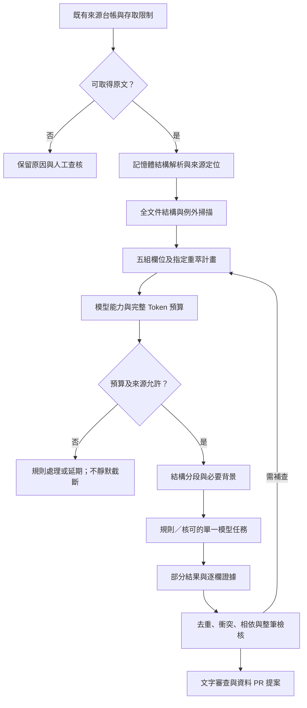

# 欄位分組、局部重萃與長文本處理規劃

日期：2026-10-31。**本文件為後續實作規格，PR #26 僅記錄規劃與研究，未實作新萃取功能、未執行模型評測。**使用者要求先穩定現有批次再擴張；瀏覽器驗收暫緩。

## 1. 與其他 PR 的界線

| PR | 狀態與範圍 |
|---|---|
| [#24](https://github.com/matt-ye/opengsa/pull/24) | 查核時仍開啟。已實作來源盤點、19 筆候選及可靠性修正，包括重複金額、給付週期與角色、院別、文件層級 N/A、內容指紋及文字審查。最新基準為 110 項 Python／38 項 Node，8 筆通過／11 筆有缺漏，全部待審；這些尚非 main 的已發布能力 |
| [#25](https://github.com/matt-ye/opengsa/pull/25) | 查核時仍開啟。受阻來源與 Defuddle 初步研究；其中替代端點、實測及量化宣稱須按 [研究註記](CRAWLING-EXTRACTION-BEST-PRACTICES.md#pr25) 補證 |
| 本 PR | 五組欄位、指定欄位重萃、依賴與版本管理、模型分工、Token 預算及結構分段，均為規劃。獨立自 main 建立，不攜入 #24／#25 的程式或候選快照，不合併任何 PR |

現有模型介面能回傳部分欄位修補，但只有固定支援清單，尚不等於完整的任意欄位重萃。目前 `_sanitize_blocks` 使用前 25 個區塊、每塊最多 320 字，可能漏掉後段條件；後續以可追溯的內容選取與 Token 分段取代靜默截斷。

## 2. 五組管理、欄位路徑執行

五組是管理、測試及操作標籤，**不代表每筆固定呼叫五次模型**。規則先解析，僅對未完成或有歧義的欄位安排模型任務。

| 組別 | 範圍及既有欄位對應 | 特別要求 |
|---|---|---|
| A：方案與適用範圍 | title、category、resource_kind、cycle、participants、organizations、institution_scope | 區分年度、梯次、分支、申請／受益／收款角色；ID 由系統管理，不交由模型自由命名 |
| B：申請資格 | eligibility、hardship | 學位、學校院系、領域、年級與基準日、候選資格取得日、國籍、工作、年齡、設籍、清寒、畢業及先前補助；保存且／或、否定、例外及採認日 |
| C：給付與兼領 | benefit、compatibility | 金額、幣別、單位、頻率、比例、上下限、期間、給付對象、計算基準；重疊支出／期間與重複申請分開，雙方規定都要核對 |
| D：申請程序與時間 | application_method、schedule、expense_period | 紙本／電子、郵寄／親送、親簽及核章、推薦、申請／補件／核銷；學生至機關各層期限、送達／郵戳、相對規則、支出期間與結果日 |
| E：版本、證據與完整度 | policy_version、source_metadata、field_evidence、gaps_and_conflicts、verification | 以系統與獨立檢核為主，模型僅提供可核驗線索；真人 review 紀錄不可由模型建立 |

其中部分資格（如年齡、設籍）目前僅是 `other_conditions` 摘要，後續先加入本批需要的結構化比較，不立即建立通用規則語言。

每個重大欄位保存：值、適用對象／分支、適用期間、查核狀態及證據。區分「已確認」「完整原文未載」「尚未查完／來源受阻」「不適用」「有衝突」。只看部分段落不能宣告全文未載；未載限制不等於不限；N/A 必須有文件層級或原文依據。

## 3. 指定欄位重萃與相依檢核

任務計畫須明確分開：

- `write_fields`：唯一允許修改的欄位；模型輸出越界即拒絕。
- `read_dependencies`：供理解的既有欄位及其版本，唯讀。
- `revalidate_fields`：這次變動可能影響的欄位；重新檢核不等於一定再呼叫模型。
- 來源版本、目標候選內容指紋、規則／Prompt／Schema／解析版本、模型設定、呼叫與 Token 預算。

以下是**尚未實作的任務格式示意**，不是現行 Schema 或已可使用的 CLI：

```json
{
  "target": "candidate-id",
  "group": "benefit",
  "write_fields": ["benefit.items", "benefit.summary"],
  "read_dependencies": ["cycle", "participants", "eligibility", "expense_period"],
  "revalidate_fields": ["benefit", "compatibility", "schedule"],
  "mode": "plan_only"
}
```

日後擴充現有 CLI，先提供無網路、無模型的 `plan_only`，再由計畫執行已授權任務。組別和欄位清單都編譯成同一種計畫；檢核器可為缺漏自動產生計畫，執行仍受來源及預算約束。

給付列項與程序步驟需有穩定身分，不以易位移的陣列索引作為永久重萃地址。局部更新先寫入候選複本，完成範圍、證據、Schema 與跨欄位檢查後才整批套用；失敗不覆蓋原紀錄，缺鍵不代表刪除，unknown 不自動清除既有已確認值。

來源版本變更時，重用欄位必須證明證據及相依背景仍有效；受影響的舊欄位標為待重核。部分重萃不能偷換整筆來源版本。既有真人核准綁整筆內容指紋；內容更新後重新覆核，不能沿用舊核准。

## 4. 模型輸入與輸出預算

可以由程式預先分段。計算單位是模型 Token，不用英文字數換算中文，也不以字元數保證能送出。模型能力設定至少含 provider、模型／版本、查核日期、輸入上限、輸出上限、是否共用 context、請求位元組上限、tokenizer／官方計數方法、結構輸出能力及額度確認狀態。

每次計算完整請求，包括系統指令、JSON Schema、方案背景、唯讀依賴、段落、表頭／註腳及協定序列化開銷。設：

```text
T = 指令 + Schema + 共享背景 + 依賴 + 文件段落 + 序列化開銷
T <= input_limit - 輸入安全餘裕
output_reserve <= output_limit
若輸入／推理／輸出共用 context：
T + output_reserve + thinking_reserve <= context_limit - 安全餘裕
另檢查請求位元組、單輪 Token、呼叫數及供應商限額
```

實際模型對推理與輸出計帳方式不同，依當期官方規格實作。不得把不同供應商上限混用或無證據填無限大；能力未知則停止模型任務並留下原因。安全餘裕是可調政策，不宣稱固定百分比適用所有模型。

官方 token-count API 也可能有額外請求成本／額度；先確認再使用。可用正確 tokenizer 在本機估計並校準，保留 estimated／actual 的區別。本規劃不呼叫計數或推論 API。

## 5. 結構優先的長文本分段

1. **存取及來源確認**：既有 Fetcher 先檢查 URL、robots、主機及預算；受阻保持明確狀態。
2. **記憶體解析與清理**：保留章節、條號、清單、表格欄列、註腳、頁碼及附件關聯；清理後仍可回查原始定位。Defuddle 僅是解析候選工具，不接管受限來源下載。
3. **文件與方案分流**：先辨識年度、分支與適用角色，再安排欄位任務，避免同名方案互相污染。
4. **全文件結構掃描**：找出共同定義、適用資格、否定、例外、兼領及跨條引用。即使只重萃給付，也須帶入可能改變給付意義的條件。
5. **組合段落**：以完整條文／段落／表格為單位；表格太長則按列分割，每段帶必要表頭、身分類別、金額單位與註腳。單段仍過長才按句子細分，帶少量必要重疊；重疊量以測試決定。
6. **精算及排程**：依所選模型的完整請求預算打包段落；短文可一次處理多組，長文可多段處理一組；預算用盡則記錄未處理段落，不能靜默丟棄。
7. **段內萃取**：輸出部分欄位與來源 span／block ID；模型標示看過的範圍，未知保留，不能宣告整份文件完整。
8. **程式合併與衝突處理**：以方案、年度、角色及證據 span 去重。不同段落不一致時保留衝突，不能最後寫入者覆蓋，也不只看模型摘要就發布。
9. **完整度及跨欄檢核**：逐組與整筆檢核；「模型可容納」不等於「所有必要段落已處理」。涉及未讀例外、缺附件、來源版本改變或輸出被截斷時保持待審。

每段建立 source revision、唯一 block/span ID、章節／頁碼／定位、原文雜湊、段落範圍、estimated tokens、processed／deferred／failed 狀態。PDF 同頁多行不可共用一個模糊證據 ID。分段清單以定位與雜湊保存，不長期存放正文或二進位 PDF。

短證據上限仍以同一來源文件 revision 合計 120 字，不因分組或分段乘倍增加；hash_only 來源維持 0 原文外送。重跑需在允許範圍重新取得原文或使用仍在記憶體的上下文，雜湊不能還原全文。

## 6. 成本、快取及失敗處理

- 五組各送一次完整文件可能增加成本；重送的共同背景、overlap、Prompt、Schema、稽核與修復呼叫都列入預算。
- 快取鍵含來源 revision、相關段落及依賴雜湊、欄位範圍、模型／版本、Prompt／Schema／解析版本。只存允許的結構化候選與追溯資訊，不快取受限正文。
- overlap 同一證據只計一次給付；快取重用也須符合當次權限與未過期的來源版本。
- JSON 不完整、輸出上限終止、拒絕或能力不支援均不能視為成功。優先縮小目標／重新分段；不拼接破碎 JSON，不增加預算、不自動改用付費模型。
- 排程 model_mode=off、現有 HTTP／呼叫預算維持。分組不把目前單輪呼叫上限自動提高；未處理任務明確延期。

## 7. 以評測選擇模型

先完成規則與單一模型可用的局部重萃，再以同一批人工核對樣本比較不同模型。日期換算、金額、比例及去重由程式處理；模型定位條件與語意。

評測按組別列正確率／召回、例外漏失、否定及年度混用、數值單位、證據支持率、未知保守性、JSON 合格率、Token、延遲與重試。高風險錯誤（錯誤宣告可申請、錯期限、金額串用）單獨列出；不以模型自信或單一總分選模型。

保留開發／驗證樣本分離，避免用挑選模型的同一批案例宣告普遍效果。抽取與複核可選不同模型，但一致回答不等於來源證實；複核需回看原文，模型評測不等於真人發布核准。僅使用已確認端點、區域、免費資格及額度的 provider；未知成本維持 catalog-only。

## 8. 欄位判斷與整併順序

先統一欄位狀態與發布門檻，補齊資格／程序，再擴充可比較條件。資格、受理狀態、資料完整度、人工覆核狀態各自輸出原因與缺漏。

同方案的辦法、年度公告、申請附件及院系程序只建立關聯；每欄整併須記錄來源與適用年度，衝突不擅自選值。歷史修正日不代填生效日；年度未明的附件不能直接歸入當期；校級截止不代替學生截止。

## 9. 分期與驗收

| 階段 | 交付 | 必要驗收 |
|---|---|---|
| P0 | 五組欄位清單、狀態與相依關係、離線重萃計畫 | 越界欄位拒絕、缺鍵不刪值、個人缺漏與來源缺漏分開 |
| P1 | Token 預算、結構分段及處理範圍清單 | 第 26 段以後的例外可被找出；超長單段／表格有安全處置；未讀區塊不宣稱完整 |
| P2 | 局部套用、去重、快取、跨欄位檢核 | overlap 不重複給付；同角色不同金額衝突；來源更新使相依快取／覆核失效 |
| P3 | 本批來源欄位補齊與多文件整併提案 | P1 醫學院博士五年級候選人；教育部基準日年級未知不補猜；紙本、補件、核銷與 N/A 正確分流 |
| P4 | 小量人工核對基準評測與 provider 選擇 | 分組正確性／完整性／成本可比較；免費不明者不推論，超預算停止；資料 PR 仍待人工核准 |

實作後用既有 19 筆候選及合成邊界案例驗證，維持正式資料與真人台帳不自動改寫。涵蓋跨段「但／除外」、同額不同角色、行首／行尾身分、跨頁表頭、月／年費相對期限、接受函補送、曆月與固定天數，以及被模型視為指令的惡意來源文字。

## 10. 資料流



研究依據與 PR #25 待補證事項見 [官方最佳實務查核](CRAWLING-EXTRACTION-BEST-PRACTICES.md)。此圖描述目標流程，非目前已啟用的排程能力。
