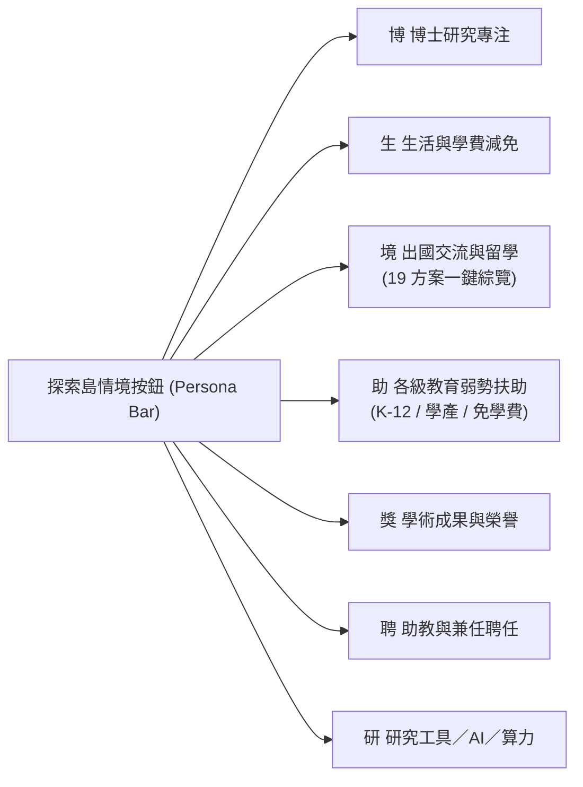

# 網頁篩選器擴展與 K-12／出國獎助可見度升級規格書 (2026-11-05)

## 1. 痛點分析與升級緣起

在全庫方案擴充至 236 筆後，使用者於公開站實際操作時發現兩大關鍵可見度盲點：
1. **K-12 各級教育獎學金「看似沒有入庫」**：
   - 專案先前已於 [`data/candidates/k12-scholarships.json`](../data/candidates/k12-scholarships.json) 完整收錄 25 筆公部門法定助學與民間兒少扶助方案（如教育部學產基金、高中職免學費、原住民國中小助學金、罕病基金會助學金等）。
   - **盲點成因**：原前端下拉選單標籤為 `<option value="all">碩士與博士</option>`，且僅提供「碩士」、「博士」、「博士候選人」三個選項。這造成兩重障礙：
     - **視覺心智誤導**：使用者一看到選單，直覺認為網站僅針對研究所碩博士生。
     - **邏輯排擠**：一旦選取「碩士」或「博士」，K-12 方案（適用於高中職、國中小、幼兒園）因為 `degrees` 不符而全部被自動過濾隱藏。
2. **出國出訪與國際交流獎學金「看似沒有全部顯示」**：
   - 全庫實際涵蓋 19 筆出國相關獎助（國科會國際會議、千里馬出國研究、臺大 115 遠學計畫、FAOS 補助、台達電荷蘭獎學金、Fulbright Taiwan 等）。
   - **盲點成因**：過去將出國獎助硬拆成 `國際會議 (international_conference)`（僅 7 筆）與 `境外研究 (overseas_research)`（僅 10 筆），頂部情境按鈕也是分立的（「會」與「外」），導致學生無法一鍵綜覽全庫 19 筆出國補助。
3. **大學部（學士班）缺乏明確身分篩選**：
   - 全庫有 120 筆方案同時開放大專大學部申請，但過去選單無法單獨篩選大學部。

---

## 2. 篩選維度全盤擴展設計

### 2.1 學歷／教育階段篩選器 (`filter-degree`)

將原先狹隘的 4 個選項升級為覆蓋**全教育階段**的 8 大維度：

| 篩選選項代碼 (`deg`) | 介面顯示標籤 | 匹配邏輯與覆蓋範疇 |
| :--- | :--- | :--- |
| `all` (預設) | **全部學歷與身分** | 全庫 236 方案完整展示，不隱藏任何層級 |
| `master_phd` | **碩士與博士（研究生總覽）** | 匹配 `degrees` 包含 `master` 或 `phd` 之方案 |
| `phd` | **博士生** | 精確匹配具備博士資格之研究型獎助 |
| `candidate` | **博士候選人限定** | 匹配通過資格考、具備博士候選人資格限定之方案 |
| `master` | **碩士生** | 精確匹配碩士研究生獎助 |
| `undergraduate` | **大學部／大專學生** | 匹配標註大專、大學部、學士班或包含大專院校之方案（120 方案） |
| `senior_high` | **高中職／五專** | 匹配高中、高職、綜合高中或五專前三年之就學補助（25+ 方案） |
| `basic_k12` | **國中／國小／幼兒** | 匹配國民中小學清寒助學、育兒津貼與幼兒園就學補助 |

```javascript
// prototype.js 核心匹配實作
if (key === "degree") {
  if (wanted === "all") return true;
  if (wanted === "candidate") return item.candidateMode === "required" || item.degrees?.includes("candidate");
  if (wanted === "master_phd") return Array.isArray(item.degrees) && (item.degrees.includes("master") || item.degrees.includes("phd"));
  if (wanted === "undergraduate") {
    return (Array.isArray(item.degrees) && item.degrees.includes("undergraduate")) ||
           (item.audience && /大學|學士|大專|undergraduate/i.test(item.audience)) ||
           (item.title && /大學|學士|大專/i.test(item.title));
  }
  if (wanted === "senior_high") {
    return (Array.isArray(item.degrees) && item.degrees.includes("senior_high")) ||
           (item.audience && /senior_high|vocational|高中|高職|五專/i.test(item.audience)) ||
           (item.title && /高中|高職|五專/i.test(item.title));
  }
  if (wanted === "basic_k12") {
    return (Array.isArray(item.degrees) && (item.degrees.includes("elementary") || item.degrees.includes("junior_high") || item.degrees.includes("preschool"))) ||
           (item.audience && /elementary|junior_high|preschool|國中|國小|幼兒|小學|幼兒園/i.test(item.audience)) ||
           (item.title && /國中|國小|幼兒/i.test(item.title));
  }
  return Array.isArray(item.degrees) && item.degrees.includes(wanted);
}
```

---

### 2.2 用途分類選單 (`filter-category`)

在維持既有細項的同時，新增兩個頂層**聚合總覽選項**：

1. **`all_abroad`（✈️ 出國出訪與境外交流總覽）**：
   - 同時聚合 `international_conference`、`overseas_research`、`travel_grant` 與標題含出國/境外/海外之所有方案，一鍵查看全庫 19 筆出國獎助。
2. **`all_k12`（🎒 各級教育與弱勢扶助總覽）**：
   - 聚合學產基金、高職免學費、兒少急難助學等共 33 筆基礎就學扶助方案。
3. **保留細項**：
   - `phd_research`（博士研究）
   - `living_tuition`（生活／學費）
   - `living_emergency`（急難支持）
   - `outcome_award`（成果獎）
   - `international_conference`（└ 國際會議差旅）
   - `overseas_research`（└ 境外研究留學）
   - `indirect_support`（聘任入口）
   - `research_tools`（研究工具／算力）

---

### 2.3 探索島情境快速篩選按鈕 (Persona Bar)

在首頁快速篩選工具列中，強化兩大高頻需求的情境按鈕：



- **`abroad_all`（境 出國交流與留學）**：一鍵套用 `category: "all_abroad"`，解決過去會議與留學被切開的破碎體驗。
- **`k12_aid`（助 各級教育弱勢扶助）**：一鍵套用 `category: "all_k12"`，讓關注中小學、高職免學費與弱勢專案的讀者一秒直達！

---

## 3. 測試驗證防線

1. **前端整合測試 (`tests/prototype.test.cjs`)**：
   - 擴充至 **57 項整合測試**（100% PASS）。
   - 專門新增 3 項單元測試：
     - `全教育階段學歷與身分篩選：支援大學部、高中職與國中小幼兒，杜絕K-12方案被排擠`
     - `出國出訪與國際交流總覽篩選：綜合國際會議與境外研究，一鍵綜覽全庫出國方案`
     - `情境按鈕擴充：k12_aid與abroad_all快速套用並正確還原`
2. **建置與資料合約檢查**：
   - `scripts/check_data.py`：PASS。
   - `tests/test_build_site.py`：PASS。
   - 所有既有 URL 狀態同步機制（`?tab=search&cat=all_abroad&deg=undergraduate`）完全保持向後相容。
