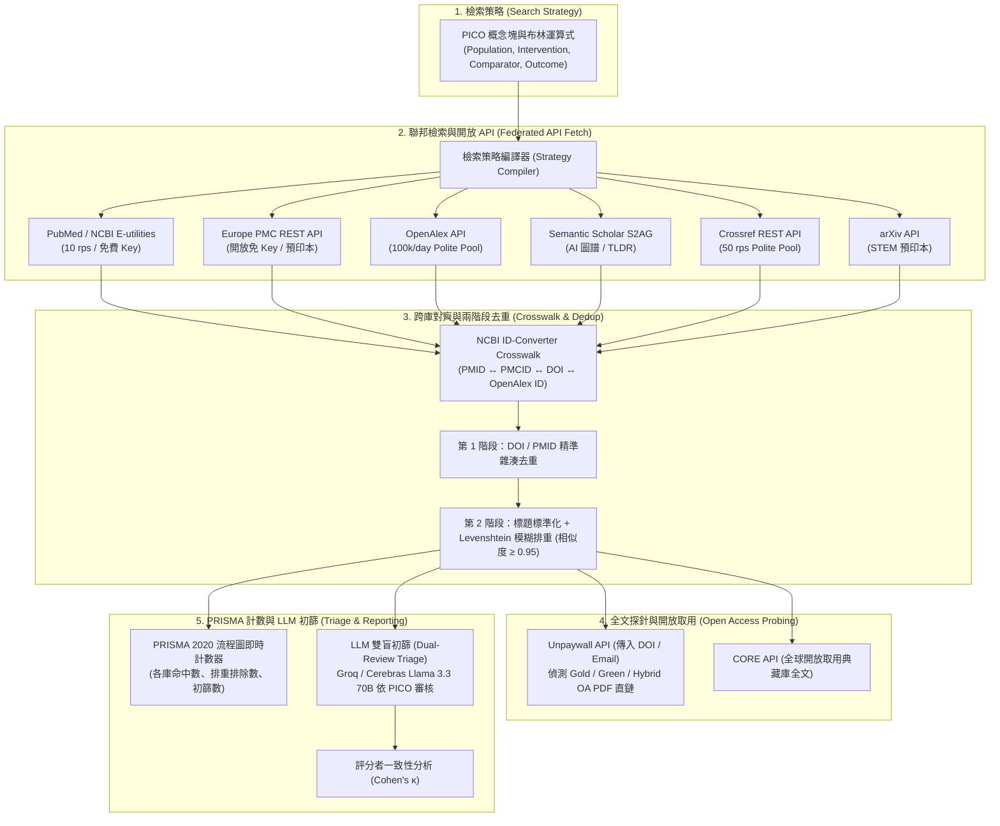

# 學術文獻檢索專用免費資料庫 API 申請全攻略、聯邦架構與自動化管線研究報告

> **本研究報告定位**：專為碩博士研究生、系統性文獻回顧（Systematic Review / Meta-Analysis）研究團隊與學術工具開發者量身打造的**「免費學術文獻資料庫 API 完整指南與自動化工程架構」**。
>
> 報告整合借鏡自作者多項實際開源研究管線（包含 [`matt-ye/lit-search-worker`](https://github.com/matt-ye/lit-search-worker)、[`matt-ye/brain-exposome`](https://github.com/matt-ye/brain-exposome) 與 [`matt-ye/Meta_Analysis_Pipeline`](https://github.com/matt-ye/Meta_Analysis_Pipeline)）之實戰工程經驗。全面梳理全球 **8 大權威開放學術文獻 API** 的申請來源、認證方式、頻率限制與檢索技巧，並深入解析現代**「聯邦多庫檢索（Federated Search） $\to$ 跨庫 ID 映射 $\to$ 兩階段去重 $\to$ PRISMA 2020 自動統計 $\to$ LLM 雙盲初篩」**之自動化管線實踐。

---

## 1. 執行摘要與現代文獻檢索自動化架構

在傳統醫學、生物資訊、公共衛生與跨領域工程的系統性文獻回顧中，研究人員常面臨三大痛點：
1. **人工跨庫查詢耗時**：需逐一手動在 PubMed、Embase、Web of Science 輸入繁複的布林檢索式並手動匯出 RIS 檔案。
2. **跨庫去重極度繁瑣**：各資料庫中繼資料欄位不一（有的缺 DOI、有的缺 PMID、期刊縮寫各異），容易造成重複論文漏排或誤刪。
3. **商業資料庫無免費 API**：Web of Science、Scopus、Embase 採高昂機構訂閱制且嚴格限制自動化抓取。

本研究提出的**「現代開放學術文獻自動化架構」**，完全基於全球合規的開放資料庫 API 與開源工程模式，形成完整的閉環流水線：



---

## 2. 全球 8 大開放學術文獻資料庫 API 深度解析

| 資料庫 / API 服務 | 官方申請入口 | 認證方式與門檻 | 免費額度與速率限制 | 核心領域與資料規模 | 亮點功能 |
|---|---|:---:|---|---|---|
| **1. PubMed / NCBI E-utilities** | [ncbi.nlm.nih.gov/account](https://www.ncbi.nlm.nih.gov/account/) | 免費申請 API Key | • 無 Key: 3 requests/sec<br>• 有 Key: **10 requests/sec** | 生物醫學、臨床、公衛<br>(> 3,600 萬篇文獻) | MeSH 主題詞檢索、PubTator3 實體標註、PubMed Central 全文關聯。 |
| **2. Europe PMC REST API** | [europepmc.org](https://europepmc.org/RestfulWebService) | **完全免 Key 開放** | • 建議 $\le 10$ requests/sec<br>• 無每日總量上限 | 生物醫學、生命科學、歐洲專利、預印本 | 整合 bioRxiv/medRxiv 預印本、研究資助金（Grants/Funders）連結。 |
| **3. OpenAlex API** | [openalex.org](https://openalex.org/) | 帶 Email 進禮貌池 | • **每日 100,000 次**<br>• 10 requests/sec | 全學科綜合學術圖譜<br>(> 2.5 億篇論文) | 微軟學術圖譜（MAG）後繼者，論文、學者、機構與概念完整關聯圖譜。 |
| **4. Semantic Scholar (S2AG)** | [semanticscholar.org/product/api](https://www.semanticscholar.org/product/api) | 免費申請 API Key | • 無 Key: 1 request/sec<br>• 有 Key: 享受高併發頻寬 | 全學科、電腦科學、生醫<br>(> 2 億篇文獻) | AI 生成單句摘要（TLDR）、高影響力引用（Influential Citations）判定。 |
| **5. Crossref REST API** | [crossref.org](https://api.crossref.org/) | 帶 Email 進禮貌池 | • 禮貌池最高 **50 requests/sec**<br>• 無每日限額 | 全學科 DOI 註冊出版品<br>(> 1.5 億筆中繼資料) | 全球所有 DOI 權威發源地，參考文獻清單（References）與出資單位資訊。 |
| **6. CORE API** | [core.ac.uk/services/api](https://core.ac.uk/services/api) | 免費註冊 API Key | • 免費開發者配額<br>• 支援即時批次查詢 | 全球開放取用論文全文<br>(> 3,400 萬篇全文) | 全球數千所大學機構典藏（IR）全文聚合器，可直接取得純文字與 PDF。 |
| **7. Unpaywall API** | [unpaywall.org/products/api](https://unpaywall.org/products/api) | 傳入 Email 參數 | • 建議 $\le 100,000$ 次/日<br>• 10 requests/sec | 全球合法 Open Access 論文<br>(> 5,000 萬篇 OA 全文) | 傳入 DOI 立即回傳合法 PDF 直鏈，精準區分 Gold、Green、Hybrid OA。 |
| **8. arXiv API** | [arxiv.org/help/api](https://arxiv.org/help/api) | **完全免 Key 開放** | • 建議每 3 秒 1 次請求<br>• 避免高併發突發 | 物理、數學、資訊科學、AI<br>(> 240 萬篇預印本) | 全球頂尖 AI 與資訊領域前沿預印本，支援複雜分類號檢索。 |

---

## 3. 各資料庫詳細申請步驟與程式碼範例

### 3.1 PubMed / NCBI E-utilities API
- **官方申請入口**：[https://www.ncbi.nlm.nih.gov/account/](https://www.ncbi.nlm.nih.gov/account/)
- **申請步驟**：
  1. 註冊並登入 NCBI 帳號（支援 Google 或第三方帳號登入）。
  2. 進入 **Account Settings** $\to$ 下拉至 **API Key Management**。
  3. 點擊 **Create an API Key**，立即取得一組 36 字元的 API Key。
- **Python 檢索與抓取範例**：
  ```python
  import requests

  NCBI_API_KEY = "your_ncbi_api_key"
  BASE_URL = "https://eutils.ncbi.nlm.nih.gov/entrez/eutils"

  # 1. 搜尋取得 PMID 清單
  search_params = {
      "db": "pubmed",
      "term": "(dementia[Title/Abstract]) AND (air pollution[Title/Abstract])",
      "retmode": "json",
      "retmax": 20,
      "api_key": NCBI_API_KEY
  }
  r = requests.get(f"{BASE_URL}/esearch.fcgi", params=search_params)
  id_list = r.json()["esearchresult"]["idlist"]

  # 2. 批量取得文獻中繼資料
  summary_params = {
      "db": "pubmed",
      "id": ",".join(id_list),
      "retmode": "json",
      "api_key": NCBI_API_KEY
  }
  summary_res = requests.get(f"{BASE_URL}/esummary.fcgi", params=summary_params)
  print(summary_res.json()["result"][id_list[0]]["title"])
  ```

---

### 3.2 Europe PMC REST API
- **官方文檔**：[https://europepmc.org/RestfulWebService](https://europepmc.org/RestfulWebService)
- **特色**：無需註冊任何金鑰，直接發起 HTTP GET 請求。
- **Python 範例**：
  ```python
  import requests

  query = 'TITLE_ABS:"exposome" AND FIRST_PDATE:[2024-01-01 TO 2026-11-04]'
  params = {
      "query": query,
      "format": "json",
      "pageSize": 25,
      "resultType": "core"
  }
  headers = {"User-Agent": "MyAcademicTool/1.0 (mailto:student@ntu.edu.tw)"}
  res = requests.get("https://www.ebi.ac.uk/europepmc/webservices/rest/search", params=params, headers=headers)
  papers = res.json()["resultList"]["result"]
  for p in papers:
      print(f"Title: {p['title']} | DOI: {p.get('doi')} | Source: {p.get('source')}")
  ```

---

### 3.3 OpenAlex API
- **官方網站**：[https://openalex.org/](https://openalex.org/)
- **禮貌池（Polite Pool）機制**：
  OpenAlex 採用全球知名的「禮貌池」模式。在發起請求時，只要在 Header 帶入您的真實聯絡 Email，系統會自動將您的連線路由至高速獨立伺服器集群，享有每日 **100,000 次** 請求配額與 **10 requests/sec** 的超高頻寬。
- **Python 範例**：
  ```python
  import requests

  headers = {"User-Agent": "mailto:myresearch@ntu.edu.tw"}
  # 檢索 2024 年後失智症與環境暴露之高引論文
  url = "https://api.openalex.org/works?filter=title_and_abstract.search:dementia exposome,publication_year:>2023&sort=cited_by_count:desc"

  res = requests.get(url, headers=headers)
  data = res.json()
  for work in data["results"][:5]:
      print(f"{work['title']} (Cited by: {work['cited_by_count']}) -> {work['doi']}")
  ```

---

### 3.4 Semantic Scholar Academic Graph (S2AG) API
- **官方申請入口**：[https://www.semanticscholar.org/product/api](https://www.semanticscholar.org/product/api)
- **申請步驟**：
  1. 點擊 **Apply for an API Key** 填寫學術專案簡述與預估調用量。
  2. 審核通過後即可獲得 API Key。
- **Python 呼叫範例（取得論文 AI 單句總結 TLDR）**：
  ```python
  import requests

  headers = {"x-api-key": "your_s2_api_key"}
  paper_id = "DOI:10.1038/s41586-020-2649-2"
  url = f"https://api.semanticscholar.org/graph/v1/paper/{paper_id}?fields=title,tldr,influentialCitationCount,citationCount"

  res = requests.get(url, headers=headers)
  paper = res.json()
  print("TLDR 摘要:", paper.get("tldr", {}).get("text"))
  print("高影響力引用數:", paper.get("influentialCitationCount"))
  ```

---

### 3.5 Crossref REST API
- **官方網站**：[https://api.crossref.org/](https://api.crossref.org/)
- **使用規範**：在 User-Agent 帶入 `mailto:student@ntu.edu.tw` 即可進入 Polite Pool（上限高達 50 rps）。
- **Python 範例（依 DOI 解析權威期刊刊名、刊期與文獻出資機構）**：
  ```python
  import requests

  headers = {"User-Agent": "LiteratureWorker/1.0 (mailto:student@ntu.edu.tw)"}
  doi = "10.1016/j.envint.2023.108123"
  res = requests.get(f"https://api.crossref.org/works/{doi}", headers=headers)
  message = res.json()["message"]

  print("期刊名稱:", message.get("container-title", [""])[0])
  print("出版年份:", message.get("created", {}).get("date-parts", [[None]])[0][0])
  print("資助單位:", [f.get("name") for f in message.get("funder", [])])
  ```

---

### 3.6 Unpaywall API（合法 Open Access 全文直取）
- **官方網站**：[https://unpaywall.org/products/api](https://unpaywall.org/products/api)
- **使用方法**：傳入任一論文 DOI，即可判別是否有出版商 Gold OA、機構典藏庫 Green OA 等合法免費 PDF。
- **Python 範例**：
  ```python
  import requests

  doi = "10.1038/nature12373"
  email = "student@ntu.edu.tw"
  url = f"https://api.unpaywall.org/v2/{doi}?email={email}"

  res = requests.get(url)
  data = res.json()
  if data.get("is_oa"):
      best_oa = data.get("best_oa_location", {})
      print(f"發現合法免費全文 ({best_oa.get('oa_date')})!")
      print("PDF 直接下載網址:", best_oa.get("url_for_pdf"))
  else:
      print("該論文為付費訂閱制（Paywalled），需經由校園圖書館代理訪問。")
  ```

---

## 4. 自動化文獻檢索工程管線之 5 大實踐模式（借鏡 `lit-search-worker`）

在作者團隊維運之 [`lit-search-worker`](https://github.com/matt-ye/lit-search-worker) 與 [`brain-exposome`](https://github.com/matt-ye/brain-exposome) 實務架構中，提煉出以下 5 項核心工程模式：

### 4.1 聯邦檢索策略編譯器 (Strategy Compiler)
文獻回顧的檢索詞往往遵循 PICO 結構。在程式碼中，切勿手動為每個資料庫維護獨立字串，而應定義結構化的詞彙矩陣，並由編譯函數自動渲染：
```javascript
// 範例：聯邦檢索詞組結構
const strategy = {
  concepts: {
    exposure: ["exposome", "air pollution", "heavy metals", "particulate matter"],
    outcome: ["dementia", "Alzheimer disease", "cognitive decline"]
  }
};

// 自動編譯為 PubMed 語法
function compilePubMed(strat) {
  const expStr = strat.concepts.exposure.map(t => `"${t}"[tiab]`).join(" OR ");
  const outStr = strat.concepts.outcome.map(t => `"${t}"[tiab]`).join(" OR ");
  return `(${expStr}) AND (${outStr})`;
}
```

### 4.2 跨庫 ID 映射對齊 (NCBI ID-Converter Crosswalk)
不同資料庫返回的識別碼不一（PubMed 給予 PMID、Europe PMC 給予 PMCID、Crossref 給予 DOI、OpenAlex 給予 Work ID）。
- **解法**：在資料擷取後第一時間調用 NCBI ID-Converter API（`https://www.ncbi.nlm.nih.gov/pmc/utils/idconv/v1.0/`），一次性補齊 `PMID <-> PMCID <-> DOI`，為後續去重建立黃金索引。

### 4.3 兩階段嚴格去重演算法 (Hybrid Deduplication)
1. **第 1 階段（精準 DOI / PMID 去重）**：
   - 將 DOI 轉為全小寫並剔除 URL 前綴（如 `https://doi.org/`）。
   - 以雜湊表（Hash Set）記錄已出現的 DOI 與 PMID。
2. **第 2 階段（標題標準化模糊去重）**：
   - 針對未提供 DOI 的文獻，進行標題清洗：轉小寫、移除標點符號、移除開頭的冠詞（`a`, `an`, `the`）。
   - 採用 **Levenshtein 編輯距離比率** 或 **Jaro-Winkler 演算法**，若兩篇文獻出版年份相同且標題相似度 $\ge 0.95$，判定為重複文獻並合併來源標記（Provenance）。

### 4.4 PRISMA 2020 流程圖統計數據自動化
系統性文獻回顧必須報告 PRISMA 流程。管線在執行過程中即時記錄各階段數字：
- **Identification**：$N_{\text{PubMed}} + N_{\text{EPMC}} + N_{\text{OpenAlex}} = \text{Total Identified}$。
- **Deduplication**：經跨庫 ID 映射與模糊比對後，排除 $N_{\text{duplicates}}$ 筆重複文獻。
- **Screening**：標題與摘要初篩納入與排除筆數。
- **Included**：最終進入統合分析之研究總數。

### 4.5 LLM 輔助文獻雙盲初篩 (Dual-Review Triage)
利用極速推論供應商（如 Groq 或 Cerebras 之 Llama 3.3 70B）模擬第二審查員角色：
- **PICO 評判 Prompt 設計**：
  明確定義「納入準則（Inclusion）」與「排除準則（Exclusion）」，要求模型以嚴格 JSON 格式輸出：
  ```json
  {
    "decision": "include", // "include" | "exclude" | "uncertain"
    "reason": "Study evaluates PM2.5 exposure and Alzheimer incidence in elderly population.",
    "pico_match": {"population": true, "exposure": true, "outcome": true}
  }
  ```
- **評分者信度分析（Cohen's $\kappa$）**：
  定期比對人工初篩與模型初篩的一致性係數（$\kappa \ge 0.80$ 代表極佳一致性），確保文獻篩選兼顧速度與方法學嚴謹性。

---

## 5. 商業付費資料庫（WoS / Scopus / Embase）之邊界與處置

在進行跨領域或醫學頂級系統性回顧時，許多學會指引（如 Cochrane Handbook）仍建議納入 Embase 或 Web of Science。但此類資料庫**完全沒有對一般學生與研究人員開放免費公開 API**。

### 推薦之混合管線模式（Hybrid Workflow）：
1. **開放 API 臂（Automated Arm）**：
   PubMed、Europe PMC、OpenAlex、arXiv 走全自動排程 API 檢索與增量監控。
2. **商業付費手動臂（Manual PRISMA Arm）**：
   - 利用學校圖書館之校園 IP / VPN 代理，在 Web of Science / Embase 介面貼上相同的檢索式。
   - 一鍵匯出標準 `.ris` 或 `.bib` 檔案（例如 `embase_export.ris`）。
   - 將匯出檔放入專案 `data/manual_arms/` 目錄中，由自動化腳本直接讀取、解析並自動合併進主去重與 PRISMA 統計隊列中。

此架構既保護了研究團隊免於違反商業資料庫之爬蟲服務條款（ToS），又保證了文獻檢索的完整性與重現性（Reproducibility）。

---

## 6. 總結與開源資源清單

| 工具 / 函式庫 | 語言 / 技術 | 用途說明 |
|---|---|---|
| [`matt-ye/lit-search-worker`](https://github.com/matt-ye/lit-search-worker) | Cloudflare Worker / JS | 聯邦文獻檢索、NCBI ID 對齊、PRISMA 計數與 LLM 篩選工作節點。 |
| [`matt-ye/brain-exposome`](https://github.com/matt-ye/brain-exposome) | Python / SvelteKit | 失智症環境暴露因子文獻雷達、中繼資料抓取與結構化展示。 |
| `Biopython (Bio.Entrez)` | Python | 官方認證之 PubMed / NCBI E-utilities 高階包裝函式庫。 |
| `pyalex` | Python | 官方社群推薦之 OpenAlex 高效 Python 客戶端。 |
| `habanero` | Python | Crossref REST API 官方推薦 Python 客戶端。 |

善用免費開放學術 API 與現代化資料工程架構，每位研究生都能以零雲端成本建構專屬的頂級「文獻雷達」與「自動化系統性回顧工作站」！
