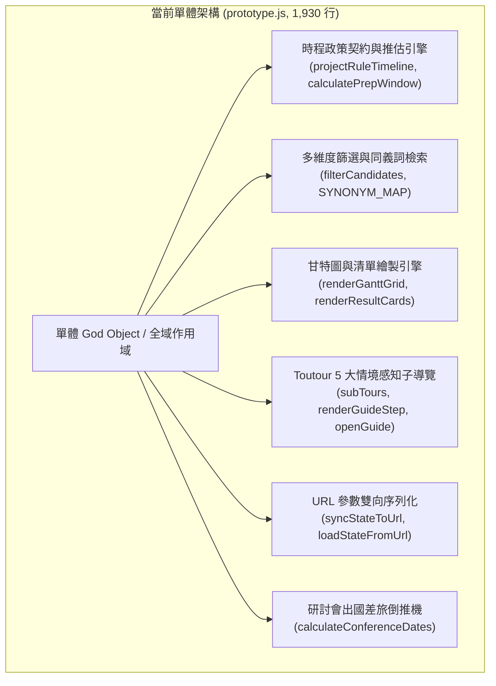
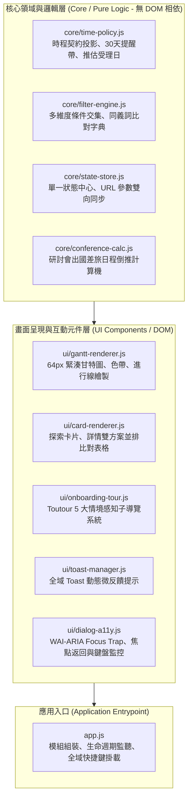
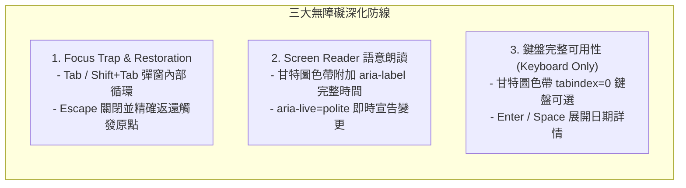
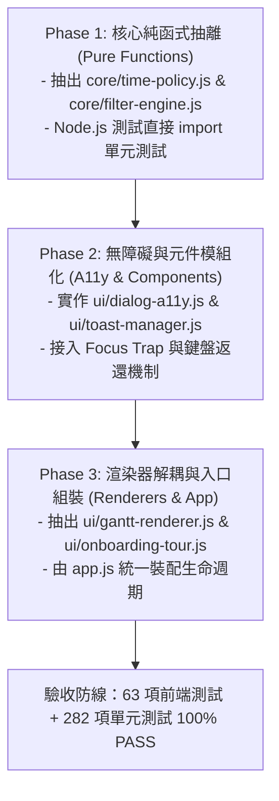

# OpenGSA 前端核心架構模組化與無障礙體驗深化規劃 (Frontend Modularization & A11y Deepening)

> **文檔定位**：本規劃書記錄 OpenGSA 前端核心程式碼由單體式腳本（Monolithic Script）走向模組化（ES Modules）、高內聚低耦合架構，以及全站深化無障礙標準（WCAG 2.1 AA / Focus Trap / Screen Reader）的完整重構藍圖。依據使用者決策，先行規劃技術契約與漸進遷移路線，確保靜態發布零依賴優勢與現有 63 項測試防線 100% 穩定。

---

## 1. 現狀診斷與重構動機 (Current State & Architectural Pain Points)

截至 PR #69，OpenGSA 的前端互動由 [`docs/design/prototype.js`](file:///c:/Users/wiwi4/OneDrive/文件/ChatGPT/開源專案/opengsa/docs/design/prototype.js) 單一檔案承載，總長已達 **1,930 行**。雖然具備無外部相依、輕量高效的優點，但伴隨專案功能演進已浮現以下架構壞味道（Code Smells）：



### 具體架構痛點：
1. **職責邊界模糊（God Object）**：
   - 計算邏輯（純函式 Pure Function，如時程起訖推估、Levenshtein 同義詞加權）與 DOM 繪製（甘特圖網格拼接、HTML 字串注入）交織在同一檔案。
2. **狀態集中但缺乏單向資料流（Scattered State）**：
   - `currentMode`, `currentTab`, `picks`, `filters`, `activeTourKey` 等全域變數自由散佈，任一事件均可直接修改全域狀態，追蹤狀態異動成本高。
3. **測試與隔離難度漸增**：
   - 現行 `tests/prototype.test.cjs` 必須在 Node.js 中藉由正則表達式提取特定函式原始碼，或模擬大量 DOM 樹才能進行測試，無法直接對核心演算法進行輕量單元測試。
4. **無障礙體驗（A11y）尚有細部死角**：
   - 彈窗（如 `#guide-dialog`、`#rss-dialog`）開啟時缺乏焦點陷阱（Focus Trap），鍵盤使用者 `Tab` 鍵容易遊走至背景元素。
   - 彈窗關閉後焦點未精準返還給觸發按鈕（Focus Restoration）。
   - 甘特圖色帶與進度條缺少動態 `aria-live` 與無障礙文字描述。

---

## 2. 模組化職責邊界設計 (Modular Architecture Blueprint)

堅持 **公民科技輕量化（Zero Bundler Overhead）** 原則，採用現代瀏覽器原生支援之 **ES Modules（`<script type="module">`）**，**不引入** Webpack、Vite 或複雜的 node_modules 打包鏈，保持 GitHub Pages 純靜態即時發布優勢。



### 模組目錄結構規劃：
```text
docs/design/
├── js/
│   ├── core/
│   │   ├── time-policy.js       # 時程契約、推估起日、30天提醒帶計算 (Pure)
│   │   ├── filter-engine.js     # 多維度篩選、同義詞比對、身分交集邏輯 (Pure)
│   │   ├── state-store.js       # 全域反應式狀態中心、URL 雙向同步 (State)
│   │   └── conference-calc.js   # 研討會出國差旅倒推計算機 (Pure)
│   ├── ui/
│   │   ├── gantt-renderer.js    # 64px 緊湊甘特圖、色帶、進行線繪製 (DOM)
│   │   ├── card-renderer.js     # 探索卡片、詳情雙方案並排比對 (DOM)
│   │   ├── onboarding-tour.js   # Toutour 5 大情境感知子導覽核心 (Tour)
│   │   ├── toast-manager.js     # 全域 Toast 動態微反饋 (UI Component)
│   │   └── dialog-a11y.js       # WAI-ARIA Focus Trap、鍵盤導引 (A11y)
│   └── app.js                   # 入口腳本，裝配各模組與生命週期事件
├── prototype.js                 # 向下相容整合封裝層（過渡期相容現有測試）
└── wireframes.html              # 引入 app.js (<script type="module" src="js/app.js">)
```

---

## 3. 無障礙（A11y）深化規格 (Accessibility Deepening Standard)

全面對標 **W3C WCAG 2.1 AA** 標準，落實三大無障礙防線：



### 1. 對話框焦點陷阱與返還（Focus Trap & Restoration）
- **實作模組**：`ui/dialog-a11y.js`
- **機制設計**：
  ```javascript
  // 啟動對話框時記住觸發按鈕
  function trapFocus(dialogElement, triggerElement) {
    const focusable = dialogElement.querySelectorAll(
      'button:not([disabled]), [href], input:not([disabled]), select:not([disabled]), [tabindex="0"]'
    );
    const firstFocusable = focusable[0];
    const lastFocusable = focusable[focusable.length - 1];
    
    // 開啟時立即將焦點置於第一個元件
    firstFocusable.focus();

    dialogElement.addEventListener('keydown', (e) => {
      if (e.key === 'Tab') {
        if (e.shiftKey && document.activeElement === firstFocusable) {
          e.preventDefault();
          lastFocusable.focus();
        } else if (!e.shiftKey && document.activeElement === lastFocusable) {
          e.preventDefault();
          firstFocusable.focus();
        }
      } else if (e.key === 'Escape') {
        closeDialog(dialogElement, triggerElement);
      }
    });
  }

  function closeDialog(dialogElement, triggerElement) {
    dialogElement.close();
    // 關閉後精確返還焦點至觸發按鈕
    if (triggerElement && typeof triggerElement.focus === 'function') {
      triggerElement.focus();
    }
  }
  ```

### 2. 螢幕閱讀器與 ARIA 動態區域（Screen Reader Announcements）
- **甘特圖視覺色帶轉無障礙可讀文本**：
  - 既有甘特圖僅以視覺顏色區分「受理期」、「30天準備期」、「推估日」；
  - 重構後為每條甘特圖色帶注入語意化屬性：
    `aria-label="國科會博士生獎學金：官方受理期自 2026年6月1日至7月15日，距離截止尚有 24 天"`。
- **動態狀態朗讀（`aria-live="polite"`）**：
  - 篩選結果變更：`#result-count` 即時播報「已篩選出 12 項方案」。
  - 跨頁收藏：`#global-toast` 即時播報「已成功將 國科會博士生獎學金 加入個人時程」。
  - 備件待辦進度：`#plan-progress` 播報「目前已完成 3 項，共 8 項待辦」。

### 3. 全站純鍵盤操作閉環（Keyboard-Only Navigation）
- 甘特圖中之每一個方案色帶與時間節點均設置 `tabindex="0"` 與 `role="button"`。
- 支援方向鍵或 Tab 遍歷色帶，按下 `Enter` 或 `Space` 即刻跳轉至第二頁方案詳情。

---

## 4. 漸進式重構遷移路徑 (Incremental Migration Roadmap)

為避免大規模重構造成現有功能退化（Regression），採用三階段漸進式切換策略：



### 階段里程碑：
- **Phase 1（核心純邏輯抽離）**：
  - 目標：將時程計算與篩選比對抽離為無副作用（Side-effect free）的純模組。
  - 優勢：前端測試框架可直接對 `core/*.js` 進行毫秒級的純演算法測試，無需 mock DOM。
- **Phase 2（無障礙加固與元件解耦）**：
  - 目標：引入 `ui/dialog-a11y.js`，解決 Focus Trap 與 Esc 返還問題。
  - 優勢：全面通過 Lighthouse A11y 審查與螢幕閱讀器測試。
- **Phase 3（渲染器解耦與入口組裝）**：
  - 目標：拆分甘特圖繪製、卡片渲染與 Toutour 導覽，建立 `app.js` 入口。
  - 封裝相容層：`prototype.js` 作為外觀模式（Facade），同時將 API 掛載於 `window.OpenGSA`，確保既有整合測試零修改。

---

## 5. 向下相容保證與驗收矩陣 (Compatibility & Acceptance Gates)

| 驗收面向 | 驗收標準 | 檢驗方式 |
| :--- | :--- | :--- |
| **靜態部署相容性** | 零建置工具，純靜態 ES Modules 可於 GitHub Pages 正常載入執行 | 預覽站 Chrome/Safari/Firefox 實機驗證 |
| **現有測試防線** | 現有 63 項前端測試 100% 通過（`node --test tests/prototype.test.cjs`） | 測試腳本直接運行，0 失敗 |
| **無障礙 Focus Trap** | 開啟指南或訂閱彈窗時，Tab 鍵受限於對話框內；Esc 關閉後焦點返還原按鈕 | 鍵盤實機操作測試與 DOM 事件斷言 |
| **正式台帳純淨** | 正式台帳檔案與候選資料 0 異動 | `git diff data/` 為空 |
| **效能不退化** | 首頁載入時間與甘特圖渲染時間保持在 $\le 50\text{ms}$ | 瀏覽器 Performance Profiler |
