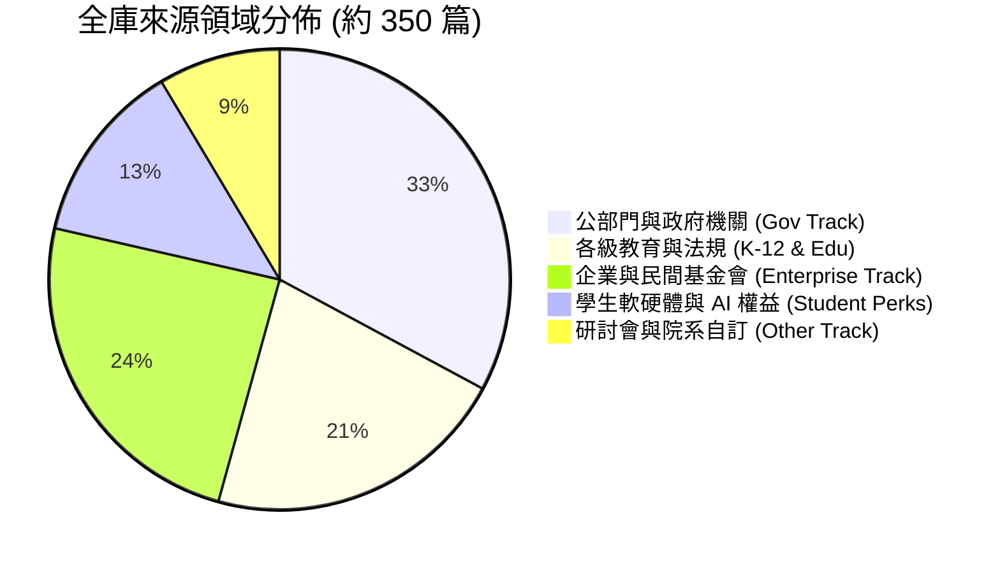
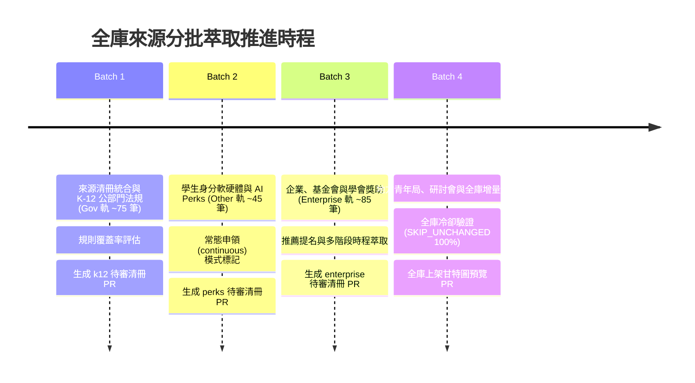

# 全庫 300–400 篇來源萃取架構與分批推進執行規劃

> **版本**：v1.0 (2026-11-04)  
> **基底狀態**：PR #45～#49（Step 1～5）已全數合併至 `feat/temporal-reextraction`，核心時間推導、增量比對閘門、Actions 長時續傳快取與 8 組 API 備援池已驗證完畢。  
> **目標**：在嚴守「來源不猜測、無真人授權不代填、排程預設關閉模型、嚴格 HTTP/Robots 限制」的前提下，規劃並執行全庫約 320～380 篇多軌來源之批次萃取與結構化投影。

---

## 一、 全庫來源規模與結構盤點

經過各專案分支與調研成果（PR #21、#32、#41、#43 等）之交叉盤點，全庫來源共計 **320～380 篇**，劃分為五大核心集群：



| 來源集群 | 來源數量預估 | 典型代表案例 | 適用軌道 (`track`) | 授權與證據模式 (`evidence_mode`) |
| :--- | :---: | :--- | :---: | :---: |
| **1. 既有已核與高等教育來源** | 64 筆（已 100% 重萃完成） | 國科會博士生獎學金、教育部留學獎學金、臺大各學院獎助、中研院獎補助 | `gov` / `enterprise` / `other` | `hash_only` (教務處等) / `short_excerpt` |
| **2. K-12 各級教育與清寒扶助** | 70～80 筆 | 幼兒就學補助、高中職全面免學費、學產基金低收獎助、總統教育獎、各縣市清寒學生扶助 | `gov` | `short_excerpt` (主管法規多為公開轉載) |
| **3. 學生身分軟硬體與 AI Perks** | 40～50 筆 | GitHub Copilot / Student Pack、Azure for Students、AWS Educate、JetBrains、Apple 教育價、Figma | `other` | `short_excerpt` (商業條款公開宣告) |
| **4. 企業、文教基金會與專業學會** | 80～95 筆 | 台積電博士獎學金、鴻海獎學鯨、元大優秀人才、Google PhD Fellowship、NVIDIA Graduate Fellowship | `enterprise` | `short_excerpt` (民間官網公開公告) |
| **5. 地方政府創新與研討會補助** | 30～40 筆 | 新北市青年局 AI 職涯營、臺北市青年局工具補助、FAOS 研討會、各大學國際會議補助 | `other` | `short_excerpt` / `hash_only` |

---

## 二、 萃取執行架構與核心防護管線

全庫萃取延續 Step 1～Step 5 打造之**三軌分流＋三層閘門＋雙軌萃取＋斷點續傳**架構：

```mermaid
flowchart TD
    subgraph INTAKE["1. 來源排程與分流 (Scheduler & Dispatcher)"]
        S1["全庫待萃來源佇列 (~350 URLs)"] --> S2{"軌道排程路由 (3-Track Routing)"}
        S2 -->|週二/五| T_GOV["Gov 軌 (公部門/K-12/法規)"]
        S2 -->|週一/四| T_ENT["Enterprise 軌 (企業/基金會/學會)"]
        S2 -->|週三/六| T_OTH["Other 軌 (AI Perks/研討會/院系)"]
    end

    subgraph GATE["2. 三層增量比對閘門 (3-Stage Incremental Diff Gate)"]
        T_GOV & T_ENT & T_OTH --> G1{"Gate 1: 候選人指紋<br>Candidate SHA256 變動?"}
        G1 -->|否| G2{"Gate 2: 網頁內容雜湊<br>Raw SHA256 變動?"}
        G1 -->|是| RUN_NEW["RUN_NEW: 全新或變更候選"]
        G2 -->|未變動且已完成| SKIP["SKIP_UNCHANGED: 0 HTTP / 0 Token 冷卻"]
        G2 -->|變動或待補| G3{"Gate 3: Chunk 快取與冷卻<br>undetermined_subkind + parser_sha256"}
        G3 -->|冷卻中| SKIP
        G3 -->|需執行| RUN_BATCH["RUN_BACKFILL / RUN_REFINEMENT"]
    end

    subgraph ENGINE["3. 雙軌雙層萃取引擎 (Dual Extraction Engine)"]
        RUN_NEW & RUN_BATCH --> P1["Stage 1: 規則優先確定性解析 (Deterministic Parser)"]
        P1 --> P2{"是否完全解析成日曆/規則?"}
        P2 -->|成功| OUT["輸出規範政策 (Time Policy)"]
        P2 -->|多區塊/長篇PDF/未收斂| P3{"是否啟用手動模型備援?<br>(model_mode=fallback/force)"}
        P3 -->|否 (預設排程)| COOLDOWN["標註 undetermined_subkind 進入冷卻"]
        P3 -->|是 (手動觸發)| P4["Stage 2: 8組 API 備援池 + 1500-token Micro-Chunks"]
        P4 --> OUT
    end

    subgraph RADAR["4. 甘特圖與雷達投影 (Radar & Gantt Projection)"]
        OUT --> R1["雙重錨定檢核 (星期一致性 + 跨年防護)"]
        R1 --> R2["生成 radar_metadata (certainty: confirmed / inferred)"]
        R2 --> R3["前端甘特圖安全長條 / 制度參考卡 / 截止提醒帶"]
    end
```

---

## 三、 分批實施路線圖（Phased Implementation Roadmap）

為了避免單次任務時間過長觸發 Timeout，並確保每個領域資料都有完整的驗證與審查，全庫萃取規劃為 **四個獨立批次（Four Sprints）**，每批次均採「專屬分支 $\rightarrow$ 微批次驗證 $\rightarrow$ 單元測試 $\rightarrow$ 開立 PR $\rightarrow$ 審查合併」之閉環流程：



### 批次一：來源清冊統合與 K-12 公部門法規萃取（Gov 軌）
- **範圍**：納入 `data/k12-scholarship-sources-baseline.json` 核心 25 方案及中央/地方主管法規，合計約 **75 篇來源**。
- **目標**：
  1. 擴充 `data/scan-sources.json` 來源登記表，設定 `evidence_mode: short_excerpt` 與合法網域白名單。
  2. 運行規則引擎，萃取固定學期時程（如每年 9/1~9/30、2/15~3/15）與法定免學費制度參考卡（`reference`）。
  3. 驗證學產基金、特殊教育、原住民族與少子女化等跨部會方案之不重複請領規則。
- **產出**：開立 PR，交付 `data/candidates/source-review.json` 增量候選與批次稽核報表。

### 批次二：學生身分軟硬體、硬體折扣與 AI Perks 萃取（Other 軌）
- **範圍**：納入 `data/student-perks-baseline.json` 核心 28 方案，合計約 **45 篇來源**。
- **目標**：
  1. 運用已擴充的常態受理規則（`continuous`），解析 GitHub Copilot、Azure $100、AWS Educate、JetBrains、Figma 等常年開放方案。
  2. 處理週期性教育折扣（如 Apple BTS 每年 7~9 月返校季促銷）。
  3. 確保無日期限制方案不偽造日曆座標，正確標註「常年受理；額度與在學身分依官方審查」。
- **產出**：開立 PR，交付學生軟硬體福利候選與時程映射。

### 批次三：企業、文教基金會與專業學會獎助萃取（Enterprise 軌）
- **範圍**：台積電、鴻海、元大、中研院、Google、NVIDIA 等民間代表性獎學金，合計約 **85 篇來源**。
- **目標**：
  1. 處理「學校推薦／學院提名」（`procedure_only`）與「學生直接申辦」之角色分離。
  2. 解析多附件 PDF 簡章（利用 Step 3 實作的同網域 Attachment Map-Reduce）。
  3. 針對未載明確起日者，套用已驗證的雙重錨定（`dual_anchored`）或 30 天準備提醒帶（`deadline_only`）。
- **產出**：開立 PR，交付企業與基金會候選時程。

### 批次四：地方青年局、研討會與全庫冷卻整合
- **範圍**：地方青年局補助、各大學國際會議差旅補助，並整合全庫 **320～380 篇**來源。
- **目標**：
  1. 執行全庫 3-Stage Incremental Diff 盤點，驗證所有未變更來源 100% 觸發 `SKIP_UNCHANGED`（0 HTTP / 0 Token）。
  2. 針對無法解析之少數來源，產出 `undetermined_subkind` 診斷分類清冊（如條文無日期、需登入系統等）。
  3. 產出全庫甘特圖與雷達綜合預覽。
- **產出**：開立最終整合 PR，提交全庫時程觀測報告。

---

## 四、 執行防護與法律資安規範

全庫萃取嚴格執行下列六大防線：

1. **零竄改正式台帳**：`data/pilot.json` 與人工覆核欄位維持完全鎖定，未獲真人逐筆核可不入正式庫。
2. **HTTP 流量防爆**：單一 micro-batch $\le 8$ URLs / $\le 20$ HTTP，全輪 $\le 200$ HTTP，同站請求間隔 $\ge 3$ 秒。
3. **Robots.txt 嚴格合規**：遇到 `Disallow` 或 403 即刻標註 `robots_denied` / `host_paused`，嚴禁暴力重試。
4. **教務處與受限來源零洩漏**：`hash_only` 來源嚴禁傳入外部模型 API，僅使用本機正則與 Deterministic IR 解析。
5. **推論排程預設關閉**：GitHub Actions 排程維持 `model_mode=off`；僅在本機手動測試時允許調用備援池。
6. **跨平台指紋一致性**：解析器與來源雜湊全面採用 CRLF-normalized 摘要，確保 Windows 本機與 Actions Linux 容器計算結果 100% 一致。
