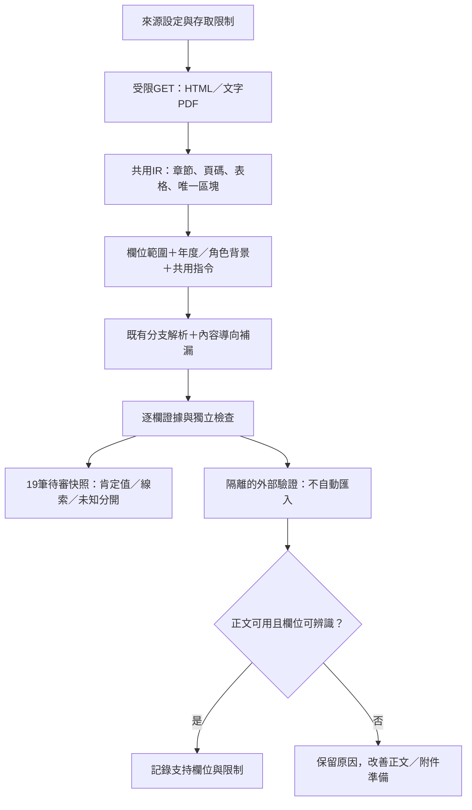

# 通用欄位萃取與外部驗證

2026-11-01：依使用者指示，先改善既有19筆，再以待納入來源作隔離驗證。本輪沒有啟用新的正式排程來源、模型、付費服務或人工核准。本文優先於舊文件的8／11、舊版本與未完成身分萃取描述。

## 19筆的結果

| 項目 | 前版 | 本版 |
|---|---:|---:|
| 可讀對象資訊 | 13 | 19 |
| 其中明標「制度對象線索，非完整資格」 | 0 | 2 |
| 收件／轉送摘要 | 12 | 16 |
| 含已支持的各層日期／相對規則 | 7 | 8 |
| 學生本人的可用時間資訊 | 3 | 3 |
| 自動檢核通過／仍有缺漏 | 8／11 | 12／7 |

19份文件仍是13組方案，不是19個不同獎學金。兩筆對象線索為中研院公告及TA制度HTML；它們可以幫助導流，不能證明完整申請資格或讓清晰度變綠。TA制度PDF有在學學生條文，但未由此推定碩、博士細分。

全部給付列項保留，來源revision及prepared digest一致，原來的受阻附件紀錄保留。國科會全國會議法規已重新萃取正確收件路徑；不再沿用臺大專屬程序。教育部第二梯年度／給付對象、新竹年齡基準、院系實際收件日仍不猜測。

「自動檢核通過」描述Schema、證據等檢查，不是完整資格解析、真人核准或準確率。所有候選仍pending，promotion_ready=false；正式pilot10筆與真人台帳不改。

## 可概化的流程與指令

新增`scripts/semantic_facts.py`，不含來源ID、URL或provider分支，接收同一份document IR：

1. 優先找有申請／在學／就讀等關係的資格條款。排除目的、成績單、薪資級距；PDF只合併同頁短相鄰行，不跨標題、條號、中文／數字子項或表格列。
2. 缺完整條款時，可產生明標的制度對象線索。`identity.claim_kind`區分`eligibility_clause`與`program_descriptor`，不把線索當資格門檻。
3. 依「向／送至／受理／經費由／公告單位」等關係找單位，按角色並列，保留來源refs與逐欄證據。不把所有提到的單位收集成承辦人；個人姓名、電話、email及指令注入不作自動角色證據。未解的「本會／本院」保留原文用語並連來源，不猜獨立網址。
4. 保留學生、學院、機構等不同程序。常態月日只保留規則，不補當年；購買、出國、公布結果及修法日不當受理窗口。角色不明時不指派為學生截止。
5. 已有專屬解析結果不被通用補漏覆蓋；舊的13筆分支解析仍保留。這是共用補漏層，沒有宣稱已移除全部歷史來源規則。
6. 每個新事實回附原區塊與雜湊；單位值及角色、學位詞彙另有檢核，錯誤不因欄位較多而通過。

`semantic_facts.INSTRUCTIONS`同時進入欄位計畫與模型系統指令，規定先辨識年度／分支／角色、保留否定及例外、只輸出有證據欄位。指定範圍仍透過`--group`／`--field`。模型能改寫的欄位仍受現有alias清單與能力／Token門檻限制；本輪身分及單位補漏實際由規則執行，沒有對外模型評測。



## Schema與判斷

學位陣列允許`[]`，表示學位條件尚未辨識，不是「不限」或「不符合」。移除基礎模板預設博士、地方青年補助預設碩博及從薪資級距推定學位的行為。既有判斷器會留下`scheme_degree_rule`缺口；前台將這類篩選列為可能相關，嚴格篩選不當作符合。

FAOS、中研院、兩個AI補助及兩份TA文件，合計6筆沒有肯定的碩博細分；保留可讀資訊，不補造學位。新欄位為向下相容的可選fact屬性，正式pilot仍可沿用原資料。

## 操作與重現

```powershell
# 離線欄位計畫，仍可使用既有局部模式
python scripts/prepare_candidates.py --group eligibility --output-dir work/new-plan

# 演算法修正後明確完整重萃，限一個既有來源
python scripts/prepare_candidates.py --full-replay --source-id nstc-assistant-rule --refresh --output-dir work/new-replay

# 隔離驗證，不寫入來源台帳或正式候選
python scripts/validate_extraction_sources.py --output-dir work/new-validation
python scripts/validate_extraction_sources.py --config docs/examples/extraction-heldout-sources.json --output-dir work/new-heldout
```

`--full-replay`必須取得完整且版本相符的上下文，不沿用人工核准；可修正先前無依據的預設值，與禁止資訊退步的局部修補分開。正文重抓成功不等於附件取得成功，所以保留原附件受阻紀錄。輸出只進全新work目錄，不自動改正式總表。一般新來源仍需人工核對選擇器、資源類型、適用範圍、條款與格式，不能單憑URL自動分類。

## 外部驗證的實際結果

來源都取自既有待納入清單，但未加入正式來源設定或公開19筆：

| 階段 | 來源 | 結果 |
|---|---|---|
| 第一輪未調參驗證 | [國科會人社論文要點](https://law.nstc.gov.tw/LawContent.aspx?id=FL039061) | 可讀取，取得資格摘要與證據；仍有其他欄位缺漏 |
| 第一輪未調參驗證 | [臺大人社論文公告](https://www.aca.ntu.edu.tw/w/aca/GAADNews_26020916123732454) | 可讀取，最初未辨識對象；後改列校準案例，得到制度線索，不補學位 |
| 第一輪未調參驗證 | [秘書室研究生獎勵金PDF](https://sec.ntu.edu.tw/001/Upload/relfile/9760/24895/04-038.pdf) | 可解析文字，最初未辨識對象；後改列校準案例，得到制度線索，不宣稱最新版或當期受理 |
| 第二輪真正未參與調整 | [臺大人事室既有種子](https://www.personnel.ntu.edu.tw/News_n_101162_sms_79140.html) | 正文必要標記不符，不建立候選，不放寬標記混入導覽內容 |
| 第二輪真正未參與調整 | [實踐大學轉知頁](https://rd.usc.edu.tw/p/406-1048-4836,r147.php?Lang=zh-tw) | 可讀取，保留1筆隔離待審候選，但沒有可肯定的資格摘要；需進一步核對正文／附件入口 |

第一輪是1／3有對象摘要；使用其失敗案例改善後重跑為3／3，但新增兩筆只是制度線索，且這已是校準重跑，不能稱作盲測成功率。第二輪兩筆沒有肯定的資格摘要，清楚保留失敗與缺漏，不把「HTTP成功」算「完整萃取成功」。本批數量少、沒有跨全臺人工gold corpus，不能推估全站覆蓋率或模型準確率。

版本為extractor-1.5.0、verifier-1.4.0、prompt-1.3.0；scanner-2／document-ir-2未變。保留逐輪程式／設定雜湊與結果。[機器驗收紀錄](../data/audits/generalizable-extraction-2026-11-01.json)。153項Python、45項Node與Chrome逐筆檢查，不代表來源資訊已由真人核准。

## 下一階段

先處理第二輪暴露的正文標記、轉知頁與附件發現，取得可解析的完整內容後再重萃；不為提高數字而放寬來源檢查。再建立按來源平台、學校、格式分割的人工小樣本，分開評估資格條款、制度線索、單位角色及日期。圖像PDF、跨頁複雜表格、未解別名與新領域來源仍有適應性限制，不宣稱任意網站可全自動完成。
