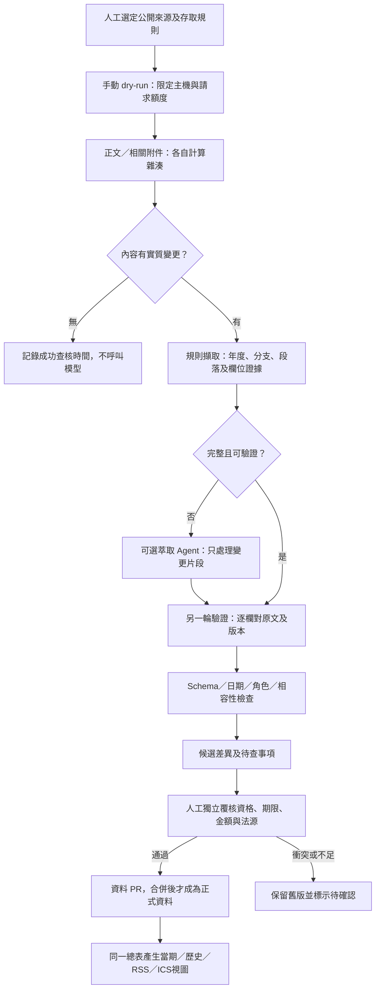

# 首批來源與 Actions／資料萃取設計

2026-10-29後續實作：使用者已要求開始自動爬取，現況以[SCANNER.md](SCANNER.md)為準。本文件以下保留初始設計與尚未完成的完整資料／Agent管線；六頁HTML、允許PDF、有限差異偵測與低頻候選報告已實作，不代表全部階段已完成。

設計版0.1，2026-10-29。使用者已接受v0.6作為MVP介面基礎；v0.7補上固定篩選卡及研討會日期試算。本文件只設計資料管線，尚未建立爬蟲、資料掃描Actions、排程、推論服務或D1。另核可的pages.yml僅做靜態預覽檢查與發布，詳見[部署說明](DEPLOYMENT.md)。

## 先選四組公開來源

| 來源組 | 官方入口／附件發現頁 | 驗證重點 | 建議頻率（未啟用） |
|---|---|---|---|
| 臺大校級博士生獎學金 | [申請明細](https://www.aca.ntu.edu.tw/w/aca/GAADService_21071211271211713)、[一覽頁](https://www.aca.ntu.edu.tw/w/aca/GAADService_24102208484895715) | 同頁有教育部／國科會分支及新舊金額，須拆年度與梯次；一覽頁含圖片，純HTML不足 | 受理期每日，其餘每週 |
| 臺大研究生校長獎 | [教務處](https://www.aca.ntu.edu.tw/w/aca/GAADService_23060908295960368) | 畢業資格、申請年度、辦法與名冊分開；過期公告不代表制度停止 | 每週，受理期每日 |
| 臺大遠學計畫 | [研發處](https://ord.ntu.edu.tw/w/ordntu/GW_20072012192817260) | 一般／配合款／博士後分支、候選人資格、先前國科會申請結果不可混用 | 每週，受理期每日 |
| 國科會研究生國際會議補助＋臺大路徑 | [國科會作業要點](https://law.nstc.gov.tw/LawContent.aspx?id=FL038260)、[臺大程序](https://www.aca.ntu.edu.tw/w/aca/GAADService_21071211044877383) | 事件相對期限、學生／校方送件、接受函補送分開 | 每週；偵測版本異動後覆核 |

這是四組來源，不是四筆機會，也不是四種已完成的爬蟲。先驗證兩種格式：HTML正文與文字型PDF。尚未發現可驗證的公開JSON API或RSS端點，不自行猜網址。FAO登入區維持人工查閱；醫學院著作獎須先取得完整當期公告，暫不列首批自動來源。

可機讀設定草案見[來源登錄表](examples/ingestion-sources.proposed.json)，目前不被應用程式載入。來源責任人仍為空值，robots、條款與自動存取許可待核對；公開可瀏覽不等於已完成爬取合規審查。

## 管線及權限邊界

初版不用常駐Agent。每次變更才啟動有限次萃取及驗證；模型預設關閉。模型不能寫正式資料、變更來源白名單、決定付費備援或自行核定法律適用。第二輪模型驗證不能取代人工獨立覆核。

## 各來源如何擷取

1. **臺大教務處HTML**：初查可用`.article-title`與`.article-center`；先驗證標題及必要標記，再移除導覽／頁尾。`.card-text-info`有巢狀區塊，不能把父子文字重複串接。選擇器只觀察一次，須以離線樣本驗證，零筆匹配或標題改變應停止更新。
2. **臺大研發處HTML**：先按`.card-text-info`區塊及標題拆方案分支，再建立欄位，不把全頁金額合併成單一範圍。頁面目前可見七個區塊，數量不作永久契約。
3. **國科會法規頁**：依完整法規名稱、修正日、發文字號、條款定位；實作時另建條文樣本，不能沿用臺大CSS。法規修正日與擷取日分開，保留歷史版。
4. **文字PDF**：只沿官方正文的相關辦法／當期申請附件取回，逐頁抽字，保留頁碼與短證據。附件URL不變也要獨立檢查內容雜湊；不能只看母頁是否改變。掃描圖、加密檔、超限或空文字轉人工，初版不啟用OCR。
5. **圖片式總覽**：當成發現入口；追至正式明細及附件。若關鍵資訊只在圖片，標示缺漏，不能宣告已完整萃取。

空白正規化可處理換行、全形空格及不換行空格；不可刪掉「不含」「未」「前」「至少」等語義。保留原始位元組雜湊及正文語義雜湊兩者，避免導覽公告輪播造成假更新。遇網頁版型改變時保留先前正式資料，另標示來源待查，不把空解析當成下架。

## 資料、證據與版本

延用[資料契約](DATA-CONTRACT.md)，以下是新增欄位提案，尚未宣稱通過正式Schema：

| 資料層 | 必要內容 | 儲存位置 |
|---|---|---|
| source | 穩定ID、機關及角色、URL／API類型、adapter、附件策略、存取狀態、責任人、頻率 | Git來源登錄表 |
| source_revision | 原URL及最終URL、查核時間、HTTP驗證資訊、正文／附件雜湊、官方版本、parser版本 | 小型Git台帳；高頻執行狀態日後可移D1 |
| candidate | 分支、年度、梯次、申請角色、條件AND／OR、金額／幣別／單位、各層期限、結果日、兼領限制 | PR候選JSON，未合併不公開為正式 |
| evidence | 欄位路徑、來源修訂ID、段落／PDF頁碼、必要短摘錄、擷取方式、缺漏與衝突 | 跟隨候選；不存整份PDF或全文 |
| review | 規則與模型版本、模型用量、驗證結果、編輯及獨立覆核者、待查事項 | PR與資料版本 |

未知用`null`或既有unknown狀態，不填false、不限或0；金額需明示每月／每年／總額、最低／最高／參考／增核。官方未公告結果日就留空；不能把審查需時自行變成保證結果日。

資料主鍵沿用穩定機會ID，年度、梯次、分支及申請路徑分列；來源修訂另有ID。更正同一梯次保留修訂鏈，不覆蓋證據歷史，也不新增成兩個同時開放的機會。當期、截止及歷史視圖由同一總表導出；歷史仍放Git，不另維護一份人工過期表。試點不需要D1，未來若加入D1由Git產生查詢副本，禁止雙邊人工編輯。

## 研討會的事件相對期限

2026-10-29初查：[國科會第4點](https://law.nstc.gov.tw/LawContent.aspx?id=FL038260)規定機構最遲在會議月份之前一個月首日彙送，遇例假日順延次一上班日；接受函未取得可註明補送，至遲會議首日前四週送達。[臺大申請程序第3項](https://www.aca.ntu.edu.tw/w/aca/GAADService_21071211044877383)另要求學生在校方彙送日前一日17:00送出。

建議把規則存為資料，不為每位學生新增一筆獎學金：

| 規則ID | 錨點及運算 | 性質 |
|---|---|---|
| agency_submit | conference_start所屬月，前一月首日；官方工作日曆調整 | 校方彙送，非學生期限 |
| ntu_student_submit | 已校正的agency_submit前一日17:00，Asia/Taipei | 學生送件，院系可能更早 |
| acceptance_supplement | conference_start減28個日曆日 | 接受函補送；不取代原申請 |
| personal_prepare | 學生送件日減自選0–90天 | 個人準備建議，非官方規定 |

原型尚未整合官方工作日曆，因此顯示**未作例假日調整的條文基準試算**，`calendarStatus=unverified`、`deadlineStatus=estimate_pending_calendar`，不得產生正式截止通知。未接獲接受函不等於不能先申請；通知晚於送件及晚於補送各別提示；同一天也不保證趕得及。遇會議首日與補送節點特殊先後關係，並列顯示並請確認承辦流程，不偷偷修正條文。

名稱、會議日、通知日及準備緩衝只留瀏覽器本次記憶體；不進Git、Actions、模型、D1、URL或日誌。不因填日期就判定符合身分或曾獲補助限制。初版先提供一張可收合試算卡；個人多會議管理及ICS等正式規格確認後再做。

## Actions工作拆解（尚未建立workflow）

| 階段 | 觸發／輸入 | 權限與輸出 | 進階門檻 |
|---|---|---|---|
| A：離線驗證 | 本機固定HTML／PDF最小樣本 | 無網路及憑證；候選JSON／差異 | 四來源組各五個案例通過 |
| B：手動dry-run | 未來workflow_dispatch；source_group、dry_run=true、model=false | contents:read；不寫repo、不建PR；短期去識別差異報告 | 確認robots／條款／責任人及費用上限 |
| C：候選PR | 受信任維護者明確啟用；與擷取隔離 | 最小contents:write、pull-requests:write；僅候選分支，禁止自動合併 | 分支保護、人工獨立覆核及來源白名單測試 |
| D：排程 | 後續核可schedule；每日批次依來源next_check_at挑選 | 同一來源不得並行；無變更不產生PR | 連續四週評估漏報、誤報、人工時間及免費額度 |

不在此文件放假裝可執行的runner指令，也不新增資料掃描workflow，以免設計稿被GitHub誤啟用；另核可的Pages發布workflow不執行擷取。未來實作掃描時固定Action版本、禁止不受信任PR取得Secrets、不用pull_request_target執行外部分支程式；網頁及PDF全部視為資料，不能接受其中指令。

實作依[GitHub工作流程語法](https://docs.github.com/en/actions/reference/workflows-and-actions/workflow-syntax)設定permissions、concurrency及timeout；依[官方觸發事件說明](https://docs.github.com/en/actions/reference/workflows-and-actions/events-that-trigger-workflows)檢查workflow_dispatch／schedule預設分支限制及pull_request_target風險。排程可能延遲，不能把Actions當作保證準時的學生通知服務。

初始額度提案：單輪最多20次HTTP（含重新導向、重試、附件）、5份變更文件，每檔PDF最多10MB／50頁，每URL最多2次嘗試、3次重新導向，每主機同時1請求、請求間至少3秒，逾時20秒；429依Retry-After暫停並留待下次，不以額外重試突破總額。重新導向及附件皆須驗證主機白名單；名冊、獲獎名單、登入頁及私人附件不取回。

workflow預計上限10分鐘，同來源用concurrency避免重疊。原始HTML／PDF只在暫存目錄，結束清除，不進Git、cache或長期artifact；候選報告僅存必要短證據且保存7天。無變更時只寫最小成功紀錄。無憑證、額度耗盡、來源故障或驗證不過，一律保留正式資料並交待查，不自動升級付費方案。

第一個POC模型預算為0，先量測不用模型的可擷取比例。之後免費API要另確認條款、資料保留、免費額度與每輪token預算，預設只傳去除個資的變更片段；API key僅從受信任工作環境Secret注入，不列入來源JSON或Git。Workers AI及其他服務都是可替換的備選，此階段不建立CF服務。

## 測試與驗收

第一個資格案例固定為「臺大職能治療所博士班五年級、已取得候選人資格」的合成情境；其他國籍、在職狀態、預計畢業、先前國科會申請結果與會議資料未提供，一律待確認。教育部一至三年級限制適用時判不符；不能連帶排除國科會不同分支。校長獎需確認畢業條件；遠學需確認先前申請結果；會議需確認活動及身分條件，候選人資格本身不等於符合全部方案。

每組至少五個離線樣本：正常、缺關鍵欄位、新舊年度／分支共存、正文或附件改版、來源故障／解析空白。額外覆蓋同URL換PDF、巢狀文字、圖片無字、院系與機關不同期限、日期跨年與閏月、晚接受函、例假日未知、惡意網頁指令、跳轉白名單外及額度耗盡。樣本只保留必要且可授權的去識別片段；不用獲獎名冊作fixture。

- 規則抽取或模型的每個資格、期限、金額均有可回查短證據；欠缺時留空並列待查。
- 無變更不呼叫模型；故障不刪除舊正式資料；附件獨立變更可被發現。
- 任何候選更新都不得跳過人工關鍵欄位覆核或直接覆寫主分支。
- 原型日期計算涵蓋跨年、閏月、未知工作日曆、通知先後及無效輸入，16項原型測試目前通過；這不代表來源adapter已測試。
- 四組來源的離線fixture及Actions實作均尚未完成；本次驗收只交付可審閱設計、機讀登錄表與介面改進。

建議下一個實作順序：先博士獎學金HTML＋一份文字PDF離線adapter，確認逐欄證據；再擴校長獎及遠學；最後接事件相對法規，通過離線案例才做手動dry-run。資料覆核量能確認後再談自動排程與正式發布。
