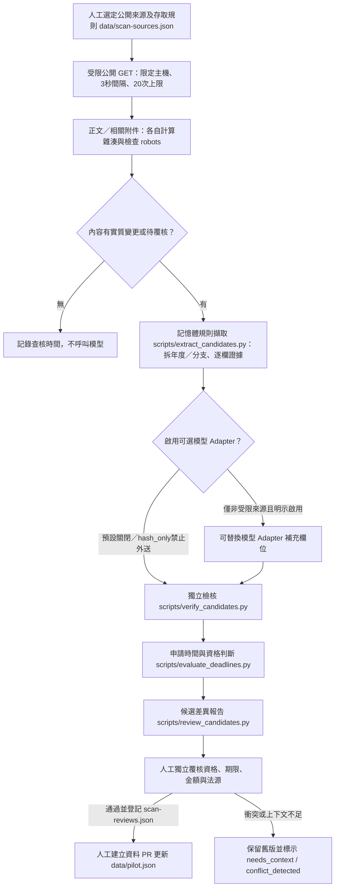

# 首批來源與 Actions／資料萃取設計

2026-10-29後續實作更新：使用者已核可並完成「公開來源低頻掃描 → 有版本候選 Schema (`schema/candidate.schema.json`) → 結構化萃取 (`scripts/extract_candidates.py`) → 獨立檢核 (`scripts/verify_candidates.py`) → 申請時間與資格判斷 (`scripts/evaluate_deadlines.py`) → 候選差異覆核報告 (`scripts/review_candidates.py`)」。現況與操作方式以[SCANNER.md](SCANNER.md)與[DATA-CONTRACT.md](DATA-CONTRACT.md)為準；模型 Adapter 預設關閉，自動開立資料 PR 與 D1 仍維持未啟用，且結構驗證通過或模型輸出不等於官方資格已核定。

設計初版0.1，2026-10-29。使用者已接受v0.6作為MVP介面基礎；v0.7／v0.8補上固定篩選卡及多方案研討會日期試算。另核可的pages.yml僅做靜態預覽檢查與發布，詳見[部署說明](DEPLOYMENT.md)。

## 先選四組公開來源（加 FAOS 擴充為六個公開正文目標）

| 來源組 | 官方入口／附件發現頁 | 驗證重點 | 排程狀態 |
|---|---|---|---|
| 臺大校級博士生獎學金 | [申請明細](https://www.aca.ntu.edu.tw/w/aca/GAADService_21071211271211713)、[一覽頁](https://www.aca.ntu.edu.tw/w/aca/GAADService_24102208484895715) | 同頁有教育部／國科會分支及新舊金額，自動拆分為兩筆獨立候選；教務處採 `hash_only` | 已啟用每週二、五 09:17（臺北）低頻掃描 |
| 臺大研究生校長獎 | [教務處](https://www.aca.ntu.edu.tw/w/aca/GAADService_23060908295960368) | 畢業資格、申請年度、10萬元獎勵、辦法與名冊分開；過期公告標 `closed` 但不當制度停辦 | 已啟用每週二、五 09:17（臺北）低頻掃描 |
| 臺大遠學計畫 | [研發處](https://ord.ntu.edu.tw/w/ordntu/GW_20072012192817260) | 一般／配合款分支、候選人資格、先前國科會申請結果不可混用；`/WebUPD/` 遵守 robots 不下載 | 已啟用每週二、五 09:17（臺北）低頻掃描 |
| 國科會研究生國際會議補助＋臺大路徑＋FAOS | [國科會作業要點](https://law.nstc.gov.tw/LawContent.aspx?id=FL038260)、[臺大程序](https://www.aca.ntu.edu.tw/w/aca/GAADService_21071211044877383)、[FAOS辦法](https://www.faos.org.tw/Application/ApplicatStud.html) | 事件相對期限、學生／校方送件、接受函補送分開；FAOS會前兩個曆月由學校提出，不混用國科會補送 | 已啟用每週二、五 09:17（臺北）低頻掃描 |

FAO登入區維持人工查閱；醫學院國際事務需動態渲染、醫學院著作獎須先取得完整當期公告，暫列 deferred，不假稱已自動爬取。

## 管線及權限邊界（已實作架構）

每次變更在記憶體完成規則萃取與獨立檢核；模型 Adapter 預設關閉 (`DisabledModelAdapter`)。模型不能寫正式資料、變更來源白名單、決定付費備援或自行核定法律適用；檢核器強制忽略模型自稱通過之標記，且第二輪檢核不能取代人工獨立覆核。

## 資料、證據與版本對照

| 資料層 | 實作檔案 | 必要內容与保護機制 |
|---|---|---|
| source | `data/scan-sources.json` | 穩定ID、機關、URL、選擇器、必要標記、附件策略、`evidence_mode` (`hash_only` / `short_excerpt`) |
| source_revision | `work/scanner/state.json`、`work/scanner/report/candidates.json` | 最終URL、查核時間、HTTP驗證資訊、原始與語義雜湊、欄位線索定位 |
| candidate | `schema/candidate.schema.json`、`work/scanner/report/structured-candidates.json` | `1.0.0-candidate`：分支、年度、梯次、申請／受益角色、資格與否定條件、金額／幣別／單位、各層期限、結果日、兼領限制、法規版本 |
| field_evidence | 內嵌於 `structured-candidates.json` | 欄位路徑、來源修訂ID、段落／PDF頁碼、`evidence_mode`、短摘錄（`hash_only` 恆為 `null`）、SHA-256 雜湊、擷取方式 |
| verification & review | `work/scanner/report/review-diff.json`、`review-summary.md`、`data/scan-reviews.json` | 六項獨立檢核結果、學生窗口狀態、P1 比對、與 `pilot.json` 欄位差異、非原編輯者覆核門檻 |

未知用`null`或`unknown`狀態，不填`false`、不限或`0`；金額需明示幣別與單位（`per_month`、`lump_sum`、`total_range` 等）。官方未公告結果日就留 `unknown`；不能把審查需時或論文接受通知日當成補助結果日。

## 研討會的事件相對期限分流

規則由 `scripts/evaluate_deadlines.py` 與前端 `docs/design/prototype.js` 保持一致分流：

| 方案／規則ID | 錨點及運算 | 性質與限制 |
|---|---|---|
| 國科會／臺大 (`nstc-ntu`) | 機構：`conference_start` 前一月首日；臺大學生：機構日前一日 `17:00` (`Asia/Taipei`)；補送：會前 28 天 | 例假日順延尚待官方行事曆校正 (`calendar_status=unverified`)；院系可能更早 |
| 臺大醫學院國際事務 (`ntu-med-intl`) | 學生向國際事務中心送件：`conference_start` 減 28 個日曆日 | 獨立方案與兼領限制，**不得套用國科會事後補送接受函規則** (`acceptance_supplement=null`) |
| 傑出人才發展基金會 (`faos-student`) | 學校負責人向基金會提出：`conference_start` 前兩個曆月（遇月底對齊月末日，非減 60 天） | **學生校內期限留 `unknown`**（須另查學校承辦期限，早於會前兩個月）；無接受函事後補送條款 |
| 自填院系所 (`custom-unit`) | 依使用者自填校內／院系截止日試算 | 維持 `unknown` (`manual_unverified_deadline`)，不冒充官方已核定規則 |

個人準備建議 (`personal_prepare_start`) 恆標記 `is_personal_prepare_official_start = False`，論文接受通知日恆標記 `is_acceptance_notice_official_result = False`。
