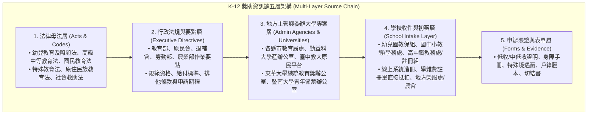

# 臺灣學前幼兒至高級中等教育（K-12）獎助學金全景、多層法源與來源資訊鏈調研報告

> **本文件定位**：針對臺灣教育體系中從**幼兒園（學前教育 2–5 歲）**、**國民小學（6–12 歲）**、**國民中學（12–15 歲）**至**高級中等學校（普通高中、技術型高中／高職、綜合高中、五專前三年 15–18 歲）**之公私立獎助學金、就學費用減免、生活扶助金與弱勢補助進行全方位深度盤點。
>
> 本研究落實「**每一方案逐筆記錄 2 至 3 個法源依據（含母法條文與全國法規資料庫連結）**」與「**2 至 3 個官方入口／申辦網頁**」，並提供機器可讀之基準台帳 [`data/k12-scholarship-sources-baseline.json`](../data/k12-scholarship-sources-baseline.json)，為後續其他 Agent 整合 Obsidian 知識庫（PR #34）與來源資訊鏈（PR #32）完成紮實打底。
>
> **本輪約束與邊界**：本輪不修改現行大專及碩博士正式資料（`data/pilot.json`）、不修改生產環境業務程式碼；排程模型維持關閉（`model_mode=off`），K-12 相關資料作為獨立擴展研究與來源候選佇列儲存。

---

## 1. 執行摘要與資訊架構（Executive Summary & Source Architecture）

在臺灣的教育扶助體系中，學前教育（幼兒園）以「降低家庭育兒負擔、平價教保」為主軸；國民中小學（國小、國中）屬於九年國民義務教育，學費由國家全額負擔，資助重點在於「清寒代收代辦費、營養午餐、書籍費、弱勢現金生活扶助」；高級中等學校（高中職、五專前三年）自 112 學年度第 2 學期起全面落實「公私立高中職免學費政策（取消排富）」，資助重點轉向「雜費減免、專業技職津貼、跨部會生活扶助金與各類獎學金」。

本報告完整收錄 **25 個具備正式法源之國家級與民間代表性核心方案**，並將每個方案之資訊節點拆解為五層標準鏈：

---

## 2. 跨教育階段 25 項核心獎助方案清冊（多法源與多網頁深度對照）

以下依教育階段分類展開，完整標註 **2~3 個官方權威法源（全國法規資料庫／主管法規系統）** 及 **2~3 個官方申辦系統／入口網頁**：

---

### 2.1 學前教育階段（幼兒園 2 至 5 歲）

#### 方案 01：我國少子女化對策計畫 —— 幼兒就學補助（公立、非營利、準公共幼兒園費用減免）
- **主管機關**：教育部國民及學前教育署
- **法定依據（2-3個法源）**：
  1. 《幼兒教育及照顧法》第 7 條、第 43 條：[全國法規資料庫 (H0070030)](https://law.moj.gov.tw/LawClass/LawAll.aspx?pcode=H0070030)
  2. 《教育部國民及學前教育署補助直轄市縣（市）政府推動學前教育作業要點》：[教育部主管法規查詢系統 (GL002047)](https://edu.law.moe.gov.tw/LawContent.aspx?id=GL002047)
  3. 《行政院少子女化對策計畫》（核定本）：[行政院重要政策專區](https://www.ey.gov.tw/Page/5A8A0CB5B41DA11E/0fae6274-124b-4bfe-995b-b9d997d9e52c)
- **官方網頁與申辦入口（2-3個連結）**：
  1. 全國教保資訊網 —— 幼兒就學補助專區：[https://www.ece.moe.edu.tw/](https://www.ece.moe.edu.tw/)
  2. 教育部少子女化對策專區：[https://www.edu.tw/](https://www.edu.tw/)
  3. 臺北市幼兒就學費用補助（一生育成方案）：[https://www.doe.gov.taipei/](https://www.doe.gov.taipei/)
- **適用對象與補助內容**：滿 2 歲至入國小前幼兒。公立幼兒園家長每月繳費 $\le 1,000$ 元（第 2、3 胎免費）；非營利 $\le 2,000$ 元（第 2 胎 1,000 元，第 3 胎免費）；準公共 $\le 3,000$ 元（第 2 胎 2,000 元，第 3 胎 1,000 元，低收/中低收免繳）。差額由政府直撥補助幼兒園。
- **申請管道與排他**：家長免申請，幼兒園繳費單直接扣減；**同月份不得與育兒津貼或托育補助重複請領**。

#### 方案 02：教育部 2 至未滿 5 歲育兒津貼
- **主管機關**：教育部國民及學前教育署 / 衛生福利部社會及家庭署
- **法定依據（2-3個法源）**：
  1. 《幼兒教育及照顧法》第 43 條：[全國法規資料庫 (H0070030)](https://law.moj.gov.tw/LawClass/LawAll.aspx?pcode=H0070030)
  2. 《教育部育兒津貼發放作業要點》：[教育部主管法規查詢系統](https://edu.law.moe.gov.tw/)
  3. 《衛生福利部育有未滿二歲兒童育兒津貼申領作業要點》（跨部會銜接）：[全國法規資料庫 (L0070044)](https://law.moj.gov.tw/LawClass/LawAll.aspx?pcode=L0070044)
- **官方網頁與申辦入口（2-3個連結）**：
  1. 教育部幼兒育兒津貼線上申辦平臺：[https://e-service.k12ea.gov.tw/](https://e-service.k12ea.gov.tw/)
  2. 衛生福利部社會及家庭署育兒津貼專區：[https://www.sfaa.gov.tw/](https://www.sfaa.gov.tw/)
  3. 我的 E 政府 —— 育兒津貼整合申辦頁面：[https://www.gov.tw/](https://www.gov.tw/)
- **適用對象與補助內容**：2 歲至未滿 5 歲由家長自行照顧或就讀一般私立幼兒園之幼兒。第 1 胎每月 5,000 元；第 2 胎每月 6,000 元；第 3 胎以上每月 7,000 元（現金入帳）。
- **申請管道與排他**：向戶籍地鄉鎮市區公所申辦或線上填報；**就讀公立、非營利或準公共幼兒園已領就學補助者不得請領**。

#### 方案 03：低收入戶及中低收入戶幼童托教補助
- **主管機關**：衛生福利部 / 各直轄市及縣市政府教育局社會局
- **法定依據（2-3個法源）**：
  1. 《社會救助法》第 16 條之 2：[全國法規資料庫 (D0050078)](https://law.moj.gov.tw/LawClass/LawAll.aspx?pcode=D0050078)
  2. 《低收入戶幼童托教補助辦法》：[全國法規資料庫 (D0050170)](https://law.moj.gov.tw/LawClass/LawAll.aspx?pcode=D0050170)
  3. 《幼兒教育及照顧法》第 7 條第 3 項（弱勢優先保障）：[全國法規資料庫 (H0070030)](https://law.moj.gov.tw/LawClass/LawAll.aspx?pcode=H0070030)
- **官方網頁與申辦入口（2-3個連結）**：
  1. 衛福部社會救助及社工司救助法規專區：[https://dep.mohw.gov.tw/DOSAASW/](https://dep.mohw.gov.tw/DOSAASW/)
  2. 臺北市政府教育局學前教育科幼兒托教專區：[https://www.doe.gov.taipei/](https://www.doe.gov.taipei/)
  3. 全國教保資訊網弱勢幼兒扶助專區：[https://www.ece.moe.edu.tw/](https://www.ece.moe.edu.tw/)
- **適用對象與補助內容**：經審定為低收入戶或中低收入戶之在學幼童。公立/非營利全額免繳學雜費；私立幼兒園每學期補助 6,000 至 15,000 元。
- **申請管道與排他**：幼兒園開學初統一造冊向縣市社會局/教育局申請；不可重複申領政府同性質全額補助。

---

### 2.2 國民中小學義務教育階段（國小、國中 6 至 15 歲）

#### 方案 04：教育部學產基金設置低收入戶學生助學金（全學段核心基石）
- **主管機關**：教育部國民及學前教育署（委辦國立勤益科技大學學產基金專案辦公室）
- **法定依據（2-3個法源）**：
  1. 《教育基本法》第 8 條第 2 項：[全國法規資料庫 (H0020045)](https://law.moj.gov.tw/LawClass/LawAll.aspx?pcode=H0020045)
  2. 《教育部學產基金設置低收入戶學生助學金實施要點》第 3 點、第 4 點、第 6 點：[教育部主管法規查詢系統 (GL000729)](https://edu.law.moe.gov.tw/LawContent.aspx?id=GL000729)
  3. 《學產基金收支保管及運用辦法》第 5 條：[全國法規資料庫 (H0020038)](https://law.moj.gov.tw/LawClass/LawAll.aspx?pcode=H0020038)
- **官方網頁與申辦入口（2-3個連結）**：
  1. 教育部學產基金低收入戶學生助學金整合系統：[https://scholarship.ncut.edu.tw/](https://scholarship.ncut.edu.tw/)
  2. 教育部圓夢助學網 —— 學產基金專區：[https://helpdreams.moe.edu.tw/](https://helpdreams.moe.edu.tw/)
  3. 教育部主管法規查詢系統：[https://edu.law.moe.gov.tw/](https://edu.law.moe.gov.tw/)
- **適用對象與補助內容**：設籍臺灣及金馬低收入戶在學學生，前學期無記過處分。**國小每學期 2,500 元；國中每學期 2,500 元**；高中職及五專前三年 4,000 元；大專校院 5,000 元（現金發放）。
- **申請管道與排他**：每學期初由學校教務處/學務處造冊線上申報；**嚴格排他：不得與公教人員子女教育補助、身障減免、軍公教遺族優待、原住民助學金、高中職免學費補助定額部分、失業勞工子女、農漁民就學金重複請領（重複者應繳回）**。

#### 方案 05：原住民族委員會國民中小學清寒原住民學生助學金
- **主管機關**：原住民族委員會（委辦國立臺中教育大學）
- **法定依據（2-3個法源）**：
  1. 《原住民族教育法》第 15 條：[全國法規資料庫 (D0130001)](https://law.moj.gov.tw/LawClass/LawAll.aspx?pcode=D0130001)
  2. 《原住民族委員會辦理國民中小學清寒原住民學生助學金實施要點》：[全國法規資料庫 (D0130026)](https://law.moj.gov.tw/LawClass/LawAll.aspx?pcode=D0130026)
  3. 《原住民族基本法》第 10 條：[全國法規資料庫 (D0130003)](https://law.moj.gov.tw/LawClass/LawAll.aspx?pcode=D0130003)
- **官方網頁與申辦入口（2-3個連結）**：
  1. 國民中小學清寒原住民學生助學金平臺：[https://cip.ntcu.edu.tw/home](https://cip.ntcu.edu.tw/home)
  2. 原住民族委員會全球資訊網：[https://www.cip.gov.tw/](https://www.cip.gov.tw/)
  3. 教育部圓夢助學網 —— 原民會中小學清寒助學金專區：[https://helpdreams.moe.edu.tw/](https://helpdreams.moe.edu.tw/)
- **適用對象與補助內容**：具原住民身分且就讀國內公私立國中小，具中低收入戶身分或家戶年所得在 50 萬元以下者。**國小生每學期 1,500 元（全學年 3,000 元）；國中生每學期 2,000 元（全學年 4,000 元）**。
- **申請管道與排他**：每年 9 月向學校提出，學校統一至平臺登錄；**低收入戶原住民學生應優先申領學產基金，不符申領學產基金者方可申請本要點**。

#### 方案 06：國軍退除役官兵輔導委員會高中職以下榮民子女就學補助
- **主管機關**：國軍退除役官兵輔導委員會
- **法定依據（2-3個法源）**：
  1. 《國軍退除役官兵輔導條例》第 18 條：[全國法規資料庫 (F0150001)](https://law.moj.gov.tw/LawClass/LawAll.aspx?pcode=F0150001)
  2. 《國軍退除役官兵輔導委員會高中職以下榮民子女就學補助申請作業要點》：[退輔會主管法規查詢系統](https://www.vac.gov.tw/)
  3. 《國軍退除役官兵輔導條例施行細則》第 11 條：[全國法規資料庫 (F0150002)](https://law.moj.gov.tw/LawClass/LawAll.aspx?pcode=F0150002)
- **官方網頁與申辦入口（2-3個連結）**：
  1. 國軍退除役官兵輔導委員會全球資訊網 —— 就學就養服務：[https://www.vac.gov.tw/](https://www.vac.gov.tw/)
  2. 退輔會榮民子女就學補助線上申辦系統：[https://eservice.vac.gov.tw/](https://eservice.vac.gov.tw/)
  3. 財團法人榮民榮眷基金會官網：[https://www.vndf.org.tw/](https://www.vndf.org.tw/)
- **適用對象與補助內容**：未支領軍公教退休金之榮民或榮民遺眷子女，全戶年所得未逾 148 萬元者。**國小每學期 500 元；國中每學期 1,000 元**；高中職每學期 3,000 至 5,000 元。
- **申請管道與排他**：每年 9/15~10/25、2/15~4/10 向各縣市榮民服務處提出；不得與軍公教公費或子女教育補助費重複申領。

#### 方案 07：軍公教遺族就學費用優待（全學段公費）
- **主管機關**：教育部國民及學前教育署 / 各主管教育行政機關
- **法定依據（2-3個法源）**：
  1. 《軍公教遺族就學費用優待條例》第 2 條、第 3 條：[全國法規資料庫 (H0150009)](https://law.moj.gov.tw/LawClass/LawAll.aspx?pcode=H0150009)
  2. 《軍公教遺族就學費用優待條例施行細則》全條文：[全國法規資料庫 (H0150010)](https://law.moj.gov.tw/LawClass/LawAll.aspx?pcode=H0150010)
  3. 《公務人員撫卹法》及《軍人撫卹條例》：[全國法規資料庫 (S0080003)](https://law.moj.gov.tw/LawClass/LawAll.aspx?pcode=S0080003)
- **官方網頁與申辦入口（2-3個連結）**：
  1. 全國法規資料庫 —— 軍公教遺族就學費用優待條例：[https://law.moj.gov.tw/](https://law.moj.gov.tw/)
  2. 教育部國民及學前教育署各級學校減免專區：[https://www.k12ea.gov.tw/](https://www.k12ea.gov.tw/)
  3. 教育部圓夢助學網 —— 公費優待專頁：[https://helpdreams.moe.edu.tw/](https://helpdreams.moe.edu.tw/)
- **適用對象與補助內容**：領有撫卹令之軍公教人員在學遺族。國中小義務教育階段免學雜費，核發全公費／半公費代金（包含主食費、副食費、書籍費及制服費）。
- **申請管道與排他**：入學時檢具撫卹令向就讀學校教務處申請一次，核可後終身（撫卹期內）有效；全公費者不得再領取其他政府公教獎助金。

#### 方案 08：身心障礙學生及身心障礙人士子女就學費用減免與獎助
- **主管機關**：教育部國民及學前教育署原民特教組 / 各直轄市及縣市教育局處
- **法定依據（2-3個法源）**：
  1. 《特殊教育法》第 28 條、第 38 條：[全國法規資料庫 (H0080027)](https://law.moj.gov.tw/LawClass/LawAll.aspx?pcode=H0080027)
  2. 《身心障礙學生及身心障礙人士子女就學費用減免辦法》：[教育部主管法規查詢系統 (GL000732)](https://edu.law.moe.gov.tw/LawContent.aspx?id=GL000732)
  3. 《特殊教育學生獎學金及補助金辦法》：[教育部主管法規查詢系統 (GL000731)](https://edu.law.moe.gov.tw/LawContent.aspx?id=GL000731)
- **官方網頁與申辦入口（2-3個連結）**：
  1. 全國特殊教育資訊網：[https://special.moe.gov.tw/](https://special.moe.gov.tw/)
  2. 教育部主管法規查詢系統：[https://edu.law.moe.gov.tw/](https://edu.law.moe.gov.tw/)
  3. 教育部國民及學前教育署特教組專區：[https://www.k12ea.gov.tw/](https://www.k12ea.gov.tw/)
- **適用對象與補助內容**：持有身障證明學生或身障人士子女（家庭年所得 $\le 220$ 萬元）。國中小階段雜費全免並補助代收代辦費；學業成績優良者另頒特教學生成績優秀獎學金。
- **申請管道與排他**：註冊時持身障手冊向學校特教組/註冊組申請扣減；與政府同性質學雜費減免不得重複請領。

#### 方案 09：內政部移民署新住民及其子女培力與獎助（勵）學金計畫（全學段）
- **主管機關**：內政部移民署（新住民發展基金）
- **法定依據（2-3個法源）**：
  1. 《入出國及移民法》第 38 條之 1：[全國法規資料庫 (D0080132)](https://law.moj.gov.tw/LawClass/LawAll.aspx?pcode=D0080132)
  2. 《新住民發展基金補助作業要點》第 5 點、第 7 點：[全國法規資料庫 (D0080178)](https://law.moj.gov.tw/LawClass/LawAll.aspx?pcode=D0080178)
  3. 《內政部辦理新住民及其子女培力與獎助（勵）學金計畫》（年度行政計畫）：[新住民培力資訊網](https://ifi.immigration.gov.tw/)
- **官方網頁與申辦入口（2-3個連結）**：
  1. 新住民及其子女培力與獎助（勵）學金線上整合系統：[https://sp.immigration.gov.tw/](https://sp.immigration.gov.tw/)
  2. 內政部移民署全球資訊網：[https://www.immigration.gov.tw/](https://www.immigration.gov.tw/)
  3. 新住民培力發展資訊網：[https://ifi.immigration.gov.tw/](https://ifi.immigration.gov.tw/)
- **適用對象與補助內容**：在學之新住民子女與新住民本人。**國小組優秀獎學金 3,000 元、清寒助學金 5,000 元；國中組優秀獎學金 4,000 元、清寒助學金 8,000 元**；高中職組優秀 8,000 元、清寒 12,000 元；特殊才能加頒最高 20,000 元。
- **申請管道與排他**：每年 2 月下旬至 3 月下旬線上填報並印出送學校初審轉移民署；清寒助學金與優秀獎學金僅能擇一。

#### 方案 10：國民中小學清寒學生無力支付午餐費及代收代辦費補助
- **主管機關**：教育部國民及學前教育署 / 各縣市政府教育局處
- **法定依據（2-3個法源）**：
  1. 《國民教育法》第 20 條：[全國法規資料庫 (H0070001)](https://law.moj.gov.tw/LawClass/LawAll.aspx?pcode=H0070001)
  2. 《學校衛生法》第 23 條：[全國法規資料庫 (H0070019)](https://law.moj.gov.tw/LawClass/LawAll.aspx?pcode=H0070019)
  3. 《教育部國民及學前教育署補助直轄市縣（市）政府辦理救助國民中小學清寒學生午餐經費要點》：[教育部主管法規查詢系統 (GL000966)](https://edu.law.moe.gov.tw/LawContent.aspx?id=GL000966)
- **官方網頁與申辦入口（2-3個連結）**：
  1. 教育部國民及學前教育署學校體育及衛生組：[https://www.k12ea.gov.tw/](https://www.k12ea.gov.tw/)
  2. 校園食材登錄平台 —— 清寒學生午餐補助專案：[https://fatraceschool.k12ea.gov.tw/](https://fatraceschool.k12ea.gov.tw/)
  3. 各直轄市及縣市教育局學生營養午餐審查系統：[https://www.gov.taipei/](https://www.gov.taipei/)
- **適用對象與補助內容**：低收、中低收、家庭變故或經導師認定無力支付午餐費之公立國中小學生。學期中由政府全額吸收營養午餐費用；寒暑假核發「安心午餐券」（每餐約 65~70 元，可於四大超商兌換便當）。
- **申請管道與排他**：開學時向班導師及學務處提出申請；為實物給付折抵，不扣抵任何現金助學金。

#### 方案 11：教育部總統教育獎（國家級勵志獎項）
- **主管機關**：教育部國民及學前教育署（委辦國立東華大學專案推動辦公室）
- **法定依據（2-3個法源）**：
  1. 《教育基本法》第 8 條第 1 項：[全國法規資料庫 (H0020045)](https://law.moj.gov.tw/LawClass/LawAll.aspx?pcode=H0020045)
  2. 《教育部總統教育獎遴選要點》第 2 點、第 3 點、第 7 點：[教育部主管法規查詢系統 (GL000728)](https://edu.law.moe.gov.tw/LawContent.aspx?id=GL000728)
  3. 《總統教育獎發展分組實施要點》：[專案辦公室官方系統](https://pea.nknu.edu.tw/)
- **官方網頁與申辦入口（2-3個連結）**：
  1. 總統教育獎官方網站（專案推動辦公室）：[https://pea.nknu.edu.tw/](https://pea.nknu.edu.tw/)
  2. 教育部國民及學前教育署專題專頁：[https://www.k12ea.gov.tw/](https://www.k12ea.gov.tw/)
  3. 總統府全球資訊網 —— 總統教育獎專區：[https://www.president.gov.tw/](https://www.president.gov.tw/)
- **適用對象與補助內容**：處逆境而力爭上游、具孝行/才藝/特殊奉獻之在校學生。**國小組每名 15 萬元；國中組每名 15 萬元**；高中組 20 萬元；大專組 25 萬元。通過複選未入選決選者另發給「奮發向上獎」2 萬元。
- **申請管道與排他**：每年 11~12 月由就讀學校推薦，經縣市初審、教育部複審與實地家訪後決審；跨學程階段方得再次推薦。

---

### 2.3 高級中等教育階段（普通高中、技術型高中／高職、五專前三年 15 至 18 歲）

#### 方案 12：高級中等學校全面免學費方案（全面取消排富新制）
- **主管機關**：教育部國民及學前教育署高級中等教育組
- **法定依據（2-3個法源）**：
  1. 《高級中等教育法》第 56 條第 1 項：[全國法規資料庫 (H0060043)](https://law.moj.gov.tw/LawClass/LawAll.aspx?pcode=H0060043)
  2. 《高級中等學校向學生收取費用辦法》第 3 條、第 4 條：[教育部主管法規查詢系統 (GL000735)](https://edu.law.moe.gov.tw/LawContent.aspx?id=GL000735)
  3. 《教育部補助高級中等學校學生學費實施要點》第 2 點、第 3 點：[教育部主管法規查詢系統 (GL000736)](https://edu.law.moe.gov.tw/LawContent.aspx?id=GL000736)
- **官方網頁與申辦入口（2-3個連結）**：
  1. 教育部國教署高級中等學校免學費專區：[https://www.k12ea.gov.tw/](https://www.k12ea.gov.tw/)
  2. 高級中等學校助學補助線上整合查驗系統：[https://ep.k12ea.gov.tw/](https://ep.k12ea.gov.tw/)
  3. 行政院拉近公私立學校學雜費差距專案專頁：[https://www.ey.gov.tw/](https://www.ey.gov.tw/)
- **適用對象與補助內容**：具中華民國國籍且就讀國內公私立高中、高職、綜合高中或五專前三年之正式生，**全面免納學費（無所得上限）**。公立高中職免繳約 6,240 元；私立高中職免繳 24,423 至 35,940 元不等（直接扣除學費，學生僅付雜費與代收代辦費）。
- **申請管道與排他**：註冊時系統自動查驗扣抵，學生免附證明；**不含重讀、延修；已獲學費全免者，不得重複領取其他部會學費補助**。

#### 方案 13：特殊境遇家庭子女孫子女高級中等學校學雜費減免
- **主管機關**：教育部國民及學前教育署 / 衛生福利部
- **法定依據（2-3個法源）**：
  1. 《特殊境遇家庭扶助條例》第 8 條：[全國法規資料庫 (D0050075)](https://law.moj.gov.tw/LawClass/LawAll.aspx?pcode=D0050075)
  2. 《特殊境遇家庭子女孫子女就讀高級中等以上學校學雜費減免辦法》第 3 條：[教育部主管法規查詢系統 (GL000733)](https://edu.law.moe.gov.tw/LawContent.aspx?id=GL000733)
  3. 《教育部補助特殊境遇家庭子女孫子女就學費用作業要點》：[教育部主管法規查詢系統 (GL000734)](https://edu.law.moe.gov.tw/LawContent.aspx?id=GL000734)
- **官方網頁與申辦入口（2-3個連結）**：
  1. 全國法規資料庫 —— 特殊境遇家庭扶助條例：[https://law.moj.gov.tw/](https://law.moj.gov.tw/)
  2. 教育部圓夢助學網 —— 特殊境遇就學減免專區：[https://helpdreams.moe.edu.tw/](https://helpdreams.moe.edu.tw/)
  3. 衛福部家庭暴力及性侵害防治委員會 / 各縣市社會局特境專區：[https://dep.mohw.gov.tw/](https://dep.mohw.gov.tw/)
- **適用對象與補助內容**：符合特境家庭扶助身分（喪偶、家暴、入獄、重傷病單親等）之子女或孫子女。就讀公私立高中職減免雜費之 60%（因學費已由全面免學費負擔，實質減免剩餘雜費）。
- **申請管道與排他**：開學時持地方社會局核定函向學校註冊組申請扣減；不可與其他全額減免重複申請。

#### 方案 14：勞動部失業勞工在學子女生活扶助金（高中職組）
- **主管機關**：勞動部勞動福祉退休司
- **法定依據（2-3個法源）**：
  1. 《就業服務法》第 24 條第 1 項第 5 款：[全國法規資料庫 (N0090001)](https://law.moj.gov.tw/LawClass/LawAll.aspx?pcode=N0090001)
  2. 《就業保險法》第 12 條第 3 項：[全國法規資料庫 (N0050021)](https://law.moj.gov.tw/LawClass/LawAll.aspx?pcode=N0050021)
  3. 《勞動部辦理失業勞工子女就學補助實施要點》（修正生活扶助金作業規定）：[勞動部勞動法規系統 (FL015259)](https://laws.mol.gov.tw/FLAW/FLAWDAT01.aspx?id=FL015259)
- **官方網頁與申辦入口（2-3個連結）**：
  1. 勞動部失業勞工子女就學補助線上申請系統：[https://lae.mol.gov.tw/](https://lae.mol.gov.tw/)
  2. 勞動部全球資訊網 —— 就學補助專區：[https://www.mol.gov.tw/](https://www.mol.gov.tw/)
  3. 勞動力發展署各分署窗口專頁：[https://www.wda.gov.tw/](https://www.wda.gov.tw/)
- **適用對象與補助內容**：非自願離職失業勞工（綜所稅年額 $\le 148$ 萬），子女就讀高中職。**公立高中職每名 4,000 元；私立高中職每名 6,000 元**；單親或 2 名以上在學者加給 20%（現金撥款）。
- **申請管道與排他**：每年 9~10 月、2~3 月線上申辦或郵寄；**新制重大突破：改為生活扶助金後，可與教育部高中職免學費補助併領**；但不得與公教人員子女教育補助費重複請領。

#### 方案 15：農業部獎勵農漁民子女就學金（高中職組）
- **主管機關**：農業部農民輔導司
- **法定依據（2-3個法源）**：
  1. 《農業發展條例》第 67 條之 1：[全國法規資料庫 (M0020001)](https://law.moj.gov.tw/LawClass/LawAll.aspx?pcode=M0020001)
  2. 《農業部獎勵農漁民子女就學金申請作業要點》第 2 點、第 4 點：[全國法規資料庫 (M0020027)](https://law.moj.gov.tw/LawClass/LawAll.aspx?pcode=M0020027)
  3. 《農民健康保險條例》第 5 條：[全國法規資料庫 (D0050021)](https://law.moj.gov.tw/LawClass/LawAll.aspx?pcode=D0050021)
- **官方網頁與申辦入口（2-3個連結）**：
  1. 農業部全球資訊網 —— 獎勵農漁民子女就學金專區：[https://www.moa.gov.tw/](https://www.moa.gov.tw/)
  2. 農業部農漁民子女就學金申辦管理系統：[https://scholarship.moa.gov.tw/](https://scholarship.moa.gov.tw/)
  3. 中華民國農會農民福利專區：[https://www.farmer.org.tw/](https://www.farmer.org.tw/)
- **適用對象與補助內容**：農保被保險人或農漁會會員子女，所得總額 $\le 120$ 萬元，前學期無記過。**公立高中職每名 4,000 元；私立高中職每名 6,500 元**。
- **申請管道與排他**：每年 9/1~10/15、3/1~3/31 向基層農漁會申請；**嚴格排他：因教育部全面免繳學費，若已領有免學費者，依農業部要點規定不得重複領取（依當期主管公告為準）**。

#### 方案 16：高級中等學校原住民學生助學金及伙食費補助
- **主管機關**：教育部國民及學前教育署原民特教組
- **法定依據（2-3個法源）**：
  1. 《原住民族教育法》第 19 條：[全國法規資料庫 (D0130001)](https://law.moj.gov.tw/LawClass/LawAll.aspx?pcode=D0130001)
  2. 《教育部國民及學前教育署補助高級中等學校原住民學生助學金及伙食費作業要點》：[教育部主管法規查詢系統 (GL000737)](https://edu.law.moe.gov.tw/LawContent.aspx?id=GL000737)
  3. 《高級中等教育法》第 56 條：[全國法規資料庫 (H0060043)](https://law.moj.gov.tw/LawClass/LawAll.aspx?pcode=H0060043)
- **官方網頁與申辦入口（2-3個連結）**：
  1. 教育部國教署原民學生就學補助專區：[https://www.k12ea.gov.tw/](https://www.k12ea.gov.tw/)
  2. 全國高級中等學校原住民學生助學金申報系統：[https://ep.k12ea.gov.tw/](https://ep.k12ea.gov.tw/)
  3. 圓夢助學網 —— 高中原住民專案：[https://helpdreams.moe.edu.tw/](https://helpdreams.moe.edu.tw/)
- **適用對象與補助內容**：高中職或五專前三年具原住民身分學生。**助學金每學期每人 11,000 元**；伙食費每學期每人約 10,500 至 12,000 元（直撥學校團膳抵扣）。
- **申請管道與排他**：開學時向高中職學務處提出，由學校造冊報國教署核發；不得與其他中央全額原民助學金重複。

#### 方案 17：高級中等學校建教合作學生生活津貼與學費全額補助
- **主管機關**：教育部國民及學前教育署高中職組 / 勞動部
- **法定依據（2-3個法源）**：
  1. 《高級中等學校建教合作實施及建教生權益保障法》第 11 條、第 16 條、第 24 條：[全國法規資料庫 (H0060041)](https://law.moj.gov.tw/LawClass/LawAll.aspx?pcode=H0060041)
  2. 《勞動基準法》第 21 條（基本工資保障）：[全國法規資料庫 (N0030001)](https://law.moj.gov.tw/LawClass/LawAll.aspx?pcode=N0030001)
  3. 《教育部國民及學前教育署補助高級中等學校辦理產學攜手合作計畫要點》：[教育部主管法規查詢系統](https://edu.law.moe.gov.tw/)
- **官方網頁與申辦入口（2-3個連結）**：
  1. 全國高級中等學校建教合作資訊網：[https://coop.k12ea.gov.tw/](https://coop.k12ea.gov.tw/)
  2. 教育部國教署產學合作專頁：[https://www.k12ea.gov.tw/](https://www.k12ea.gov.tw/)
  3. 勞動部勞動條件及就業平等司建教生專區：[https://www.mol.gov.tw/](https://www.mol.gov.tw/)
- **適用對象與補助內容**：參與高中職建教合作專班之建教生。於合作機構實習訓練期間，**機構按月發給生活津貼不得低於法定基本工資（月領 28,590 元起）**；在校期間免繳學雜費，產學攜手計畫每月另發給 5,000 元獎勵金。
- **申請管道與排他**：就讀專班由學校、學生及企業簽訂三方契約；津貼為機構受訓對價法定保障，不排斥清寒助學金。

#### 方案 18：教育部青年教育與就業儲蓄帳戶方案（高三畢業就業儲蓄）
- **主管機關**：教育部青年發展署 / 勞動部勞動力發展署
- **法定依據（2-3個法源）**：
  1. 《青年教育與就業儲蓄帳戶方案》（行政院核定本）：[青年儲蓄方案官方網站](https://young.cloud.ncnu.edu.tw/)
  2. 《教育部推動青年教育與就業儲蓄帳戶方案補助要點》：[教育部主管法規查詢系統](https://edu.law.moe.gov.tw/)
  3. 《勞動部青年就業領航計畫作業要點》：[勞動法令查詢系統 (FL085025)](https://laws.mol.gov.tw/FLAW/FLAWDAT01.aspx?id=FL085025)
- **官方網頁與申辦入口（2-3個連結）**：
  1. 青年教育與就業儲蓄帳戶方案官方網站：[https://young.cloud.ncnu.edu.tw/](https://young.cloud.ncnu.edu.tw/)
  2. 教育部青年發展署專區：[https://www.yda.gov.tw/](https://www.yda.gov.tw/)
  3. 勞動部台灣就業通青年就業領航專頁：[https://www.taiwanjobs.gov.tw/](https://www.taiwanjobs.gov.tw/)
- **適用對象與補助內容**：高中職應屆畢業生參與青年就業領航計畫者。除領取企業薪資外，教育部提撥「就學就業準備金」每月 5,000 元，勞動部提撥「穩定就業津貼」每月 5,000 元，**合計每月政府補貼 10,000 元，至多 3 年（最高累積 36 萬元儲蓄金）**。
- **申請管道與排他**：高三下學期向高中輔導室報名申辦；參與期間不得具備大專校院正式學籍。

---

### 2.4 全國性民間慈善／教育基金會跨學段獎助學金（國小至高中職）

#### 方案 19：財團法人行天宮文教發展促進基金會 —— 行天宮助學金
- **主辦單位**：財團法人台北市行天宮文教發展促進基金會
- **依據與規章（2-3個依據）**：
  1. 《財團法人法》第 21 條（公益目的支出規範）：[全國法規資料庫 (I0020030)](https://law.moj.gov.tw/LawClass/LawAll.aspx?pcode=I0020030)
  2. 《財團法人台北市行天宮文教發展促進基金會行天宮助學金實施辦法》：[行天宮文教官網](https://www.ht.org.tw/)
  3. 《行天宮急難濟助實施辦法》：[行天宮文教官網](https://www.ht.org.tw/)
- **官方網頁與申辦入口（2-3個連結）**：
  1. 行天宮文教發展促進基金會官方網站：[https://www.ht.org.tw/](https://www.ht.org.tw/)
  2. 行天宮五大志業全球資訊網：[https://www.hsingtian.org.tw/](https://www.hsingtian.org.tw/)
  3. 教育部圓夢助學網 —— 行天宮助學金專區：[https://helpdreams.moe.edu.tw/](https://helpdreams.moe.edu.tw/)
- **適用對象與補助內容**：家庭遭遇變故或經濟困難之在學學生。**國小每名 3,000 元；國中每名 5,000 元；高中職每名 8,000 元**；大專組 10,000 元。
- **申請管道與排他**：每年 3 月與 9 月由學校彙總郵寄基金會審查；民間純贈與，可與公費減免兼領（同戶限補助一人）。

#### 方案 20：財團法人普仁青年關懷基金會 —— 大手拉小手助學計畫
- **主辦單位**：財團法人普仁青年關懷基金會
- **依據與規章（2-3個依據）**：
  1. 《財團法人法》第 21 條：[全國法規資料庫 (I0020030)](https://law.moj.gov.tw/LawClass/LawAll.aspx?pcode=I0020030)
  2. 《大手拉小手助學計畫遴選簡章》：[普仁基金會官網](https://www.you-care.org.tw/)
  3. 《普仁引導計畫實施要點》（志工陪伴機制）：[普仁基金會官網](https://www.you-care.org.tw/)
- **官方網頁與申辦入口（2-3個連結）**：
  1. 普仁青年關懷基金會官方網站：[https://www.you-care.org.tw/](https://www.you-care.org.tw/)
  2. 普仁大手拉小手助學線上專案管理平臺：[https://www.you-care.org.tw/program](https://www.you-care.org.tw/program)
  3. 教育部圓夢助學網 —— 普仁大手拉小手專頁：[https://helpdreams.moe.edu.tw/](https://helpdreams.moe.edu.tw/)
- **適用對象與補助內容**：合作國中及高中職清寒弱勢生。**國中生每月發放 1,000 元（一年 12,000 元）；高中職生每月發放 2,000 元（一年 24,000 元）**，按月不間斷發放，並由志工一對一長期陪伴。
- **申請管道與排他**：每年 3~5 月由合作學校輔導室推薦，普仁社工面試家訪；可與各項政府補助兼領。

#### 方案 21：財團法人中華民國佛教慈濟慈善事業基金會 —— 慈濟新芽獎學金
- **主辦單位**：財團法人中華民國佛教慈濟慈善事業基金會
- **依據與規章（2-3個依據）**：
  1. 《財團法人法》第 21 條：[全國法規資料庫 (I0020030)](https://law.moj.gov.tw/LawClass/LawAll.aspx?pcode=I0020030)
  2. 《佛教慈濟慈善事業基金會新芽獎學金實施辦法》：[慈濟慈善基金會官網](https://www.tzuchi.org.tw/)
  3. 《慈濟慈善志業弱勢家庭長期扶助作業要點》：[慈濟全球志工網](https://tw.tzuchi.org/)
- **官方網頁與申辦入口（2-3個連結）**：
  1. 慈濟慈善事業基金會全球資訊網 —— 新芽獎學金：[https://www.tzuchi.org.tw/](https://www.tzuchi.org.tw/)
  2. 慈濟全球志工服務網：[https://tw.tzuchi.org/](https://tw.tzuchi.org/)
  3. 教育部圓夢助學網 —— 慈濟新芽獎學金：[https://helpdreams.moe.edu.tw/](https://helpdreams.moe.edu.tw/)
- **適用對象與補助內容**：慈濟關懷戶或經學校推薦之清寒學生（設學習領域、進步、全勤、孝悌、特殊表現五大獎）。**國小每名 3,000 元；國中每名 5,000 元；高中職每名 8,000 元**；大專每名 12,000 元。
- **申請管道與排他**：每年 6~8 月由學校導師或慈濟志工提報推薦表，社工家訪後於秋季在全臺靜思堂公開頒發。

#### 方案 22：財團法人罕見疾病基金會 —— 罕見疾病獎助學金
- **主辦單位**：財團法人罕見疾病基金會
- **依據與規章（2-3個依據）**：
  1. 《罕見疾病防治及藥物法》第 23 條、第 33 條：[全國法規資料庫 (L0030018)](https://law.moj.gov.tw/LawClass/LawAll.aspx?pcode=L0030018)
  2. 《財團法人法》第 21 條：[全國法規資料庫 (I0020030)](https://law.moj.gov.tw/LawClass/LawAll.aspx?pcode=I0020030)
  3. 《財團法人罕見疾病基金會罕見疾病獎助學金實施要點》：[罕病基金會官網](https://www.tfrd.org.tw/)
- **官方網頁與申辦入口（2-3個連結）**：
  1. 財團法人罕見疾病基金會官方網站：[https://www.tfrd.org.tw/](https://www.tfrd.org.tw/)
  2. 衛生福利部國民健康署罕見疾病資訊網：[https://www.hpa.gov.tw/](https://www.hpa.gov.tw/)
  3. 教育部圓夢助學網 —— 罕病獎助學金專區：[https://helpdreams.moe.edu.tw/](https://helpdreams.moe.edu.tw/)
- **適用對象與補助內容**：經衛福部公告之罕病在學病友（涵蓋 10 項獎別）。學前組 5,000 元；國小組 6,000 元；國中組 8,000 元；高中職組 10,000 元；大專以上 12,000~30,000 元。
- **申請管道與排他**：每年 8~9 月備妥診斷證明書與成績單郵寄基金會；可與特教學雜費減免兼領。

#### 方案 23：財團法人台灣兒童暨家庭扶助基金會 —— 弱勢兒少獎助學金
- **主辦單位**：財團法人台灣兒童暨家庭扶助基金會（家扶基金會）
- **依據與規章（2-3個依據）**：
  1. 《兒童及少年福利與權益保障法》第 23 條：[全國法規資料庫 (D0050001)](https://law.moj.gov.tw/LawClass/LawAll.aspx?pcode=D0050001)
  2. 《財團法人法》第 21 條：[全國法規資料庫 (I0020030)](https://law.moj.gov.tw/LawClass/LawAll.aspx?pcode=I0020030)
  3. 《家扶基金會經濟弱勢兒少獎助學金發放作業準則》：[家扶基金會官網](https://www.ccf.org.tw/)
- **官方網頁與申辦入口（2-3個連結）**：
  1. 家扶基金會官方網站 —— 獎助學金專區：[https://www.ccf.org.tw/](https://www.ccf.org.tw/)
  2. 家扶基金會全國各縣市家扶中心聯絡網：[https://www.ccf.org.tw/center](https://www.ccf.org.tw/center)
  3. 教育部圓夢助學網 —— 家扶獎助學金專區：[https://helpdreams.moe.edu.tw/](https://helpdreams.moe.edu.tw/)
- **適用對象與補助內容**：全臺受家扶認養扶助之弱勢國中小與高中職學生。國小組 1,000~3,000 元；國中組 2,000~5,000 元；高中職組 5,000~10,000 元（每學期發放）。
- **申請管道與排他**：開學時向所屬地方家扶中心社工員直接申請；限家扶受助家庭，可與政府補助併領。

#### 方案 24：偏遠地區學校及非山非市公立高級中等以下學生交通與住宿補助
- **主管機關**：教育部國民及學前教育署
- **法定依據（2-3個法源）**：
  1. 《偏遠地區學校教育發展條例》第 12 條、第 16 條：[全國法規資料庫 (H0070046)](https://law.moj.gov.tw/LawClass/LawAll.aspx?pcode=H0070046)
  2. 《偏遠地區學校教育發展條例施行細則》第 7 條：[全國法規資料庫 (H0070049)](https://law.moj.gov.tw/LawClass/LawAll.aspx?pcode=H0070049)
  3. 《教育部國民及學前教育署補助偏遠地區學校教育經費作業要點》：[教育部主管法規查詢系統 (GL001817)](https://edu.law.moe.gov.tw/LawContent.aspx?id=GL001817)
- **官方網頁與申辦入口（2-3個連結）**：
  1. 教育部國教署偏鄉教育專區：[https://www.k12ea.gov.tw/](https://www.k12ea.gov.tw/)
  2. 偏遠地區學校教育資源網：[https://rural.k12ea.gov.tw/](https://rural.k12ea.gov.tw/)
  3. 各直轄市及縣市政府教育局處偏鄉服務組：[https://www.gov.tw/](https://www.gov.tw/)
- **適用對象與補助內容**：就讀偏遠、特偏、極偏或非山非市公立中小學及高中學生。補助每月交通費 500~1,500 元或租賃免費通學交通車；住校生全額補助宿舍管理費與住宿伙食費。
- **申請管道與排他**：學校統一造冊向縣市教育局申請；實物折抵，不扣抵現金獎學金。

#### 方案 25：財團法人鴻海教育基金會 —— 鴻海獎學鯨（高中職及技職專案組）
- **主辦單位**：財團法人鴻海教育基金會
- **依據與規章（2-3個依據）**：
  1. 《財團法人法》第 21 條：[全國法規資料庫 (I0020030)](https://law.moj.gov.tw/LawClass/LawAll.aspx?pcode=I0020030)
  2. 《鴻海獎學鯨申請辦法（高中職暨大專組簡章）》：[鴻海教育基金會官網](https://www.foxconnfoundation.org/)
  3. 《教育基本法》第 8 條（民間參與公益教育）：[全國法規資料庫 (H0020045)](https://law.moj.gov.tw/LawClass/LawAll.aspx?pcode=H0020045)
- **官方網頁與申辦入口（2-3個連結）**：
  1. 鴻海教育基金會官方網站：[https://www.foxconnfoundation.org/](https://www.foxconnfoundation.org/)
  2. 鴻海獎學鯨線上申請審查系統：[https://www.foxconnfoundation.org/plan/scholarship](https://www.foxconnfoundation.org/plan/scholarship)
  3. 教育部圓夢助學網 —— 鴻海獎學鯨專頁：[https://helpdreams.moe.edu.tw/](https://helpdreams.moe.edu.tw/)
- **適用對象與補助內容**：高中、高職、綜合高中及五專前三年之清寒學子（學業成績 70 分以上）。**每名發放新臺幣 30,000 元高額獎學金**。
- **申請管道與排他**：每年 8~10 月自行於線上系統申辦並郵寄同意書；可兼領政府免學費與各項公費助學金。

---

## 3. 跨學段資助類型與排他相斥規則比對總表

為了避免學生或家長誤踩重複申領而被追繳的法律風險，以下梳理核心排他條款：

| 資助項目與法規依據 | 適用學制階段 | 給付類型與金額 | 能否與高中職免學費併領？ | 嚴格排斥項目（不得兼領） |
| :--- | :---: | :--- | :---: | :--- |
| **教育部學產基金低收入助學金** （學產要點第6點） | 國小至高中職、五專 | 國中小 2.5k / 高中職 4k (每學期) | :x: 否（與免學費定額補助衝突） | 公教子女補助、身障減免、軍公教遺族、原住民助學金、農漁民就學金、失業勞工生活扶助金 |
| **高中職全面免學費方案** （高中文教法第56條） | 高中、高職、五專前三年 | 免納全額學費 (6.2k ~ 35.9k) | **核心基準** | 不得重複請領其他部會同額學費補貼；但**可與各類非學費性質生活扶助金兼領** |
| **勞動部失業勞工生活扶助金** （就業服務法第24條） | 高中職、大專 | 公立 4k / 私立 6k (每學期) | :white_check_mark: **可併領**（新制修訂） | 公教子女補助、教育部學產基金助學金 |
| **農業部農漁民子女就學金** （農業發展條例第67-1條） | 高中職、大專 | 公立 4k / 私立 6.5k (每學期) | :x: 否（依要點第4點不得重複） | 已享有政府各類免納學費優待者原則上排斥 |
| **原住民學生助學金及伙食費** （原住民族教育法第19條） | 國中小、高中職 | 國小 3k/年、國中 4k/年 高中職 11k/學期 + 伙食費 | :white_check_mark: 可併領 | 低收入戶原住民應優先申領學產基金；同性質原住民助學金限擇一 |
| **移民署新住民培力獎助學金** （入出國及移民法第38-1條） | 國小至高中職 | 優秀 3k~8k / 清寒 5k~12k | :white_check_mark: 可併領 | 同一年度優秀獎學金與清寒助學金僅得擇一申請 |
| **民間基金會（行天宮/慈濟/普仁等）** | 國小至高中職 | 定額 3k 至 30k 不等 | :white_check_mark: 可併領 | 屬民間慈善捐助，政府公費與免學費均不限制兼領 |

---

## 4. 給後續 Agent 的打底與整合指引（Handoff Guide）

接手本專案執行後續資訊鏈補鏈、Obsidian Vault 匯入（PR #34）或候選審查的 Agent，可依循以下明確規範落地：

1. **資料結構基準**：
   - 本研究已建立合法標準 JSON 檔案：[`data/k12-scholarship-sources-baseline.json`](../data/k12-scholarship-sources-baseline.json)，內含 25 筆標準化方案，包含 `education_stages`、`legal_bases`、`official_portals`、`target_audience` 與 `compatibility_restrictions`。
2. **Obsidian Vault 匯入建議（PR #34 介接）**：
   - 執行 `scripts/export_obsidian_vault.py` 時，可擴充 parser 讀取 `k12-scholarship-sources-baseline.json`，在 `vault/Generated/Programs/` 自動生成對應的 K-12 方案筆記（如 `k12-moe-scholarship-fund.md`）。
   - 將 70+ 筆法定母法 URL 自動掛載為 `vault/Views/crawl-queue.json` 中的 `needs_profile` 或 `ready` 節點。
3. **資訊鏈多層節點關係（PR #32 介接）**：
   - 繪製 K-12 來源圖譜時，應區分「中央主管法源節點」（如全國法規資料庫）與「委辦大學實施平台」（如勤益科大、臺中教大），避免把委辦大學平台誤當成獨立出資機關。
4. **邊界與紀律遵守**：
   - 本擴展研究屬於來源打底，**絕對不得覆寫現有 19 筆碩博士候選或正式 `data/pilot.json`**。
   - 所有外部法規 URL 皆受 `hash_only` 邊界保護，排程模型維持關閉（`model_mode=off`）。

---

## 5. 官方來源資料庫與法規資料集 URL 總覽

1. **全國法規資料庫（法務部）**：[https://law.moj.gov.tw/](https://law.moj.gov.tw/)
2. **教育部主管法規查詢系統**：[https://edu.law.moe.gov.tw/](https://edu.law.moe.gov.tw/)
3. **勞動部勞動法令查詢系統**：[https://laws.mol.gov.tw/](https://laws.mol.gov.tw/)
4. **教育部圓夢助學網（K-12 至大專單一入口）**：[https://helpdreams.moe.edu.tw/](https://helpdreams.moe.edu.tw/)
5. **全國教保資訊網（學前教育）**：[https://www.ece.moe.edu.tw/](https://www.ece.moe.edu.tw/)
6. **教育部學產基金低收入戶助學金整合系統**：[https://scholarship.ncut.edu.tw/](https://scholarship.ncut.edu.tw/)
7. **原民會清寒原住民助學金平臺（臺中教大）**：[https://cip.ntcu.edu.tw/home](https://cip.ntcu.edu.tw/home)
8. **高級中等學校助學補助查驗系統（國教署）**：[https://ep.k12ea.gov.tw/](https://ep.k12ea.gov.tw/)
9. **新住民及其子女培力與獎助學金系統（移民署）**：[https://sp.immigration.gov.tw/](https://sp.immigration.gov.tw/)
10. **退輔會榮民子女就學補助線上系統**：[https://eservice.vac.gov.tw/](https://eservice.vac.gov.tw/)
11. **勞動部失業勞工子女就學補助系統**：[https://lae.mol.gov.tw/](https://lae.mol.gov.tw/)
12. **青年教育與就業儲蓄帳戶官方網站**：[https://young.cloud.ncnu.edu.tw/](https://young.cloud.ncnu.edu.tw/)
13. **總統教育獎官方網站（東華大學）**：[https://pea.nknu.edu.tw/](https://pea.nknu.edu.tw/)
