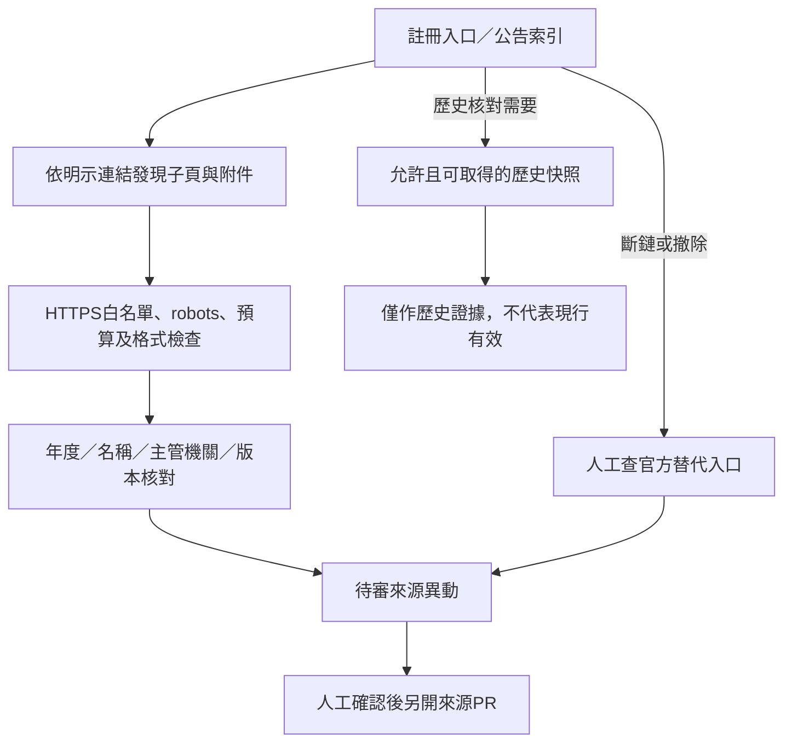

# 長期架構、網址韌性與維運成本

2026-11-01整合PR #22，保留研究方向並修正未經量測的覆蓋率、時效與免費額度保證。本文件是後續提案，不代表已啟用新來源、搜尋API、資料庫或模型排程。現況以[文件準備](PREPARED-EXTRACTION.md)及[進階驗收](ADVANCED-EXTRACTION-TESTS.md)為準。

## 來源網址更換

- 入口發現與具名方案萃取分開；父頁與附件各有來源版本，不把同名檔案當同一內容。
- 正式掃描仍以已註冊來源為限；入口監控擴展尚未全部實作。
- 年份URL樣板與HEAD探測只保留提案，不猜下一期存在、不把200當作有效徵件；任何探測也計入存取與請求預算。
- 重新導向不自動加入白名單；canonical只是線索，不能越過登入、robots或來源授權。
- Internet Archive／Perma.cc僅是歷史佐證候選；須另查存取條款、保存許可與成本。歷史副本不能補猜現行資格、期限或生效日，也不新增原文永久封存。

## 搜尋工具

Google官方目前表示Custom Search JSON API不接受新客戶，既有客戶須於2027-01-01前遷移，因此不新增此依賴。[官方說明](https://developers.google.com/custom-search/v1/overview)

常態偵測採既有來源掃描；搜尋引擎、社群回報或人工搜尋可協助發現替代入口，仍須重新審核來源。沒有量測各站索引延遲，不宣稱固定延遲數日或數週。每週二／五掃描也不是零延遲或即時通知；有排程間隔、排隊與失敗風險。

Brave、SearXNG等只列探索選項，未啟用。免費軟體不等於自架服務沒有運算或維護成本；搜尋服務的額度須另核，不沿用舊研究的免費次數。

## 低成本維運邊界

| 項目 | 目前安排與限制 |
|---|---|
| 網站 | GitHub Pages公開預覽；不是無限容量或流量。已發布網站上限1GB、每月100GB為軟性頻寬限制。[官方限制](https://docs.github.com/en/pages/getting-started-with-github-pages/github-pages-limits) |
| Actions | 公開repo使用標準GitHub-hosted runner可免費使用運算，但仍有限流、工作時長與儲存限制；larger runner可能收費。[計費說明](https://docs.github.com/en/actions/concepts/billing-and-usage) |
| 資料 | Git管理結構化候選／正式快照，過期與當期用同一契約；不保存大量HTML／PDF。D1仍是需要時才評估的查詢副本 |
| 模型 | 排程off；手動小量、確定性規則優先。僅帳戶／成本已確認時呼叫，免費層不承諾永久存在 |
| 訂閱／網域 | 尚未啟用通知或購買網域，不把未實作服務計為已提供 |

不以350KB假定頁面大小推算可服務28萬次瀏覽；應以部署產物、實際流量、cache與artifact用量量測。實際掃描受robots／節流影響，不沿用每次40秒的假定。

## Token與費用如何估算

不能把repo保留的120字短證據上限當成模型輸入長度。模型輸入還包含完整Prompt、schema、候選摘要、共同例外、表格脈絡與每段來源；輸出、推理、安全餘裕及失敗重跑另計。hash_only完全禁止外送，其他來源也須先過隱私／完整性檢查。

規劃公式為：每月費用＝輸入tokens×輸入單價＋輸出tokens×輸出單價＋其他帳單項目。各模型單價、免費額度、過期與快取折扣須依帳戶／官方資料另查，沒有實測時不能稱精算。

保留一個純算術情境：假設每月160次、每次輸入500／輸出200tokens，則每月80,000輸入＋32,000輸出，一年960,000輸入＋384,000輸出。這不是OpenGSA真實需求量。若假設每百萬輸入0.15美元、輸出0.60美元，算術結果為0.3744美元／年；此假設不是目前模型報價，也不含重試等成本。

已移除85%／90%規則覆蓋、固定免費RPD、十年以上免費運行及零帳單風險保證。應先用人工標準答案和provider相容計數器量測，再決定來源數與模型分組。現有來源17文件／19候選的8通過、11缺漏不能換算為欄位準確率。

## 開源支持與參照

開源資助的官方入口、申請草稿及擴展藍圖集中於[資助與擴展評估](OPENAI-CODEX-FUND-APPLICATION-AND-EXPANSION.md)。沒有送出申請、承諾獲獎或啟用付費。

可研究[Open States](https://github.com/openstates/openstates-scrapers)、[changedetection.io](https://github.com/dgtlmoon/changedetection.io)、[CourtListener](https://github.com/freelawproject/courtlistener)的抓取與異動處理；這些是參照入口，不宣稱已驗證其部署成本或可直接套用。導入前仍需審核授權、依賴與實際需求。
