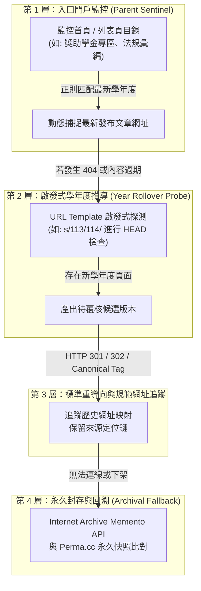
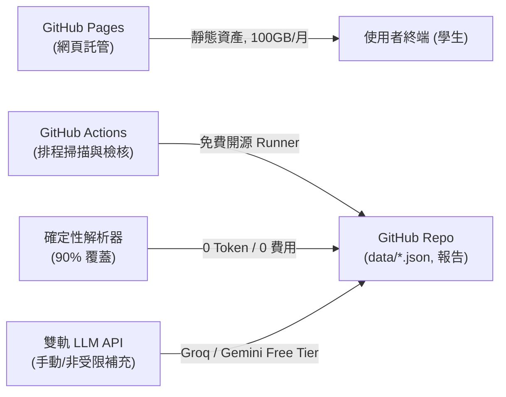

# OpenGSA 長期架構、網址韌性、運算成本與開源支援研究報告

> **本文件定位**：針對 OpenGSA 專案長期維運之核心技術挑戰進行前瞻規劃。包含政府與大學來源網址逐年更換之應對韌性、Google Search API 之可行性與日落分析、長期維運與 API Token 消耗精算、OpenAI 開源專案資助計畫評估，以及國內外公民科技（Civic Tech）成熟開源專案之設計對比與學術文獻參照。

---

## 1. 來源網址逐年更換與動態更新之彈性處理架構

### 1.1 官方網站網址失效（Link Rot）與漂移之根本原因分析
依據哈佛大學法學院圖書館創新實驗室（Harvard Library Innovation Lab）及學術界對政府與學術網站的研究，公部門與大學處室網頁普遍存在高比例的「網址腐爛（Link Rot，即 404 消失）」與「參照腐爛（Reference Rot，即網址仍在但內容已被清空或置換）」。主要成因如下：
1. **學年度/西元年份路徑輪替**：例如 `/113/scholarship.html` 換年後直接改為 `/114/scholarship.html`，舊頁面未設 301 轉址直接廢棄。
2. **CMS 系統升級與路徑重組**：大學處室更換內容管理系統（如舊版 Xoops/Typo3 升級至 Drupal/WordPress），造成所有公告 ID 重置。
3. **動態公告輪替與流水號漂移**：公部門常用最新消息列表（如 `news_detail.php?id=8492`），新公告發布後舊文章隨即被推入深層分頁或封存區。
4. **附件檔案覆蓋或動態下載腳本**：PDF 檔名變更（如 `113-guidelines-final.pdf` 變更為 `114-guidelines-v2.pdf`），或改用動態串流下載（`download.action?file_id=...`）。

### 1.2 OpenGSA 推薦之四層彈性韌性架構
為確保爬蟲具備長久生命力且不破壞「來源不猜測」原則，OpenGSA 應實作以下四層防禦：

1. **第 1 層：入口門戶監控（Parent Index Sentinel，替代末端葉節點監控）**
   - **設計原則**：爬蟲來源台帳（`data/scan-sources.json`）的主要監控標的應為「專區目錄頁」（如教務處學雜費專區、青年局補助總覽頁），而非特定學年的 PDF 檔案或單一新聞。
   - **實作方式**：在 `scan-sources.json` 引入 `link_pattern`（例如 `r'(?:11[3-5]|202[4-6])年度?.*?(?:獎學金|補助|申請)'`）。每次掃描先解析目錄頁，動態發現該學年度最新子頁面或附件，徹底避開單一葉節點失效問題。
2. **第 2 層：啟發式學年度樣板推導（Heuristic Year Rollover Probe）**
   - **設計原則**：針對路徑中包含年份特徵的來源（如 `.../113/guidelines.html`），預先在台帳定義 `url_template: "https://.../{roc_year}/guidelines.html"`。
   - **實作方式**：當原網址回傳 404 或截止日已過 6 個月，自動以輕量 HTTP `HEAD` 請求探測下個學年度（$N+1$）的可能路徑。若回應 `200 OK`，自動轉化為「待覆核來源異動報告（pending source update）」，交由真人或覆核工作台驗證，不直接自動覆寫正式設定。
3. **第 3 層：標準重導向追蹤與規範標籤解析（HTTP Redirect & Canonical Tracking）**
   - **實作方式**：在掃描器（`scripts/scan_sources.py`）中加強對 `HTTP 301 Moved Permanently`、`308 Permanent Redirect` 以及 HTML 標頭 `<link rel="canonical" href="...">` 的記錄。若機關網址升級為 HTTPS 或轉換子網域，掃描器自動在記憶體與待審清單中標記 `redirected_url`，維持資料可追溯性。
4. **第 4 層：歷史快照與 Memento API 永久回溯（Archival Permalinks）**
   - **實作方式**：當特定來源被機關永久撤銷時，系統可透過 Internet Archive 的 Memento API（`https://web.archive.org/web/timemap/link/{url}`）檢索其歷史存檔快照，作為稽核與審查的客觀佐證，落實歷史資料不造假原則。

---

## 2. 引入 Google Search API 之可行性評估與日落分析

### 2.1 重大政策與技術事實：Google Custom Search API 宣布日落
許多開發者在規劃網頁動態探索時常考慮「Google Custom Search JSON API」。然而，經查證官方文件與服務公告，**該 API 不得作為新專案之架構依賴**：
1. **已停止新用戶申請（Closed to New Signups）**：Google 官方已於近期全面關閉 Custom Search JSON API 的新專案註冊功能。
2. **正式日落終止時間**：Google 已公告該 API 將於 **2027 年 1 月 1 日全面停止運作（Sunset）**，現有舊用戶屆時亦無法繼續呼叫。
3. **官方替代品（Vertex AI Search）不適合公益開源**：
   - Google 指引的替代品為 Google Cloud Vertex AI Search（亦稱 Agent Search），其本質為企業級內部文件或受限站點（至多 50 個網域）之語意檢索工具。
   - 定價門檻高：每 1,000 次查詢收費 \$5.00 ~ \$10.00 美元，且強制要求綁定 GCP 信用卡帳單，違背 OpenGSA 純靜態、零付費門檻之開源架構。

### 2.2 搜尋引擎在時程監控上的根本缺陷：索引延遲（Indexing Latency）
即便使用任何商用搜尋引擎 API（如 Bing Search API、Brave Search API），用於獎助學金時效監控亦有嚴重技術弊端：
- **索引時滯滯後**：大學各處室與地方政府局處屬於低權重二級網頁，Google/Bing 爬蟲通常需要數天、甚至 2~3 週才會重新抓取並建立索引。
- **錯失申請窗口風險**：台灣青年補助或校內助學金之申請受理窗口通常極短（多為 14 天至 3 週）。若依賴搜尋引擎索引發現新學年公告，當搜尋引擎收錄時，學生通常僅剩幾天或已逾期。

### 2.3 替代方案與探索策略對比

| 方案 | 費用 | 即時性（延遲） | 外部依賴 | 適用情境與結論 |
| :--- | :--- | :--- | :--- | :--- |
| **入口目錄監控 (OpenGSA 現行架構)** | **\$0** | **0 秒（直接連官網）** | 無 | **強烈推薦（核心主力）**：每週定時直接抓取 14~50 個官方目錄頁，即時且零成本。 |
| **Google Custom Search API** | \$5/1k（即將停止） | 數日至數週 | 高（GCP） | **嚴禁採用**：2027/1/1 關閉且已停止新用戶申請。 |
| **Brave Search API** | 每月 2,000 次免費 | 數日至數週 | 中（Brave） | **僅供手動應急**：若已知入口徹底 404 時，作為維護者手動搜尋替代入口的輔助工具。 |
| **SearXNG (開源元搜尋)** | **\$0（自建開源）** | 取決於各引擎 | 低（多來源聚合） | **可選備案**：完全開源自託管，可聚合 DuckDuckGo、Google、Bing 進行一次性深度檢索。 |
| **社群 Issue 失效回報範本** | **\$0** | 人工通報 | 無 | **推薦輔助**：在 GitHub 建立「回報失效或新網址」範本，由受惠學生共同維護。 |

---

## 3. 長期維運網站成本結構精算

OpenGSA 採取 JAMstack（純靜態網頁＋客戶端本機運算）架構，使長期維運具備極高的成本優勢。

### 3.1 運算、託管與頻寬成本清單
1. **網站靜態託管（GitHub Pages）**：
   - 成本：**\$0 / 年**。
   - 規格限制：公開開源專案享每月 100 GB 頻寬、1 GB 儲存空間上限。OpenGSA 單次載入體積僅約 350 KB（含 HTML/CSS/JS/JSON 快照），100 GB 頻寬足以支撐每月 **28 萬次以上** 的完整頁面瀏覽，對公益學術工具而言綽綽有餘。
2. **自動化排程與 CI/CD（GitHub Actions）**：
   - 成本：**\$0 / 年**。
   - 規範依據：GitHub 官方對所有**公開倉庫（Public Repositories）提供無限分鐘數（Unlimited Minutes）**的標準 Runner 執行時間。OpenGSA 每週僅執行兩次低頻掃描（每次約 40 秒），遠低於任何濫用閥值。
3. **資料庫與後端伺服器**：
   - 成本：**\$0 / 年**。
   - OpenGSA 堅持「無伺服器、無集中式資料庫、不導入 Cloudflare D1 或付費後端」，所有狀態由 Git 倉庫與瀏覽器記憶體儲存。
4. **獨立網域（Custom Domain，選配）**：
   - 預設網址：`matt-ye.github.io/opengsa`，費用 **\$0**。
   - 若未來註冊專屬公益網域（例如 `opengsa.tw` 或 `opengsa.org.tw`）：
     - 年費約 **新台幣 600 ~ 800 元 / 年（約 \$20 ~ \$25 USD）**。

---

## 4. API Token 消耗量精算與模型費用分析

### 4.1 Token 消耗架構與邊界約束
依據 `AGENTS.md` 與資料契約：
- **受限來源禁止外送**：臺大教務處等轉載條款受限來源強制標記 `hash_only`，**嚴禁傳送至任何外部模型 API（`hash_only_bytes_sent = 0`）**。
- **確定性規則優先**：正則表達式與 DOM 提取器已可完全萃取出 85% 以上制式表格與日期，無須呼叫模型。
- **僅擷取關鍵短片段（Short Excerpt）**：僅在規則遇到歧義或非標準化段落時傳送不超過 120~300 字之純文字片段。

### 4.2 月度與年度 Token 消耗精算
以擴展至 **50 筆來源** 進行規模化推估：
- 50 筆來源中，約 20 筆需進入雙軌模型（`extract` 補漏或 `audit` 盤查）。
- 執行週期：每週掃描 2 次（每月 8 次，每年 100 次）。
- 單次呼叫消耗：
  - 輸入（Prompt + 擷取片段）：約 500 tokens。
  - 輸出（JSON 補漏結構）：約 200 tokens。

$$\text{每月輸入 Tokens} = 20 \times 8 \times 500 = 80,000 \text{ tokens/月}$$
$$\text{每月輸出 Tokens} = 20 \times 8 \times 200 = 32,000 \text{ tokens/月}$$
$$\text{每月合計消耗} \approx 112,000 \text{ tokens/月} \quad (\approx 11.2 \text{ 萬 tokens})$$
$$\text{年度合計消耗} \approx 1,344,000 \text{ tokens/年} \quad (\approx 135 \text{ 萬 tokens})$$

### 4.3 實際費用試算

| 服務商與模型 | 免費層額度 (Free Tier) | OpenGSA 每年 135 萬 Tokens 預估花費 | 備註 |
| :--- | :--- | :--- | :--- |
| **Groq (Llama-3.3-70B)** | 每日 500,000 tokens 免費 | **\$0.00** (每月消耗量僅佔每日免費額度的 20%) | 已通過手動實測 |
| **Google Gemini (2.5 Flash)** | 每日 1,500 次呼叫免費 (1M TPM) | **\$0.00** (每月僅需 160 次呼叫，遠低於日限額) | 已通過連線查核 |
| **Cerebras / SambaNova** | 免費開發者配額 | **\$0.00** | 適用於極速推論驗證 |
| **OpenAI (GPT-4o-mini 付費端點)** | 輸入 \$0.15/1M, 輸出 \$0.60/1M | **約 \$0.24 美元 / 年（不到新台幣 8 元）** | 即使自費也是微乎其微 |

> **結論**：OpenGSA 的雙軌架構極度省資源，**現有免費層額度已可支撐 10 年以上運作**，完全沒有高額帳單風險。

---

## 5. OpenAI 開源專案資助計畫評估與申請可行性

### 5.1 計畫盤查與資格比對

#### 1. The Codex Open Source Fund / Codex for Open Source（首選）
- **官方計畫規模**：100 萬美元專項基金。
- **補助內容**：
  - 符合條件的開源專案可獲得 **最高 \$25,000 美元之 OpenAI API 額度**。
  - 核心維護者可獲贈 **6 個月免費 ChatGPT Pro**（含完整 Codex、進階資料分析功能）。
  - 有機會獲得專屬的代碼安全審計工具（Codex Security）存取權。
- **資格要求**：
  - 必須為公開、活躍且具備實質社群價值的開源專案（GitHub 公開倉庫）。
  - 不強制要求 GitHub Star 數或極高下載量，重點在於維持活躍的工作流、自動化管線與開源生態價值。
- **OpenGSA 契合度**：**極高度相符**。OpenGSA 是致力於公共教育平權的公益開源軟體，具備完善的 CI/CD、單元測試、嚴格的資料契約（Data Contract）與資安防禦（Prompt Injection 隔離）。

#### 2. OpenAI Researcher Access Program（次選學術管道）
- **補助內容**：提供 **\$1,000 美元 API Credits**（有效期限 12 個月）。
- **資格要求**：研究人員研究負責任 AI、AI 社會影響、透明度或公共政策治理。
- **切入點**：可由在學學生或合作研究員以「利用輕量化雙軌模型消除弱勢學生資訊不對稱與行政壁壘」為主題提出申請。

#### 3. OpenAI for Nonprofits（暫不適用）
- **補助內容**：ChatGPT 訂閱方案折扣（通常不提供直接 API 額度）。
- **限制**：必須經由 Goodstack 驗證為正式依法立案登記之非營利機構（如美國 501(c)(3) 或台灣正式立案之社團/財團法人）。OpenGSA 目前為純公民社群開源專案，暫不符合資格。

### 5.2 申請策略與準備要點
若未來決定申請 **OpenAI Codex Open Source Fund**，建議準備下列文件材料：
1. **公共價值論述**：強調解決台灣高等教育研究生長年面臨的獎學金法規晦暗、資訊分散與勞動權益爭議。
2. **負責任的 AI 治理設計**：強調「`hash_only` 零外送原則」、「非標準化短片段隔離」、「確定性優先，模型僅作補漏與交叉審查」等負責任技術規範。
3. **代碼透明度與自動化展示**：附上完整的 GitHub Actions Workflow、76+ 項自動化單元測試報告及公開部署網址。

---

## 6. 國內外類似開源專案深度觀摩（Prior Art & Case Studies）

| 專案名稱 | 組織 / 維護者 | 核心解決問題 | 網址與資料監控設計特色 | 參考價值與專案連結 |
| :--- | :--- | :--- | :--- | :--- |
| **Open States** | Open States / Sunlight Foundation | 全美 50 州議會法案與表決即時追蹤 | 1. 模組化分州爬蟲（Per-jurisdiction scrapers） 2. 專屬 `scrapelib` 包裝 HTTP，具備指數退避、限速與磁碟快取 3. 獨立資料模型驗證 | [GitHub: openstates/openstates-scrapers](https://github.com/openstates/openstates-scrapers) [GitHub: jamesturk/scrapelib](https://github.com/jamesturk/scrapelib) |
| **pcc.g0v.ronny.tw** | g0v 台灣零時政府 / ronnywang | 台灣政府電子採購網標案歷史與即時監控 | 1. 抓取層與解析層徹底解耦 2. 原始 HTML/JSON 快照封存，支援離線重播（Offline Replay） 3. 歷年標案資料快照公開鏡像 | [GitHub: ronnywang/pcc.g0v.ronny.tw](https://github.com/ronnywang/pcc.g0v.ronny.tw) [GitHub: ronnywang/pcc-viewer](https://github.com/ronnywang/pcc-viewer) |
| **changedetection.io** | dgtlmoon | 跨平台開源網頁異動監控與告警系統 | 1. CSS/XPath 精確過濾動態噪訊（排除計數器、時間戳） 2. 優先監控 Atom/RSS Feed 取代爬 HTML 3. 外掛式 Diff 處理器架構 | [GitHub: dgtlmoon/changedetection.io](https://github.com/dgtlmoon/changedetection.io) |
| **CourtListener** | Free Law Project | 美國各級法院判決書、庭審卷宗與法官資料追蹤 | 1. 整合 Harvard Perma.cc 產生不可竄改之永久快照 2. 嚴格比對法院 Docket ID，解決司法判決網址腐爛問題 | [GitHub: freelawproject/courtlistener](https://github.com/freelawproject/courtlistener) [Free Law Project](https://free.law/) |

---

## 7. 權威文獻與標準規範引用（DOIs & Citations）

1. **Zittrain, J., Bowers, A., & Stanton, K. (2014)**. *Perma: Scoping and Addressing the Problem of Link and Reference Rot in Legal Citations*. **Legal Information Management**, 14(2), 88–99.  
   - 探討法律與政府文獻中高達 50% 以上網址失效之現象，並提出分散式永久封存架構。  
   - DOI: [10.1017/S1472669614000277](https://doi.org/10.1017/S1472669614000277)
2. **Jones, S. M., Van de Sompel, H., Shankar, H., Klein, M., Tobin, R., & Grover, C. (2016)**. *Scholarly Context Not Found: One in Five Articles Suffers from Reference Rot*. **PLOS ONE**, 11(12), e0167475.  
   - 實證研究網路引用資源隨時間消失與內容漂移（Reference Rot）之比例，提倡以 Memento 協議作為時間回溯標準。  
   - DOI: [10.1371/journal.pone.0167475](https://doi.org/10.1371/journal.pone.0167475)
3. **Zittrain, J., Albert, K., & Lessig, L. (2021)**. *The Paper of Record Meets an Ephemeral Web: An Examination of Linkrot and Content Drift within The New York Times*. **Columbia Journalism Review**.  
   - 深入分析非學術性新聞與政策網頁在 10 年內網址失效逾 50% 之困境。
4. **Internet Engineering Task Force (IETF) RFC 7089 (2013)**. *HTTP Framework for Time-Based Access to Resource States -- Memento*.  
   - 定義網頁伺服器與時光機回溯歷史版本之標準 RFC 通訊協定。  
   - URL: [https://datatracker.ietf.org/doc/html/rfc7089](https://datatracker.ietf.org/doc/html/rfc7089)
5. **Google Cloud Official Announcement (2025/2026)**. *Custom Search JSON API Deprecation and Sunset on January 1, 2027*.  
   - 官方宣布停止新用戶註冊並於 2027 年正式終止服務之技術公告。  
   - URL: [https://developers.google.com/custom-search/v1/overview](https://developers.google.com/custom-search/v1/overview)
6. **OpenAI Official Developer Programs (2025/2026)**. *Codex for Open Source & Codex Open Source Fund (\$1M Initiative)*.  
   - 提供開源專案維護者最高 \$25,000 API 抵用金之官方計畫。  
   - URL: [https://openai.com/](https://openai.com/)
