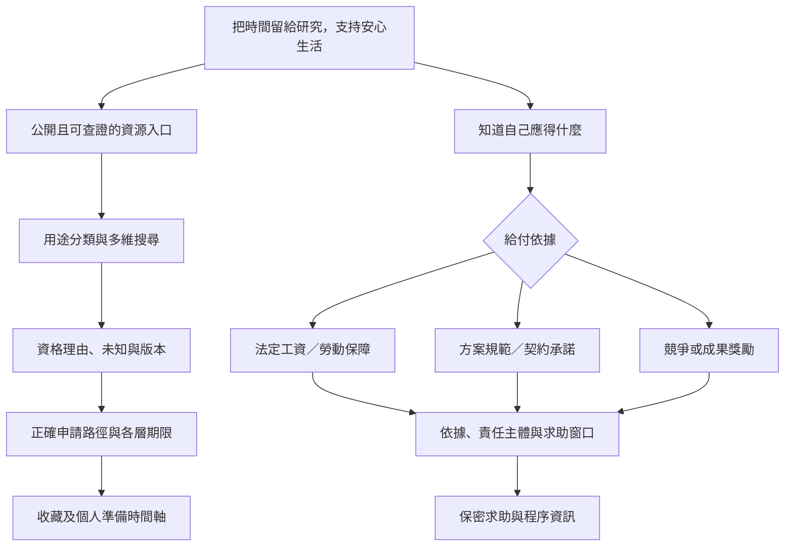

> 文件性質：規劃參考／研究日快照。repo 初始化已核可；目前分期及授權邊界以 [目前計畫](PLAN.md) 為準。文內「本次／本輪／尚未建 repo」描述的是原規劃階段，不代表目前 repo 尚不存在；來源條件仍須逐案重查。

# OpenGSA：理念、Slogan 與臺大 FAO 參考網站評估

Grant Scholarships Award｜規劃補充 v1.0｜2026-10-28（Asia/Taipei）

本輪只做瀏覽器唯讀觀察與文件規劃，未提交申請、收藏資料或變更個人資料；未寫產品程式、建立 repo、部署或啟用排程。本文件與原 handoff、資源分類文件共同構成規劃；新增功能仍須排優先序，不自動全部擴張成 MVP。

## 1. 建議對外文案

### 主 Slogan

**把時間留給研究，把獎助檢索交給 OpenGSA。**

### 首頁說明

文獻值得你花時間，獎助資訊應該更容易找到。OpenGSA 整理獎學金、補助、獎項與研究生權益，讓你看懂申請條件、掌握期限，也知道遇到問題時可以向誰求助。

### 理念短句

**先有安心研究的生活，才有探索與成長的可能。**

### 權益頁標語

**讓獎助資訊透明，讓學生有選擇，讓權益有依據。**

以上為建議文案，保留後續修改空間。「獎助」在此涵蓋獎學金、補助與獎項，不代表每個人都能取得現金或足額生活支持。

## 2. 使用者理念轉成產品原則

| 使用者提出的方向 | 建議正式表述 | 可落實的產品行為 |
|---|---|---|
| 把檢索力氣留給文獻 | 降低研究生尋找資源的時間成本 | 統一檢索、別名搜尋、去重、資格理由、收藏與期限時間軸；衡量完成找資源任務的時間 |
| 財務安全穩健，減少額外兼職壓力 | 支持研究生的財務安定，減少因基本生活不足而被迫額外兼職的壓力 | 生活／學費／住宿／急難與研究資源並列；標明金額、給付頻率、期間、領款時間是否未知及兼領限制 |
| 杜絕把持申請、要脅學生 | 減少資訊壟斷與以獎助控制學生的空間，支持透明、公平且可查證的申請程序 | 公開正式條件、推薦與審查角色、名額、各層期限、書面依據與替代詢問窗口；有爭議時提供保密求助路徑 |
| 學生知道最低應得給付及權益 | 讓學生能查明依法、依辦法或依契約應得的給付與救濟途徑 | 給付性質分流、版本與適用日、責任主體、停止／返還條件、申訴與調解入口 |
| 不要先逼成果才願意支持 | 倡議先提供穩定、安全且受尊重的研究環境，再支持探索、成果與成長 | 清楚區分基礎支持、工作報酬、競爭型獎學金與成果獎；揭露合法且事前明示的成果或續領條件，不混為一談 |

「減少被迫兼職」是支持學生的選擇，不是反對學生自行選擇工作；不把兼職視為不努力或不配獲助的理由。是否影響某項資格仍按該方案辦法判斷。

平台不能保證杜絕所有脅迫、提供足額收入或完成申訴。理念要有具體資訊與求助設計支撐，不能用無法履行的保證取代服務。

## 3. 「最低應得給付」的呈現方式

不設一個適用所有研究生、由教授個人一律負擔的單一最低獎助金數字。此欄位改為「我適用的給付保障」，逐筆查核下列不同依據：

| 給付層級 | 判斷基礎 | 頁面應顯示 |
|---|---|---|
| 法定工資與勞動保障 | 實際僱傭關係、適用法令、工作期間與計薪方式 | 適用的月／時薪標準、工時與保險等依據；實際雇主／聘僱單位待核對，不能直接等同指導教授個人 |
| 方案／校院系最低保障 | 特定年度方案、校規、核定及適用身分 | 規範名稱、金額、涵蓋期間、受領條件、資金來源及承辦責任 |
| 契約或書面承諾 | 聘僱契約、獎助核定通知、招生或研究室書面約定等 | 承諾主體、金額、付款期、附帶條件、變更與爭議窗口；效力有爭議時提示求助，不自動判定 |
| 競爭型／成果型獎勵 | 獎項辦法、審查與成果條件 | 不保證取得；不得加總成穩定月收入或基礎生活保障 |
| 倡議的生活支持標準 | 學生需求、生活費與政策討論 | 明確標「倡議／估算」，不得當成現行法定應付額 |

法律查核基礎：[最低工資法](https://law.moj.gov.tw/LawClass/LawAll.aspx?pcode=N0030028)第 3–5 條區分適用對象及月／時薪標準；[教育部獎助生權益保障指導原則](https://edu.law.moe.gov.tw/LawContent.aspx?id=GL001889)區分學習範疇與有對價的僱傭關係。不能僅憑「獎助金」「RA」「TA」名稱作最後認定。

成果獎本來可以獎勵已完成的成果，競爭型獎學金也可能依法／依辦法設有成績、研究或續領條件。OpenGSA 的倡議重點是保障事前透明、約定給付與安全的研究環境，防止把本應履行的給付或公平申請機會當成任意施壓工具，而不是否定所有成果獎或評量。

## 4. FAO 的實際查看範圍與證據界線

參考網站：[臺大學生財務支援系統 FAO](https://my.ntu.edu.tw/fao/search.aspx)。使用使用者的 Chrome 現有分頁進行查看；第一次送出查詢提示登入，使用者重新登入後完成「博士生、本國生、來源不限、目前可申請」查詢。此處選本國生僅為介面測試，不作為使用者已確認的個人資格資料。

已觀察：搜尋表單、結果表格與分頁、下方教務處／研發處資源摺疊區塊，以及一筆獎助詳情頁。詳情樣本為[大學院校客家信仰文化研究生獎學金](https://my.ntu.edu.tw/fao/searchmore.aspx?n=1407)，含金額、提供者、承辦單位、期間、條件、身分及原公告連結。

側欄另見基本資料、申請紀錄、我的最愛、申請案維護與證明列印入口；未進入個人紀錄或驗證這些功能的內部操作。頁面另有 English 與 AI 文字助理入口，未測試翻譯或 AI 回答品質。不評斷未測試的功能、全站資料完整性、資安、行動版或正式無障礙符合性。

未保留姓名、學號、私人申請紀錄、登入資訊或整份頁面快照於公開規劃；目前內容僅描述介面與方案資訊結構。登入後觀察不授權日後大規模抓取或公開重製內部資料。

## 5. 值得保留的優點

| FAO 已觀察的設計 | OpenGSA 的保留方向 |
|---|---|
| 可選大學／碩士／博士、本國／僑／陸／外籍等 | 保留多維資格篩選，補年級、院系、候選人、在職與領取史；未知可不填 |
| 可查目前開放與近兩學年度機會 | 保留歷史資料，明確區分當期、歷史與未公告；支援觀察下一期 |
| 可按來源單位及關鍵字查詢 | 保留來源可見性；預設跨來源搜尋，避免學生要先知道由哪個單位承辦 |
| 結果有金額、期間、詳情，部分欄位可排序 | 保留比較便利；金額補幣別、頻率、上限、核銷與保障程度 |
| 有總筆數與分頁 | 保留清楚結果數及返回位置；不把多個列表混成同一個不明總數 |
| 下方整合教務、研發、國際處、學院、助學與急難等入口 | 保留廣泛資源，採用途為主要探索入口，承辦單位為輔助維度 |
| 詳情有原始公告連結與日期 | 保留逐筆追原始依據，補資料版本及最後人工核對時間 |
| 收藏、紀錄及證明入口 | 收藏優先；申請檢核清單與官方證明申辦連結可規劃，校務核發功能仍由學校處理 |

## 6. 改良方向：觀察事實與設計判斷分開

| 實際觀察 | 造成的使用問題／設計推論 | OpenGSA 提案 |
|---|---|---|
| 首次看到的表單勾選大學生、本國生及生活輔導組；不能確認是預設或既有狀態 | 學生可能未察覺目前搜尋範圍較窄 | 用醒目的已套用條件標籤；預設跨來源；學制由使用者選擇或明確確認 |
| 上方查詢結果與下方跨單位資源是兩套呈現；博士查詢時下方教務區仍列學士新生方案 | 容易以為畫面上所有機會都已符合目前條件 | 全頁一致篩選；若另有未篩選探索區，標「其他資源，尚未比對」 |
| 多筆名稱附「逕寄，請點詳情勿點申請」 | 重要申請路徑藏在長名稱中，行動按鈕不易理解 | 名稱保持純名稱；獨立顯示「自行寄件／校內系統／單位推薦」及正確入口 |
| 詳情樣本的提供者及承辦單位皆為生活輔導組，但名稱是外部財團，並有逕寄提示 | 「提供者」欄位容易被讀成實際出資方 | 分別顯示主辦／資助／轉知／承辦／收件單位，未知明示 |
| 詳情樣本的條件欄只見「收件單位：逕寄」，特殊條件為「其他特殊規定」 | 摘要不足以判斷資格 | 把收件方式移到程序；資格逐條列出，缺內容顯示待查並追原公告 |
| 有金額數字、美元範圍、上限與分期等不同文字格式 | 直接以金額排序可能難以公平比較；未實測排序演算法 | 結構化幣別、總額／月額、分期、上限、是否核定；不同單位不硬排成同一榜單 |
| 研發處區塊仍含 108／109 年的申請日期文字 | 使用者可能把歷史資訊誤讀為本期 | 年度分版、歷史標籤、當期未查得提示；不因舊機關名稱就直接判定停辦 |
| 頁尾顯示最近更新日期 2013/12/04，但列表含 2026 內容 | 單一頁尾日期不能解釋逐筆新鮮度，也不能據此斷言全站未維護 | 每筆資料分別記來源更新、抓取與人工核對時間 |
| 第一次查詢時提示登入，使用者重登後才完成 | 閱讀公開型獎助資訊也可能受登入狀態影響；此觀察不證明全站皆強制登入 | OpenGSA 的公開來源資訊可免登入閱讀；私人設定與校務申請另分流 |
| 已查看的搜尋／詳情中未見逐條資格理由、個人時間軸或權益分流 | 仍需使用者自行讀長文及串接資訊 | 加入可解釋比對、下一步、各層期限、收藏時間軸與權益入口；不宣稱 FAO 全站沒有這些功能 |

版面觀察：本次桌面視窗中主內容集中於較窄的固定寬度區域，表格文字密集。OpenGSA 應採可重排列表／詳情、可讀字級與鍵盤操作；是否符合行動與無障礙標準，後續須另行驗證，不憑單次畫面定論。

## 7. 權益與防止不當控制的具體功能

### 第一階段應納入規劃

1. 每項方案列出誰訂資格、誰收件、誰推薦、誰審查與誰發款；推薦不等於由單一教授決定全部資格。
2. 把推薦函、指導教授同意等正式必要程序明示；不能宣稱所有獎助都可以跳過教授，亦不協助繞過合法程序。
3. 列出條件的正式依據與變更日期；使用者可比較額外被要求的條件是否出現在公告或契約中。資料不足時引導詢問，不自動宣告違法。
4. 提供一般問題的書面詢問要點、應保存的資料種類與適當窗口。校內學生申訴、勞動爭議、性平或其他案件分流，適用程序與期限逐項查證。
5. 涉個案的求助不走公開 issue；頁面提示避免上傳姓名、學號、私人往來或未遮蔽證據。平台首版不收個案附件，不設教授黑名單。
6. 學生資料不提供給指導教授或學校作監看，不以「研究成果少」「曾申訴」降低資源排序。
7. 顯示兼領及給付性質，避免將獎學金、薪資與核銷混合加總；不因學生獲獎就自動推論雇主可扣減既有薪資。

### 財務安定的後續功能候選

可以規劃本機資金時間軸，分成「已確認／已核定」「審查中／未核定」「競爭型機會」三層，與生活費／房租自訂估算並列。未知撥款日明示未知；未獲獎不能當作確定收入。此功能尚未納入首版必做，不連接銀行帳戶，不要求上傳財務證明，也不提供投資或借貸推薦。

成果評量與穩定支持要同時透明：揭露條件、續領及停止程序，提供可詢問／申復路徑；平台不自行裁定教授、學生或學校的法律責任。

## 8. 由理念到產品的視覺化流程

## 9. 轉成後續驗收條件

- 使用者能看出結果是否依本人條件篩選，以及還有哪些未知；不同資源區塊不得暗中使用不同篩選範圍。
- 不需讀名稱裡的警語，就能知道應自行寄件、登入校務系統、請單位推薦或等待甄選。
- 每筆結果都能分辨資助方與轉知／承辦單位；沒有證據的角色保留未知。
- 不將歷史日期、頁尾更新日或搜尋到的時間，當成當期截止或正式公布日。
- 使用者能分辨穩定支持、工作報酬、競爭型獎學金與成果獎；沒有通用的「教授最低應付獎助金」假數字。
- 基本公開資訊免登入；登入限定來源僅依合法公開及使用範圍呈現，不能因本次可讀就直接公開全文。
- 能找到與事件類型相符的正式窗口，且不須公開私人個案；平台不承諾申訴必定受理或成功。
- 至少以臺大職能治療博士五年級、一般碩士生、外籍博士生三種情境檢查文案及流程；不將本次瀏覽器查詢勾選狀態當成使用者已確認 Profile。

本輪完成的是一個參考網站的有限範圍觀察與產品規劃，不是 FAO 全站稽核，也不是個案行政違失或法律責任的判定。
