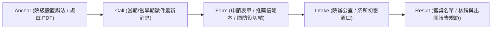

# 臺大 11 個學院與處室出國研修、國際會議發表與出訪獎助專題調研

> **版本**：1.0.0-ntu-overseas  
> **更新時間**：2026-11-05  
> **研調狀態**：院系所專案出國補助盤點完成／資訊鏈標準拓撲建立  
> **合規聲明**：本文件僅供資料流與資訊鏈追蹤規劃；各方案之正式申請資格、補助名額、實際撥款金額與截止日，皆以各學院及校級國際事務處當期正式公告與母辦法為準。

---

## 1. 調研緣起與目標

在先前的 PR #58 中，OpenGSA 成功補回了「臺大醫學院學生出國補助辦法」（cand-ntu-med-overseas）與「醫學院研究生優秀著作獎」（cand-ntu-med-paper）。  
然而，臺大做為綜合型研究大學，各學院與處室針對研究生（碩士生、博士生）及大學部學生出國參與國際學術會議（發表口頭論文/海報）、赴國外頂尖實驗室進行短期訪問研究、或參與雙聯/短期研修，均設有**學院自籌款、校友捐贈或高等教育深耕計畫**之獨立獎助要點。

此類獎助過去常分散於各學院獨立網站的「法規專區」或「最新消息」，缺少橫向統整與時程能見度，導致學生錯過申請窗口或重複申請補助。  
本文件深入盤查臺大 **11 個學院**及**國際事務處 (OIA)** 之出國獎補助體系，梳理五節點資訊鏈（`anchor` 母法、`call` 徵件公告、`form` 表件系統、`intake` 審查收件、`result` 結果公告），以利後續自動化追蹤與開放資料呈現。

---

## 2. 臺大 11 學院暨校級出國獎助全覽盤查

| 單位名稱 | 獎補助名稱 / 設置要點 | 補助對象 | 額度範圍 (新臺幣) | 受理梯次 / 申請時限 | 資訊鏈入口 / 網址 |
| :--- | :--- | :--- | :--- | :--- | :--- |
| **文學院** | 學生參與國際學術與教育活動獎學金設置要點 | 文學院在學博碩學士 | 歐美澳紐最高 6 萬元；亞洲最高 4 萬元；研討會機票/註冊費最高 2 萬元 | 每年兩次（4 月底與 10 月底） | [文學院法規專區](https://liberal.ntu.edu.tw/) |
| **理學院** | 推廣國際交流獎學金設置要點 | 理學院在學研究生及學士 | 出席國際會議最高 2~3 萬元；出國短期研習每月 1.5~2.5 萬元（最長3個月） | 每年兩梯次（5 月 15 日與 11 月 15 日） | [理學院國際交流專區](https://www.science.ntu.edu.tw/) |
| **社會科學院** | 學生赴外交流及參與國際學術會議獎助要點 | 社科院碩博士生 | 口頭發表機票與註冊費最高 3 萬元 | 每年兩梯次（4 月與 10 月） | [社科院最新公告](https://coss.ntu.edu.tw/) |
| **醫學院** | 補助研究生出席國際學術會議辦法 & 短期研習獎學金 | 醫學院在學研究生 | 會議最高 3 萬元；海外短期研習生活費每期最高 10 萬元 | 會議出國前 1 個月隨到隨審；研習每年固定兩梯次 | [醫學院研究生教務組](https://www.mc.ntu.edu.tw/) |
| **工學院** | 學生參與國際學術會議及國際交流獎助要點 / 宗倬章基金會補助 | 工學院各系所研究生 | 亞洲地區 1.5 萬元；歐美紐澳 3~4 萬元 | 出國前 1 個月隨到隨審或固定梯次（3 月、9 月） | [工學院國際事務室](http://www.eng.ntu.edu.tw/) |
| **生農學院** | 學生出國交流及參與國際學術會議補助要點 | 生農學院全職學生 | 國際會議機票/註冊費最高 3 萬元 | 每年 4 月與 10 月公告受理 | [生農學院院網](https://www.bito.ntu.edu.tw/) |
| **管理學院** | 學生赴國外出席國際會議及國際交流獎助金實施要點 | 管院各系所專任研究生 | 出席會議補助 3~5 萬元；交換學生獎助 5~10 萬元 | 每年 3 月與 9 月，管院 CARO 辦公室統籌 | [管院國際事務室 CARO](https://management.ntu.edu.tw/) |
| **公共衛生學院** | 學生出席國際學術活動補助要點 | 公衛學院在學博碩生 | 歐美 3 萬元；大洋洲 2.2 萬元；亞洲 1.5 萬元 | 活動舉辦前 4 週向公衛院辦提出 | [公衛學院首頁規章](https://cph.ntu.edu.tw/) |
| **電機資訊學院** | 高等教育深耕計畫學生赴國外發表論文補助要點 | 電資學院（電機、資訊、電信等） | 頂尖旗艦會議（Top Conferences）機票與差旅加碼最高 4~6 萬元 | 隨到隨審，會議召開前 1 個月提出 | [電資學院網頁公告](https://eecs.ntu.edu.tw/) |
| **法律學院** | 獎助學生赴國外短期研究及出席國際學術研討會辦法 | 法律學院學士與碩博士生 | 會議最高 2 萬元；短期訪學最高 5 萬元 | 每年 5 月與 11 月兩梯次受理 | [法律學院最新公告](https://www.law.ntu.edu.tw/) |
| **生命科學院** | 學生出席國際會議獎助辦法 | 生科院各所研究生 | 依地區最高補助 1.5 萬至 3 萬元 | 會議前 30 日提出申請 | [生命科學院規章](https://www.lifescience.ntu.edu.tw/) |
| **國際事務處 (OIA)** | 學生赴國外研修獎學金 / 希望出國獎學金 / 雙聯獎學金 | 臺大全校具正式學籍學生 | 依地區每學期 5~15 萬元；全學年最高 30~50 萬元 | 每年 11 月至次年 1 月受理下一學年申請 | [國際事務處 OIA 專區](https://oia.ntu.edu.tw/) |

---

## 3. 各學院深層資訊鏈（Source Chains）結構分解

每一項出國補助皆遵循 OpenGSA 的五層標準資訊鏈拓撲：

### 3.1 文學院 (Liberal Arts) 範例
1. **Anchor**: 文學院首頁 ➔ 法規專區 ➔ `國立臺灣大學文學院學生參與國際學術與教育活動獎學金設置要點.pdf`。
2. **Call**: 每年 3 月中與 9 月中於文學院官網「最新消息」發布「11X 學年度第 X 學期學生參與國際學術與教育活動獎學金受理申請公告」。
3. **Form**: 下載文學院標準申請表、指導教授簽名推薦函、出國研習計畫書格式。
4. **Intake**: 學生備妥文件交所屬系所辦公室初審核章後，由系所統一送交文學院院長辦公室。
5. **Result**: 院評審委員會核定後，公布受獎學生姓名、前往國家與核定金額，並要求返國後 1 個月內繳交出國心得報告。

### 3.2 電機資訊學院 (EECS) 頂尖會議專案
1. **Anchor**: 高等教育深耕計畫——電資學院核心人才赴國外發表頂尖論文補助原則。
2. **Call**: 常態受理（隨到隨審），要求申請人必須為論文第一作者或通訊作者。
3. **Form**: 線上 Google 表單 / 電子郵件收件，檢附 Paper Acceptance Letter、Reviewers' Comments、大會註冊收據。
4. **Intake**: 電資學院院辦公室業務承辦人。
5. **Result**: 院審查通過後核發核定通知信，回國後憑單據實報實銷。

### 3.3 公衛學院 (CPH) 與理學院 (Science)
- 公衛學院採取「活動前 4 週提件」的動態窗口，對應於即將召開之流行病學、生物統計、環境衛生等國際年會。
- 理學院設置每年 5 月 15 日及 11 月 15 日兩大截點，涵蓋物理、化學、數學、地科等學科暑期短期研習或下學期出訪。

---

## 4. 跨校與跨學院之比較與常規邊界

1. **先後順序原則 (Precedence Principle)**：
   臺大所有學院出國補助要點中，普遍訂有「**優先向國科會（NSTC）及教育部申請補助**」條款。若已獲得國科會補助機票與生活費，學院通常僅就「不足額部分」（如大會高額註冊費、短差差額）酌予加碼補助，不得重複支領同一項目的全額款項。
2. **出國報告與分享義務**：
   受補助學生返國後 30 天至 60 天內，均須提交 1,000~2,000 字之出國研習報告書及照片，並授權學院於官網或院訊公開，部分學院（如社科院、工學院）會安排公開成果發表會。
3. **經費核銷規範**：
   嚴格遵照《國外出差旅費報支要點》，外幣匯率依出國前一天或出發當日臺灣銀行賣出即期匯率換算。

---

## 5. 後續納入候選庫（Candidates）的建置建議

為使雷達網站（Gantt 與清單檢視）能夠良好呈現各學院研究生的出國機會：
1. **短期優先候選卡 (Priority Candidates)**：
   - 推薦優先將**文學院**（cand-ntu-liberal-arts-overseas）與**公共衛生學院**（cand-ntu-cph-overseas）建立候選卡，這兩個學院具備鮮明的申請截點（4/10月固定制 vs 4週前動態制），能完整補充現有醫學院出國補助的時程樣態。
2. **資訊鏈關聯綁定**：
   - 於 `data/source-inventory.json` 中將 11 個學院的出國法規與公告頁面登記為標準來源 URL（歸入 B3 或專屬學院批次）。
   - 保留原站 HTTPS 連結與雜湊觀察，不改寫官方正式台帳。
