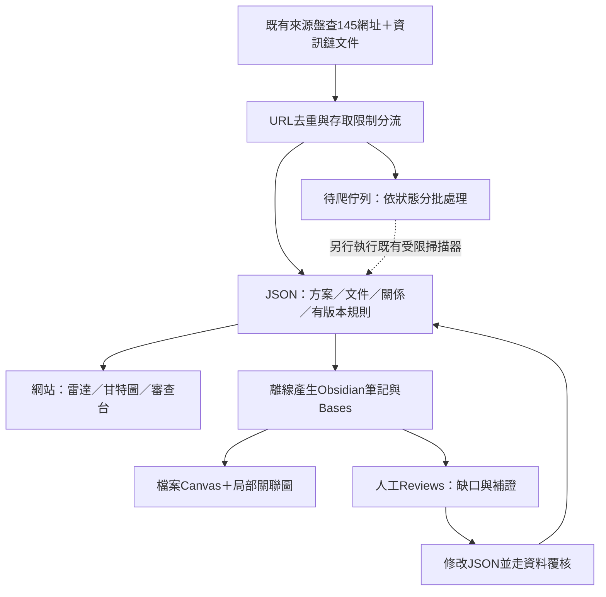

# Obsidian 研究工作台與來源佇列

更新：2026-11-01。使用者已確認在 D 槽建立獨立專案副本，vault 放在專案的 `vault/`。原 C 槽專案及八個既有 worktree 保留，不刪除、不搬動。本次不設定雲端同步、不新開爬取排程，也不修改網站日期、19筆候選或人工核准。

## 選擇：JSON 主檔＋Obsidian 研究＋學生網站

| 方式 | 適合 | 需要注意 |
|---|---|---|
| 現有網頁地圖／審查台 | 遠端免安裝、分享、學生雷達、明確的篩選與時間軸 | 深度探索與人工筆記較費力；仍可作遠端入口 |
| Obsidian vault | 方案／文件／規則間反向連結、局部圖、人工研究、Bases 表格 | 不是爬蟲或資料庫；直接改產生的筆記會與主檔分歧 |
| 本次混合方式 | 以同一套 JSON 產生上述兩種檢視 | 不建立第二套手動維護的獎學金資料庫 |

[Graph](https://obsidian.md/help/plugins/graph) 以筆記連結建立關聯圖；[Bases](https://obsidian.md/help/bases) 直接把 Markdown 屬性作為表格資料，不需要新增伺服器或外掛。[Canvas](https://obsidian.md/help/plugins/canvas) 的純文字卡片不會自動建立筆記反向連結，因此本次將既有地圖的方案與來源卡片改為真正的檔案卡片，並補上 wikilink。



## 已落地的結構

```text
vault/
  00-首頁.md                     操作入口與方案索引
  Generated/
    Programs/                   13方案；連向文件與規則
    Sources/                    184個去重來源；格式、狀態與出向關係
    Rules/                      10條待審規則；定位與版本hash
  Maps/來源資訊鏈.canvas         71個檔案卡片＋圖例；103條邊
  Views/來源與待爬清單.base      七種來源表格檢視；可編輯的靜態設定
  Views/待審規則.base            規則、適用範圍與年度；可編輯的靜態設定
  Views/crawl-queue.json         可供後續批次工具讀取的佇列
  Reviews/                      人工補證；只有README入Git
  Assets/                       預留；只有README入Git
  .obsidian/                    本機設定；不入Git
  .generated-manifest.json      產生器擁有的檔案與內容指紋
```

來源數184是舊盤查145個網址與現有資訊鏈58個文件網址的聯集，依完全相同的URL去重；不是184個獎學金，也不代表184個來源都已抓取。Canvas沿用13方案既有拓樸，不強塞所有尚未配對的來源；未配對來源先從Bases表格整理。

Markdown frontmatter 只存平坦屬性；完整日期規則、資格樹與證據仍在正式JSON，筆記以JSON程式碼區塊呈現。這符合[Obsidian Properties](https://obsidian.md/help/properties)的屬性操作方式，也避免把巢狀資料拆成難以還原的欄位。

## 待爬清單的意義

| 狀態 | 數量 | 下一步 |
|---|---:|---|
| checked | 26 | 已有可讀快照；依最後觀察日期與原規格決定重查，不代表最新或完整 |
| ready | 13 | 已有來源規格；實際執行前仍重新檢查robots與存取限制 |
| needs_profile | 83 | 定義入口／具名方案、格式、允許的連結深度、角色及掃描設定 |
| manual_only | 37 | 登入、robots疑義／禁止、403或停用；保留人工查核 |
| format_deferred | 11 | DOC／ODT等先補轉換器與測試，不冒充成功萃取 |
| needs_https | 2 | 先驗證HTTPS入口，不能直接降低傳輸限制 |
| reference_only | 12 | 技術文件、政策參考或海外占位，不當作獎助申請資料 |

既有禁止與停用優先於可讀標籤；來源筆記、表格和佇列都保留原盤查狀態。`ready`不是額外爬取授權。佇列不會自動執行；每次仍須套用原掃描器限制。預備批次上限為20次請求、12份文件、同站至少3秒，`model_mode=off`、`raw_retention=memory_only`；這些是匯出佇列的宣告，沒有新增執行器。

## 操作方法

1. 用Obsidian「開啟資料夾為儲存庫」，選專案中的 `vault` 資料夾。開啟 `00-首頁.md`。本次本機已完成註冊，資料夾名稱為 `vault`。
2. 要排工作量，開「來源／待爬清單」，切換「可分批掃描」「需補來源規格」或「人工查核」。點來源ID開筆記，再點官方入口。
3. 要看一個獎項的引用鏈，從首頁開方案；用「開啟局部關聯圖」，深度先設1–2。要看有方向與關係標籤的圖，改開Canvas。原生Graph只表達筆記連結，不應把反向引用讀成法規效力。
4. 要補線索，新增 `Reviews/` 筆記並連回方案／來源ID，註明觀察日期、網址與疑點。需要正式更正時，修改JSON並走原有覆核流程；筆記或勾選不能代替人工核准。
5. 分享遠端結果可沿用repo內的離線HTML地圖；不要求所有貢獻者安裝Obsidian。

開啟時只需核心的Graph、Canvas、Backlinks和Bases，不需社群外掛、Dataview或新增資料庫。若另一台裝置沒有啟用Bases，可從設定啟用核心外掛；一般筆記、Canvas及HTML仍可閱讀。

重建與一致性檢查（在專案根目錄）：

```powershell
.\.venv\Scripts\python.exe -B scripts/export_obsidian_vault.py
.\.venv\Scripts\python.exe -B scripts/export_obsidian_vault.py --check
```

CLI可用且Obsidian已開啟時，明確指定目標vault，避免讀寫其他私人vault：

```powershell
& 'C:\Program Files\Obsidian\Obsidian.com' vault=vault open 'path=00-首頁.md'
& 'C:\Program Files\Obsidian\Obsidian.com' vault=vault base:query 'path=Views/來源與待爬清單.base' 'view=可分批掃描' format=json
```

產生器先檢查整批內容指紋，偵測人工編輯就停止，不靜默覆寫。人工內容請先複製到Reviews，再由維護者處理衝突；不要刪除manifest來強迫重建。只有manifest列管、內容未被改動的過時檔案可由產生器移除；不遞迴清理vault。Canvas的JSON排版變動不算內容編輯，但移動節點／改連線會被攔下。Bases是可編輯的靜態YAML設定，不受產生器管理；篩選或欄寬變更可另開PR，自訂個人檢視則另存Reviews。它直接讀最新筆記屬性，不需每批重建。

## 如何節省token並逐批抓取

vault提供索引與研究介面，實際抓取與萃取仍走原管線：URL去重 → 存取政策 → 增量hash → 依格式準備document IR → 只重跑改變區塊／受影響欄位 → 規則優先萃取 → 必要時在已核可來源與成本範圍內使用模型 → 獨立檢核 → 待審JSON → 重建兩種檢視。

下一批先處理ready中具名且有缺口的少量來源，設定明確的法源／公告／校院系所關係及停止條件。再從83個需規格來源挑同版型入口，做可重用轉換器。不要把全圖或所有歷史原文每次重送模型；共享辦法只準備一次，各方案以文件ID和版本引用。人工只處理衝突、關鍵日期與新型態，未知可繼續導流官方。

本次export零HTTP、零模型、零新下載；大量PDF、受限HTML全文與私人附件不進vault。`hash_only`不因轉成Markdown就解除外送或保留限制。現有19筆候選及10筆pilot內容不變。

## 雲端與維護成本

首選先把可公開的產生筆記／地圖放既有GitHub repo：版本差異可追蹤，不新增常駐服務費。代價是Git同步／合併需維護，不等同即時多端同步；複製vault後仍需本機開啟資料夾。

人工Reviews、Assets與`.obsidian`預設不入Git。`.gitignore`只約束Git，不會限制OneDrive、Drive或其他雲端工具上傳；若未來要同步私人筆記，需另選私人目的地、同步排除規則與權限，不能把公共repo當私人備份。Obsidian亦提供[其他同步方式](https://obsidian.md/help/sync-notes)及[選購Sync／Publish](https://obsidian.md/pricing)；目前沒有啟用或購買。避免同一vault同時交給多個同步工具處理，參考[官方Sync說明](https://obsidian.md/help/sync)。

本次D槽是獨立Git clone，不共用C槽worktree的`.git`；可獨立驗證及回復。舊工作副本保留，之後若要清理需另行處理。Codex既有chat的工作目錄不因建立新clone而自動切換；後續工作請明確選D槽專案。

## 驗收與限制

- 離線測試驗184來源唯一性、舊來源完整納入、限制不放寬、wikilink與71檔案卡片可解析。
- 重建冪等、人工編輯阻擋、路徑逸出阻擋、人工筆記保留及過時檔案清理均有測試。
- CI以 `export_obsidian_vault.py --check` 檢查主檔與vault同步；公開Pages成品仍由原allowlist建置，不包含vault或本機設定。
- 本機Obsidian 1.14.5實際查詢Bases：184來源、ready13、待審規則10。介面檢查與完整測試結果見本PR。
- 本輪完整176項Python、46項Node、資料／掃描設定檢查、公開預覽及審查台建置通過。實際開啟兩份Bases與Canvas後重跑export檢查，內容仍無漂移；沒有新增第三方套件。
- 這不是所有來源已萃取成功或資訊鏈全部完整的驗收；下一批依佇列與缺口繼續，結果仍pending。
