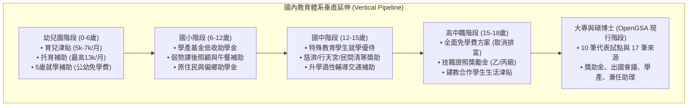
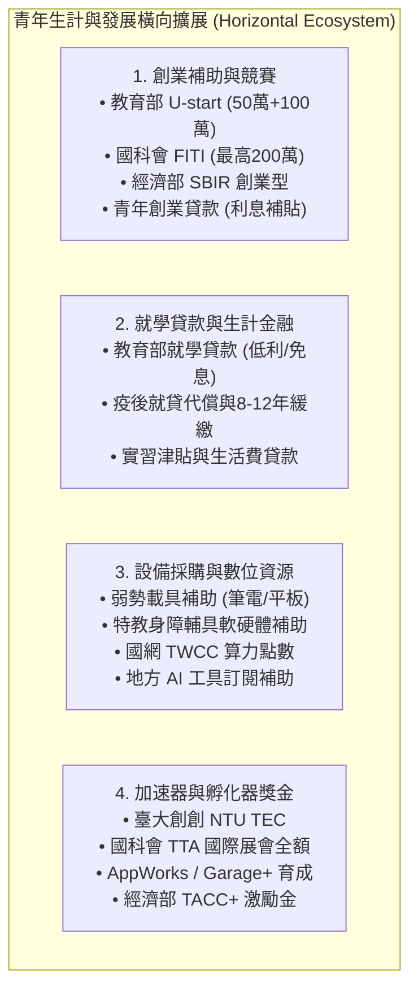

# OpenAI The Codex Open Source Fund 申請評估與 OpenGSA 垂直／橫向擴展藍圖

> **本文件定位**：針對申請 **OpenAI The Codex Open Source Fund / Codex for Open Source** 進行獨立深度檢索與可行性評估，擬定具體申請策略與中英文問答稿；並針對 OpenGSA 專案之長遠生命週期，系統化規劃**境內教育體系「垂直延伸」（幼兒園、國小、國中、高中職）**與**青年生計發展「橫向擴展」（創業補助、就學貸款、設備採購、加速器與孵化器）**之完整架構與資料模型藍圖。

---

## 1. 執行摘要（Executive Summary）

OpenGSA 專案由最初解決全臺碩博士研究生獎助學金與兼任助理勞動權益爭議起步，已建立起完整的「確定性規則優先、雙軌 LLM 輔助萃取與盤查、零個資外洩防禦、純靜態公開部署」之成熟開源架構。

經深度調研，OpenAI 官方專門面向活躍開源專案維護者設立之 **The Codex Open Source Fund / Codex for Open Source（100 萬美元專項基金）**，其核心宗旨為「透過 AI 工具與 API 額度減輕開源維護者的日常繁重負擔，促進公共代碼生態健康」。本專案具備完全開源、強固的 CI/CD 管線、負責任的 AI 治理設計（`hash_only` 零外送保護）、以及消除青年弱勢資訊不對稱之顯著公共利益，**高度契合其資助標準**。

同時，本報告進一步完成全臺教育與青年支援體系之拓撲規劃：
1. **垂直延伸**：向上銜接幼兒園（0~6 歲托育與育兒津貼）、國中小（義務教育弱勢代辦費、午餐與原民特教補助）、高中職（全免學費政策、證照獎勵金與建教津貼）。
2. **橫向擴展**：涵蓋大專與青年創業補助（FITI、U-start、SBIR）、就學貸款與寬緩利息補貼、弱勢載具與 AI 工具設備經費，以及國內頂尖加速器與孵化器（NTU TEC、TTA、AppWorks、Garage+、TACC+）。

---

## 2. OpenAI The Codex Open Source Fund 計畫深剖

### 2.1 計畫宗旨與官方支援項目
- **計畫名稱**：The Codex Open Source Fund / Codex for Open Source
- **主辦單位**：OpenAI Developer Programs & Open Source Initiatives
- **官方規模**：100 萬美元專項資助基金（滾動式審查，無截止期限壓力）
- **三大核心資助項目**：
  1. **高額 API 抵用額度（API Credits）**：經審核通過之專案，最高可獲贈 **\$25,000 美元之 OpenAI API 額度**，專供專案整合至 CI/CD 自動化流程、Pull Request 審查、資料檢驗與發布管線。
  2. **核心維護者 ChatGPT Pro 支援**：為公開倉庫之核心維護者提供 **6 個月免費 ChatGPT Pro 帳號**（內含完整 Codex 程式碼生成、Canvas 即時協作與進階資料分析功能）。
  3. **Codex Security 漏洞掃描與審計存取**：針對高影響力或具備複雜架構之專案，提供條件式存取專屬資安分析與漏洞掃描工具。

### 2.2 官方審查標準與核心偏好
相較於微軟或 Google 部分計畫要求極高的 GitHub Star 數或月下載量，OpenAI 的開源資助計畫展現出極高彈性與務實導向：
- **無硬性 Star / 下載量門檻**：官方明確指出，即便並非萬星專案，只要在特定領域發揮關鍵公共生態作用、維護活躍，均歡迎申請。
- **核心偏好條件**：
  - **公開與標準授權（Public & Open Source）**：專案必須為公開倉庫，採 OSI 認可之開源許可（如 MIT、Apache 2.0、CC BY 4.0）。
  - **維護者真實身分與寫入權限（Core Maintainer Role）**：申請人必須為具備倉庫 Write/Admin 權限的核心維持者。
  - **清晰的自動化工作流場景（Actionable Workflow）**：清楚說明 API Credits 如何實際用於減輕維護者繁重工作（如 PR 審查、資料抽取防偽、跨來源交叉盤查），而非無目的之閒置資源。
  - **嚴格的隱私與安全治理（Responsible AI & Safety）**：具備防提示詞注入（Prompt Injection Defense）機制與個資敏感資料隔離。

### 2.3 官方申請表單核心欄位分析
依據 OpenAI 官方申請入口，核心需填寫項目包括：
1. **GitHub Repository URL & Identity Verification**：倉庫網址與維護者 GitHub 帳號連結。
2. **Project Impact & Description**：專案解決之核心問題、使用者族群與社會/開源價值。
3. **Current Maintenance Challenges**：維護者目前面臨的最大工作負擔（例如：需每週爬取比對數十個政府網站之公告異動、檢驗非標準化法規條文）。
4. **Proposed Integration with Codex & API**：如何將 OpenAI API 整合入專案中（例如：雙軌資料萃取、自動化候選比對、PR 自動差異分析）。

---

## 3. OpenGSA 專案適切性評估（Suitability & Fit）

### 3.1 為何 OpenGSA 是絕佳的受資助專案？（六大契合優勢）

| 評估維度 | OpenAI 資助計畫偏好 | OpenGSA 專案實踐現狀 | 契合度評等 |
| :--- | :--- | :--- | :---: |
| **公共利益與影響力** | 具備實質社會價值、消除不平等或賦能弱勢社群 | 致力於消除全臺青年學子在獎助學金、清寒扶助與勞動工讀之嚴重資訊壁壘，具備極高公共教育價值 | ⭐⭐⭐⭐⭐ |
| **開源標準與透明度** | 完全開源、無商業鎖定、標準 OSI 許可證 | 程式碼採 MIT License，原創資料採 CC BY 4.0，部署於 GitHub Pages 公開倉庫，完全公開透明 | ⭐⭐⭐⭐⭐ |
| **AI 治理與安全邊界** | 負責任 AI、注重資安防禦、無個資濫用 | 內建 `hash_only` 轉載受限來源零外送保護、`<untrusted_source_data>` 提示詞注入隔離，無使用者個資儲存 | ⭐⭐⭐⭐⭐ |
| **管線自動化成熟度** | 具備健全 CI/CD，能真正落實維護自動化 | 擁有完善 GitHub Actions、90+ Python 單元測試、38+ Node 原型測試、資料合約防呆與覆核工作台 | ⭐⭐⭐⭐⭐ |
| **Token 使用效益精準度** | 反對無節制揮霍，偏好精準、高效益呼叫 | 堅持「確定性規則優先、模型僅作短片段補漏與盤查」，年消耗僅約 135 萬 tokens，額度可用性長達數十年 | ⭐⭐⭐⭐⭐ |
| **多 Agent 協同創新** | 鼓勵探索現代 AI Agent 協作開發與維護模式 | 專案由多 Agent 協同（開發、稽核、研究 Worktree）落實敏捷演進，為開源社群現代化維護典範 | ⭐⭐⭐⭐⭐ |

### 3.2 官方申請問答中英文對照草稿（Application Draft）

#### Q1. Project Overview & Mission（專案概述與使命）
- **英文草稿**：  
  > *OpenGSA (Grant, Scholarships, Award) is an open-source civic tech initiative in Taiwan dedicated to breaking down administrative information silos for higher education students and young researchers. Through deterministic rule engines combined with dual-track LLM verification (extraction and audit), OpenGSA transparently indexes official scholarships, research travel grants, and student labor rights protections without relying on proprietary databases or paid paywalls. All code is MIT-licensed, and data is published under CC BY 4.0 via GitHub Pages.*
- **中文對照**：  
  > OpenGSA 是一項台灣的公民科技開源倡議，致力於打破大專院校學生與青年研究人員長年面臨的獎助學金與行政法規資訊壁壘。本專案結合確定性規則引擎與雙軌 LLM 查核（補漏與盤查），透明化收錄官方獎助、研討會差旅補助與學生勞動權益，不依賴任何私有資料庫或付費牆。全專案程式碼採 MIT 授權，資料以 CC BY 4.0 透過 GitHub Pages 靜態發布。

#### Q2. Maintenance Challenges & Why You Need Support（維護挑戰與為何需要資助）
- **英文草稿**：  
  > *Government ministries and university departments across Taiwan publish critical scholarship and subsidy guidelines in deeply nested, non-standardized HTML and PDF announcements that change URLs and formats every academic year. Our core maintainers face a heavy burden in manually auditing parsing gaps, disambiguating subtle eligibility clauses (e.g., mutually exclusive stipends), and verifying application channels (physical postal vs. digital submission). We need OpenAI API credits and Codex integration to automate our candidate review pipelines and Pull Request verification without depleting maintainers' personal resources.*
- **中文對照**：  
  > 台灣各部會與各大學處室每年都會更換網址，並以極不標準化、深層嵌套的 HTML 與 PDF 公告最新獎補助要點。維護團隊面臨極大的日常審查負擔，包括比對解析缺漏、消解複雜的兼領排斥條款，以及核實紙本親送與電子線上等不同申辦管道。我們需要 OpenAI API 額度與 Codex 支援，將候選比對與 PR 自動化審查管線完全串接，免除維護者自掏腰包的負擔。

#### Q3. How will OpenAI Credits and Tools be Used?（如何具體使用 OpenAI 額度與工具？）
- **英文草稿**：  
  > *We will utilize OpenAI API credits strictly within our verified dual-track architecture: (1) As an `audit` adapter in GitHub Actions to cross-examine deterministic regex extractions against official excerpts, catching hallucinations or missed eligibility negation rules; (2) In our offline review workspace to generate structured PR diffs with non-normalized text evidence; (3) Utilizing Codex/ChatGPT Pro for maintainers to rapidly develop new institutional parser adapters for 50+ universities. Thanks to our strict short-excerpt and local rule-first design, a $25,000 grant will sustainably power OpenGSA for years of continuous public civic service.*
- **中文對照**：  
  > 我們將在已驗證的雙軌架構下嚴謹使用 OpenAI 額度：(1) 在 GitHub Actions 中作為 `audit` 適配器，交叉檢驗正則規則解析結果與官方原文摘錄，攔截任何遺漏的否定資格條款；(2) 在離線審查工作台中產出附帶非標準化證據之結構化 PR 差異；(3) 運用 Codex/ChatGPT Pro 協助維護者快速開發全台 50 所大專院校的專屬解析適配器。由於本專案嚴格堅持短片段與本地規則優先，\$25,000 美元的額度將可支撐 OpenGSA 數年以上的長期公益運作。

---

## 4. 未來擴展藍圖一：國內教育體系「垂直延伸」

現行 OpenGSA 聚焦於碩博士與大專階段。為實現全齡就學無障礙，未來可依年齡與學制向下進行垂直延伸，覆蓋幼兒園、國小、國中與高中職四大教育階段：



### 4.1 幼兒園階段（0~6 歲，學前托育與就學支持）
1. **行政院 0-5 歲育兒津貼**：
   - 主管機關：衛生福利部、教育部國民及學前教育署。
   - 給付標準：第 1 胎每月 5,000 元、第 2 胎每月 6,000 元、第 3 胎以上每月 7,000 元；取消排富條款。
2. **未滿 2 歲托育補助**：
   - 給付標準：送托公共化托育機構最高補助 7,000~13,000 元/月；送托準公共托育最高補助 13,000~19,000 元/月。
3. **5 歲至入小學幼兒就學補助**：
   - 給付標準：就讀公立幼兒園免學費；非營利幼兒園家長每月繳費不超過 2,000 元；準公共幼兒園每月不超過 3,000 元；差額由教育部全額補助。
4. **地方縣市加碼與弱勢加額**：
   - 台北市「友善托育補助」、新北市「弱勢幼兒教育補助」等地方局處加碼。

### 4.2 國小階段（6~12 歲，國民義務教育基礎支持）
1. **教育部學產基金低收入戶學生助學金**：
   - 補助金額：國小部每生每學期 1,000 元。
   - 資格依據：各級學校在學且具備鄉鎮市區公所核定低收入戶證明。
2. **原住民族委員會原住民學生獎助學金**：
   - 補助標準：原住民籍國小學童學期成績優異者獎學金（1,000~3,000 元）、低收入戶助學金。
3. **弱勢學生在校課後照顧與寒暑假營養午餐全額補助**：
   - 涵蓋低收、中低收、家庭突遭變故與經導師訪視認定之弱勢學童，學期間及寒暑假午餐費由縣市教育局全額代償（餐券或配送）。
4. **民間清寒小學助學金**：
   - 如財團法人張榮發基金會、慈濟「新芽獎學金」、行天宮文教基金會急難濟助。

### 4.3 國中階段（12~15 歲，義務教育深耕與多元保障）
1. **教育部學產基金低收入戶學生助學金**：
   - 補助金額：國中部每生每學期 2,000 元。
2. **特殊教育身心障礙學生獎助學金與代金**：
   - 依《特殊教育法》，提供持有身心障礙證明之學生就學優待、教育代金（每學期約 2,000~3,500 元）與無障礙學習輔具。
3. **偏遠地區與非山非市學校學生交通補助**：
   - 補助偏鄉國中生通學交通費或學生宿舍膳宿費。

### 4.4 高中職階段（15~18 歲，高級中等學校學費平權與技職賦能）
1. **「全面落實高中職免學費方案」（行政院重大政策）**：
   - 實施期程：自 112 學年度第 2 學期起全面實施。
   - 政策重點：**全面取消家庭年所得 148 萬元排富限制**，全國公私立高中職（普通科、綜合高中、技術型高中）學生全額免繳學費（公立免繳約 6,240 元/學期，私立免繳約 24,488 元/學期）。
2. **私立高中職雜費與代收代辦費補助**：
   - 針對低收、中低收入戶學生，除學費全免外，另補助雜費與書籍冷氣等代辦費。
3. **技術型高中技藝與技能檢定證照獎勵金**：
   - 主管機關：勞動部與各縣市教育局。
   - 獎勵標準：高中職在校生考取技術士證照，丙級給予 1,000~3,000 元獎勵，乙級證照給予 5,000~10,000 元獎助金。
4. **高級中等學校建教合作學生生活津貼**：
   - 依《高級中等學校建教合作實施及建教生權益保障法》，廠商給付建教生之生活津貼**不得低於法定最低工資**，並強制投保勞保與勞工職業災害保險。

---

## 5. 未來擴展藍圖二：青年發展與生計「橫向擴展」

除了常規獎助學金，大專及碩博士青年面臨龐大的創業育成、生計信貸、硬體設備及加速器挑戰。OpenGSA 可將檢索與結構化能力橫向擴展至以下四個領域：



### 5.1 創業補助與創新競賽獎金（Entrepreneurship Grants & Awards）
1. **教育部青年發展署 U-start 創新創業計畫**：
   - **第 1 階段補助**：入選團隊獲 50 萬元創業補助（含學校育成單位輔導費 15 萬元、團隊創業基金 35 萬元）。
   - **第 2 階段創業績優團隊獎助**：經育成輔導並正式成立公司者，評選為績優團隊可再獲 25 萬至 100 萬元創業獎助金。另有針對原住民青年的「U-start 原漾計畫」。
2. **國科會創新創業激勵計畫（FITI, From IP To IPO）**：
   - 面向對象：全臺大專院校教授、研究生與青年團隊之後端科研成果轉型。
   - 獎勵標準：歷經兩階段評選與加速培訓，最終獲選「創業傑出獎」之團隊可獲得 **100 萬至 200 萬元創業種子資金**。
3. **經濟部中小及新創企業署 SBIR（小型企業創新研發計畫）**：
   - 創業型 SBIR（Stage 1 概念驗證、Stage 2 研發執行）：提供成立未滿 5 年之新創最高數百萬元研發補助款（免還款）。
4. **地方政府青年創業補助**：
   - **臺北市 SITI 產業發展獎勵補助**：創業補助最高 100 萬、研發補助最高 500 萬、品牌建立與天使投資媒合。
   - 新北市、桃園市、高雄市青年局青創方案與青創基地免租金進駐。
5. **青年創業及啟動金貸款（青創貸款）**：
   - 承貸行庫由信保基金提供最高 95% 信用保證，100 萬元以下免寫計畫書、由經濟部補貼最長 5 年利息。

### 5.2 就學貸款與生計金融支持體系（Student Loans & Financial Relief）
1. **教育部高級中等以上學校學生就學貸款（就貸）**：
   - 承貸銀行：臺灣銀行、台北富邦銀行、高雄銀行、臺灣土地銀行。
   - 涵蓋範圍：全額學雜費、實習費、書籍費（大專每學期 3,000 元）、住宿費、電腦及網路使用費，以及低收/中低收入戶生活費（低收每學期最高 4 萬元、中低收最高 2 萬元）。
2. **就學貸款寬緩與減免救濟措施**：
   - **疫後就學貸款補助方案**：政府主動代償在學中或還款中弱勢學生 1 年本息。
   - **緩繳本金機制**：畢業後月收入未達 5 萬元或符合低收者，可申請「緩繳本金」，每次申請 1 至 3 年，累計最長可達 **8 至 12 年**；緩繳期間之利息由政府全額負擔。
   - **延長還款期限**：一般還款期為就學年數的 1 倍，弱勢族群可申請延長為 1.5 至 2 倍，大幅減輕每月負擔。

### 5.3 設備經費與採買補助（Equipment & Digital Infrastructure Subsidies）
1. **弱勢學生數位學習載具補助**：
   - 教育部「高等教育深耕計畫」附錄：各大學針對低收、中低收與特殊境遇學生，提供自主學習筆記型電腦或平板電腦採購補助（每年約 15,000~25,000 元）。
2. **大專身心障礙學生無障礙教育輔助器材補助**：
   - 依《身心障礙學生教育輔助器材及適性教材提供辦法》，全額補助視障盲用電腦、擴視機、點字觸摸顯示器、聽障調頻助聽器及肢障特製課桌椅。
3. **學術研究耗材與設備補助**：
   - 國科會大專學生研究計畫（提供研究耗材費與差旅費）、碩博士論文研究實地訪調設備耗材補助。
4. **數位工具與 AI 算力補貼**：
   - 國家高速網路與計算中心（TWCC）青年學術研究點數補助。
   - 地方政府青年數位培育補助（如已查核之台北市青年局 4,000~8,000 元、新竹市 3,000~6,000 元 AI 工具軟體訂閱津貼）。

### 5.4 創業加速器與孵化器補助與獎金（Accelerators & Incubator Awards）
1. **國立臺灣大學創新育成中心 / 臺大創創加速器（NTU TEC）**：
   - 資源：提供大專生與校友團隊垂直加速器、種子基金媒合、免費工作空間與實作競賽獎勵金。
2. **臺灣科技新創基地（TTA, Taiwan Tech Arena）**：
   - 主管機關：國科會（NSTC）。
   - 資源：選拔優秀青年與校園科技新創團隊，全額補助前往美國 CES、法國 VivaTech 等全球頂尖展會之機票、攤位與商務媒合費用，對接 Plug and Play、Techstars 等國際加速器。
3. **AppWorks（之初加速器）**：
   - 大東南亞最大創業加速器社群，每半年招募一期，全程免費進駐；提供 AWS/GCP/OpenAI 雲端額度，並透過 AppWorks Funds 進行種子輪至 A 輪注資。
4. **Garage+（時代基金會育成中心）**：
   - 整合台灣頂尖企業（台積電、聯發科、廣達等）業師網絡，提供種子團隊獎助金、天使投資網絡與國際參展支援。
5. **TACC+（Taiwan Accelerator Plus）**：
   - 經濟部中小及新創企業署主導之物聯網與生醫專屬加速器，提供入選團隊最高數十萬元之概念驗證（PoC）激勵金與產業場域驗證。

---

## 6. 架構整合藍圖與資料模型調適（Schema Adaptation）

為了讓現行的 OpenGSA 資料管線能平滑納入垂直教育階段與橫向創業生態，候選資料模型與核心欄位可進行向下相容之微調：

### 6.1 `candidate.schema.json` 擴充設計
```json
{
  "$schema": "http://json-schema.org/draft-07/schema#",
  "title": "OpenGSA Candidate Schema (Expanded for K-12 & Venture)",
  "type": "object",
  "properties": {
    "resource_kind": {
      "type": "string",
      "enum": [
        "scholarship",       // 傳統獎學金
        "grant",             // 研究/差旅補助款
        "subsidy",           // 政策性津貼/免學費差額
        "loan_relief",       // 就學貸款/利息寬緩
        "venture_grant",     // 創業補助/FITI/U-start
        "incubator_award",   // 加速器獎金/進駐激勵
        "equipment_stipend", // 數位載具/輔具採購補助
        "childcare_aid"      // 托育/育兒就學補助
      ]
    },
    "education_stage": {
      "type": "array",
      "items": {
        "type": "string",
        "enum": [
          "preschool",       // 幼兒園 (0-6歲)
          "elementary",      // 國小 (6-12歲)
          "junior_high",     // 國中 (12-15歲)
          "senior_high",     // 普通高中 (15-18歲)
          "vocational",      // 技術型高中/高職 (15-18歲)
          "undergraduate",   // 大專院校學士
          "master",          // 碩士班
          "doctorate",       // 博士班
          "postdoc",         // 博士後研究員
          "early_career"     // 青年初創業者/畢業未滿5年
        ]
      }
    },
    "application_process": {
      "type": "object",
      "properties": {
        "delivery_method": {
          "type": "string",
          "enum": ["online_only", "paper_only", "online_and_paper", "school_internal", "bank_counter", "not_applicable"]
        },
        "financial_terms": {
          "type": "object",
          "properties": {
            "is_repayable": { "type": "boolean" },
            "interest_subsidy": { "type": "string" },
            "grace_period_years": { "type": "number" }
          }
        }
      }
    }
  }
}
```

### 6.2 零負擔架構保證
- **相容性**：現有 10 筆試點與大專碩博士資料維持 `education_stage: ["master", "doctorate"]`，完全向下相容，不破壞既有驗證邏輯。
- **純靜態性能**：即便未來資料量由 10 筆擴展至 500 筆，前端 JSON 壓縮後大小仍小於 200 KB，維持客戶端毫秒級即時過濾（Client-side Filtering）之優異體驗，完全不依賴後端資料庫查詢。

---

## 7. 參考來源、官方網站與文獻清單（References & Official Links）

### 7.1 OpenAI 官方資助與開源計畫
1. **OpenAI Developer Programs: Codex for Open Source & Open Source Fund**  
   - 官方網站：[https://developers.openai.com/](https://developers.openai.com/)  
   - 官方公告與申請指引：[OpenAI Codex for Open Source Overview](https://openai.com/)
2. **OpenAI Researcher Access Program**  
   - 官方申請頁：[https://openai.com/form/researcher-access-program/](https://openai.com/form/researcher-access-program/)

### 7.2 垂直延伸官方依據（幼兒園至高中職）
1. **教育部國民及學前教育署：全國教保資訊網（育兒津貼與幼兒就學補助）**  
   - 官網：[https://www.ece.moe.edu.tw/](https://www.ece.moe.edu.tw/)
2. **教育部學生學產基金助學金（國小、國中、高中職低收入戶助學金）**  
   - 官網：[https://www.saf.edu.tw/](https://www.saf.edu.tw/)
3. **行政院「落實教育平權拉近公私立大專學雜費差距及其配套措施方案」（高中職全面免學費方案）**  
   - 行政院新聞稿與法規說明：[行政院重要政策公告](https://www.ey.gov.tw/)
4. **原住民族委員會：原住民學生獎助學金平臺**  
   - 官網：[https://law.cip.gov.tw/](https://law.cip.gov.tw/)

### 7.3 橫向擴展官方依據（創業、貸款、設備、加速器）
1. **教育部青年發展署：U-start 創新創業計畫官網**  
   - 官網：[https://ustart.yda.gov.tw/](https://ustart.yda.gov.tw/)
2. **國科會創新創業激勵計畫（FITI）官網**  
   - 官網：[https://fiti.stpi.narl.org.tw/](https://fiti.stpi.narl.org.tw/)
3. **經濟部中小及新創企業署：小型企業創新研發計畫（SBIR）**  
   - 官網：[https://www.sbir.org.tw/](https://www.sbir.org.tw/)
4. **臺灣銀行就學貸款入口網（高級中等以上學校就學貸款與還款寬緩）**  
   - 官網：[https://sloan.bot.com.tw/](https://sloan.bot.com.tw/)
5. **國立臺灣大學創創中心（NTU TEC）**  
   - 官網：[https://tec.ntu.edu.tw/](https://tec.ntu.edu.tw/)
6. **臺灣科技新創基地（TTA, Taiwan Tech Arena）**  
   - 官網：[https://www.taiwanarena.tech/](https://www.taiwanarena.tech/)
7. **AppWorks Accelerator**  
   - 官網：[https://appworks.tw/](https://appworks.tw/)
8. **時代基金會 Garage+ 育成中心**  
   - 官網：[https://www.garageplus.asia/](https://www.garageplus.asia/)
9. **經濟部 TACC+ 臺灣物聯網加速器**  
   - 官網：[https://www.taccplus.com/](https://www.taccplus.com/)
