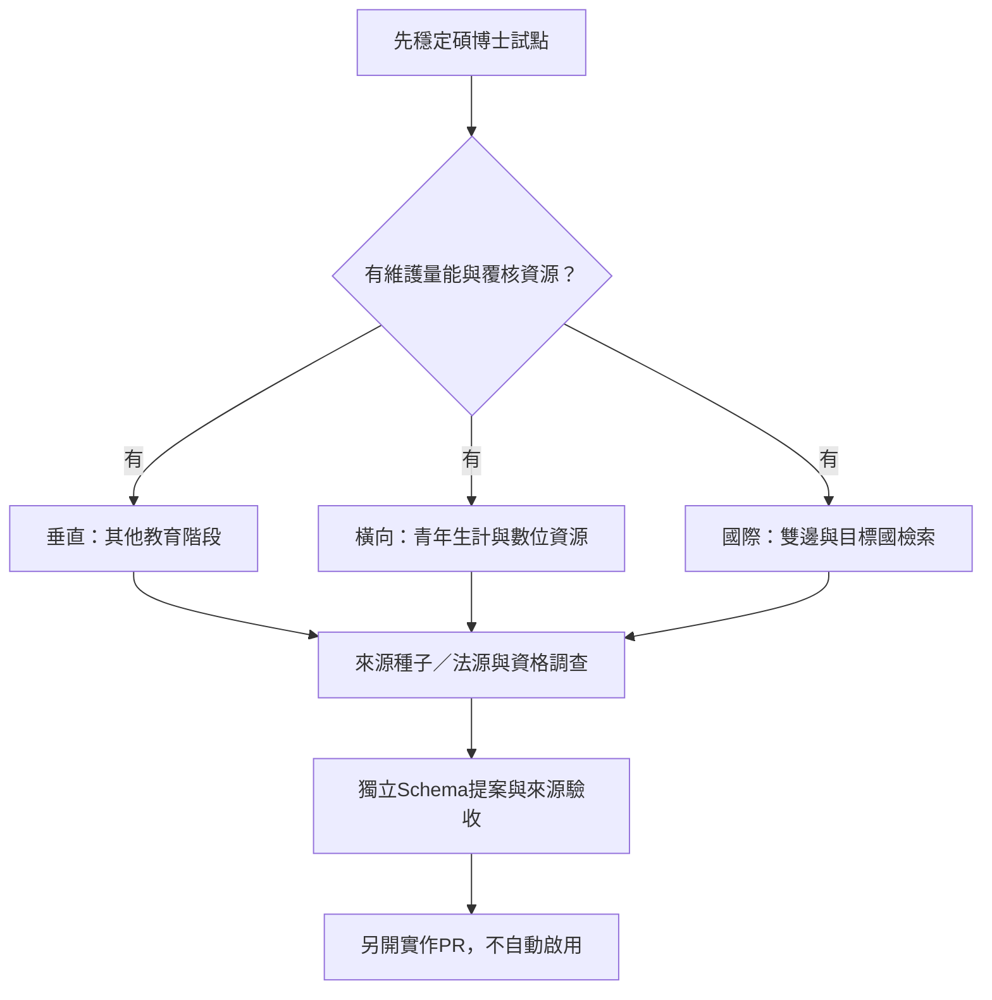

# 開源資助申請評估與擴展藍圖

2026-11-01整合PR #23，修正把不同入口的福利混為固定套裝、推定獲獎及未查證補助金額的內容。這是內部規劃／草稿，沒有提交申請、獲得資助、加入正式獎助資料或啟用新範圍。現階段仍優先穩定碩博士試點。

## 官方資助入口與判斷

| 入口 | 官方明示與限制 |
|---|---|
| [Codex Open Source Fund](https://openai.com/form/codex-open-source-fund/) | 官方介紹為100萬美元計畫，個案可獲最高25,000美元API額度、持續審查；上限不是承諾給付 |
| [Codex for Open Source](https://openai.com/form/codex-for-oss/) | 入選維護者可取得六個月含Codex的ChatGPT Pro，Security為條件式；API額度依申請審核，不把25,000美元當每位維護者固定福利 |
| [計畫介紹](https://developers.openai.com/community/codex-for-oss) | 重視活躍維護、使用／生態重要性與核心維護者角色；可解釋專案重要性，但不據此宣稱零採用也必然符合 |

表單、組織帳戶、權限、兌換與額度使用／有效期須於實際申請時再核對；研究報告不替申請人接受條款。未取得額度數量、期限與使用限制前，不能估算可支撐數十年。

OpenGSA已有公開MIT程式碼、CI、候選覆核邊界及公共教育用途，可作為申請說明。原創文件／可授權資料編輯採CC BY 4.0，但CC BY不是OSI軟體授權，第三方來源不因此改授權。採用規模、活躍使用與實際維護負擔仍需證據，不能自評全項滿分或宣稱必定核准。

## 送出前需要準備

1. 真實主要／核心維護角色、公開repo與權限，由申請人自行提供帳戶資料，不提交公開repo。
2. 實際使用量、回饋與維護案例；目前是公開預覽，不編造受惠人數、使用者或合作機構。
3. 可量測的用途：程式／PR維護、資料契約測試與已允許來源的有限模型盤查。資料萃取是否屬核准用途須依計畫答覆，不當然納入。
4. 先提供合成或可合法處理樣本；hash_only零外送、模型排程off、付費未核可等邊界維持。
5. 實際tokens與預算上限；現有140項Python／39項Node是流程驗證，不是模型準確率或真實覆蓋率。

## 中英文草稿

以下為專案自述草稿，不是官方表單問題逐字轉載；提交前依當時欄位及字數修訂，不含私人帳戶資料。

**專案與公共價值**

OpenGSA彙整臺灣研究生獎助與權益來源，以可追溯候選、規則檢核與人工覆核降低資訊不對稱。現有公開預覽、結構化資料契約與測試管線；正式候選仍待審，不宣稱已提供即時完整清單。

OpenGSA is an open-source project helping graduate students in Taiwan understand funding opportunities and student-worker rights. It provides a public prototype, traceable candidate records, deterministic checks, and a human review workflow. Candidate data remains unpublished pending review.

**維護負擔與擬議用途**

來源的HTML／PDF、年度與條文格式不同，維護者須查核解析缺漏、時程角色與版本。希望評估Codex對程式維護、PR檢查與資料契約測試的幫助；來源內容的模型評測另受授權、隱私及成本邊界約束，不要求取代人工核准。

We would evaluate Codex for parser maintenance, pull request review, and data-contract tests. Any model evaluation involving source content would remain subject to permission, privacy, and cost checks. We would measure outcomes on reviewed samples and retain human publication decisions.

## 擴展方向：保留規劃，不預先承諾支援

| 擴展軸 | 可盤點類別 | 必須補的資料 |
|---|---|---|
| 學前、國小、國中、高中職 | 育兒／托育、弱勢助學、午餐／交通、身障輔具、技職與建教支持 | 教育階段、申請／受益者、監護人、縣市與所得條件、勞動與津貼區分；不沿用原研究未逐筆核實的金額 |
| 青年生計與數位支持 | 創業／創新競賽、U-start／FITI／SBIR搜尋種子、就貸寬緩、設備／AI／算力、加速器 | 補助／貸款／投資分流，個人／團隊／公司身分、可認列支出與兼領；不是都適用研究生 |
| 跨國雙邊 | NSTC-DAAD／JSPS、互惠／Fulbright、校際雙聯、Erasmus／MSCA等搜尋種子 | 出發／目的國、國籍與居留、派出／接受單位、兩方規定與共同期限；尚未查明的計畫名稱不當作現行可申請項 |
| 目標國深度 | 國家／地方／大學與系所資源 | 語言、幣別、時區、版本與法源；留學生工時等權益須逐國正式依據，不推定通用上限 |

以上只有搜尋種子，沒有補助金額、開放狀態或官方資格保證。海外占位與較早階段教育不進本輪19筆候選。

## Schema與架構影響

未來可評估education_stage、origin／destination countries、agreement_type及新的resource_kind，但新增enum不會自動向下相容；需契約版本、資料遷移及前端／篩選／RSS／ICS測試。簽證工時不可只存一個通用數字，需國別、身分、期間、條文與例外。

維持Git正式版本、靜態輸出與可替換來源適配；有實際查詢需求才評估D1。匯率／PPP、自架搜尋、國際通知都是另案，不預先新增外部API或資料庫。長期成本假設見[維運評估](LONG-TERM-ARCHITECTURE-AND-OPERATIONS.md)。
