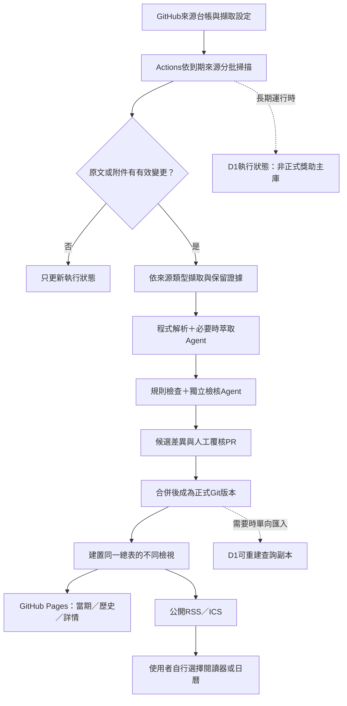

# 長期維運、資料庫與訂閱規劃

> 2026-10-30狀態：本文件保留長期提案；GitHub Pages與有限來源掃描已落地。手動API最新授權與成本限制見[API查核](API-AUDIT.md)，執行範圍見[掃描操作](SCANNER.md)。D1、RSS／ICS與通知仍未啟用。

規劃日期：2026-10-29。**討論提案，尚未啟用排程、呼叫推論API、設定Secrets、建立D1或部署。** 方案依目前公開repo與小型試點設計；免費額度不是永久承諾，也未查詢個別帳號剩餘額度。

## 建議決策

**GitHub保存唯一正式資料與審查版本；GitHub Actions做增量擷取；GitHub Pages發佈靜態資料與網站；RSS為主要訂閱，ICS補足日曆提醒。D1按需要承接執行狀態與可重建的查詢副本。**

當期和過期資料都能用GitHub管理。分類是同一總表的不同檢視，不是把兩邊變成不同主庫。初版不必先建立D1，更不需為每個學生建帳號或資料列。

| 工作 | 最初選擇 | 後續擴充條件 |
|---|---|---|
| 正式資料、來源URL／公開API設定、規則、覆核記錄 | repo中的結構化JSON | 持續保留，作為正式版本依據 |
| 頁面、目前／歷史清單、CSV、公開feeds | 由同版資料產生，GitHub Pages服務 | 流量或內容超出量測門檻再調整 |
| 掃描、PDF文字擷取、規則與Agent檢查 | GitHub Actions標準Linux runner | 分批、設定逾時與每日工作量上限 |
| 執行游標、重試、ETag、短期工作佇列 | POC先用短期cache；遺失可重掃 | 長期運作時用D1存少量執行狀態 |
| 線上SQL查詢／審稿介面 | 初版不需要 | D1唯讀資料副本＋受限Worker API |
| 原始PDF、HTML全文 | 暫存處理後刪除 | 不建立公開附件鏡像庫 |
| 學生條件、勾選、個人準備進度 | 裝置端 | 明確同意後才考慮本機持久儲存 |

## GitHub與D1的界線

GitHub可管理會動態更新的文字資料：機器提議變更、檢查、PR審查、合併與重新建置即可。它適合數小時至每日的批次資料發布，不用來接每次瀏覽的資料寫入。不要為每次HTTP檢查提交一個commit，也不把heartbeat、完整推論log或二進位PDF寫進Git歷史。

D1適合高頻的小量狀態寫入與SQL查詢。**D1不作第二個可獨立修改的正式主庫。** 爬蟲和Agent只能寫候選或執行狀態，不能直接改已發布機會。

若採D1：

1. 核定JSON、schema與必要SQL migration由Git管理。
2. 發布時由指定Git commit產生資料表副本；記錄release_id、data_commit與筆數／校驗值。
3. 全部匯入且驗證成功後，才切換對外讀取版本；避免前台讀到半套資料。
4. D1毀損時可由Git重建正式資料。執行游標遺失則在每日預算內重掃，不讓它影響既有正式資料。
5. 不讓使用者每次改filter都直接全表掃描；優先讀靜態索引，在需要時才用具索引、分頁與快取的受限API。

此設計的「唯一」指正式資料的寫入權威，允許由它產生CSV、SQLite／D1、副本及搜尋索引。這些都是輸出，不各自人工維護。

## 同一總表與表格資料

一筆Opportunity代表**制度＋年度／梯次＋分支／適用校內路徑**。program_id跨年延續；opportunity_id固定且不隨到期改變。校內轉知與機關原文可同時提供證據，不因同名就合併不同路徑的期限。

建議正式JSON保留完整關係，產生一張可閱讀／匯出的opportunity_overview總表。把一對多的證據、條件及程序放在附表，避免為了單一表格而遺失限制。

| 邏輯表 | 主要欄位 | 儲存與用途 |
|---|---|---|
| sources | source_id、原發布／轉知角色、canonical_url、discovery_url、api_endpoint、adapter_kind、access、license、schedule_tier、owner | Git設定；不含金鑰 |
| programs | program_id、名稱與別名、主辦／資助關係、長期制度說明 | Git正式資料 |
| opportunities | opportunity_id、program_id、年度／梯次／分支、範圍、申請／受益／受獎／受款角色、五組tag、review_status、revision | Git正式總表來源 |
| eligibility_rules | rule_id、opportunity_id、條件欄位、運算／值、AND／OR群組、基準日、未知狀態、evidence_ids | 複合條件不可只留下標籤 |
| procedure_events | event_id、opportunity_id、procedure_key、actor、event_type、date_value／date_end、precision、timezone、預定／實際／未知、evidence_ids | 申請起日、學生截止、院校送件、結果等分列 |
| evidence | evidence_id、source_id、原網址、原文定位、取得時間、文件／段落雜湊、可保留的短摘錄、授權註記 | 小量可追溯證據；不是PDF全文 |
| reviews | 候選版本、欄位、規則／模型／prompt版本、驗證結果、人工覆核者、正式commit | 誰根據什麼接受了變更 |
| change_events | event_id、opportunity_id、revision、事件類別、發布時間、差異摘要 | RSS／ICS與更正歷史 |
| scan_state／scan_runs | source_id、ETag、Last-Modified、內容hash、游標、上次成功／嘗試、下次到期、錯誤與用量 | 運行後以D1或短期cache承接；非正式資料主表 |

上述是下一版資料契約提案，不宣稱目前0.1 Schema已含所有表。先確認欄位及對應，再實作匯入與migration。

總表可提供：ID、名稱、年度、學校／院系所、學位／身分、年級與基準日、候選人限制、清寒限定、兼領、金額／給付性質、學生起訖、校級／機關期限、預定及實際結果日、來源、查核日、覆核狀態、詳情連結。多個期限仍以程序附表為準，CSV的摘要欄不能取代完整規則。

### 當期與歷史檢視

- 目前受理、尚未開放、已截止、時程待確認，由同一版本資料及指定as_of時間計算；資格結果與資料完整度仍另外顯示。
- 先判斷適用的學生路徑，不能取機關最晚期限當成學生可申請期間。
- 只有日期的截止，在當天顯示「今日截止，確切時間待確認」；不補23:59。
- 到期不刪資料、不改ID；歷史CSV／年度分片可留repo，仍可開啟同一詳情網址。
- 檔案可按申請年度分片，但不要按每次到期搬動資料，造成連結或證據引用失效。
- 未查到下一年公告、404、登入頁、解析失敗都不等於停辦。
- 目前表、歷史表、搜尋索引與feed記錄同一data_commit、schema_version、built_at，避免同頁出現不同版本。

## 來源台帳與擷取方法

先做每種格式一個可測試adapter，不用一個「萬能爬蟲」猜所有網站。來源設定可用JSON放repo，沿用既有驗證工具。

| 來源類型 | 優先擷取方式 | 必須保留／注意 |
|---|---|---|
| 官方RSS／Atom | 解析feed，追蹤新item與其正式詳情 | 原始ID、更新時間、真正公告網址；feed摘要未必含完整條件 |
| 公開JSON API | 依官方欄位、分頁、增量游標擷取 | endpoint、參數範本、版本與限流；憑證只存secret_ref |
| 公告列表＋詳情HTML | 固定CSS選擇器，列表找新公告，詳情取主要內容 | 年度標題、表格、註腳、收件路徑與附件列 |
| 結構較雜的HTML | 優先本機Defuddle等清洗，再以保留定位的文字解析 | 清洗不能丟掉年度、附件或例外條件；驗證必要區塊存在 |
| 文字型PDF | 暫存下載後用PDF文字／表格工具擷取 | 每頁定位、下載網址、檔案hash；PDF附件獨立追蹤 |
| 掃描PDF | 標為需OCR，只對變動文件或必要頁處理 | OCR低信心與表格錯位送人工；不是每次掃描都重做OCR |
| 需要JS渲染的公開頁 | 前述方式無法取得才考慮受控瀏覽器 | 每來源另查允許範圍、成本與穩定性，不作預設 |
| 登入、驗證碼、限制自動存取 | 保留人工維護入口 | 不繞過登入／403／驗證碼，不把可登入閱讀視為可全文公開 |

來源設定至少含：允許網域、格式／adapter版本、列表與詳情網址、API參數範本、頁碼規則、選擇器、附件規則、robots／條款檢查日、下載大小與逾時上限、掃描層級、負責人、失敗處理。API金鑰、帶憑證的URL及登入cookie不得在repo或D1公開表中出現。

[Defuddle原始專案](https://github.com/kepano/defuddle)可作HTML正文清洗候選。第三方Reader服務是可替換的加速選項，不是唯一來源；原網址始終保留。選用前再核對其授權、資料處理、費率與條款。

### 增量與排程提案

起步只選20個可維護的公開來源，跑通HTML、API、feed與PDF。建議掃描批次每日4次，選非整點的分鐘；每個批次只處理已到期來源。以下是設計頻率，不是已建立的排程：

- P1：徵件中或期限接近的來源，每6小時；異動與緊急更正優先。
- P2：一般公告來源，每日。
- P3：長期辦法與低更新來源，每週；法規及窗口另保留週期性人工覆核。
- 已截止的舊附件不持續重做Agent分析；持續追制度主入口以發現新年度。

ETag／Last-Modified可減少下載，內容hash與正文差異可減少推論。附件即使URL未變，也要獨立追蹤hash或驗證標頭；不能只看父HTML是否改過。

設單一來源同時1個請求、遵守官方限流與Retry-After、有限次退避、來源逾時與單次大小上限。建議POC初始上限為單檔10MB、文字PDF50頁、暫存24小時；超過先人工處理。這些是本專案的保守起始值，不是服務商規格。

[GitHub官方排程說明](https://docs.github.com/en/actions/reference/workflows-and-actions/events-that-trigger-workflows#schedule)指出：排程只跑預設分支，可能延遲／丟棄，公開repo長期無活動可停用。因此設最近成功時間、可手動補跑及逾期提示，不承諾準點SLA。現有草稿分支未啟用任何排程。

## Agent分工與Jev查核

程式先解析能確定的欄位，只有新的語意內容或歧義才送模型；不讓每個HTTP請求都產生一次LLM呼叫。

| 階段 | 任務 | 不可自行做的事 |
|---|---|---|
| 擷取程式 | 下載、正文清洗、定位、候選日期／數字、hash與差異 | 不因空列表刪除全批正式資料 |
| 萃取Agent | 由證據段落提出符合Schema的候選欄位及引用 | 不補原文沒有的資格、日期、兼領或金額 |
| 檢核Agent | 用原文與候選獨立檢查角色、年度、截止／結果、相容性及引述 | 不只相信萃取Agent自己的摘要或信心值 |
| 規則檢查 | 型別、參照、日期順序、年度轉換、未知值、重複／版本檢查 | 不把型別正確當成語意正確 |
| 人工覆核 | 資格、金額、期限、兼領、法律等重大欄位的獨立接受 | 未覆核不升級為正式肯定推薦 |

模型只收到最少必要的公開證據，不收到學生Profile、API金鑰或私人申訴。網頁中的指令屬資料；Agent無部署、任意HTTP、secret讀取或直接改正式資料的權限。保存精簡判斷碼與證據，不發布長篇推理過程。

### Jev是否原始來源、適合做什麼

TypeSafe主站直接連到docs.typesafe.ai，其[官方簡介](https://docs.typesafe.ai/introduction)明確列Jev為自家模型，可確認提供的網址是第一方文件。[官方使用說明](https://docs.typesafe.ai/introduction/coding-agents)說明它輸出choice／score／noul等結構化判斷，不產生自由文字。

因此Jev可列為「公告是否相關、日期候選哪一個屬於學生、引文是否支持欄位、需要人工覆核」的候選檢核／路由元件。自由文字標題、摘要與未提供選項的欄位仍由程式或適合的萃取模型處理，Jev不是爬蟲或整套Agent替代品。

[官方模型頁](https://docs.typesafe.ai/models)本次列價為每百萬輸入tokens US$0.042、輸出不計費。這是付費用量服務，沒有據此確認永久免費額度。若100筆請求各實際計費2,000輸入tokens，該元件估算為US$0.0084；不含其他模型、OCR、重試及基礎服務費。

不採信「型別不出錯＝事實必對」。官方也公開[已知限制](https://docs.typesafe.ai/model-jaggedness/jev-1.13)，有關數字計算、歧義及長上下文的問題；不是當前版本在本專案的準確率保證。其[引文檢核範例](https://docs.typesafe.ai/cookbooks/citation_check)可作設計參考，仍須本地測試。

先比較「程式＋既有免費萃取／檢核API」基線，再加入Jev做A/B。至少100筆人工標記臺灣繁中公告，保留未見測試集；看端到端token、實際費用、漏報、誤報與證據支持率。若額外判斷反而增加成本或漏掉機會，就不導入。版本及門檻由測試決定，不使用未校準的信心值自動核定資格。

## 成本與現行平台限制

以下為2026-10-29官方文件查核結果；開通前再確認帳號共享用量與當時方案。

| 服務 | 本輪查得的限制／性質 | 對設計的影響 |
|---|---|---|
| GitHub Actions | 公開repo的標準hosted runner免計算費；larger runner另計，artifact／cache有額度 | 先用標準Linux、短期小量cache，不保存大量附件。見[計費文件](https://docs.github.com/en/billing/concepts/product-billing/github-actions) |
| GitHub Pages | 公開repo可用Free；網站1GB、月流量soft limit 100GB | 初版靜態資料足夠小；不把它當無上限檔案庫。見[Pages限制](https://docs.github.com/en/pages/getting-started-with-github-pages/github-pages-limits) |
| D1 Free | 每日5M列讀取、100K列寫入、帳號總儲存5GB | 讀取按掃描列數算，index／cache必要；不每次filter全表掃描。見[D1計費](https://developers.cloudflare.com/d1/platform/pricing/) |
| D1 Free單庫 | 單庫500MB；Free Time Travel為7日 | 長期正式版本仍靠Git，可重建。見[D1限制](https://developers.cloudflare.com/d1/platform/limits/) |
| Workers Free | 每日100K請求；HTTP與Cron每次CPU為10ms | 不把PDF／OCR／整批解析塞進免費Cron。見[Workers限制](https://developers.cloudflare.com/workers/platform/limits/) |
| Workers AI | 每日10,000 Neurons免費，依模型折算；部分模型需付費方式 | 額度與其他專案共享，不能換算成固定免費呼叫數。見[AI計費](https://developers.cloudflare.com/workers-ai/platform/pricing/) |
| Groq等API | 依帳號、模型及RPM／RPD／token限流 | 以當時帳號限制與回應為準，舊資產清單不是新額度保證。見[Groq文件](https://console.groq.com/docs/rate-limits) |

因此建議先以Actions做完整批次，CF Worker只承接輕量API或後續調度；不一開始串兩套排程。要更強的執行穩定性時，再比較CF調度與成本，而不是假設「CF免費」足以處理所有工作。

### 起始預算提案

- 基礎設施與推論新增支出目標：US$0；付費元件預設關閉，Jev另列可選實驗。
- POC：20來源、每日最多20份語意異動文件、每份最多萃取＋檢核各一次；重試也計入每日上限。
- 設定每次輸入／輸出token上限、每日呼叫／token／實際費用帳、來源並行數及最大執行時間。
- 402、連續429、額度不足或模型下架時，暫停該路由、保留待處理候選與既有網站；不偷偷切換付費模型。
- 免費額度可調整／撤回，服務商與本機資產都不能當永久保證；定期測替代供應商。
- 付費帳號若與其他專案共用免費額度，專用key本身不形成免費隔離；例如Workers AI超過共享額度可能計費。無法可靠限制新增支出時，零預算POC停用該路由，改用已確認的免費方案或人工。
- 模型版本更新要重跑繁中公告案例，不自動跟隨latest。品質與人工維護時間也是成本。
- 來源100個的量級示例：20個每日4次＋30個每日1次＋50個每週1次，約117個列表檢查／日，另加變更詳情；不是117次AI推論。
- 每週檢視失敗來源、候選積壓與待覆核量；維護人力不足就暫停擴校，不以降低覆核換取數量。

## PDF與證據保存

保留來源網址、文件hash、取得時間、頁碼／段落／表格定位、欄位的精簡證據及覆核版本。只有模型整理的結論、沒有證據，無法支撐更正與查核。

原始檔與完整HTML只作暫存，成功或失敗後依TTL刪除；不進Git、不長期放D1 BLOB，也不預設開R2。短期cache也要清除，不把大量PDF轉移到Actions artifacts冒充零儲存成本。

短摘錄須有保留權利，公開repo只放可公開的最少證據；不複製完整辦法或名單。原站刪檔後，hash不能重建全文，這是輕量保存的明確取捨；重大爭議資料可評估經授權的有限保存，仍不預設鏡像全站。

## 訂閱與「不保存學生資料」

建議MVP採**公開分類RSS＋公開分類ICS＋本機選項**，不建學生帳號、Email名單或個人Profile資料表。

| 方式 | OpenGSA需保存訂閱人資料？ | 到達速度／限制 | 建議 |
|---|---|---|---|
| 公開RSS／Atom分類feed | 不需要訂閱人名單 | 閱讀器輪詢與通知設定決定；不是保證即時推播 | 第一優先 |
| 公開ICS分類日曆 | 不需學生名單 | 日曆客戶端自行更新，可設個人提醒 | 補充期限通知 |
| 本機勾選後匯出個人ICS | 不需伺服器Profile | 匯入快照，不保證後續公告變更自動更新 | 初版可做 |
| PWA背景Web Push | 需管理endpoint與送達所需的訂閱資訊 | 裝置許可、平台限制與端點生命周期 | 嚴格無訂閱端點資料時先不做 |
| 公開第三方訊息頻道 | 我們可不存學生名單，但平台有帳號／訂閱資料 | 限流、隱私及可靠度取決於第三方 | 使用者日後需要再比較 |

[RSS規格](https://www.rssboard.org/rss-specification)可提供TTL快取提示，但不保證閱讀器的刷新或通知速度。[Push API](https://developer.mozilla.org/en-US/docs/Web/API/Push_API)則有每個訂閱的endpoint與加密資訊。因此不能同時承諾「完全不管理訂閱端點」及「指定裝置背景即時推播」。

端到端延遲＝來源掃描等待＋萃取／覆核＋發布＋閱讀器輪詢。P1每6小時掃描只代表發現目標，不是6小時內保證通知；人工覆核也有等待。介面揭露最近成功檢查與資料發布時間，不寫無依據的即時SLA。

### Feed設計

先產生少量固定公開分類：全國碩博、博士研究、生活支持、國際會議、臺大等，不為每位學生產生token或個人URL。RSS和ICS由同一正式版本資料建置。

RSS事件分新機會、重要更正、截止提醒及撤回。使用穩定事件ID；更正要描述哪個欄位改動。只修改last_checked不新增通知，避免每次掃描都洗版。7／3／1日前提醒是獨立提醒事件，不偽裝成新公告，且只對已確認適用的期限產生。

即使來源沒有變更，也要在日期跨日或提醒到期時，以同一正式資料版本重新計算狀態與feed；這一步不呼叫模型、不變更原公告事實。data_commit保持原值，built_at更新；用事件ID避免重複提醒。前台依臺北時間更新當期／歷史檢視，讓頁面開著跨日也能正確顯示。

Feed只保留近期事件，完整歷史由網站提供；發布前量測壓縮後大小，以「feed大小×預估輪詢次數」估算流量，避免把完整總表重複塞入每個分類feed。

ICS依[iCalendar規格](https://www.rfc-editor.org/rfc/rfc5545)產生，保留事件識別與修訂，區分日期與確切時分。未確認日期不生成假的午夜事件；只有預計結果日則清楚標示預定。

不要把清寒、所得、國籍或個人選項編入公開feed網址；有特殊偏好可在自己的閱讀器／裝置過濾。第三方閱讀器或日曆可能處理使用者資料，需讓使用者自行選擇。

「不保存學生資料」指不建平台側學生Profile／訂閱名單，不是網路層絕對匿名。GitHub、CDN與閱讀器仍可能有存取紀錄；預設不另加追蹤、廣告或自建訪客識別，並如實揭露代管方。

## API資產與Secrets分工

本機資產清單只作私人部署參考，**不複製到公開repo**，也不把舊驗證日期當成即時可用保證。特定帳號現況另留本機評估，公開文件只記所需能力。

- Actions內呼叫服務：用[GitHub Actions Secrets](https://docs.github.com/en/actions/how-tos/write-workflows/choose-what-workflows-do/use-secrets)，選OpenGSA專用金鑰與預算；不放在來源JSON或前端。
- CF Worker內呼叫Groq、Jev等外部API：用[Worker Secrets](https://developers.cloudflare.com/workers/configuration/secrets/)。Workers AI推論可用[AI binding](https://developers.cloudflare.com/workers-ai/configuration/bindings/)，它不是第三方金鑰保管箱。
- 先選一個主要執行位置，不把所有金鑰同步到兩個平台。Registry只存secret_ref名稱；日誌不印金鑰、Authorization、帶憑證URL或原始個案。
- 專案另設推論、D1資料與發布權限；不要把有其他專案寫入權限的通用token交給模型。
- 本輪不讀取或搬動OAuth憑證，不設定新Secrets、不修改既有Workers，也不消耗推論額度。
- CI把無Secrets的測試與有Secrets的受控擷取／發布分開；來自fork或不受信任內容的程式不能取得憑證。

## 後續POC／MVP順序與驗收

| 階段 | 完成內容 | 通過標準 |
|---|---|---|
| 規劃確認 | Git主庫／可選D1、來源分類、Agent職責、預算與feed邊界 | 沒有兩個正式可寫主庫；沒有學生／Secrets表 |
| 手動POC | 至少4類公開來源adapter、暫存與差異檢查、候選表格 | 每adapter至少5個離線案例；無變更不推論；附件單獨變更可發現 |
| Agent POC | 固定模型／prompt、欄位證據、抽取與獨立檢核 | 繁中／民國年／學生及機關期限／未知／更正／惡意頁面案例；重大欄位錯誤退人工 |
| 資料與訂閱MVP | 維持既有20筆已覆核機會目標、5全國及發布日5受理門檻；靜態表／歷史表／RSS／ICS | 皆來自同一commit；只更改檢查日不通知；更正及截止提醒不重複 |
| GitHub Pages候選站 | 確認目標網址、base path、部署流程與資料標示 | 上架前明確核可；POC須標示候選資料與未完成項目 |
| 維運試跑 | 人工核可後啟用排程、監看、預算與失敗補跑 | 來源失敗不刪正式資料；額度用完不付費升級；停機可由Git恢復 |
| D1擴充 | 確有需求時加入狀態表或查詢副本 | 重建／回滾與資料版本一致；讀寫額度有量測 |

發布前仍要實測日期邊界、ID去重、角色分流、來源失效、抓取限制、模型返回錯誤、quota耗盡、CSV轉義、feed穩定ID、時區、鍵盤與手機。來源抓取及AI檢核通過，不等於學生個人資格通過。

未確認實際GitHub Pages或自訂網域前，不假設目前網址。GitHub專案站常見路徑為帳號網域下的repo子路徑，部署時要驗證資源及feed連結；本輪不更動設定。

## 專案縮圖提案

已選方向：**學生支持、明亮柔和、研究與安心生活**。使用專案名稱、既有slogan、柔和紙張／書本／陽光意象，不用個人照片。可編輯HTML見[Social preview設計](design/social-preview.html)。

[GitHub官方建議](https://docs.github.com/en/repositories/managing-your-repositorys-settings-and-features/customizing-your-repository/customizing-your-repositorys-social-media-preview)最佳顯示1280×640，PNG／JPG／GIF小於1MB。HTML保留版面及色彩，確認後輸出PNG或JPG再設定repo Social preview；這是分享卡片，帳號頭像屬不同設定。本輪只產生提案與預覽，不上傳或替換設定。
