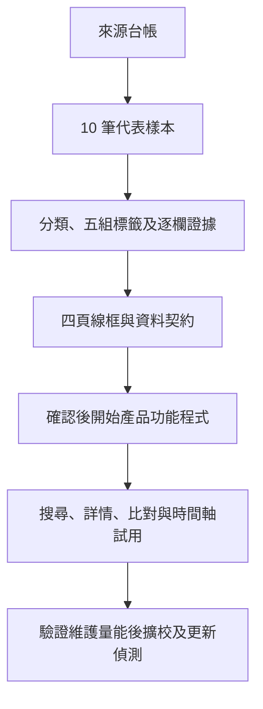

# 目前計畫與已接受決策

更新日期：2026-10-29。使用者已核可建立公開repo、規劃／資料基礎及互動原型；本文件是目前分期的依據，優先於歷史handoff的階段與數量目標。

## 已接受決策

- 名稱：OpenGSA；英文全名：Grant Scholarships Award。
- 長期服務全臺碩博士；第一階段先做全國性方案＋臺大試點。
- 採公開 repo；程式碼 MIT、原創文件及可授權資料編輯 CC BY 4.0，第三方來源保留原授權。
- 先整理資料與視覺化規劃；使用者已接受v0.6作為MVP介面基礎。正式資料契約與發布門檻仍待確認。
- 使用者已要求並核可四個獨立功能頁籤，以及找獎助的即時filter／清單／甘特圖互動原型，包含今天進行線、申請起訖與結果日關係。這不等於核可正式產品、通知或自動資格核定。
- 第一頁的勾選項目供第二、三頁共用；未勾選時使用目前篩選結果。改篩選保留勾選，合成與真實模式分開。本輪勾選與待辦僅於本次瀏覽暫存。第四頁獨立維護，不跟個人選項重算，依正式法規／窗口／來源變更修訂。
- v0.7補上桌面固定篩選卡與本次研討會試算卡。依國科會／臺大路徑分列機關、學生、接受函補送與個人準備日；例假日未校正時明示為估算，不當正式通知。輸入不傳送也不寫入總表。
- v0.8依使用者要求，研討會可選國科會、醫學院、FAOS或自填院系方案，加入第一頁甘特圖與第二、三頁共用選項，支援同場多補助、更新與移除；資料仍僅本次記憶體。新增兩筆會議制度入口供檢索，待核資格及各方案期限分開，見[來源查核](CONFERENCE-SOURCES.md)。
- 第四頁工資與保障以國科會研究人力規定為主軸，保留適用勞動法規底線，另依校補充；最低額、參考額與上限分開。來源與待覆核事項見[權益依據台帳](RIGHTS-SOURCES.md)。
- 博士生須另外查核費用增核措施：增核10,000元與領有增核者至少16,000元每月總額分開；適用核定與約用期間未知時保留待確認。12,000元通用下限尚未查得，不能擅填。
- 第四頁補齊勞動部從屬性綜合判斷、教育部學習分流及臺大校務基金研究生獎勵金辦法；不以兩個特徵自動裁決勞基法適用。校級辦法依生輔組目前連結的109年版摘要，保留106年副本差異與未覆核狀態。
- 2026-10-29使用者另核可先合併PR #1，再由PR #2發布GitHub Pages公開預覽，位置為https://matt-ye.github.io/opengsa/，供自行分享收回饋；不修改個人網站或DNS。部署依[公開預覽說明](DEPLOYMENT.md)，正式服務與資料覆核門檻不因預覽上線而免除。
- 不註冊網域、不使用付費服務、不啟用通知或來源掃描排程、不爬取登入限定內容，也不聯絡第三人。

## 現況

### 長期維運討論提案（2026-10-29，尚未核可實施）

使用者要求先規劃自動掃描、Agent檢核、低成本資料庫、無學生名單的訂閱及repo縮圖，見[長期維運與訂閱提案](OPERATIONS-PLAN.md)。建議Git作正式主資料、Actions做增量擷取、Pages發佈，D1按需要承接執行狀態或查詢副本；當期與歷史清單來自同一總表。RSS優先、ICS補充，不承諾即時推播。

本機API資產僅作私人評估，未呼叫推論、未搬動或設定Secrets。Jev第一方文件已查核，屬可選的結構化判斷元件，不預設為永久免費或整套爬蟲替代品。

縮圖已核可「學生支持、明亮柔和、研究與安心生活」圖稿，使用專案識別與HTML插畫，不用個人照片；[HTML來源](design/social-preview.html)保留可修改版本，[JPG](assets/opengsa-social-preview.jpg)已嵌入README並作預覽網站分享縮圖。GitHub Social preview由使用者自行上傳，尚未核實套用狀態。DB建立、來源掃描排程或通知仍未核可。

已整理使命、七類資金支持與兩類資訊入口、五組 tag、來源種子、三份 PDF 摘要、FAO 有限範圍觀察、資料模型草案與測試情境。

已新增[10筆代表草稿與17筆去重來源](PILOT-REVIEW.md)、[資料契約與JSON Schema](DATA-CONTRACT.md)、[四分頁互動線框與維護流程](design/README.md)、[合成資格情境](ELIGIBILITY-CASES.md)、資料檢查／10項防誤判測試，以及16項原型測試。第一至三頁已連動同批選項，第四頁為獨立資源入口。

介面基礎已選定；仍待確認正式資料契約、指派來源維護者及獨立覆核，完整資格引擎尚未開始。來源項目數不能當成已核對的方案數；PDF彙整表和登入後摘要不能替代當期正式辦法。10筆中含制度快照及事件相對樣本，不視為10筆目前開放機會。

已交付[首批來源與Actions／萃取設計](INGESTION-POC.md)及機讀來源登錄表：校級博士生獎學金、研究生校長獎、遠學、國科會／臺大會議補助四組。先HTML與文字PDF，不假設存在API；未建立資料掃描workflow、adapter或排程，來源存取規則仍待審查。pages.yml只驗證並發布靜態公開預覽，不執行上述資料掃描。

## 階段 A：規劃與資料基礎

1. 完成來源台帳：來源 ID、角色、存取條件、覆核日期、負責人與下一步。
2. 整理 10 筆完整代表機會：生活／學費／急難 2、博士研究支持 2、成果獎 2、國際會議 1、境外研究／學習 2、教師或單位申請而學生可能受益 1。
3. 完成搜尋結果、獎助詳情、個人時間軸、權益入口四頁線框與維護流程圖。
4. 確認資料契約與驗收後才開始階段 B 的產品程式。

每筆資料須有適用年度、五組標籤、來源定位、申請與受益角色、各層程序及期限。未知可以明示，但要有具體查核待辦。合成測試案例不代表個人真實學籍或所得。

## 階段 B：試用版

搜尋、標籤、詳情、簡單資格解釋、本機收藏、近期截止、基本時間軸與 ICS 匯出。公開資訊免登入，個人條件先留在裝置。

資料目標為 20 筆已覆核的年度／梯次機會，至少 5 筆全國性，其他為臺大相關；試用發布日至少 5 筆仍受理。未達門檻時維持內部候選版，不以已截止資料冒充開放機會。

權益入口先整理助理分流與契約、適用給付依據、兼領與資金性質、求助窗口四個主題。不能製造適用所有教授／研究生的單一最低獎助額；法定工資、方案保障、契約承諾與成果獎分開。

## 階段 C：擴充與維護

驗證維護量能後再擴校，檢視歷史提案的 30 筆／六校及八篇指南目標。挑 2–3 個允許且結構穩定的公開來源做差異偵測，重大異動須人工覆核。

海外全面檢索、Email／推播、複雜甘特編輯、資金缺口分析、英文介面、完整逐條法規比較及公文傳遞延遲研究另排優先序。

## 規劃流程

## 技術方向與驗收

單一 repo、Git 管理結構化資料、靜態網站與本機資格設定。Astro／TypeScript 是待確認的架構提案；尚未安裝依賴或建立網站。正式選版時再核對穩定版相容性。先不建立帳號、常駐資料庫、LLM 推薦或向量檢索。

- 資格、受理與證據狀態分開；未知不能自動通過。
- 標籤與規則同源，兼領兩邊限制及期間都要查。
- 校內截止、機關截止、歷史年度與未公告分開。
- 提供純文字時間表及鍵盤／手機可用流程。
- 不公開個資、登入憑證、私人紀錄或未授權全文。
- 先以博士五年級候選人、一般碩士生及外籍博士生三種合成情境驗證。
- 高風險欄位須另一位覆核者；未找到覆核者可留草稿，不標成已確認。

## 下一步待辦

- [x] 本批引用來源去重並建檔17筆；其餘檢索種子保留於分類清單。
- [ ] 指定來源維護責任及非原編輯者的獨立覆核。
- [x] 10筆代表樣本完成草稿建檔、來源初查、未知與查核待辦。
- [x] 四分頁互動線框與維護流程完成審閱稿；找獎助清單／甘特圖共用篩選。
- [x] 今天線、申請起訖、結果日、程序節點、共用選項及研討會試算完成，16項原型測試通過。
- [x] 使用者接受v0.6作MVP介面基礎；v0.7補固定篩選卡及研討會規劃。
- [x] 四組來源與Actions／萃取設計完成；實際adapter及工作流程另排實作。
- [x] JSON Schema、引用與日期檢查，以及10項防誤判測試通過。
- [ ] 確認資料契約、範圍與公開版本驗收。

資料結構檢查通過不代表官方內容或個人資格已通過；目前所有資料仍為draft。四頁線框已作桌面視覺與320 CSS px窄螢幕重排檢查，尚非完整無障礙驗收。下一步先做首個離線adapter及逐欄證據，再通過資料與發布門檻後進階段B正式試用。
