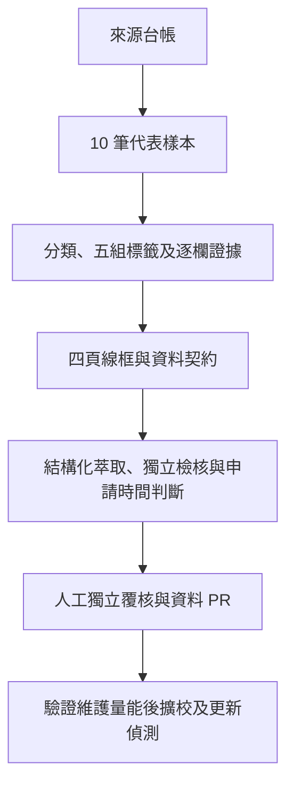

# 目前計畫與已接受決策

更新日期：2026-11-01。使用者已核可建立公開repo、規劃／資料基礎及互動原型；本文件是目前分期的依據，優先於歷史handoff的階段與數量目標。

## 本輪狀態（優先於下列歷史決策中的舊數量與API提案）

最新萃取：共用內容規則、欄位指令、完整重萃與資格／制度線索分流已實作。19筆重跑仍pending，12筆自動檢核通過、7筆有缺漏；19筆可讀對象（含2筆線索）、16筆收件、8筆時程。153項Python／45項Node通過。第一輪3個外部來源已轉作校準，另2個未參與調整的來源仍有正文／資格辨識缺口；不啟用為正式排程來源。下一步先改善來源準備與附件發現。[最新驗收及流程](GENERALIZABLE-EXTRACTION.md)。

最新雷達方向：使用者核可保留未知、逐欄有證據才顯示、來源導流與預填Issue回報，要求19筆正常呈現。已接可讀摘要、文件／方案切換、未知篩選分區、清晰度與異常優先工作台；143項Python／45項Node及Chrome逐筆檢查通過。最新修正保留12筆收件文字、7筆分層時間，去流程標題附註並縮短未知提示；[顯示原因盤查與6筆通用萃取下一步](RADAR-FIELD-DISPLAY.md)。公開建置讀候選快照作摘要，不寫正式pilot／核准；Actions產物自動回存仍未接。[最新雷達現況](RADAR-VIEW.md)優先於下方逐筆完整審查的舊流程。

最新：使用者核可整合PR #22～#27並merge，以#27保留分支祖先；維運與開源資助／擴展研究已修正未驗證數字及福利混用，仍是提案。審查台review-1.1.0加入說明、中文缺漏與篩選；140項Python／39項Node通過。19筆仍待審；先審臺北AI，其餘按[人工清單](CURRENT-REVIEW-CHECKLIST.md)補證或修正，不代填核准。

進階驗證：15項對抗測試、HTML語意段落／獨立表格定位、程序時程與N/A相依、受理狀態重算及過濾完整性防線已補齊。scanner-2／document-ir-2重新掃描17文件／19候選仍8／11，0已知欄位退步、0模型呼叫、0人工核准。140項Python／38項Node及建置通過，詳見[進階驗收](ADVANCED-EXTRACTION-TESTS.md)。模型能力／tokenizer實接與人工gold樣本評測仍待下一階段，不擴來源或發布。

最新整合：使用者核可整合PR #24～#26並先處理來源格式化。已實作document IR、唯一區塊定位、表格／章節脈絡、預算分段、局部規則重萃與基準一致性檢核。17文件／19候選重跑維持8／11及0人工核准，未擴張來源、未呼叫模型。現況與限制以[文件準備與整合驗收](PREPARED-EXTRACTION.md)為準；下段「只改文件」是PR #26當時階段。

2026-10-31歷史階段：先記錄[五組欄位、局部重萃、模型評測與長文本Token分段規劃](FIELD-SCOPED-EXTRACTION-PLAN.md)，[官方研究及PR #25註記](CRAWLING-EXTRACTION-BEST-PRACTICES.md)區分已查來源與未補證實測。#24當時110項Python／38項Node為舊基準；其內容已納入本次整合，不再以「仍開啟／本次只改文件」描述現況。仍不啟用模型或改正式資料台帳。

PR #16～#21已全數合併至 main。網站10筆資料仍為待覆核草稿（draft），人工覆核台帳無合成紀錄，正式資料契約與防呆全面通過。8組Repository Secrets已完成官方端點連線與模型目錄查核，Groq完成小量JSON推論，其餘7組依合規政策嚴守catalog-only（不擅自扣費或推論）；PR #18收錄之17筆AI工具與算力補助已完成初查與分流，申請管道Schema（紙本/電子/親簽/NA判準）已落實。排程模型始終關閉（model_mode=off）。驗收與剩餘門檻見[可靠性修正](RELIABILITY-AUDIT.md)、[API查核](API-AUDIT.md)及[掃描操作](SCANNER.md)。

2026-10-31已完成145個來源／參考網址盤查，16個profile中13啟用、3停用；17份文件整理成19筆當前待審候選。8筆自動檢核通過、11筆有缺漏，無真人核准，正式pilot不改寫。最新驗收與限制見[SOURCE-COVERAGE-AUDIT.md](SOURCE-COVERAGE-AUDIT.md)。

## 已接受決策

- 2026-10-30 使用者核可候選審查閉環，並另核可合併 PR #20（已合併）。新增工作台、第一至三頁候選預覽、人工處置意向及重新核驗後的資料 PR 草稿；來源缺漏與個人條件未填分開，來源變更需重掃重審。不自動人工核准、改寫正式資料或發布。操作及驗收見 [REVIEW-WORKSPACE.md](REVIEW-WORKSPACE.md)。

- 名稱：OpenGSA；英文全名：Grant Scholarships Award。
- 長期服務全臺碩博士；第一階段先做全國性方案＋臺大試點。
- 採公開 repo；程式碼 MIT、原創文件及可授權資料編輯 CC BY 4.0，第三方來源保留原授權。
- 先整理資料與視覺化規劃；使用者已接受v0.6作為MVP介面基礎。正式資料契約與發布門檻仍待確認。
- 使用者已要求並核可四個獨立功能頁籤，以及找獎助的即時filter／清單／甘特圖互動原型，包含今天進行線、申請起訖與結果日關係。這不等於核可正式產品、通知或自動資格核定。
- 第一頁的勾選項目供第二、三頁共用；未勾選時使用目前篩選結果。改篩選保留勾選，合成與真實模式分開。本輪勾選與待辦僅於本次瀏覽暫存。第四頁獨立維護，不跟個人選項重算，依正式法規／窗口／來源變更修訂。
- v0.7補上桌面固定篩選卡與本次研討會試算卡。依國科會／臺大路徑分列機關、學生、接受函補送與個人準備日；例假日未校正時明示為估算，不當正式通知。輸入不傳送也不寫入總表。
- v0.8依使用者要求，研討會可選國科會、醫學院、FAOS或自填院系方案，加入第一頁甘特圖與第二、三頁共用選項，支援同場多補助、更新與移除；資料仍僅本次記憶體。新增兩筆會議制度入口供檢索，待核資格及各方案期限分開，見[來源查核](CONFERENCE-SOURCES.md)。
- 第四頁工資與保障以國科會研究人力規定為主軸，保留適用勞動法規底線，另依校補充；最低額、參考額與上限分開。來源與待覆核事項見[權益依據台帳](RIGHTS-SOURCES.md)。
- 博士生須另外查核費用增核措施：增核10,000元與領有增核者至少16,000元每月總額分開；適用核定與約用期間未知時保留待確認。12,000元通用下限尚未查得，不能擅填。
- 第四頁補齊勞動部從屬性綜合判斷、教育部學習分流及臺大校務基金研究生獎勵金辦法；不以兩個特徵自動裁決勞基法適用。校級辦法依生輔組目前連結的109年版摘要，保留106年副本差異與未覆核狀態。
- 2026-10-29使用者另核可先合併PR #1，再由PR #2發布GitHub Pages公開預覽，位置為https://matt-ye.github.io/opengsa/，供自行分享收回饋；不修改個人網站或DNS。部署依[公開預覽說明](DEPLOYMENT.md)，正式服務與資料覆核門檻不因預覽上線而免除。
- 不註冊網域、不使用付費服務、不啟用通知、不爬取登入限定內容，也不聯絡第三人。
- 使用者後續要求處理自動爬取，啟用[有限來源掃描](SCANNER.md)：來源台帳中已啟用的正文目標、可允許文字PDF、週二／五09:17（臺北）與手動試跑。此新決策取代早期來源掃描未啟用限制；D1与通知仍未啟用。先低頻觀察四週，再評估是否提高頻率。
- 2026-10-29使用者進一步要求完成「爬取結果 → 結構化獎助資料 → 檢核 → 申請時間判斷」主要開發，並接受雙軌「確定性規則 + LLM API (`extract` 補缺 + `audit` 交叉盤查)」規劃：已建立有版本之候選 Schema (`schema/candidate.schema.json`, `1.1.0-candidate`)、結構化萃取 (`scripts/extract_candidates.py`, `extractor-1.1.0`，確定性規則優先＋雙軌可替換模型 Adapter)、七面向獨立檢核 (`scripts/verify_candidates.py`, `verifier-1.1.0`，含 `coverage_ok` 與 `passed_with_gaps`)、多層期限分流與 P1 資格比對 (`scripts/evaluate_deadlines.py`)、候選覆核與差異報告 (`scripts/review_candidates.py`)，以及三軌對照基準測試 (`scripts/evaluate_extraction_benchmark.py`)。爬蟲或模型仍不直接覆寫 `data/pilot.json`，未經非原編輯者獨立覆核一律維持 `pending`。
- 2026-10-30使用者另要求完成全域來源盤點與擴展架構：以臺大為例規劃全校 5 大處室、11 傳統學院＋3 跨領域學院、代表性系所（電資/工/理/醫等）之獎助拓撲，並建立向全臺大專院校擴展之四層標準階層規範 (`Institutional Hierarchy Schema`)；全面盤點國科會、中研院、教育部等政府機關，民間非營利基金會與企業獎學金；擴界納入創業補助（FITI/U-start/TEC）、AI工具與算力補助（國網TWCC/公有雲研究點數）、國外交流（Fulbright/DAAD/法德英歐）與青年百億海外圓夢基金（`twpathfinder.org`）；提煉 7 大主題關鍵字庫與排斥條款語法；曾提案3把API與瀑布容錯（已由上述8組Secrets、單一Provider及成本限制決策取代），見[全域來源藍圖與擴展規劃](SOURCE-LANDSCAPE-AND-EXPANSION.md)。
- 2026-10-30使用者進一步要求深度展開學術生涯與校園支持體系：盤點研討會五層補助網絡、千里馬深化與雙聯學位；碩士、博士、博士候選人（中研院/蔣經國/Fulbright）、博士後研究學者（國科會/中研院院長特聘/遠學分支）四大階梯專屬身分獎助；斐陶斐榮譽學會（博士10%、碩士3%、學士1%）、校級與大專優秀青年遴選；助教（TA）多軌聘任（學務處獎勵金、教務處通識、雙語教育中心 EMITA、學院聘、系聘）、4,000 至 50,000 元薪資級距與校內勞僱工讀保障，見[學術生涯與助教工讀深度盤點](ACADEMIC-CAREER-AND-ASSISTANTSHIPS.md)。
- 2026-10-30使用者另要求全方位補強「權益與求助 (#rights)」法規體系與救濟支援：全面盤點國科會、教育部、中研院、勞動法規及大學規章之完整母法依據與授權條文；深入剖析「學生與勞工雙重身分」、「假學習真勞動」、著作權與論文歸屬、僑外生工作證與兵役衝突等法律爭議樣態；建立勞僱型、學習型、計畫專任與校內工讀四維度比對矩陣；繪製從系所、學院、校級申評會與性平會、中央部會（教育部訴願/勞動部1955勞檢/行政院/內政部移民署/國家人權委員會）至國會立委與高教工會之「五類求助救濟地圖」；並於結構化萃取器擴充 NVIDIA NIM、SambaNova、Cerebras、OpenRouter 與 SiliconFlow 等API預設端點（免費資格另依本輪查核，不保證額度），見[獎助學金完整法源庫、學生勞動權益、身分爭議與五類申訴救濟地圖](RIGHTS-AND-LEGAL-FRAMEWORK.md)。
- 2026-10-30使用者核可開工執行「資源整合四階段路線圖、UI/UX 響應式審核修復、Tab 04 權益島雙軌化與政策島互動設計」：維持頂層 4 Tab 架構，於第一頁新增探索島情境快篩傳送門（`#persona-bar`），於第四頁新增次級視角切換（`#rights-view-switch`：全部總覽／📜 法規與給付標準／🗺️ 五類救濟與從屬性自測）、四種工作型態比對矩陣、本次記憶體「3分鐘從屬性與工作型態爭點自測（`#subordination-wizard`）」及「五類申訴求助窗口地圖（`#grievance-map`）」，並完成 iOS 16px 防縮放、手機橫向導覽解鎖、觸控熱區擴充與跨頁捲動記憶，見[資源整合路線圖、UI/UX 響應式審核與「政策島」互動設計落地指南](UX-AUDIT-AND-ISLAND-DESIGN.md)。

## 現況

### 結構化萃取、雙軌規則+LLM盤查、獨立檢核、申請時間判斷與候選覆核流程（2026-10-29）

已完成五大核心模組與三軌基準測試，並與既有掃描管線串接：

1. **有版本的候選資料 Schema (`schema/candidate.schema.json`, `1.1.0-candidate`，向下相容 `1.0.0-candidate`)**：涵蓋制度／學年度／梯次／分支／法規快照 (`cycle.kind` 含 `policy_snapshot`)、申請與受益角色 (`participants`)、學校院系範圍 (`eligibility.institution` / `scope`)、結構化資格與否定條件 (`eligibility.negated_conditions`)、金額／幣別／發放單位 (`benefit.items`)、兼領規則 (`compatibility`)、各層程序與期限 (`schedule.steps` 分流 `student`、`department`、`college`、`university`、`institution`、`supplement`)、結果公布日 (`schedule.result_date`)、法規修正與生效版本 (`policy_version`)、逐欄證據 (`field_evidence`，含 `source_block_sha256`、`rule_and_model_agreed`、`prompt_version`)、缺漏與衝突 (`gaps_and_conflicts`)、獨立檢核結果 (`verification`，含第 7 項 `coverage_ok`、`passed_with_gaps` 與 `audit_findings`) 及人工覆核門檻 (`review`)。
2. **雙軌結構化萃取與盤查 (`scripts/extract_candidates.py`, `extractor-1.1.0`)**：先執行通用確定性規則解析（支援中文大／小寫金額如『四萬元』／『伍拾貳萬伍仟至玖拾萬元』、中文數字民國年如『一一五年九月』、拆分臺大博獎國科會／教育部分支、區分設置辦法 PDF `policy_snapshot` 與當期公告、遠學一般補助分支、各研討會方案），再提供雙軌模型 Adapter（預設 `OPENGSA_MODEL_MODE=off` 零呼叫；支援 `extract` 補缺、`audit` 交叉盤查與 `both` 雙軌模式；無金鑰時支援 `MockModelAdapter` 離線測試；外部 `OpenAICompatibleAdapter` 具硬體級 `_guard_hash_only` 防護，確保 `hash_only` 來源 `0 bytes` 外送，並內建 `<untrusted_source_data>` 防提示詞注入、逐字引文子字串檢驗與規則二次解析）。
3. **獨立檢核 (`scripts/verify_candidates.py`, `verifier-1.1.0`)**：執行 Schema、逐欄證據（強制所有非 `unknown` 欄位皆須具備 `field_evidence` 並核對 `source_block_sha256`）與防模型捏造、日期精度（`Asia/Taipei`、僅日期不自造 `23:59`、修正日不自動當生效日）與金額單位、年度／分支不混用、否定條件與申請角色分流、來源衝突攔截，以及第 7 項 `coverage_ok`（對未抓取關鍵附件或缺漏金額標為 `passed_with_gaps`）等七大檢查。完全忽略模型或 Agent 自稱通過之標記，未經獨立覆核者維持 `pending` 且 `promotion_ready=false`。
4. **申請時間與資格判斷 (`scripts/evaluate_deadlines.py`)**：嚴格以學生適用窗口判斷 `open`、`not_yet_open`、`closed`、`unknown`；支援固定日期、確切時分、事件相對規則（國科會／臺大前月首日與前一日17:00＋四週補送、醫學院會前四週送件、FAOS會前兩個曆月學校提出且學生校內期限留 `unknown`）、缺起日、例假日待核與來源過期檢查。內建 P1（臺大職能治療所博士班五年級、已取得候選人資格）及 P1-A～P3 邊界測試情境。
5. **候選覆核、差異報告與三軌基準測試 (`scripts/review_candidates.py`, `scripts/evaluate_extraction_benchmark.py`)**：輸出 `structured-candidates.json`、`review-diff.json`、`review-summary.md` 與 `model-usage.json`，將法規快照 PDF 歸類為 `policy_regulation_snapshot` 避免假性狀態差異；並透過 Corpus A（8 份真實公開文件＝10 筆候選）＋ Corpus B（20 組合成邊界與對抗測試）完成 `rules_only`、`llm_only` 與 `rules_plus_llm` 三軌 3 輪可重現評估。

2026-10-29 當時 **52 項 Python 測試＋26 項 Node 原型測試** 通過；現行數量以本輪 CI 及下述工作台驗收為準。

## 階段 A：規劃與資料基礎

1. 完成來源台帳：來源 ID、角色、存取條件、覆核日期、負責人與下一步。
2. 整理 10 筆完整代表機會：生活／學費／急難 2、博士研究支持 2、成果獎 2、國際會議 1、境外研究／學習 2、教師或單位申請而學生可能受益 1。
3. 完成搜尋結果、獎助詳情、個人時間軸、權益入口四頁線框與維護流程圖。
4. 確認資料契約與驗收後才開始階段 B 的產品程式。

每筆資料須有適用年度、五組標籤、來源定位、申請與受益角色、各層程序及期限。未知可以明示，但要有具體查核待辦。合成測試案例不代表個人真實學籍或所得。

## 階段 B：試用版

搜尋、標籤、詳情、簡單資格解釋、本機收藏、近期截止、基本時間軸與 ICS 匯出。公開資訊免登入，個人條件先留在裝置。

資料目標為 20 筆已覆核的年度／梯次機會，至少 5 筆全國性，其他為臺大相關；試用發布日至少 5 筆仍受理。未達門檻時維持內部候選版，不以已截止資料冒充開放機會。

權益入口先整理助理分流與契約、適用給付依據、兼領與資金性質、求助窗口四個主題。不能製造適用所有教授／研究生的單一最低獎助額；法定工資、方案保障、契約承諾與成果獎分開。

## 階段 C：擴充與維護

驗證維護量能後再擴校，檢視歷史提案的 30 筆／六校及八篇指南目標。挑 2–3 個允許且結構穩定的公開來源做差異偵測，重大異動須人工覆核。

海外全面檢索、Email／推播、複雜甘特編輯、資金缺口分析、英文介面、完整逐條法規比較及公文傳遞延遲研究另排優先序。

## 規劃流程

## 技術方向與驗收

單一 repo、Git 管理結構化資料、靜態網站與本機資格設定。先不建立帳號、常駐資料庫、LLM 推薦或向量檢索。

- 資格、受理與證據狀態分開；未知不能自動通過。
- 標籤與規則同源，兼領兩邊限制及期間都要查。
- 校內截止、機關截止、歷史年度與未公告分開。
- 提供純文字時間表及鍵盤／手機可用流程。
- 不公開個資、登入憑證、私人紀錄或未授權全文。
- 以博士五年級候選人（P1）、一般碩士生（P2）及外籍博士生（P3）三種合成情境驗證。
- 高風險欄位須另一位覆核者；未找到覆核者可留草稿，不標成已確認。

## 下一步待辦

- [x] 候選審查工作台、同批候選三頁預覽、具版本人工意向及重新核驗後的資料 PR 提案匯出；Actions 手動離線 artifact，不含 Secrets 或模型呼叫。
- [ ] 真正的獨立覆核者核對兩筆 AI 工具候選，解除來源疑點後另開資料 PR；本開發不填真人核准紀錄。

- [x] 本批引用來源去重並建檔17筆；其餘檢索種子保留於分類清單。
- [ ] 指定來源維護責任及非原編輯者的獨立覆核。
- [x] 10筆代表樣本完成草稿建檔、來源初查、未知與查核待辦。
- [x] 四分頁互動線框與維護流程完成審閱稿；找獎助清單／甘特圖共用篩選。
- [x] 今天線、申請起訖、結果日、程序節點、共用選項及研討會多方案試算完成（測試以最新CI為準）。
- [x] 使用者接受v0.6作MVP介面基礎；v0.7／v0.8補固定篩選卡及多方案研討會規劃。
- [x] 有版本候選 Schema (`1.1.0-candidate`)、雙軌結構化萃取與盤查 (`extract` + `audit`)、獨立檢核 (`coverage_ok` / `passed_with_gaps`)、申請時間與 P1 資格判斷、候選差異覆核報告完成（測試以最新CI為準）。
- [ ] 由非原編輯者對候選報告與 10 筆草稿完成人工獨立覆核，再經資料 PR 更新正式資料。
- [x] 完成臺大全院系拓撲、全國院校階層化擴展模型、政府/民間/企業/創業/算力/海外/圓夢基金全方位盤點、關鍵字矩陣，以及API備援歷史提案（已由本輪成本限制與8組Secrets取代） (`docs/SOURCE-LANDSCAPE-AND-EXPANSION.md`)。
- [x] 完成研討會五層補助網絡、千里馬/雙聯學位、碩博候選人博士後身分專屬獎助、斐陶斐/優秀青年推薦制度、助教 (TA) 多軌聘任 (EMITA) 與薪資級距深度盤點 (`docs/ACADEMIC-CAREER-AND-ASSISTANTSHIPS.md`)。
- [x] 完成初版法源位階圖、勞動爭議從屬性自測、四型態比對矩陣與五類申訴救濟地圖 (`docs/RIGHTS-AND-LEGAL-FRAMEWORK.md`)。
- [x] 完成資源整合四階段路線圖、UI/UX 響應式體檢、探索島情境快速篩選（`#persona-bar`）、權益島雙軌視角與公民科技政策島調研 (`docs/UX-AUDIT-AND-ISLAND-DESIGN.md`)。
- [x] 執行 Phase 2 來源拓撲擴充：於 data/scan-sources.json 登錄千里馬、人力約用、教務處 TA、專題兼任上限 4 大來源，並建立候選萃取與測試；上限來源因錯接URL現已停用，不能視為四項全數支援。
- [x] 升級研討會與赴外交流個人規劃器：擴充國科會千里馬赴國外研究方案（固定視窗推算、出國前一年收件基準），建立 Tab 2 獎助詳情至 Tab 4 上位法規與助教薪資跨分頁深度導覽，完成當時測試（完整數量以本輪驗收及最新CI為準）。
- [ ] 確認資料契約、範圍與公開版本驗收。

資料結構檢查或自動檢核通過不代表官方內容或個人資格已核定；目前所有正式草稿仍為 `draft`，所有掃描萃取候選仍為 `pending`。

## PR18查核與程序欄位（2026-10-30）

使用者要求驗證PR18新資源、紙本／非紙本及N/A判斷，已在PR19分支補充。17筆搜尋種子不直接當可申請清單；具體更正見PR18-RESOURCE-REVIEW.md。五個官方頁面已受限實測，0模型、0正式資料改寫；申辦方式與適用性已串到候選、檢核、匯出與第一至三頁，獨立覆核及資料PR門檻保留。

2026-10-31後續核可：先穩定本批再擴張。已修正給付重複、週期與身分、院別範圍及文件層級N/A；工作台新增方案文件分組及review-text.md文字審查清單。最新8筆通過、11筆有缺漏，仍全部待審。詳見[本批穩定化與擴張門檻](CANDIDATE-STABILITY.md)。
