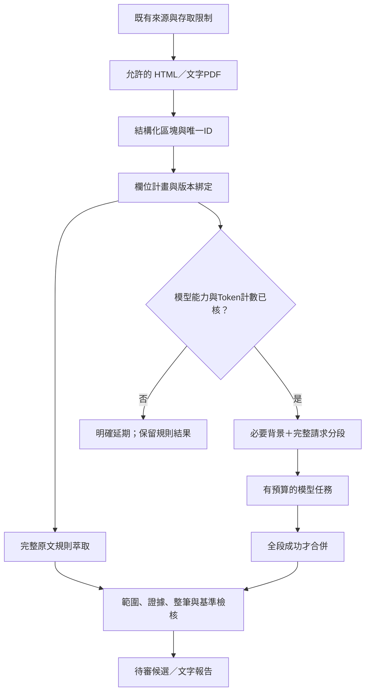

# 文件準備、局部重萃與整合驗收

2026-11-01後續：新增通用內容補漏及`--full-replay`完整重萃，19筆更新至extractor-1.5.0；153項Python／45項Node通過。完整重萃可糾正無依據預設值，但仍需新鮮且版本相符的上下文，保留附件受阻與待審限制。[最新通用流程與外部驗證](GENERALIZABLE-EXTRACTION.md)優先於下方歷史數字。

2026-10-31：依使用者指示整合 PR #24～#26，先將來源轉成適合萃取的可追溯格式。整合分支包含 #24 的最新程式／候選修正、#26 規劃及 #25 經補證分級後的研究方向；不繼承 #25 未核驗的端點、金額或效能宣稱。

後續已完成[進階測試與來源重驗](ADVANCED-EXTRACTION-TESTS.md)：新增15項對抗案例，修正行內文字、定位、局部時程及共用分支限制。最新待審快照採scanner-2／document-ir-2；17文件／19候選重掃仍8通過／11有缺漏，沒有已知欄位退步。下文35次HTTP為首輪歷史驗收，第二輪38次另計；最新全套140項Python／38項Node。

## 已實作

1. `scripts/document_ir.py`：記憶體內的統一文件區塊（document IR）。保留原文與原定位，另有唯一 unit ID、順序、章節、頁碼、表格表頭／資料列及結構查核程度。安全 manifest 只輸出定位、計數及雜湊，不長期保存正文。
2. HTML 在既有合法容器內保留表格關係與標題，沒有改為抓全站；PDF 文字行不再只能用模糊的同頁定位傳給模型。模型使用唯一 unit ID，驗證時映回原文及證據雜湊。
3. 原模型入口移除「前 25 塊、每塊 320 字」截斷。`pack_requests` 計算完整請求，保留輸出／推理／安全餘裕，按單位打包；超長單位細分仍保留全部字元與父區塊範圍。過大的共同背景會明確延期，不截掉例外。
4. 必要定義、資格、否定與例外段落作為共同背景。每段回應經格式檢核後才合併，同欄位衝突、模型截斷、越界或中途預算耗盡時整批拒絕，不套用部分結果。
5. `scripts/extraction_scope.py`：五組管理與指定欄位範圍；相依的金額／頻率、年級／基準日、程序／時間一起核驗。禁止修改來源、核准或受理狀態，禁止永久陣列索引；known 變 unknown 或列項減少時轉待審。
6. `scripts/prepare_candidates.py`：預設離線計畫，明確 `--refresh` 才受限重抓並執行規則重萃。輸出到新 work 目錄，沒有人工核准、模型呼叫或發布。
7. 候選記錄 preparation digest 與 normalizer version，重新覆核須比對；內容指紋隨之改變。原有真人核准不沿用，短證據仍以來源 revision 合計 120 字為上限。
8. 修正檢核入口差異：沒有既有 pilot 基準時不能清掉舊的欄位退步警告；局部重萃入口帶入同一份 pilot，比照工作台判斷。

## 操作

從 repo 根目錄執行，`--group` 可重複，值為 identity、eligibility、benefit、process、version；`--field` 可指定既有欄位路徑。可組合，但 coupled 欄位會擴為共同證據範圍，報告列出實際寫入範圍。

```powershell
# 無網路／無模型，只產生計畫
python scripts/prepare_candidates.py --group benefit --output-dir work/benefit-plan-new

# 限一個既有來源，重新核對原文後只重萃給付；實際擴為 benefit 整體
python scripts/prepare_candidates.py --source-id nstc-assistant-rule --field benefit.summary --refresh --output-dir work/assistant-replay-new

# 結果另開待審工作台，不自動發布
python scripts/build_review_workspace.py --candidates work/assistant-replay-new/pending-candidates.json --output work/assistant-review-new
```

`preparation-report.json` 記錄各筆計畫、來源狀態、文件 manifest、明確延期原因及請求數；`--refresh` 額外輸出 `pending-candidates.json`。來源變更、受阻或候選分支變更不強套舊計畫。多來源仍受每輪 20 次 HTTP／180 秒限制，可用 `--source-id` 分批；不提高預算。

## 模型能力與限制

規則處理所有原文，模型只接受可外送來源。`OpenAICompatibleAdapter` 支援呼叫端提供 `model_limits`、provider 相容的 `count_tokens(payload)` 及 `field_scope`（現有模型欄位 alias 清單）。模型、能力查核日期、輸入／輸出／位元組限制及 shared context 都必須明示；能力不明或沒有正確計數器就回報延期，沒有自動用近似字數猜上限。

完整 payload 由同一個函式建立及計數；單輪呼叫上限、429 不連續重試、單一 provider 及 hash_only 零外送維持。模型任務快取鍵包含候選內容、模型、Prompt、模式、欄位範圍及區塊，不以同名方案冒充同一個任務。

環境變數建立的 adapter 目前尚未自動接上供應商能力／tokenizer 查核，因此手動模型工作也會在缺能力時延期；不得把這個新門檻視為金鑰故障。下一步須接已查核的能力設定與正確計數器，並用人工核對樣本評測，再選擇各組模型。沒有執行付費或真實模型比較，也不宣稱某模型勝出。

目前模型修補仍受現有欄位 alias 與逐欄語意檢查約束；五組全部可做規則重萃，不代表每個 Schema 欄位已可交給任意模型改寫。

PDF 僅有文字層時保留 `pdf_layout_unverified`，沒有宣稱能還原所有跨頁表格、掃描影像或 OCR。複雜 rowspan／colspan 另標待核。JSON／XML／資料庫來源可接到同一個區塊介面，但本輪沒有啟用新格式的網路來源或新套件。

## 卡點驗收

| 卡點 | 驗證 |
|---|---|
| 第 26 塊以後的例外、超過 320 字 | 合成測試確認文字未截掉，後段例外進共同背景 |
| 同頁 PDF 不同身分金額 | 唯一 unit ID 映回原文字行；舊模糊定位若引文不唯一即拒絕 |
| 表頭與金額分離 | HTML 準備保留表頭、資料列與身分，不將不同列任意拼接 |
| 單段超過模型輸入 | 完整字元可由分段還原，每個完整請求均在測試 Token 預算內 |
| 能力不明、背景超限、模型越界／中斷／衝突 | 停止或延期，不送出不合規請求、不套用部分結果 |
| 只重萃金額卻修改其他欄位／沿用核准 | 範圍檢查、內容指紋、不可寫入來源／review、重設待審 |
| 局部重萃遺失退步警告 | 無基準保留警告，有基準比照原工作台；不能讓通過筆數虛增 |
| robots／登入／附件限制 | 沿用原有失敗與禁止路徑測試，受阻來源仍人工查核 |

既有 17 份文件／19 筆候選已分批做實際受限 GET、版本比對、準備及全組規則重萃。最後全批及章節層級追驗合計 35 次 HTTP，全部重萃成功，8 通過／11 有缺漏，0 檢核錯誤、0 人工核准、0 模型呼叫；不把缺漏補猜成符合。另以單一研究人力來源完成給付欄位CLI追驗，增加2次HTTP；前期診斷重跑另計，不宣稱 35 次是整輪網路總數。

模型相關測試使用合成資料、模擬回應及明確標記的測試 Token counter；證明流程與預算檢查，不證明真實模型準確率。詳細紀錄見 [結構化驗收](../data/audits/prepared-extraction-2026-10-31.json)。125 項 Python、38 項 Node 測試及資料／設定／公開與工作台建置通過。正式 pilot 仍 10 筆草稿，真人台帳仍空。

## 現行流程


