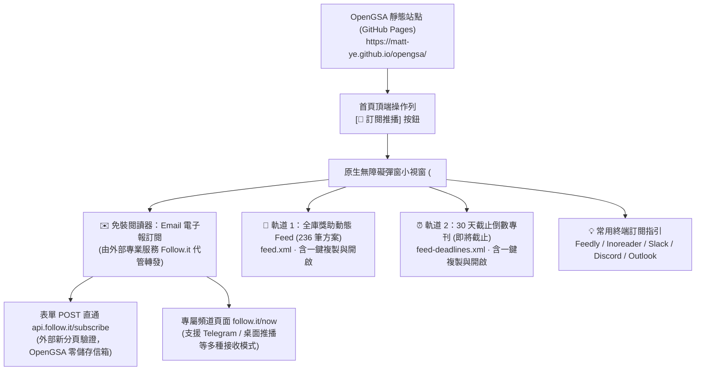
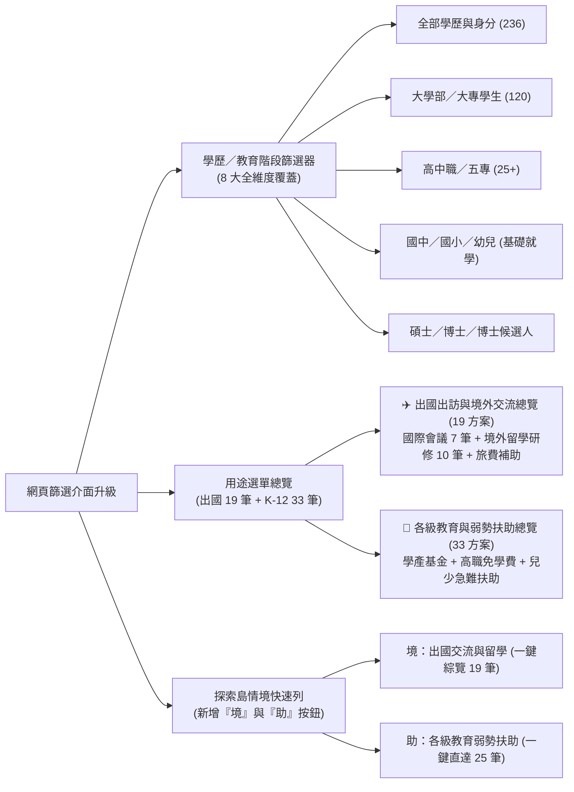

# OpenGSA 主動推播通知與全教育階段篩選升級全景手冊 (2026-11-05)

## 1. 背景與升級願景

OpenGSA 致力於讓台灣學生「把時間留給研究，把獎助檢索交給 OpenGSA」。在完成全庫 **236 方案** 的時程政策萃取、通用資訊鏈拓撲建構與甘特圖投影之後，使用者在實務使用中提出了兩大核心體驗升級需求：

1. **主動推播通知需求（PR #65）**：
   > 「資訊雖然在網站上，但我平時都在做研究、寫論文，沒辦法每天手動刷新網頁，最後往往在截止日前夕才發現，措手不及！是否有像電子報或 RSS 一樣的主動通知？甚至不用裝軟體就能在 Email 收到？」
2. **身分涵蓋與視覺可見度需求（PR #66）**：
   > 「之前找的 K-12 相關獎學金是不是被狹隘的學位選單過濾掉了？出國獎學金也被國際會議與出國留學割裂分立，能不能一鍵總覽？」

本專案以此為契機，同步完成 **主動推播通知架構（雙軌 RSS 2.0 + 首頁專屬彈窗小視窗 + Follow.it 零個資 Email 代管）** 以及 **全教育階段篩選與視覺可見度升級（全學歷覆蓋 + 出國總覽 19 筆 + K-12 扶助總覽 33 筆 + 情境列升級）**。

---

## 2. 主動推播通知架構全景 (Proactive Notification Architecture)

### 2.1 雙軌 RSS 2.0 Feed 規格與發布管線
由獨立腳本 [`scripts/build_feed.py`](../scripts/build_feed.py) 於 GitHub Pages 建置流程中全自動產生：

| 頻道名稱 | 發布檔案路徑 | 公開訂閱網址 | 涵蓋範疇與推播重點 |
| :--- | :--- | :--- | :--- |
| **全庫獎助動態頻道** | `dist/site/feed.xml` | `https://matt-ye.github.io/opengsa/feed.xml` | 收錄全庫 236 筆方案，依最新官方公告與修訂日推播；內含身分資格、金額、官方原文連結。 |
| **30 天截止倒數提醒** | `dist/site/feed-deadlines.xml` | `https://matt-ye.github.io/opengsa/feed-deadlines.xml` | 動態篩選即日起 30 天內即將截止的項目，冠以 `⏱️ [即將截止]` 前綴，推播倒數天數與送件指引。 |

### 2.2 Follow.it 零個資 Email 訂閱代管機制
* **個資零儲存原則**：OpenGSA 嚴守開源公益純靜態架構，不在伺服器端儲存讀者電子郵件，免除資安外洩風險與 SMTP 發信成本。
* **外部無縫橋接**：
  - 彈窗小視窗直接內嵌 `<form action="https://api.follow.it/subscribe" method="post" target="_blank">`，帶入 `resource="https://matt-ye.github.io/opengsa/feed.xml"`。
  - 使用者在彈窗輸入 Email 送出後，直接在外部新分頁由 Follow.it 完成寄件驗證。
  - 亦提供 `https://follow.it/now` 專屬導向連結，讀者可自選以 Telegram 機器人或桌面推播接收通知。

### 2.3 友善互動與剪貼簿回饋
- 雙軌 Feed 均提供 `[📋 複製]` 按鈕，點擊自動調用 `navigator.clipboard.writeText()`，並觸發 2.5 秒的「已複製 Feed 網址」Toast 提示浮層。

---

## 3. 全教育階段篩選與可見度升級 (Filter & Visibility Upgrade)

### 3.1 徹底解除教育階段篩選盲點
過去前端選單標籤誤寫為「碩士與博士」，使非研究生方案（大學部 120 方案、高中職 25+ 方案、國中小與幼兒方案）容易在點選後被排擠。
* **全新 `filter-degree` 8 大維度**：
  1. `all`：全部學歷與身分（預設展示全庫 236 方案）
  2. `master_phd`：碩士與博士（研究生總覽）
  3. `phd`：博士生
  4. `candidate`：博士候選人限定
  5. `master`：碩士生
  6. `undergraduate`：大學部／大專學生（精確匹配全庫 120 筆大專校院與包含學士之方案）
  7. `senior_high`：高中職／五專（匹配高職免學費、學產基金等方案）
  8. `basic_k12`：國中／國小／幼兒（匹配義務教育與幼兒扶助方案）

### 3.2 聚合出國獎助與 K-12 弱勢就學扶助
* **`all_abroad`（✈️ 出國出訪與境外交流總覽）**：
  一鍵聚合國科會研究生出席國際會議差旅、臺大 11 學院出國發表、千里馬博士生赴國外研究、遠學計畫等共 **19 筆出國獎助**，不再需要於會議與留學間反覆切換。
* **`all_k12`（🎒 各級教育與弱勢扶助總覽）**：
  直達學產基金低收入戶助學金、高職免學費方案、教育部急難救助等共 **33 筆基礎就學扶助方案**。
* **Persona Bar 新增快速情境按鈕**：
  - `境`（出國交流與留學：國際會議／千里馬／遠學 19 方案一鍵綜覽）。
  - `助`（各級教育弱勢扶助：K-12／學產／免學費 25 方案一鍵直達）。

---

## 4. 品質防線與測試矩陣 (Testing Verification Matrix)

專案嚴格維持「重大變更獨立覆核、資料契約 0 篡改、全覆蓋自動化測試」原則：

| 測試維度 | 測試模組檔案 | 測試數量 | 驗證重點 |
| :--- | :--- | :--- | :--- |
| **Python 單元測試** | `tests/test_feed.py` | 3 項 | RSS 2.0 XML 結構、RFC 822 時間解析、236 方案全覆蓋、30天截止倒數提醒準確度。 |
| **發布成品邊界測試** | `tests/test_build_site.py` | 8 項 | 發布檔案白名單、首頁 `[📡 訂閱推播]` 按鈕、`<dialog>` 彈窗結構、Follow.it 表單屬性、雙軌 Feed 複製按鈕、ID 唯一性無衝突。 |
| **前端整合測試** | `tests/prototype.test.cjs` | 57 項 | 全教育階段學歷篩選、出國綜合過濾、K-12 扶助總覽、Persona Bar 快速套用與還原、URL 狀態同步。 |
| **合約與稽核** | `scripts/check_data.py` | - | 候選方案 Schema、資料指紋零竄改、正式 pilot 欄位保護。 |
| **CI/CD 自動化** | GitHub Actions `check-and-build` | - | 全套測試 100% 綠燈，建置產物僅含公開發布檔案。 |

---

## 5. 結論與上線驗收宣告

本次 PR #65、PR #66 與 PR #67 的整合交付，徹底解決了學生「怕錯過截止日」與「找不到非研究生／出國獎學金」兩大長久痛點，並使 OpenGSA 成為全台首個兼具：
- **全庫 236 方案 1-to-1 時程甘特圖投影**
- **雙軌 RSS 2.0 即時動態與截止倒數推播**
- **零個資 Follow.it 電子報／Telegram 託管**
- **全教育階段（K-12 至博後研究）與出國出訪一鍵篩選**

之現代化開放獎助情報平台。正式台帳與候選資料 0 竄改，排程嚴格維持 `model_mode=off`。
