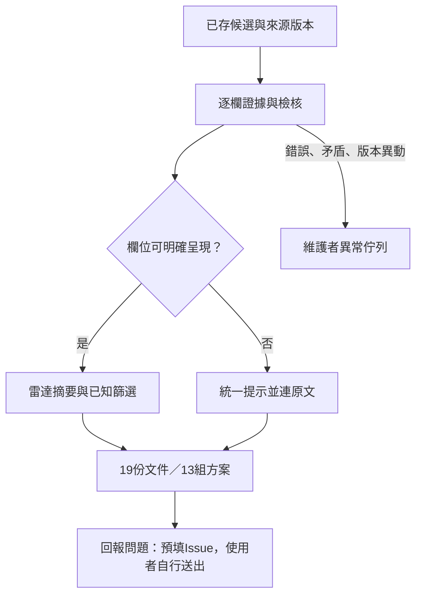

# 獎助雷達：欄位顯示、篩選與回報

2026-11-01後續萃取已更新：19筆可讀對象（含2筆制度線索）、16筆收件、8筆時間資訊；153項Python／45項Node及Chrome檢查。制度線索不算完整資格或清晰度綠燈，6筆學位細分未知不作肯定篩選。[最新萃取與外部驗證](GENERALIZABLE-EXTRACTION.md)優先於下方上一輪143／45驗收紀錄。

2026-11-01使用者核可改為資訊雷達，未知欄位可保留，無須逐筆補完；持續測試既有19筆，不擴張來源。本版更新前台與建置投影，不改正式pilot或代填人工核准。

## 使用方式

- 預設以文件顯示19筆，保留年度、版本與精確來源；也可切為13組方案。彙整只選一份主要公告並列其他原文連結，不把不同年度／辦法的欄位拼接。
- 卡片直接顯示名稱、大致對象、時間規則與來源，第二頁改用可讀申請重點。第三頁共用選項；切換文件／方案不刪除已勾選文件。
- 未明資訊統一為黃色警示圖示與「不明，請見來源 ↗」。內部仍保留未載、未辨識、附件受阻與衝突原因；局部未知不抹除已有內容及限制。
- 官方公告直接連到該筆原文，包括PDF。收件／轉送已有文字而無獨立網址時，保留文字並連原文；單位名與網址不混為同一個必填欄位，不猜首頁、電話或私人聯絡方式。標題去除流程附註，各層時間另列，見[顯示落差盤查](RADAR-FIELD-DISPLAY.md)。
- 每筆「回報問題 ↗」開GitHub預填Issue，帶公開名稱、ID、原文URL及來源revision。需要使用者確認送出才會建立Issue及通知，網站不代送。
- 個人研討會與合成項目的回報只開一般回饋表，不帶名稱、會議日期、個人條件、篩選或待辦。Issue公開，請勿填個資。

GitHub自訂表單文字欄位可由URL query預填；[官方說明](https://docs.github.com/en/issues/tracking-your-work-with-issues/using-issues/creating-an-issue)。表單位於`.github/ISSUE_TEMPLATE/data-problem.yml`，合併到預設分支後才正式可用。

## 顯示邊界

`scripts/radar_metadata.py`依候選的欄位證據與獨立檢核產生顯示metadata；相關單位另保留原有來源refs支持的角色文字。覆蓋率不足可留下其他已支持欄位；缺證據、未完整解析的身分或失敗／衝突則不作肯定顯示。推估日期另列，不作正式起日或受理判定；原始候選與理由不改寫。



預覽建置從`data/candidates/source-review.json`讀19筆，沒有把它們標為人工核准或寫回`data/pilot.json`。完整資料PR匯出仍使用原獨立覆核門檻；雷達摘要不是完整資料發布意向。來源掃描、robots、hash_only、排程模型off及成本限制維持。

本次沒有把每次Actions掃描產物自動提交回候選快照；雷達顯示repo快照，仍須更新版本並建置後才反映新內容，不宣稱即時服務。RSS／ICS未啟用。

## 篩選與清晰度

確定符合所選已知條件與部分未知分區，取消「另列可能相關」只看前者；來源未知不當政府、年級未知不當不限、兼領未知不當允許。年級目前仍按限制類型，不提供基準日五年級的個人資格核定。

綠／黃／紅為核心資訊明確、部分待確認、需重核。核心四項是來源對應、年度／版本、時間規則、大致對象；顯示X／4，不稱正確率。綠燈另需觀察日期在既有180日新鮮度範圍內，這是保守顯示規則，不保證官方仍受理。錯誤或日期矛盾不被完整度抵銷；[W3C資料品質](https://www.w3.org/TR/vocab-dqv/)也分別描述完整性、正確性與一致性。

制度參照與來源明示免申請分開；地方AI補助的年度最晚上限不當作個人截止，也不依此畫30天準備提醒。個人條件未填仍不代表符合或有經費。

## 維護與驗收

工作台預設只看矛盾、錯誤或來源異動；未知可保留。對照表直接列可讀欄位，不再逐格展開JSON。需要完整資料核准時仍可切回全部文件／完整意向流程。

- 143項Python、45項Node通過，包含證據缺失、失敗隱藏、精確PDF連結、未知分區、回報隱私、清晰度、不跨文件拼接與局部未知不抹除內容。
- Chrome逐筆開19張詳情，驗來源／Issue ID／revision與未知連結；第三頁19張選項、13組切換保留選取，320px無整頁橫向溢出。沒有送出任何Issue。
- 公開成品仍僅HTML、專案縮圖與`.nojekyll`；沒有PDF／原始HTML／私人資產。正式pilot與真人台帳未改。

```powershell
python -m unittest discover -s tests -v
node --test tests/prototype.test.cjs
python scripts/check_data.py
python scripts/scan_sources.py --check-config
python scripts/build_site.py work/radar-site-new
python -m http.server 8782 --bind 127.0.0.1 --directory work/radar-site-new
```

手動Chrome冒煙檢查（npx臨時工具，不新增repo依賴）：

```powershell
npx --yes --package @playwright/cli playwright-cli -s=radar-check open http://127.0.0.1:8782/ --browser chrome
npx --yes --package @playwright/cli playwright-cli -s=radar-check snapshot
# 先建立output/playwright資料夾，腳本會保留截圖；均不入庫
npx --yes --package @playwright/cli playwright-cli -s=radar-check run-code --filename scripts/browser_radar_smoke.js
```

冒煙腳本針對本批19筆，來源擴張時需更新基準。API推論準確率不在本輪驗收範圍。
