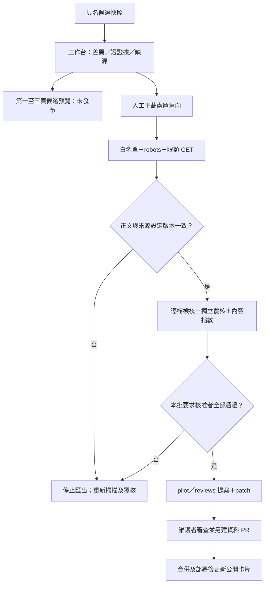

# 候選審查工作台與資料 PR 草稿

2026-11-01更新review-1.1.0：加入頁首操作說明、審查範圍篩選、中文缺漏／狀態與核准意向數。最新逐方案人工清單見[本批審查指南](CURRENT-REVIEW-CHECKLIST.md)。篩選不清除已填處置，下載仍包含所有已處置項目；自動通過8筆不代表8筆可發布，目前只有臺北AI候選無來源欄位缺漏。

> 後續整合更新：本批已接上統一文件準備、Token預算分段及局部規則重萃，現行能力／未完成項目與實際驗收見[文件準備整合](PREPARED-EXTRACTION.md)。舊階段提案或測試數量不代表最新整合狀態。

PR #21 已合併；目前預設批次為13來源、17份文件的19筆具名候選，原AI兩筆快照保留歷史。本階段提供「看差異 → 預覽卡片 → 下載人工處置意向 → 重新核驗 → 匯出資料 PR 草稿」閉環。不直接寫入正式資料或部署，排程模型維持 off，不增加資料庫或 API 服務。

## 操作

在 repo 根目錄、安裝 `requirements-ingestion.txt` 的 Python 環境執行：

```powershell
python scripts/build_review_workspace.py --output work/review-initial
```

開啟 `work/review-initial/review.html`。離線檢視為 0 次來源 GET、0 次模型呼叫；本次檢核明示 `needs_context`，與原始快照的上次檢核分開。點「第一至三頁候選預覽」會開啟同批候選的搜尋、詳情與時間軸，不混入合成排程或個人研討會。預覽一律 draft，核准意向不會變成已發布標籤。

亦可至 Actions → **Scan public sources** → Run workflow，選 `operation=review_workspace`，下載 `candidate-review-…` artifact 後解壓、開啟 `review.html`。此操作針對 repo 具名候選快照，並非每輪掃描報告；不注入 Secrets、不重抓來源、不使用模型。Artifact 保留 14 天，不納入 Pages 成品。

若需先核驗來源再看差異：

```powershell
python scripts/build_review_workspace.py --source-id nstc-assistant-rule --refresh --output work/review-refreshed
```

覆核者核對官方來源、短證據及各欄位後，填實際識別、日期、理由及處置，下載 `review-decisions.json`。這是未驗證身分的人工處置意向；維護者須在 GitHub 審查其身分、獨立性及理由，不代表已執行資料發布。

```powershell
python scripts/build_review_workspace.py --source-id nstc-assistant-rule --refresh --decisions work/review-decisions.json --export-draft --output work/review-final
```

輸出目錄必須為空或尚不存在，拒絕覆寫舊成品，避免沿用上輪核准 patch。下載檔案請自行移入 ignored 的 `work/`，不要提交私人資料。

## 檢核與阻擋



- 處置須完全匹配 candidate ID、source ID、來源 revision、內容 SHA-256。金額、程序、證據、缺漏或原編輯者變動都使舊意向失效。覆核者不得與編輯者相同（忽略大小寫及首尾空白），拒絕空白理由、重複紀錄與未來日期。候選自帶核准標記不採信。
- 當次 `--refresh` 必須確認註冊來源的語意版本：正文區塊、允許附件清單及來源設定組成版本。導覽列／瀏覽計數改動不造成假異動；正文、必要標記、設定或附件變更則攔截並要求重掃，並非整頁位元組簽章。
- 重新核驗沿用 scanner 的 HTTPS 白名單、robots、限額、節流與錯誤停機；全文只留記憶體，無模型呼叫。工作台支援註冊 HTML、primary PDF及精確登錄附件；附件必須綁定父頁，且當次重新發現連結、通過robots後才可核驗。
- Bundle 不合契約、來源脈絡不足、檢核不過或來源必要欄位缺漏，均不能匯出。只選本次意向標為 `applied` 的候選，不夾帶 ledger 其他核准項。任一要求核准者被攔截，整批提案不產生，CLI exit 2。
- 個人購買／條件完成日未填及受理／經費狀態未知，不再誤列為來源萃取缺漏；仍保留提醒及 `application.state=unknown`，不推定個人符合或仍開放。其他未知缺漏預設歸來源問題。

## 產物

| 檔案 | 用途 |
|---|---|
| `review.html` | before/after、來源、缺漏分類及人工處置意向 |
| `candidate-preview.html` | 同批候選在第一至三頁的未發布預覽 |
| `verified-candidates.json`、`review-summary.md` | 本次檢核結果，非正式資料 |
| `manifest.json` | 快照日、來源 GET 次數、模型 0 次及發布狀態 |
| `pilot-proposal.json`、`reviews-proposal.json` | 來源核驗及人工意向通過後才產生 |
| `data-pr.patch`、`PR-DRAFT.md` | 待維護者檢查的總表／處置台帳差異與 PR 內容 |

`--refresh` 預設以執行當日臺北日期判斷窗口；離線使用候選快照日。可用 `--as-of YYYY-MM-DD` 重現。總表日期不同時，提案明確重算既有項目的受理狀態，保留原來源 `checked_on`，理由標註「依既有來源重算（非重新查核來源）」。不把舊觀察日改成今天。

正式 pilot、人工處置台帳與原候選快照均不被工具改寫。提案仍須維護者檢查 patch、執行驗證並另開資料 PR；不自動套用 patch、提交、合併或發布。本開發 PR 不含真人核准紀錄。

每次需來源GET的覆核請用 `--source-id` 限定少量來源，避免超出每批20次HTTP。先產生該批工作台再下載意向；若意向含其他未選候選，CLI會拒絕，不默默丟棄。來源相同但文件不同的候選會分列；多份同一opportunity同時核准須先人工整併，避免後寫覆蓋。

## 第一批AI候選的實測（歷史）

2026-10-30 重新核驗：4 次來源 HTTP（含兩份 robots）、0 模型，兩筆語意版本與 PR #20 一致。臺北通過自動來源檢核，購買／條件完成日及經費狀態仍未知；新竹年齡採認基準尚未解除，維持 `passed_with_gaps`。人工覆核 0 筆、正式資料更新 0 筆。原候選 JSON 保留當時快照，不因新版分類器而改寫歷史。

臺北書面提出仍未直接證明郵寄／親送選項；新竹電子＋親簽上傳仍未直接證明後續完全免紙本。不把未知改為 N/A。P1 博士五年級候選人仍缺地方、年齡及購買條件，不能自動判為可申請。

新增離線測試涵蓋來源變更、無來源脈絡、舊意向失效、自稱核准、Bundle 必填欄位、缺漏分流及合成核准至有效提案的完整路徑。合成 reviewer 僅存在臨時測試，不進正式台帳。

PR #21階段驗收：90 項 Python、38 項 Node 通過；資料、來源設定及公開建置通過。合成匯出 patch 另以 `git apply --check` 驗證可套用，未真正套用。瀏覽器確認候選僅兩筆、第二／三頁共用選取、紙本／電子及親簽資訊同步、320px 無整頁橫向溢出。地方政府資助標籤按具名方案辨認，不再把所有政府補助套用國科會法規參照卡。


2026-10-31完整來源匯入及驗收見[來源盤查](SOURCE-COVERAGE-AUDIT.md)，工作台預設讀取 `data/candidates/source-review.json`，不與舊批次自動聯集。

2026-10-31後續核可：先穩定本批再擴張。已修正給付重複、週期與身分、院別範圍及文件層級N/A；工作台新增方案文件分組及review-text.md文字審查清單。最新8筆通過、11筆有缺漏，仍全部待審。詳見[本批穩定化與擴張門檻](CANDIDATE-STABILITY.md)。
