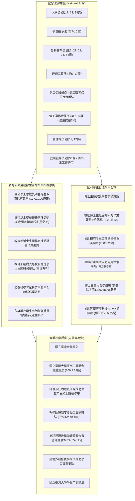
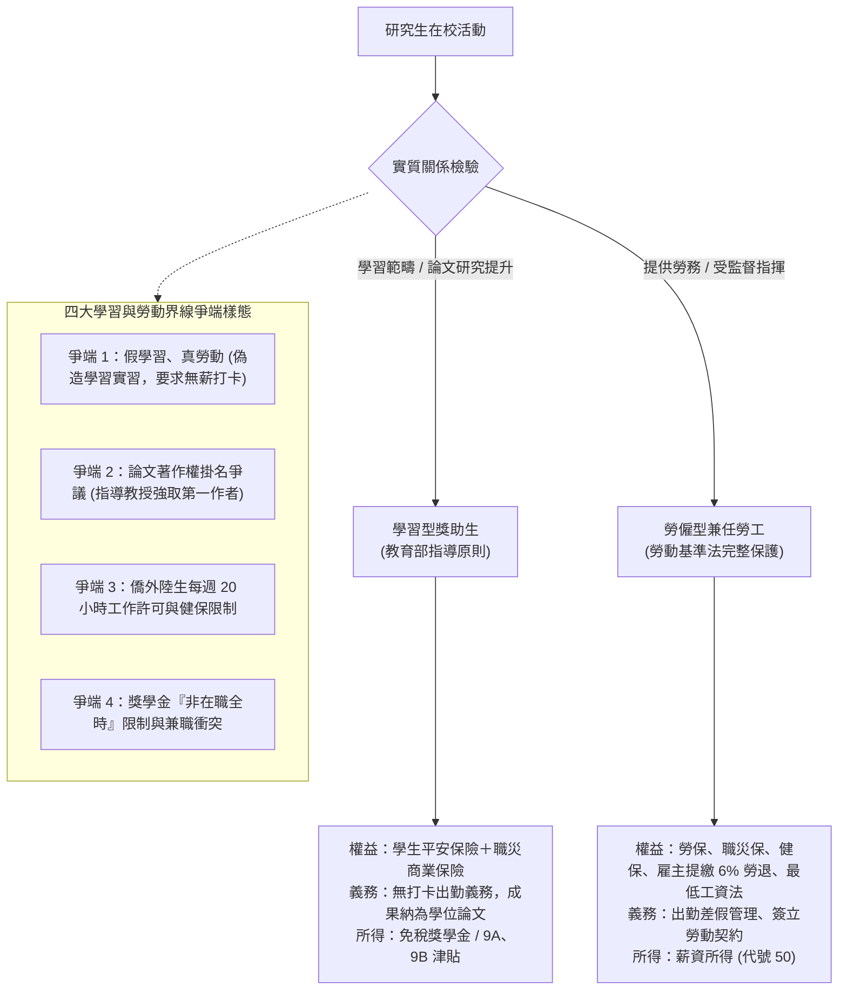
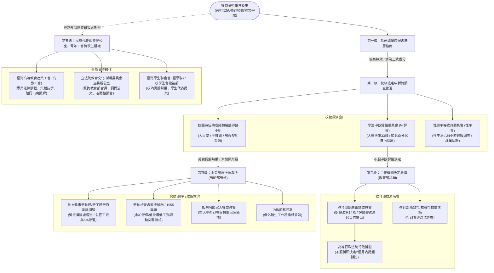

# OpenGSA 獎助學金完整法源庫、學生勞動權益、身分爭議與五級申訴救濟地圖

> 文件性質：權益入口（#rights）全域法規藍圖與救濟指南（2026-10-30 規劃版）。
> 本文件針對公開預覽第四頁「權益與求助 (#rights)」進行全方位法規補強：全面整理國科會、教育部、中研院、勞動法規及校級規章之**完整母法與作業要點法源依據**；深究研究生「學生與勞工雙重身分」、「假學習真勞動」、著作權歸屬、外籍生與兵役衝突等**法律爭議樣態**；建立「勞僱型 vs 學習型 vs 專任 vs 工讀」之**工作型態全維度比對矩陣**；並系統化繪製從「系所 $\to$ 學院 $\to$ 校級（申評會/性平會） $\to$ 中央部會（教育部訴願/勞動部勞檢/行政院/內政部） $\to$ 國會立委與高教工會」之**五級求助救濟地圖**。

---

## 1. 獎助學金與高教研究支持之完整法源體系依據庫

OpenGSA 收錄之所有獎學金、研究津貼、會議補助與兼任薪資，背後皆有其明確之法規授權與命令依據，嚴禁將「校方行政便宜措施」或「口頭要求」混淆為法定限制：

### 1.1 核心主管機關法規清單與法條索引

| 主管機關 / 層級 | 法規 / 命令 / 函釋全有名稱 | 法規代號 / 發文字號 | 核心規範與授權條文 |
|---|---|---|---|
| **法律底線** | **《大學法》** | 全國法規資料庫 | • **第 17 條**：各大學訂定研究生修業年限與學位規章之母法。 • **第 33 條**：學生自治組織、學生代表出席校內重要會議及**學生申訴評議制度之法定依據**。 • **第 34 條**：教育部應訂定各級學校學生申訴辦法。 |
| **法律底線** | **《學位授予法》** | 全國法規資料庫 | • **第 7 條至第 10 條**：碩士、博士學位論文考評、口試委員組織、學位授予與論文抄襲撤銷要件。 |
| **法律底線** | **《勞動基準法》** | 全國法規資料庫 (N0030001) | • **第 2 條**：勞工、雇主與工資定義（受僱從事工作獲致報酬者即為勞工）。 • **第 21 條**：工資由勞雇雙方議定，但不得低於基本工資。 • **第 22、23 條**：工資應全額直接給付勞工，雇主應提供工資明細。 • **第 24、30、32 條**：工時上限每日 8 小時、每週 40 小時，延長工時需發給加班費。 • **第 74 條（勞工吹哨者保護條款）**：勞工發現事業單位違法得向主管機關申訴；雇主不得因申訴而為解僱、降調、減薪或不利處分。 |
| **法律底線** | **《最低工資法》** | 全國法規資料庫 (N0030028) | • **第 5 條**：勞工與雇主議定之工資，不得低於最低工資。 • **第 17 條**：違法低於最低工資者，處新臺幣 2 萬至 100 萬元罰鍰並公布事業單位名稱。 |
| **法律底線** | **《勞工退休金條例》** | 全國法規資料庫 (N0030020) | • **第 7 條、第 14 條**：雇主應為適用勞基法之受僱勞工（含兼任助理/工讀生），**按月提繳不低於每月工資 6% 之勞工退休金**存入勞工個人專戶，**不得自勞工工資中扣除**。 |
| **法律底線** | **《著作權法》** | 全國法規資料庫 | • **第 11 條**：職務上著作歸屬（受僱人為著作人，得約定著作財產權歸雇主）。 • **第 15 條**：著作人享有公開發表權與姓名表示權（學位論文學生享有獨立著作權）。 |
| **國科會** | **《補助專題研究計畫研究人力約用注意事項》** | NSTC FL028686 (113.10.22修正) | • **第 3 點**：研究人力分為專任人員、兼任人員（在學學生）及臨時工。 • **第 4 點第二款第二目**：**學生兼任人員，每月至少 6,000 元**。 • **第 4 點第一款**：專任最低專科級 30,400 元、學士級 36,300 元、碩士級以上 41,500 元。 • **第 7 點**：機構應與約用人員簽訂契約，屬僱傭關係者應依勞基法辦理保險與勞退。 |
| **國科會** | **博士生研究人力費用增核措施公文與 FAQ** | 科會綜字第 1130048968 號函 (113.7.15) | • 說明二（一）1：**領有增核費用之博士生兼任人員，每月合計總額至少 16,000 元**（兼任 6,000 元＋增核 10,000 元）。 • 增核經費專款專用；專職全時工作者排除。 |
| **國科會** | **《補助研究生出席國際學術會議作業要點》** | NSTC FL038260 | • 第 4 點：會議首日所屬月份之前一個月首日機構彙送。 • 接受函可於會議舉行四週前補交。 |
| **教育部** | **《專科以上學校獎助生權益保障指導原則》** | 臺教高(五)字第 1070196432 號函 | • 第 4 點：劃分學習範疇（研究獎助生、附服務負擔助學生）與勞僱兼任助理。 • 第 8 點：學習型獎助生須參照勞基法職災標準加保商業保險；論文著作權歸屬保障。 • **第 14 點**：凡存有提供勞務獲取報酬之事實且具從屬性者，**一律回歸勞動法規（勞僱型）**。 |
| **勞動部** | **《專科以上學校兼任助理勞動權益保障指導原則》** | 勞動關2字第 1040126620 號函 | • 綜合判斷人格從屬性、經濟從屬性、組織從屬性；確認僱傭關係即受勞基法完整保護。 |

---

## 2. 學生與勞工身分模糊爭議深度剖析（Identity Dilemmas）

高教體系中，研究生常面臨「既是受教育的學生，又是實際產出科研成果的勞動者」的雙重身分困境，導致以下五大常見法律爭端：

### 2.1 爭端 1：「假學習、真勞動」之判定標準與違法樣態

許多實驗室為規避勞健保保費與 6% 勞退提繳，常強迫學生簽署「學習型同意書」，實務上最高法院與勞動檢查之認定原則如下：

* **形式名稱不拘，實質事實優先（Substance over Form）**：即使契約抬頭記載「學習型研究生」、「自願獎助生」，若客觀上存在工作事實與指揮監督，**法院及勞檢一律判定為「勞基法受僱勞工」**。
* **判定勞僱關係之「從屬性三要素」**：
  1. **人格從屬性**：工作時間是否受指定（如排班、打卡、每週固定固定進實驗室打卡滿 40 小時）；請假是否須經教授核准；工作內容是否包含與個人學位論文無關之行政報銷、監考、系所清潔、承接教授私人外包專案。
  2. **經濟從屬性**：學生並非為自己的營業目的付出勞力，而是為了獲得生活津貼或薪資；工作工具（電腦、儀器、試劑、空間）全由學校或實驗室提供。
  3. **組織從屬性**：納入實驗室生產或教學組織體系，與專任助理、行政人員依分工協同作業。
* **違法樣態與法律後果**：
  - 違法以「6,000 元」約定超過法定最低工資對應之工時（如每月要求工作 80 小時，時薪折合僅 75 元，嚴重違反《最低工資法》第 5 條）。
  - 學校將面臨勞保局按日加處罰鍰、追繳全期 6% 勞退金，並遭勞檢處開罰 2 萬至 100 萬元。

---

### 2.2 爭端 2：學位論文、專案研究與智慧財產權歸屬

* **學位論文原創著作權**：
  - 依《著作權法》第 10 條及第 15 條，學生撰寫碩博士學位論文，係獨立完成之學術著作，**學生本人為唯一法定著作人**。
  - 指導教授僅提供「觀念啟發、架構指導或文字潤飾」，並未直接參與實質內容創作表達者，**依法不得列為共同著作人**，更不得強行要求掛名第一作者。
* **研究計畫成果專利與產學合約**：
  - 若學生擔任「勞僱型研究助理 (RA)」，依《著作權法》第 11 條或計畫契約，計畫產出之技術專利或報告著作財產權通常歸屬於受補助機構（大學）或出資機關（國科會）。
  - **重要保障底線**：教育部《專科以上學校獎助生權益保障指導原則》第 8 點明訂，若屬研究獎助生，其研究成果**有權直接作為學生本人學位論文之一部分**，計畫主持人不得事後阻撓學生論文口試或發表。

---

### 2.3 爭端 3：外國留學生、僑生與陸生之就業與健保身分規範

* **工作許可（Work Permit）法規底線**：
  - 依《就業服務法》第 50 條及《雇主聘僱外國人許可及管理辦法》，外國留學生、僑生在學期間受聘僱從事工作（含擔任勞僱型 TA/RA），**必須事先向勞動部勞動力發展署申請工作許可**。
  - **工時上限**：除寒暑假外，每週工作時間**最長不得超過 20 小時**。未獲許可即受僱工作者，依法得處 3 萬至 15 萬元罰鍰並限令出境。
* **全民健保加保分流**：
  - 具僑外生身分且持有居留證者，若擔任「勞僱型」助理，**自受僱日起即應由學校以「第一類受僱者」身分投保健保**（無須等待 6 個月）。
  - 若屬「學習型」或無工作者，則須在台居留滿 6 個月後，始得以「第六類被保險人」加入健保。
* **陸生政策動態**：
  - 政府已修正全民健康保險法施行細則，逐步將陸生比照外籍生納入健保體系；陸生擔任計畫助理仍須遵守兩岸人民關係條例與主管部會現行作業規範（通常限制擔任涉國家安全或核心機密計畫）。

---

### 2.4 爭端 4：獎學金「禁止專職全時工作」與兵役法令衝突

* **非在職全時切結與兼職界線**：
  - 國科會博士生研究獎學金（4萬/月）與教育部博士生獎學金，均明文規定「受獎期間不得從事專職全時之有給職工作」。
  - **合法例外（FAQ 第 3 題）**：留職停薪進修、無薪差假進修，或僅受聘為本校課程短期兼任助教（領取少額助教鐘點費），未構成全職勞動關係者，不在此限。
* **兵役緩徵與出境研習**：
  - 博士班研究生依《兵役法》修業期間享有法定緩徵（最高至 33 歲）。
  - 獲國科會千里馬計畫出國研究之役男，應檢附核定公文依《役男出境處理辦法》向學校軍訓室或各縣市兵役局申請「赴國外大學研究出境核准」（最長以 1 年為限）。

---

## 3. 工作型態全維度比對矩陣（勞僱 vs 學習 vs 專任 vs 工讀）

| 比較維度 | 勞僱型兼任助理 (TA / RA) | 學習型獎助生 (研究 / 附服務負擔) | 專任研究助理 (Full-time RA) | 校內工讀生 (Student Worker) |
|---|---|---|---|---|
| **法律核心依據** | 《勞動基準法》 勞動部兼任助理指導原則 | 《大學法》 教育部獎助生權益保障指導原則 | 《勞動基準法》 國科會專題人力約用注意事項 | 《勞動基準法》 《最低工資法》 |
| **法律關係實質** | **勞動契約（僱傭關係）** | **教育與學習活動（非勞僱）** | **勞動契約（全職僱傭）** | **勞動契約（兼職僱傭）** |
| **工資 / 給付屬性** | **工資（薪資所得代號 50）** | **獎學金 / 補助費（稅單 9A/9B）** | **工資（薪資所得代號 50）** | **工資（薪資所得代號 50）** |
| **最低給付底線** | 受《最低工資法》保障（折合時薪 $\ge 196$ 元）；國科會兼任 $\ge 6,000$ 元 | 無法定工資底線，由學校獎助辦法依修課或點數核發 | 專科 30,400 / 學士 36,300 / 碩士以上 41,500 元 | **每小時最低 196 元（2026年標準）**；月薪 $\ge 29,500$ 元 |
| **勞工保險與職災** | **強制參加勞保與職業災害保險** | 不得投保勞保；**學校強制加保商業職災險** | **強制參加勞保、就保與職災保險** | **強制參加勞保與職業災害保險** |
| **勞工退休金 (6%)** | **學校強制按月提繳 6% 勞退**（存入個人專戶） | **無勞工退休金** | **學校強制按月提繳 6% 勞退** | **學校強制按月提繳 6% 勞退** |
| **工時約束與出勤** | 受勞基法每日 8 小時、每週 40 小時約束；加班發加班費 | **嚴禁要求上下班打卡或限期排班排休** | 每日 8 小時、每週 40 小時；享有特休假與事病假 | 按約定排班時數出勤，享有休息日與例假 |
| **成果論文發表權** | 職務上產出，著作財產權歸學校或計畫 | **研究成果可直接納入學生本人學位論文** | 專利與智慧財產權依僱傭契約歸學校 | 事務性勞務，無學術產出爭端 |

---

## 4. 五級權利救濟與申訴申復管道地圖（Grievance & Relief Map）

當遭遇「違法苛扣獎勵金」、「強迫無薪工作」、「被剝奪兼任助理薪資」、「學位論文爭端」或「校園不當處分」時，救濟行動遵循「由內而外、由基層至司法與國會」的五級階梯：

### 4.1 各級救濟窗口運作指引與實戰策略

#### 第一級：系所與學院層級（基層溝通）
* **窗口**：指導教授、系主任、系導師、系學生事務代表、學院院長。
* **適用情形**：實驗室內部工作分工誤會、研究津貼排班協調、換題目或更換指導教授。
* **策略**：書面保留溝通紀錄（Email 或通訊軟體截圖），避免僅做私下口頭承諾。若涉及正式懲處或扣發獎勵金，應要求對方提出正式書面處分書。

#### 第二級：校級法定申訴與調查管道（校內救濟）
1. **學生申訴評議委員會（申評會）**：
   - **法源依據**：《大學法》第 33 條第 4 項、《各級學校學生申訴評議委員會組織及運作辦法》、各校《學生申訴辦法》。
   - **受理對象**：學生對於學校就其個人所為之獎懲、其他處分或行政措施，認為**違法或不當**，致損害其受教育權、受獎權益或其他個人權利者。
   - **法定時效**：應於**收受或知悉處分之次日起 30 日內**，以書面向申評會提出申訴。
   - **組織公正性保障**：委員中學生代表比例**不得少於五分之一**（通常包含研究生代表），且得聘請法律、心理或教育學者擔任委員；評議過程得通知申訴人到場陳述意見。
2. **校內兼任助理勞動權益爭議小組**：
   - **窗口**：各大學人事室、學務處生活輔導組、研發處計畫管理組。
   - **適用**：校內勞僱型兼任助理之薪資未發、工時爭議或保險漏保爭端。
3. **性別平等教育委員會（性平會）**：
   - **法源**：《性別平等教育法》。
   - **窗口**：學務處性平會專案秘書 / 24 小時校安專線。
   - **程序**：學校知悉疑似性騷擾或性霸凌事件後，**必須於 24 小時內依法通報教育部**，並由性平會於規定時限內組成獨立調查小組；調查期間應啟動課業隔離與心理諮商保護，嚴格禁止加害人接觸被害人。

#### 第三級：主管機關法定救濟（教育部行政訴願與糾舉）
1. **教育部訴願審議委員會**：
   - **法源依據**：《訴願法》第 1 條、第 14 條。
   - **救濟路徑**：學生若不服校內申評會之申訴評議決定，得於**收到評議決定書之次日起 30 日內**，檢附申訴決定書經由原學校或逕向**教育部提起訴願**。
   - **行政訴訟**：若教育部訴願決定仍予駁回，得於訴願決定書送達次日起 **2 個月內**，向就讀學校所在地之**高等行政法院提起行政訴訟**（確認行政處分違法或給付訴訟）。
2. **教育部高等教育司 / 技職司檢舉專線**：
   - **適用**：檢舉學校行政高層系統性違法（例如：全校性違規使用學習型規避勞動法規、挪用國科會或教育部博士生獎學金專款）。

#### 第四級：中央部會勞動檢查與行政裁決（勞動部、行政院、內政部）
1. **地方縣市勞動局 / 勞工局（勞資爭議調解）**：
   - **法源依據**：《勞資爭議處理法》。
   - **適用**：勞僱型研究生助理被積欠薪資、未依法給付最低工資、未足額提繳 6% 勞工退休金。
   - **效力**：由地方政府調解委員介入；調解成立作成調解紀錄，**具有民事契約與執行力效力**；雇主拒絕履約可逕行聲請法院強制執行。
2. **勞動檢查處直接檢舉（發動突襲勞檢）**：
   - **電話專線**：勞動部 **1955 勞工諮詢申訴專線**，或各縣市勞檢處線上檢舉。
   - **吹哨者保護**：依《勞動基準法》第 74 條，主管機關與勞檢員**對申訴人身分負絕對保密義務**，學校不得對檢舉學生為任何不利處分。
3. **內政部移民署**：
   - 負責外籍學生居留延期、工作證受不當註銷時之身分復權救濟。
4. **監察院國家人權委員會**：
   - 針對高教重大體制性侵害人權、主管機關怠忽職守未依法監督時之陳情調查案。

#### 第五級：外部民意代表、青年工會與學生組織（國會與社會倡議）
1. **臺灣高等教育產業工會（高教工會, THE Union）**：
   - 國內唯一專門協助大專兼任助理、專任助理與青年學者爭取勞動權益的工會組織。
   - 提供法律諮詢、義務律師陪同出席勞資調解、協助撰寫訴願與訴訟書狀，並發起集體倡議。
2. **立法院立法委員國會辦公室**：
   - 教育及文化委員會、社會福利及衛生環境委員會立法委員。
   - 可向教育部、國科會或勞動部調閱專案公文、在立法院總質詢提出糾正，或召集教育部高官與校方代表召開協調會直接施壓。
3. **青年勞動九五聯盟**、**臺灣學生聯合會 (臺學聯)**、**校學生會權益部**：
   - 發動校園輿論聲援、於校務會議提案修改不合身條款、提供同儕支援。

---

## 5. 前台 `#rights` 頁面維護與資料查核指引

1. **資訊定位與分流**：
   - 獎學金、公費與研究津貼之「法定底線」與「校方建議」必須清楚標註出處法規名稱與最新修正日期。
   - **嚴禁**將「國科會 6,000 元兼任助理底線」或「16,000 元增核總額底線」混淆為所有學生無條件可領取之全校普遍獎學金。
2. **更新機制**：
   - 每季人工巡檢主管機關重大法規命令修訂（特別是最低工資每年 1 月 1 日生效調整、國科會約用注意事項最新修正函令）。
   - 當教育部或勞動部頒布新指導原則時，即時更新比對矩陣與救濟地圖。
3. **零隱私洩漏原則**：
   - 所有申訴與救濟案件在收錄案例時，全數進行去識別化與去敏處理（如以 P1、合成案例表示），不記錄個人真實姓名、學號、案件案號或爭訟私密卷宗。
