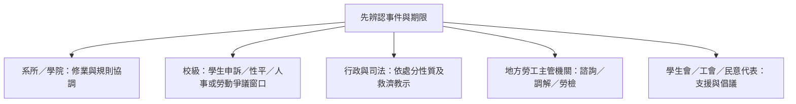

# 法源、工作身分與五類求助窗口

更新：2026-10-30；來源初查草稿，尚未完成獨立人工覆核。取代舊版將不同事件串成固定五級救濟程序、或把保障一概套用所有學生的敘述。

## 先辨認適用範圍

| 依據 | 判斷用途 | 官方入口 |
|---|---|---|
| 勞動部兼任助理權益指導原則 | 實際工作與從屬性；不能只用固定報酬或給付名稱決定 | [勞動部原則](https://laws.mol.gov.tw/FLAW/PrintFLAWDAT0202.aspx?id=FL077250) |
| 教育部獎助生權益保障指導原則 | 核對學習與勞僱分流、書面約定及保障 | [教育部法規](https://edu.law.moe.gov.tw/LawContent.aspx?id=GL001889) |
| 國科會研究人力約用注意事項 | 僅對適用的專題計畫、約用身分及期間核對給付條件 | [國科會正式條文](https://law.nstc.gov.tw/LawContent.aspx?id=FL028686) |
| 最低工資、工時及保險法規 | 依實際關係、計酬方式與進用依據確認，不以研究津貼直接倒推可要求工時 | [勞動部最低工資](https://www.mol.gov.tw/1607/28162/28166/28180/28182/28188/29025/) |
| 校務基金獎勵金、TA 辦法及支給上限 | 各自核對經費及適用身分；上限不是保證可領額 | [臺大生輔組辦法](https://advisory.ntu.edu.tw/CMS/Page/211) |

部會行政規則、補助條件與學校規章不是一律同一效力的法律。遇衝突時先查適用對象、經費、授權依據及契約，不單靠圖中的上下排列裁決個案。

## 四種情境

| 情境 | 必查事項 |
|---|---|
| 勞僱型 RA／TA | 契約、工作內容、指揮監督、工時、報酬及各項社會保險與退休制度 |
| 學習型獎助生 | 課程或研究訓練目的、實際是否變成提供勞務、書面約定與學習保障 |
| 計畫專任人員 | 任用資格、是否在學、進修例外、經費及專任標準，不能因具博士候選人資格就自動適用 |
| 校內短期工讀 | 招募與聘任依據、計酬及工時、保險與身分適用，不能只看工作名稱 |

國科會每月6,000元一般要求、博士增核10,000元及領有增核者總額至少16,000元，依 [RIGHTS-SOURCES.md](RIGHTS-SOURCES.md) 的適用分支核對；不代表每位博士生都自動取得該給付。2026最低工資與其他年度須分開記錄生效期間。

## 退休金與僑外生

勞退新制適用者由雇主按規定另提繳，不得內扣成學生自行負擔。不能寫成「所有勞僱型學生均一律6%個人專戶」；僑外生、外國專業人才及其他身分的新／舊制適用須分流確認。

勞動部說明也列出2026年外國專業人才制度調整；不能把專業人才例外直接套用每位在學工讀的僑外生。[勞動部正式說明](https://www.mol.gov.tw/1607/28690/2282/2302/2304/81139/?cprint=pt)

工作許可、居留、校內進用及赴外研究／兵役是不同程序；各向權責機關及校方核對，避免把移民署當成所有工作許可爭議的受理機關。

## 論文與研究產出

教授只提供觀念指導，不因指導身分就成為共同著作人；若有共同參與內容表達等事實，則須另判斷共同著作。學生是否單獨享有著作權，不能僅憑「學位論文」四字決定。

學位論文、計畫報告、軟體與技術專利也應分開核對；著作人、著作財產權、授權與學術倫理作者排序不是相同問題。[智財局論文著作權說明](https://www.tipo.gov.tw/tw/copyright/701-21249.html)

## 五類求助窗口（可平行選擇）

這是資源分類，並非法定逐級順序。不要要求學生先與指導教授協商，才能使用其他窗口；諮詢、調解、檢舉及倡議也不當然停止正式救濟期限。

- 校內申訴依各校現行辦法與送達事實核對：[臺大學生申訴專區](https://advisory.ntu.edu.tw/CMS/Page/252)。
- 行政或司法途徑依事件及學校屬性、處分救濟教示確認；不能將所有校內決定一律套成30日訴願及2個月起訴。
- 勞動事件分開評估諮詢、調解、勞檢與司法：[勞動部勞資爭議入口](https://www.mol.gov.tw/1607/28690/89680/)。保密與不利處分保障須核對適用法規，避免保證「絕對保密」。
- 性平事件使用專責窗口及保護措施；不要先套一般系所協商流程。
- 工會、學生會及民意代表的服務依其公告核對，不替代法定裁決與期限。

學生可自行保存聘約、工作交辦、工時與給付資料，供正式窗口了解事實；不要求在 OpenGSA 公開 Issue 上傳私人契約或薪資證明。從屬性自測只整理問題，不以勾選分數認定僱傭關係。
