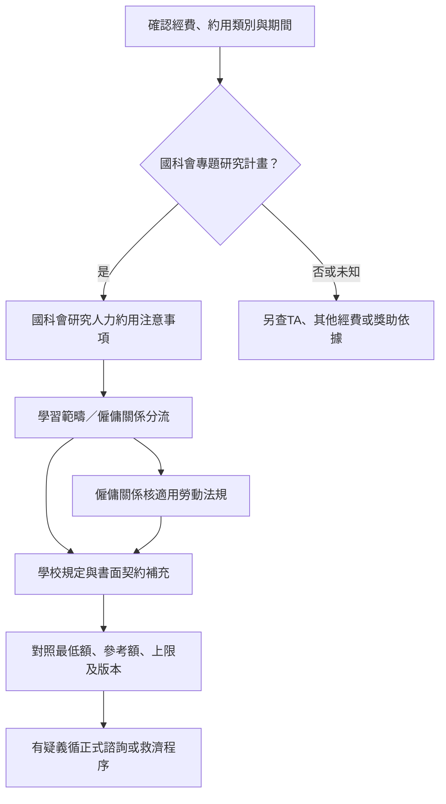

# 第四頁：國科會研究人力保障與學校補充

來源初查：2026-10-29；狀態：編輯草稿，尚待非原編輯者獨立覆核。本台帳獨立於獎助機會樣本，不增加pilot.json的筆數。

## 已接受方向

第四頁以國科會研究人力規定為主要查核依據，再依學校補充。維持獨立資源頁，不隨第一頁選項重算，依規定、適用期間或窗口變動修訂。

「以國科會為主」是資訊主軸，不表示排除適用的勞動法令。國科會計畫、一般TA、其他部會計畫及獎學金先分流；學校規定、契約、最低工資及計畫給付要求分別查核。

## 來源台帳

| ID／層級 | 官方來源 | 適用範圍與定位 | 版本與查核限制 |
|---|---|---|---|
| nstc-research-personnel／國科會原機關 | [研究人力約用注意事項](https://law.nstc.gov.tw/LawContent.aspx?id=FL028686)、[官方沿革](https://law.nstc.gov.tw/LawContentSource.aspx?id=FL028686) | 第三點人員與分流、第四點給付、第七點勞動法規及契約 | 113.10.22修正；沿革第13筆確認本次第四點修正自114.1.1生效 |
| nstc-phd-topup／國科會原機關 | [博士生費用增核入口](https://www.nstc.gov.tw/folksonomy/list/ced2afbb-f4d4-48b3-909f-247d5fbbe2f5?l=ch)、[原函PDF](https://www.nstc.gov.tw/nstc/attachments/0a7ca0b3-2bb4-4d00-a175-45246024cf08) | 113.7.15科會綜字第1130048968號函說明二（一）1：領有增核者總額至少16,000元；10,000元為增核額，專款專用 | 官網2024.7.16更新；原函4頁合併檔含113年新函及112年舊函，按各函日期與適用分支讀取，不把舊追溯方式套入新版 |
| nstc-phd-topup-faq／國科會原機關 | [博士生增核FAQ PDF](https://www.nstc.gov.tw/nstc/attachments/e3c16203-1b68-49bd-bf5d-ba1d12f6976e) | 第2題總額16,000元與約用文件、第3題專職限制、第6題不足月、第7題兼領、第10題同期間一次 | 共2頁；已讀全文並渲染第1頁核對表格。FAQ未明載獨立修正日，不用網站更新日冒充發布日 |
| nstc-personnel-history／國科會歷史原文 | [108.5.17版](https://law.nstc.gov.tw/LawContentHistory.aspx?hid=91075&id=FL028686)、[110.12.28版](https://law.nstc.gov.tw/LawContentHistory.aspx?hid=101161&id=FL028686) | 108版第四點兼任由機構自訂；110版增列學生兼任每月至少6,000元 | 官方沿革第10筆載110年第四點修正自111.1.1生效；歷史頁不當現行版 |
| moe-student-rights／教育部原機關 | [獎助生權益保障指導原則](https://edu.law.moe.gov.tw/LawContent.aspx?id=GL001889) | 國科會第三點指向的分流依據；第五點書面合意、第十二點疑義管道等 | 頁載107.11.20發布；不僅憑契約名稱認定關係 |
| mol-minimum-wage／勞動部原機關 | [最低工資的意義](https://www.mol.gov.tw/1607/28162/28166/28180/28182/28188/29025/) | 2026年時薪196元；月薪29,500元須連同正常工時及計酬條件讀取 | 115.1.1起數額；新年度另建生效版本，不覆寫舊期間。本輪未核未來生效版，不宣稱這是未來年度額度 |
| mol-assistant-guidance／勞動部原機關 | [兼任助理勞動權益保障指導原則](https://laws.mol.gov.tw/FLAW/FLAWDAT0202.aspx?id=FL077250)、[官方PDF入口](https://www.mol.gov.tw/1607/28162/28296/28428/28430/28438/28440/29148/) | 第二點依指揮監督、勞務對價等從屬性綜合判斷；第三點依適用情形辦理保障 | 104.6.17勞動關2字第1040126620號函訂定；單次全文入口逾時，已讀官方PDF可讀文字，不自行改認定結果 |
| minimum-wage-act／法律 | [最低工資法](https://law.moj.gov.tw/LawClass/LawAll.aspx?pcode=N0030028) | 第5條工資不得低於最低工資 | 法律底線與國科會補助／約用要求分列，不把兩者一概稱相同層級的法定金額 |
| labor-standards-act／法律 | [勞動基準法](https://law.moj.gov.tw/LawClass/LawAll.aspx?pcode=N0030001) | 第22、23條給付及明細；第24、30、32條加班及工時；第74條申訴與不利處分禁止 | 先確認僱傭及適用事實；條文摘要不代替個案解釋，差假等其餘條款後續逐項補查 |
| labor-pension-act／法律 | [勞工退休金條例](https://law.moj.gov.tw/LawClass/LawAll.aspx?pcode=N0030020) | 第7條適用人員、第14條雇主提繳要求 | 不能把學習型獎助生或所有外籍身分一律視為適用；保險另依國科會第四點及各保險法規確認 |
| ntu-pay-index／臺大校方 | [人事室薪資標準](https://www.personnel.ntu.edu.tw/News_n_101162_sms_79140.html) | 經費與約用身分索引，連至專任、兼任、博士後等文件 | 索引版本須再核附件；頁腳更新日及舊上版日期不等於薪資表生效日 |
| ntu-fulltime-reference／臺大校方 | [專任研究助理參考表入口](https://www.personnel.ntu.edu.tw/News_Content_Create_1_n_64102_state_F5D336F102ACBC68_s_70764_sms_62508.html) | 115.1.1起表；專任人員用，不套一般在學博士生 | 已讀PDF文字與註記，未完成表格視覺覆核；前台不轉錄校方各年資數額 |
| ntu-parttime-cap／臺大校方 | [兼任助理及研究獎助生每月支給上限表](https://ord.ntu.edu.tw/WebUPD/ordntu/pm/國立臺灣大學計畫兼任助理及研究獎助生每月支給上限標準表_23121516034949938.pdf) | 博士候選人分欄；註3時薪、註4同一委補助單位合計 | 112.12.15起施行；已渲染核對欄位。上限不是最低保障或可領保證 |
| usc-parttime-index／實踐大學校方 | [國科會計畫兼任助理標準](https://rd.usc.edu.tw/p/406-1048-4836,r147.php?Lang=zh-tw) | 最新連結標114年度起、113.11.27校內委員會修正；另列111及107–110年度舊表 | 最新附件本輪下載404，正文擷取另逾時；保留入口及版本線索，金額、上下限與例外待核。不因標題有國科會就升為原機關規定 |
| shu-nstc-amendment／世新校方轉知 | [113.10.24轉知公告](https://rd.web.shu.edu.tw/國科會修正「國家科學及技術委員會補助專題研究/) | 轉知專任最低30,400／36,300／41,500元及114.1.1生效 | 與國科會現行版及沿革核對一致；是原機關修正的轉知，並非世新另訂博士兼任10,000／12,000元下限 |

## 摘要適用界線

- 國科會第四點第二款第二目：學生兼任人員，不論學習範疇研究津貼或僱傭關係工作酬金，每月至少6,000元。這是該計畫約用身分的要求，不是所有碩博士生的普遍獎學金。
- **不能只以一般6,000元替代博士生增核分支**：113.7.15原函及FAQ第2題明定，領有本增核措施費用的博士生兼任人員，每月至少合計16,000元。10,000元是增核額，不是可取代原有一般要求的總額。
- 增核對象須為依注意事項約用的博士生兼任人員，且未在其他公私立機關（構）從事專職全時有給工作；FAQ第3題另有留職停薪例外。不能只以「博士五年級／已通過資格考」自動核定有增核。
- 增核適用須核經費核定與約用期間。113.8.1（含）以後開始的計畫依申請書審查結果主動增核；之前計畫另循變更申請，113.7.15起不再追溯、以申請當月起計；新提案併編費用。執行過程其他追加需求須另依原函第三點及作業要點程序審查，不將「停止後續相關增核申請」擴張為所有追加需求均禁止。
- 增核費用專款專用，不能流為他人／其他用途；FAQ第6題的未滿月10,000元增核按日核算，不外推成所有一般最低額均可任意按比例扣減。第10題的同一約用期間一次限制需連同計畫起日及核定內容確認。
- 國科會第四點第一款：專任每月最低額為專科級30,400元、學士級36,300元、碩士級（含）以上41,500元。第三點對在學學生擔任專任有限制及例外，不以博士年級或候選人資格自動套用。
- 第七點與適用勞動法規同時核對。6,000元不能作為任意工時下的合法工資結論，不產生「6000÷時薪＝可要求工時」試算。
- 臺大上限表：博士未獲候選人資格42,000元、已獲資格50,000元，同一委補助單位合計。不得稱為每位教授必給金額，也不能當作各計畫均可再領一份的保證。
- 看似衝突時保留原文、適用期間、經費及例外，交正式窗口確認；Agent不自行宣布規定失效。學校上限不能取代國科會或適用法令要求。
- 校方額度、計畫保障、法定工資與成果獎分開；不以尚未產生成果推定可延後適用的工資或契約給付。

## 臺大博士五年級候選人：權益閱讀測試

以下為合成情境，不判定個人實際聘任或法律關係。

1. 只知學校、系所、五年級與候選人資格：不得顯示「應領50,000元」或「應領41,500元」。
2. 確認國科會計畫學生兼任身分後：顯示每月至少6,000元摘要，分流與契約仍須確認。
3. 博士生須再問是否核定／支領增核、哪個約用期間、是否有其他專職全時有給工作；未知即顯示增核待確認，不默認未領。已確認領有增核者顯示至少16,000元合計。
4. 若屬僱傭：另查計酬、工時、適用工資及勞動權益，不只看6,000或16,000元就判斷符合。
5. 學校補充顯示候選人50,000元上限及合計範圍；cap與minimum分開。增核額是否計入特定校方上限，未核對前不自行做「上限再加10,000元」運算。
6. 若為一般課程TA或其他經費：轉到適用制度，不直接套國科會6,000／16,000元要求。

## 10,000／12,000元的檢索結論與界限

本輪核對國科會現行原文、108及110年歷史第四點、官方沿革、博士生增核原函及FAQ、臺大索引與世新轉知。另以「博士／兼任／最低／下限」搭配10,000、12,000及中文數字檢索官方來源。

- 10,000元已有明確相關依據：博士生增核額；其對應最低每月總額是16,000元，不能只寫10,000元保障。
- 12,000元尚未查得作為**國科會博士生通用最低額**的依據。這是本輪檢索結果，不等於所有校方、系所、年度或其他方案都沒有此標準；保留待查，不將記憶判定為錯誤，也不擅填成已確認下限。
- 前台須區分法律最低工資、國科會計畫約用要求、增核附帶給付要求、校方標準與契約；不能將所有款項一律稱為法定工資。
- 下一步尚待補齊：指定學校／系所可能的12,000元原文、各保險適用條件、校方更優標準及個別約用資料。正式個案不在公開repo蒐集。

## 維護與驗收

後續法規契約至少保留來源層級、制定單位、適用學校／經費／身分、給付性質、minimum／reference／cap、計酬單位、合計範圍、原文定位、公布／修正／生效日、查核日及覆核狀態。本輪未實作自動法律判定引擎。

第四頁依變更修訂，另規劃每季人工巡查連結與版本；最低工資年度公告期及得知新公告時優先核對。未建立排程。

驗收：國科會原文可直達；校方依校分列；上下限及TA／專任／學生兼任不混用；未知附件不補金額；公布與生效日分開；第一頁篩選不改第四頁。正式發布仍須獨立覆核。
