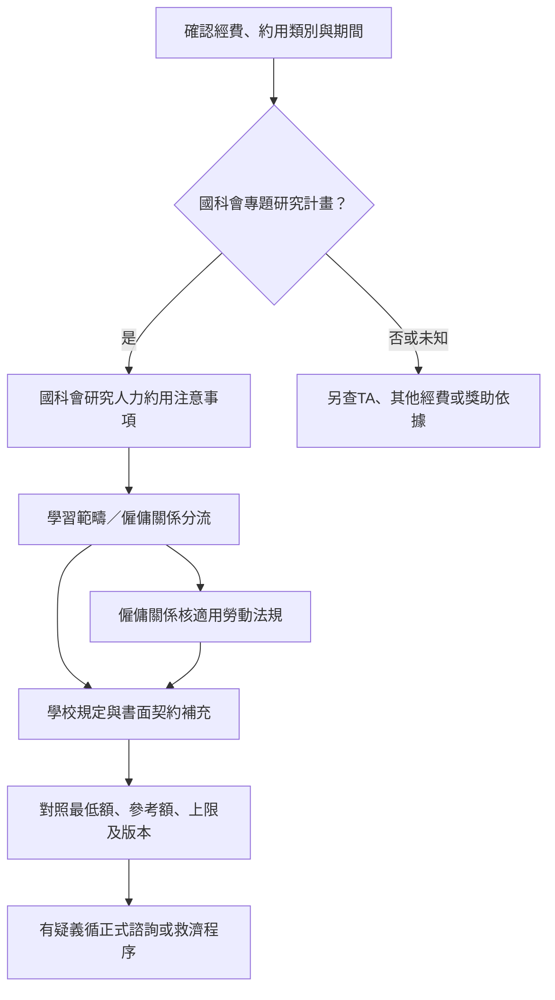

# 第四頁：國科會研究人力保障與學校補充

來源初查：2026-10-29；狀態：編輯草稿，尚待非原編輯者獨立覆核。本台帳獨立於獎助機會樣本，不增加pilot.json的筆數。

## 已接受方向

第四頁以國科會研究人力規定為主要查核依據，再依學校補充。維持獨立資源頁，不隨第一頁選項重算，依規定、適用期間或窗口變動修訂。

「以國科會為主」是資訊主軸，不表示排除適用的勞動法令。國科會計畫、一般TA、其他部會計畫及獎學金先分流；學校規定、契約、最低工資及計畫給付要求分別查核。

## 來源台帳

| ID／層級 | 官方來源 | 適用範圍與定位 | 版本與查核限制 |
|---|---|---|---|
| nstc-research-personnel／國科會原機關 | [研究人力約用注意事項](https://law.nstc.gov.tw/LawContent.aspx?id=FL028686) | 第三點人員與分流、第四點給付、第七點勞動法規及契約 | 頁載113.10.22修正；修正日不直接當生效日，逐條生效資訊待補完整公文 |
| moe-student-rights／教育部原機關 | [獎助生權益保障指導原則](https://edu.law.moe.gov.tw/LawContent.aspx?id=GL001889) | 國科會第三點指向的分流依據；第五點書面合意、第十二點疑義管道等 | 頁載107.11.20發布；不僅憑契約名稱認定關係 |
| mol-minimum-wage／勞動部原機關 | [最低工資的意義](https://www.mol.gov.tw/1607/28162/28166/28180/28182/28188/29025/) | 2026年時薪196元；月薪29,500元須連同正常工時及計酬條件讀取 | 115.1.1起數額；新年度另建生效版本，不覆寫舊期間。本輪未核未來生效版，不宣稱這是未來年度額度 |
| ntu-pay-index／臺大校方 | [人事室薪資標準](https://www.personnel.ntu.edu.tw/News_n_101162_sms_79140.html) | 經費與約用身分索引，連至專任、兼任、博士後等文件 | 索引版本須再核附件；頁腳更新日及舊上版日期不等於薪資表生效日 |
| ntu-fulltime-reference／臺大校方 | [專任研究助理參考表入口](https://www.personnel.ntu.edu.tw/News_Content_Create_1_n_64102_state_F5D336F102ACBC68_s_70764_sms_62508.html) | 115.1.1起表；專任人員用，不套一般在學博士生 | 已讀PDF文字與註記，未完成表格視覺覆核；前台不轉錄校方各年資數額 |
| ntu-parttime-cap／臺大校方 | [兼任助理及研究獎助生每月支給上限表](https://ord.ntu.edu.tw/WebUPD/ordntu/pm/國立臺灣大學計畫兼任助理及研究獎助生每月支給上限標準表_23121516034949938.pdf) | 博士候選人分欄；註3時薪、註4同一委補助單位合計 | 112.12.15起施行；已渲染核對欄位。上限不是最低保障或可領保證 |
| usc-parttime-index／實踐大學校方 | [國科會計畫兼任助理標準](https://rd.usc.edu.tw/p/406-1048-4836,r147.php?Lang=zh-tw) | 最新連結標114年度起、113.11.27校內委員會修正；另列111及107–110年度舊表 | 最新附件本輪下載404，正文擷取另逾時；保留入口及版本線索，金額、上下限與例外待核。不因標題有國科會就升為原機關規定 |

## 摘要適用界線

- 國科會第四點第二款第二目：學生兼任人員，不論學習範疇研究津貼或僱傭關係工作酬金，每月至少6,000元。這是該計畫約用身分的要求，不是所有碩博士生的普遍獎學金。
- 國科會第四點第一款：專任每月最低額為專科級30,400元、學士級36,300元、碩士級（含）以上41,500元。第三點對在學學生擔任專任有限制及例外，不以博士年級或候選人資格自動套用。
- 第七點與適用勞動法規同時核對。6,000元不能作為任意工時下的合法工資結論，不產生「6000÷時薪＝可要求工時」試算。
- 臺大上限表：博士未獲候選人資格42,000元、已獲資格50,000元，同一委補助單位合計。不得稱為每位教授必給金額，也不能當作各計畫均可再領一份的保證。
- 看似衝突時保留原文、適用期間、經費及例外，交正式窗口確認；Agent不自行宣布規定失效。學校上限不能取代國科會或適用法令要求。
- 校方額度、計畫保障、法定工資與成果獎分開；不以尚未產生成果推定可延後適用的工資或契約給付。

## 臺大博士五年級候選人：權益閱讀測試

以下為合成情境，不判定個人實際聘任或法律關係。

1. 只知學校、系所、五年級與候選人資格：不得顯示「應領50,000元」或「應領41,500元」。
2. 確認國科會計畫學生兼任身分後：顯示每月至少6,000元摘要，分流與契約仍須確認。
3. 若屬僱傭：另查計酬、工時、適用工資及勞動權益，不只看6,000元就判斷符合。
4. 學校補充顯示候選人50,000元上限及合計範圍；cap與minimum分開。
5. 若為一般課程TA或其他經費：轉到適用制度，不直接套國科會6,000元要求。

## 維護與驗收

後續法規契約至少保留來源層級、制定單位、適用學校／經費／身分、給付性質、minimum／reference／cap、計酬單位、合計範圍、原文定位、公布／修正／生效日、查核日及覆核狀態。本輪未實作自動法律判定引擎。

第四頁依變更修訂，另規劃每季人工巡查連結與版本；最低工資年度公告期及得知新公告時優先核對。未建立排程。

驗收：國科會原文可直達；校方依校分列；上下限及TA／專任／學生兼任不混用；未知附件不補金額；公布與生效日分開；第一頁篩選不改第四頁。正式發布仍須獨立覆核。
