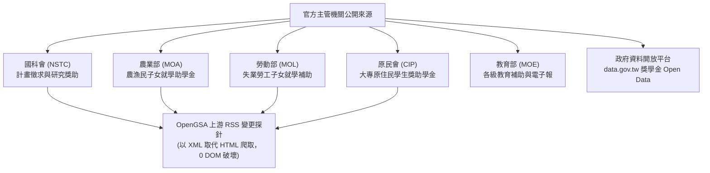
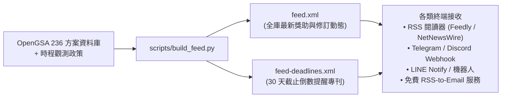
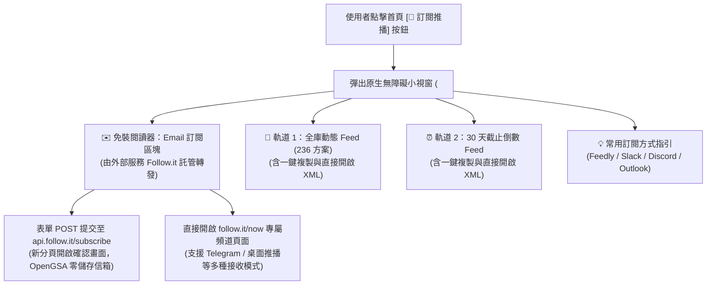

# OpenGSA RSS 電子報與主動推播通知架構規格書 (2026-11-05)

## 1. 背景與核心目標

OpenGSA 過去已完成全庫 **236 方案** 的時程政策萃取、多層資訊鏈拓撲建構與甘特圖投影。然而，學生在面對獎學金申請時，最核心的痛點往往是：
> 「資訊雖然在網站上，但我平時都在做研究、寫論文，沒辦法每天手動刷新網頁，最後往往在截止日前夕才發現，措手不及！」

為了解決「怕錯過申請期」的問題，專案正式啟動**主動推播通知機制（Proactive Notification Architecture）**。本規格書記錄官方來源的 RSS 現況調研、與臺大電子報（`epaper.ntu.edu.tw`）的架構對比，以及 OpenGSA 專屬的 RSS/Atom 雙軌發布系統。

---

## 2. 臺大電子報平台（`epaper.ntu.edu.tw`）機制對比與評析

使用者提議參考 [國立臺灣大學電子報服務平台](https://epaper.ntu.edu.tw/) 的運作機制。經深入剖析，兩者在架構與價值主張上有著關鍵差異：

| 分析維度 | 臺大電子報平台 (`epaper.ntu.edu.tw`) | OpenGSA 建議架構 (RSS + 外部無伺服器橋接) |
| :--- | :--- | :--- |
| **技術本質** | 傳統中心化 **Email 群發清單（Mailing List）** | **開放標準 RSS 2.0 / Atom 1.0 XML Feed** |
| **個資與隱私** | 必須在伺服器端收集並持久化儲存使用者真實 Email、學號與身分。 | **100% 匿名**。客戶端自由拉取，OpenGSA 不儲存任何讀者 Email 或追蹤 Cookies。 |
| **維運成本** | 需維護發信 SMTP 伺服器、DNS 反垃圾郵件設定（SPF/DKIM/DMARC），並面臨退信與 API 發信帳單。 | **$0 伺服器成本**。由 GitHub Actions 隨站建置靜態 XML，利用 GitHub Pages 全球 CDN 免費分發。 |
| **即時性與週期** | 依賴各單位固定出刊期程（每週/雙週/每月），突發或即將截止的通知往往延遲。 | **即時更新**。每次 Actions 巡檢偵測到時程變更或進入 30 天倒數，XML 即時更新。 |
| **內容純度** | 綜合性新聞通訊（校務公告、活動報導、學院花絮），獎助資訊稀釋在內文中。 | **純粹獎助情報**。每一則 Feed 條目精確標注身分、金額、申請起訖與倒數天數。 |

> **決策指引**：
> OpenGSA **不建立內部 Email 收集與 SMTP 發信系統**，以嚴守專案「零個資、零後端資料庫、零持續費用」之最高資安原則。
> 但我們**完全借鑑其「按主題分流訂閱」的心智模型**，透過提供多軌獨立 RSS Feed，並搭配第三方免費 RSS-to-Email 橋接服務，讓想要 Email 通知的學生同樣能零門檻收信！

---

## 3. 政府主要發放獎學金單位的 RSS 訂閱全景台帳 (Inbound Feeds)

經盤查，台灣主要獎助金主管部會多已遵循政府網站規範提供標準 RSS 服務。未來可作為 OpenGSA Actions 探針的上游監控源：

### 3.1 官方 RSS 頻道清單
1. **國家科學及技術委員會 (國科會 NSTC)**：
   - 網址：`https://www.nstc.gov.tw`
   - RSS 專區：提供「最新消息」與「研討會及活動訊息」RSS。
   - 涵蓋範圍：國科會博士生研究獎學金、大專學生研究計畫、千里馬海外研修、國際學術會議出差發表補助。
   - 價值：⭐️⭐️⭐️⭐️⭐️（科研與研究生最關鍵的情報核心）。
2. **農業部 (MOA)**：
   - 網址：`https://www.moa.gov.tw`
   - RSS 專區：提供「重要公告」RSS 新聞台。
   - 涵蓋範圍：每年 3 月與 9 月固定發布農漁民子女就學助學金申請簡則與受理起訖。
   - 價值：⭐️⭐️⭐️⭐️。
3. **勞動部 (MOL)**：
   - 網址：`https://www.mol.gov.tw`
   - RSS 專區：提供「最新消息與政策公告」RSS。
   - 涵蓋範圍：失業勞工子女就學補助（高中職及大專校院組）定期申請公告。
   - 價值：⭐️⭐️⭐️⭐️。
4. **原住民族委員會 (CIP)**：
   - 網址：`https://www.cip.gov.tw`
   - RSS 專區：提供「業務公告」RSS。
   - 涵蓋範圍：大專校院原住民族學生獎助學金作業要點、系統申報梯次與核定名冊公告。
   - 價值：⭐️⭐️⭐️⭐️。
5. **教育部 (MOE) 及圓夢助學網**：
   - 網址：`https://www.moe.gov.tw`、`https://epaper.edu.tw`
   - 涵蓋範圍：學產基金低收入戶助學金、高職免學費政策、弱勢學生助學計畫；政府資料開放平台提供定期更新的 Open Data API。
   - 價值：⭐️⭐️⭐️⭐️。
6. **大專校院生活輔導組 (University Assistance Offices)**：
   - 包括成功大學、淡江大學、高雄醫學大學等生輔組網站，均設有公開 RSS 2.0 頻道，即時輪播校內外 200+ 筆獎助學金公告。

---

## 4. OpenGSA 專屬雙軌 RSS 訂閱架構設計 (Outbound Feeds)

OpenGSA 隨 GitHub Pages 建置流程自動產生符合 W3C RSS 2.0 與 Atom 1.0 標準的雙軌訂閱頻道：

### 4.1 雙軌 Feed 定位與規格

1. **全庫動態頻道 (`feed.xml`)**：
   - **發布網址**：`https://matt-ye.github.io/opengsa/feed.xml`
   - **條目內容**：收錄全庫 236 筆方案，依最新觀測/修訂日期排序。
   - **內文結構**：
     - `<title>`：方案完整名稱與官方單位
     - `<link>`：`https://matt-ye.github.io/opengsa/?id={program_id}`（支援直接深層連結）
     - `<description>`：結構化呈現【身分資格】與【獎助內容】
     - `<category>`：方案分類（如 `phd_research`, `living_tuition`, `overseas_research` 等）
     - `<guid isPermaLink="false">`：方案唯一候選代碼
     - `<pubDate>`：RFC 822 標準格式

2. **截止倒數警訊頻道 (`feed-deadlines.xml`)**：
   - **發布網址**：`https://matt-ye.github.io/opengsa/feed-deadlines.xml`
   - **條目內容**：僅篩選具備**結構化學生截止日**之方案，並加上 `⏱️ [即將截止]` 視覺前綴。
   - **內文結構**：標明申請截止日期與倒數注意事項，讓學生或研究室公告機器人一目了然。

---

## 5. 首頁視覺按鈕、原生彈窗小視窗與 Follow.it 整合架構

為了讓所有造訪 OpenGSA 的學生與研究人員能以最直覺的方式訂閱，網站首頁頂端操作列配置了專屬 **`[📡 訂閱推播]`** 按鈕，點擊後觸發無障礙的原生 HTML5 `<dialog id="rss-dialog">` 小視窗：

### 5.1 Follow.it 零個資 Email 代管機制
* **隱私與個資保護原則**：
  OpenGSA 嚴格遵守「無分析追蹤、無個資入庫、零伺服器維護成本」規範。若自行收集信箱建立發信資料庫，將面臨巨大的個資法合規負擔與 SMTP 垃圾郵件防護成本。
* **Follow.it 串接方式**：
  1. **表單原生直通**：小視窗內建 `<form action="https://api.follow.it/subscribe" method="post" target="_blank">`，帶入 `resource="https://matt-ye.github.io/opengsa/feed.xml"`，使用者輸入 Email 按下送出後直接在外部新分頁完成訂閱確認，OpenGSA 伺服器完全不經手、不儲存任何 Email。
  2. **頻道即時導向**：提供 `https://follow.it/now` 專屬連結，Follow.it 會自動藉由瀏覽器 Referer 讀取 OpenGSA 頁面中的 `<link rel="alternate" type="application/rss+xml">`，直接呈現 OpenGSA 獎助訂閱確認畫面。

### 5.2 雙軌 Feed 複製與即時回饋
* **一鍵複製**：提供 `[📋 複製]` 按鈕，點擊後調用 `navigator.clipboard.writeText()` 並觸發 2.5 秒的友善提示浮層（Toast），方便使用者直接將網址貼入任何 RSS 閱讀器或機器人。
* **在新分頁開啟**：提供 `[開啟 ↗]` 連結，方便進階使用者或開發者檢視原始 XML 內容。

---

## 6. 學生端訂閱與外部通知串接指南

學生可依喜好的日常通訊習慣，透過以下方式零成本接收推播：

1. **RSS 閱讀器訂閱**：
   - 複製 `https://matt-ye.github.io/opengsa/feed.xml` 或 `feed-deadlines.xml`。
   - 貼入 Feedly, Inoreader, NetNewsWire (Mac/iOS), Readwise Reader 等任意閱讀器。
2. **通訊軟體 Webhook 推播**：
   - **Discord**：利用 MonitoRSS 或 Zapier，將 RSS 連結綁定至研究室 Discord 頻道的 Webhook。
   - **Telegram**：加入 `@FeedManBot` 或 `@AchnodFX_RSSBot`，輸入 `/sub https://matt-ye.github.io/opengsa/feed-deadlines.xml` 即可於群組自動收報。
3. **無伺服器 Email 電子報轉寄**：
   - 若學生習慣在電子信箱收信，可使用免費的 [Follow.it](https://follow.it/) 或 [Mailbrew]，貼上 OpenGSA RSS 網址並填入個人 Email，即可每日或每週自動收到格式優美的 Email 獎助摘要！

---

## 6. 管線整合與驗證防線

1. **腳本實作**：
   - [`scripts/build_feed.py`](../scripts/build_feed.py)：獨立且可重複執行的純 Python 產生器，不依賴第三方重型庫。
   - [`scripts/build_site.py`](../scripts/build_site.py)：已將 `build_feeds()` 無縫整合進 `dist/site` 輸出管線。
2. **品質防線**：
   - [`tests/test_feed.py`](../tests/test_feed.py)：單元測試自動驗證 XML 語法、RFC 822 時間解析度、236 筆方案覆蓋率與截止提醒準確性。
   - 正式台帳與候選資料 0 竄改。
