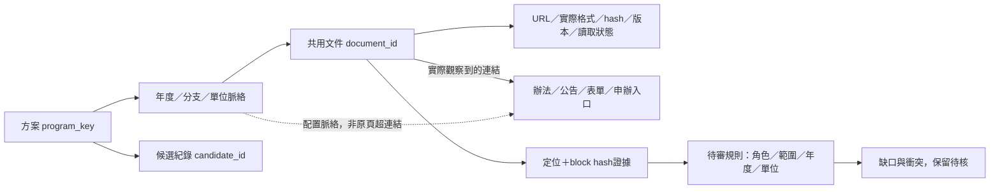

# 資訊鏈排查第一批：出國補助三組方案

2026-11-01：PR31已依使用者授權合併，merge commit `61d4916`；[Pages部署成功](https://github.com/matt-ye/opengsa/actions/runs/41294531610)。本批從既有19筆候選／13方案出發；不是把145個搜尋種子或所有海外補助都宣告完成。

[離線樹狀圖HTML](source-chains/source-chain-map.html) · [Obsidian Canvas](source-chains/source-chain-map.canvas) · [機器可讀總索引](../data/source-chain-index.json) · [第一批來源配置](../data/source-chain-batches/batch-01.config.json) · [第一批讀取快照](../data/source-chain-batches/batch-01.json)

HTML下載後可直接開，不需要API、帳號或資料庫。預設顯示第一批3方案，切換「全部既有候選」可看13方案。Canvas可放入任意Obsidian vault開啟；共用文件只生成一個節點，會跨方案連線。綠色是已讀取，黃色是既有快照，橙色是連結未讀，紅色是受阻；不是正確率或核准燈號。

## 第一批結果

| 方案 | 分層資訊鏈 | 新確認與保留疑點 |
|---|---|---|
| 國科會研究生國際會議補助 | 國科會法規 → 臺大研教組程序 → 電信所綜合公告／系級其他方案 | 機構彙送、學生校內送出、接受證明補送分開；不把系級另一補助的申請期混入國科會 |
| 傑出人才基金會出國開會補助 | 基金會辦法 → 臺大秘書室提醒 → 校內表格入口 → 基金會線上登記；表單與請款附件另外列節點 | 新找到秘書室提前收紙本的規則；日別、版本及例示疑點保留，並未自動填入公開卡片 |
| 國科會千里馬 | 國科會法規 → 116年度徵件 → 臺大本期公告 → 年度附件 | 2026申請／2027補助分開；學生7/29 08:00、機構7/31 12:00、公文8/6各有角色；年度附件未讀，不補結果日 |

### 具體來源與版本

- **會議補助**：[國科會作業要點](https://law.nstc.gov.tw/LawContent.aspx?id=FL038260)的機構期限以會議月份為錨點，遇例假日依規定順延；[臺大程序](https://www.aca.ntu.edu.tw/w/aca/GAADService_21071211044877383)另有學生送件時刻。接受證明四週前補送有前提，不能當成原始申請期限。
- **FAOS**：[基金會現行辦法](https://www.faos.org.tw/Application/ApplicatStud.html)為會前兩個月的機構申請規則。[臺大秘書室114.5.22提醒PDF](https://sec.ntu.edu.tw/001/Upload/18/relfile/9811/214008/add73815-0131-4901-b098-8dd402078f4c.pdf)另要求紙本提早送達，前5日未明曆日／工作日。第三節例子重複使用校內日期，與該節的基金會基準不一致；保留疑點並洽承辦，不讓例示取代條文。公開登記入口與校內紙本是不同程序，親簽仍未確認。聯絡方式及版本綁在該PDF證據上，不能當永久有效名錄。
- **千里馬**：[國科會116年度入口](https://www.nstc.gov.tw/sci/ch/detail/9fea56ff-9a28-4304-abb3-192109491942)與[臺大116年度公告](https://www.aca.ntu.edu.tw/w/aca/GAADNews_26051910555788878)的截止屬不同角色，不是矛盾。申請須知等附件已建立待讀節點；未以搜尋摘要填入附件內容或預定結果日期。

## 資料結構與關係



總索引保存方案與19筆候選對照、來源脈絡、白名單確認關係、待審規則與缺口。文件仍存於原PR31 sidecar及獨立批次快照；HTML和Canvas由它們合成，避免維護兩份圖。候選檔指紋使用排序JSON的語意hash，避免Windows／Linux換行造成誤判。

每筆規則有`kind`、`actor`、`scope`、`cycle`、結構化`value`及`evidence_refs`，後者綁document ID、revision、定位與block hash。跨方案錨點、舊來源版本、未讀文件證據、候選少列或錯配都會被拒絕。所有規則均`pending`，沒有代填真人核准。

樹狀圖收錄58個有方案歸屬的文件節點、43條文件關係、10筆待審規則；包含26個已讀、13個既有快照、19個未讀節點。這不是本批讀取58份：**本批只重讀10個指定來源／3方案**。其餘只沿用基線或發現入口。未經方案配對的導覽／相關連結保留在文件的「本頁發現」內，不直接當成該獎項證據。

## 掃描與萃取改進

- `chain-parser-1.6`排除明確導覽容器，附件優先占用有限連結名額，處理多層HTML編碼留下的`&amp;`；保留標籤供配對，不執行來源JS。
- 新增`extract_dates:false`供本批中繼資料查核：來源仍有正確角色，但不讓中央彙送日期被既有學生截止解析器誤判。日期／相對規則此次為證據輔助整理，並非已實作全自動跨文件推論。
- 沿用Fetcher與IR，來源全文只在記憶體；PDF直接以stdin送Poppler檢視，未把PDF或HTML原文存入repo。沒有模型呼叫、付費備援、登入或送出表單。
- 每輪限20 HTTP／12文件／180秒、每host至少3秒、最大深度0。初輪17次HTTP有1件PDF因文字空白導致marker誤判；修正後16次HTTP，10個指定來源均讀取成功。兩輪共33次受控HTTP；搜尋服務及人工瀏覽另計，不把16當整輪總量。

## 重建與檢查

```sh
python scripts/source_chains.py --config data/source-chain-batches/batch-01.config.json --output work/batch01-new.json
# 上一步只產生新artifact。查核後另行提交批次快照，不自動覆寫。
python scripts/export_source_chain_graph.py --output docs/source-chains --check
python scripts/export_source_chain_graph.py --output docs/source-chains
python -m unittest tests.test_source_chain_graph tests.test_source_chains -v
```

索引由`schema/source-chain-index.schema.json`約束；批次快照仍用既有`source-chains.schema.json`。測試會核對已提交的HTML／Canvas與JSON是否同步。

## 下一批

1. FAOS校內推薦DOCX／請款流程PDF、千里馬年度申請須知及操作說明，先補齊本批已發現附件，釐清版本及例示疑點。
2. 遠學與電資院級辦法，優先找實際院系收件與學院薦送流程；研發處禁止下載路徑不變。
3. 中研院、博士獎學金與校長獎補結果／歷史分支；臺北／新竹AI保留年齡、年度與申辦修訂疑點。
4. RA／TA是制度／聘任鏈，不能硬轉成固定月份獎學金申請窗口。

生輔組等受阻來源仍保留人工查核；不以Defuddle、替代代理或其他網域繞過robots。13方案都在圖上，只有本批3組完成這次補鏈，且仍有缺口。公開網站仍使用PR31資料，第一批未直接套用到卡片或甘特圖。

## 驗收結果

169項Python、46項Node、資料檢查、來源配置、公開頁與審查台建置通過。Chrome驗證本批3／全部13／待查10方案、文件展開與官方連結、未讀篩選、Canvas下載與72節點／103邊引用；1059／768／320px無整頁橫向溢出，0腳本錯誤。[機器驗收紀錄](../data/audits/source-chain-batch-01-2026-11-01.json)。圖像與JSON引用驗證不是獨立人工核准，也不是全13方案資訊鏈已閉合。
