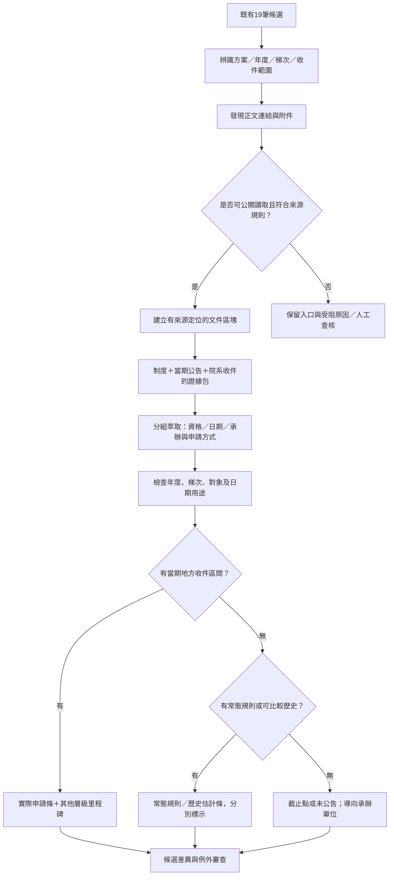
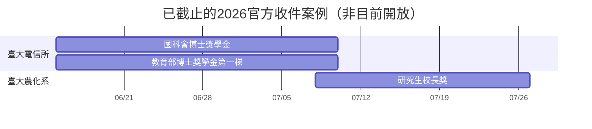

# OpenGSA：19筆候選的資訊鏈探索與日期呈現規劃

研究日期：2026-11-01（Asia/Taipei）。此文件保留核可實作前的研究快照；現行開發狀態以 SOURCE-CHAINS-AND-TIMELINE.md 為準。基線為 feat/generalizable-extraction，commit 2526847fbcf56e8960da2f3c873b429d2968d629。

## 1. 研究結論與範圍

使用者的假設成立：完整資訊常分散於制度辦法、年度徵件、院系收件公告、表單、申辦系統與結果頁。現有19筆是19個候選紀錄，對應17份不同文件、13個 program_key，並非19個彼此獨立的年度獎學金。

本輪已為19筆逐一對應資訊鏈，補查地方收件與歷史年度；找到可以直接作為甘特圖驗收案例的實際區間。這不代表全部資訊鏈已閉合：職能治療所收件日期、部分院系節點、部分附件內文及確切結果公布日仍有缺口；純規範及聘任入口也不應強行產出年度申請條。

問題包含四部分：

1. **連結發現不足**：只擷取單頁及部分PDF，漏掉院系HTML、跨站公告，以及電信所的彈出視窗文章。
2. **日期語意混用**：學生收件、院送校、校送部、核定、報支、經費使用、購買期間被迫擠進一組起訖。
3. **投影過於保守**：中央已明載參考期間時，不能因院系截止尚未知就把整段隱藏；應保留範圍與警示。
4. **文件與方案未充分整併**：同方案的公告、辦法及附件可以共同佐證；但不同年度、梯次、補助分支及收件單位必須保持分別。

以下日期都是已查到的2025／2026史料或年度規則。以本輪研究日而言，6–8月案例已截止，不是當前開放申請。

## 2. 資訊鏈分類：用角色與關係，不固定成單一路徑

| 角色 | 用途 | 不應被誤用為 |
|---|---|---|
| 制度／法源 | 資格、權利、金額基礎、有效版本 | 當年度學生收件公告 |
| 主辦方案入口 | 方案識別、主辦單位與官方連結 | 必然是最完整或最新細節 |
| 年度／梯次徵件 | 當期名額、申請辦理方式、當期規則 | 所有院系共同期限 |
| 校院系所收件 | 特定單位、特定對象的真正收件起訖 | 其他單位或全國學生期限 |
| 表單／申辦入口 | 紙本、電子、簽名、實際送件位置 | 公開資料可自動登入填報 |
| 核定／結果公告 | 預定核定與實際公布的關係 | 申請截止、撥款或報支日期 |
| 歷史年度／修訂 | 常態時段估計、展延與制度變更 | 新年度已正式開放 |

關係至少區分：依據、當期徵件、轉知、代收／薦送、修正／展延、同方案歷史版本。透過官方搜尋找到的關聯另標為「搜尋補鏈」，不能假稱是原頁直接超連結。

## 3. 13組方案資訊鏈（涵蓋全部19筆）

### G1：臺大國科會博士生獎學金——紀錄1、3

鏈：國科會115年試辦方案 → 臺大校級博士獎學金一覽及校級辦法 → 年度校級入口 → 電資學院評選辦法 → 電信所年度收件 → 表單及送件管道。

- [國科會115年方案入口](https://www.nstc.gov.tw/sci/ch/detail/24ad4e4a-bd37-4ba0-9955-5b2e2ffd5ac6)
- [臺大校級博士獎學金一覽](https://www.aca.ntu.edu.tw/w/aca/GAADService_24102208484895715)
- [臺大年度／業務入口](https://www.aca.ntu.edu.tw/w/aca/GAADService_21071211271211713)
- [電信所115學年度收件公告](https://gice.ntu.edu.tw/shownews.php?ID=7278)

校級入口載明6/15後依所屬院系所公告。電信所內文明確為 **2026-06-15至2026-07-10 17:00**，電子郵件提交PDF及試算表，並附電資學院評選辦法。這條可作為「規範→校級→院→所」的實作測試。

歷史：[電信所114學年度公告](https://gice.ntu.edu.tw/shownews.php?ID=7062)為2025-06-12至07-03 17:00。但校方明示115年中央方案已改制，不再區分原甄選／核配。舊制度樣本可顯示為歷史參考，不直接當作新制穩定預測模型。

**狀態：有明確所級完整區間；職能治療所當期區間未查得。**

### G2：教育部博士生獎學金——紀錄2、4、5

鏈：[教育部作業要點](https://edu.law.moe.gov.tw/LawContent.aspx?id=GL002336) → 臺大校級辦法及年度入口 → 第一／第二梯分流 → 院系收件 → 校級審議與結果節點。

- [臺大共同入口](https://www.aca.ntu.edu.tw/w/aca/GAADService_21071211271211713)
- [115第二梯附件](https://www.aca.ntu.edu.tw/WebUPD/aca/GAADService/1151015_教育部博獎第二梯申請.pdf)
- [電信所115第一梯](https://gice.ntu.edu.tw/shownews.php?ID=7279)
- [電信所115第二梯](https://gice.ntu.edu.tw/shownews.php?ID=7344)

第一梯電信所為 **2026-06-15至07-10 17:00**，需紙本及電子資料。第二梯電信所明定 **10/12 17:00截止**，文章發布10/6，但沒有明載起日；不直接把10/6填成正式開始日。

第二梯附件已以本機PDF渲染視覺核對，標題可確認115年度。流程圖為：**10/5起學院受理學生申請及甄審 → 11/9學院送推薦名單 → 11/16校核定 → 預計11/20院系所報支**。11/9不是全體學生的共同截止日；11/16是排程中的核定節點，不等於已查到實際公開結果日期。

歷史：[電信所114第一梯](https://gice.ntu.edu.tw/shownews.php?ID=7061)為2025-06-12至07-03 17:00。可提出「第一梯約6月至7月上旬」的兩年度低信心參考；第二梯目前只有本輪查得的115年度資料，不稱每年固定10月。

教育部法規頁與當期校方說明的政府／校方分攤數額存在版本脈絡，日後需要當期函示佐證，不以「新頁面一定覆蓋法規」簡單處理。此輪不修改金額或資格。

**狀態：第一梯完整；第二梯有正式所級截止及校級流程，地方起日仍未知；紀錄5的年度有新增證據可供下輪修正。**

### G3：研究生校長獎——紀錄6、8

鏈：校級設置辦法 → [校級年度入口](https://www.aca.ntu.edu.tw/w/aca/GAADService_23060908295960368) → 院級施行細則 → [農化系當期公告及系級辦法](https://ac.ntu.edu.tw/News_Content_n_194922_sms_123934_s_263996.html) → 系所送院 → 校級結果。

校級載明114學年度畢業生於2026/7/8–8/25辦理，詳細時程依所屬院系；農化系明定 **2026-07-08至07-27 17:00**。公告同時直接提供校、院、系三級辦法，適合作為完整資訊鏈的第二個展示案例。收件單位為農化系辦（02-3366-4801）。

[農化系113學年度公告](https://ac.ntu.edu.tw/News_Content_n_194922_s_255718.html)：2025-07-07至07-23 17:00。兩年可支持「農化系約7月上旬至下旬」的低信心歷史參考，不能推廣為所有院系的共同區間。

校級頁有歷年結果連結；只需追蹤公告是否出現及公布時間，不應為時間軸目的收錄獲獎學生名冊。院級附件已定位，其中一份本輪網頁工具未成功讀取；不能宣稱所有附件條文均完成驗證。

**狀態：農化系完整起訖，校級參考期與地方期須並存；職能治療所地方期限仍未查得。**

### G4：遠學計畫——紀錄7

鏈：校級遠學補助作業要點 → [研發處方案入口](https://ord.ntu.edu.tw/w/ordntu/GW_20072012192817260) → 年度發文／學院彙送 → [機械系收件](https://www.me.ntu.edu.tw/web/news/news_in.jsp?np_id=NP1766718706803) → 研發處審議。

研發處截止為 **2026-01-30**；機械系學生截止為 **2026-01-05 12:00**。兩者相差25日，不能用校級最後彙送日替代學生期限。機械系載即日起，但頁面未取得可靠發布日，因此地方開始仍保留未知。

另找到[醫學院站上公開115年發文](https://www.mc.ntu.edu.tw/manage/upload/news/2025/ab0ae1bb-e38e-44ee-8ef5-a40913c38ddf.函告公文.pdf)，搜尋索引顯示發文日2025-12-12與中央收件至2026-01-30。本輪未完成該PDF視覺核驗，可列「已定位、待核」，不直接拿來補官方起日。

歷史定位到[地理系114年度通知](https://www.geog.ntu.edu.tw/index.php/tw/announce/officeannounce/3276-1131227-1100)，索引載2025-01-14學生截止、1/16送院；但該站robots讀取本輪發生傳輸錯誤，未進一步自動擷取。不同系所的兩筆資料不能合成同一系所的年際樣本。暫只提出「冬季／12月至1月留意公告」的查詢提醒建議，不建立精確年度估計條。

研發處/WebUPD/既有禁止規則保持不變，辦法附件不從該路徑下載。博士生一般補助、獲千里馬者配合補助、博士後補助各有分支，不合併資格。

**狀態：有地方截止及清楚薦送關係；地方起日、醫學院／職治所期限及可比歷史仍不完整。**

### G5：國科會研究生國際會議補助——紀錄9、10

鏈：[國科會作業要點](https://law.nstc.gov.tw/LawContent.aspx?id=FL038260) → [臺大作業說明](https://www.aca.ntu.edu.tw/w/aca/GAADService_21071211044877383) → 國科會學術研發服務網 → 臺大審核彙送 → 結果通知與核銷。

它是**依會議日期推算的規則型補助**。國科會最遲彙送日為會議首日所屬月份的前一個月首日，遇例假日順延；臺大學生須在該彙送日前一天17:00前送出。接受證明可依規定註明補送，最遲會議首日前四週送國科會；這不代表原始申請也可延後至四週前。

應分出「學生送出」「校方彙送」「接受證明補件」「會議日期」「會後核銷」。法規的一個月審查期間有延長可能，只能作規則說明／預計結果範圍，不能當作確定公布日。官方沒有固定年度起日，故不適合估計每年某月開放。

**狀態：中央與臺大規則明確；需使用者的會議日期才能形成個人期限，院系額外提前要求另列。**

### G6：傑出人才發展基金會優秀學生出國開會——紀錄11

鏈：[基金會現行補助辦法](https://www.faos.org.tw/Application/ApplicatStud.html) → 學校負責人提出申請 → 校內承辦彙整及表單 → 基金會審查 → 會後檢據撥款。

明訂會議開始前**兩個月**申請，屬曆月規則，不能寫成60日。申請由大學負責人提出，學生不能把基金會最後期限視為直接寄件期限。本輪未取得臺大這項補助明確的校內提前收件天數，不套用國科會路徑。

**狀態：對外期限公式明確；臺大具體承辦與學生內部期限待補。無年度固定月份估計。**

### G7：博士生赴國外研究／千里馬——紀錄12

鏈：[國科會作業要點](https://law.nstc.gov.tw/LawContent.aspx?id=FL039188) → 年度徵件 → [臺大116年度公告](https://www.aca.ntu.edu.tw/w/aca/GAADNews_26051910555788878) → 系所轉知與國科會線上申請 → 校內彙送。

法規已明訂原則每年 **6/1–7/31中午12:00**，且申請機構可自訂較早期限。臺大116年度案的學生申請為 **2026-06-01至07-29 08:00**。116是補助年度，實際申請發生於115年，須分開。

已核對三期臺大公告：

| 補助年度 | 實際申請年度 | 臺大公告期間 |
|---|---|---|
| 114 | 2024 | 6/1–7/29 08:00 |
| 115 | 2025 | 6/1–7/28 08:00 |
| 116 | 2026 | 6/1–7/29 08:00 |

來源：[114年度](https://www.aca.ntu.edu.tw/w/aca/GAADNews_24052211230185000)、[115年度](https://www.aca.ntu.edu.tw/w/aca/GAADNews_25051610035803840)、[116年度](https://www.aca.ntu.edu.tw/w/aca/GAADNews_26051910555788878)。

下一年度未公告時，可顯示「常態6/1起、臺大歷年約7月底前收件；實際以當期公告為準」。其中6/1–7/31是官方常態規則，臺大較早截止的具體日期仍屬歷史參考。

**狀態：完整年度起訖、中央與校級分工、三年歷史皆可用；無需靠模型猜起日。**

### G8：中研院人社博士候選人培育——紀錄13

鏈：[院級計畫要點](https://www.sinica.edu.tw/cp/332) → [115年度院本部公告](https://www.sinica.edu.tw/news_content/56/3434) → 接收研究所公告／所級審查辦法 → 指導研究人員與申請表 → 所審查薦送 → 院核定。

院本部公告**發布於2025-12-29**，明載即日起受理、截止洽各研究所／中心。這可以呈現中央公告起點及「請依接收所確認」；原頁未直接列齊所有所的個別收件連結，需要以官方單位目錄或官方搜尋補鏈。

[政治所115年度公告](https://www.ipsas.sinica.edu.tw/最新訊息/學術公告/ipsas-115年度人文社會科學博士候選人培育計畫即日起/)發布2026-01-02，明載即日起至**2026-03-18**受理，可得 **2026-01-02–03-18**。未載截止時刻，不補23:59。承辦電話02-2652-5306；院級及所級辦法、申請表、同意書皆有直接連結。其7/1至次年6/30為獎助期間，不是申請期間。

[政治所114年度公告](https://www.ipsas.sinica.edu.tw/最新訊息/學術公告/ipsas-114年度人文社會科學博士候選人培育計畫即日起/)為 **2025-01-16–03-24**。兩年可提供「約1月至3月下旬，低信心歷史估計」；12月底可提早提醒注意院級公告。不能代表經濟所、社會所等其他接收單位。

這項與「國科會獎勵人文與社會科學領域博士候選人撰寫博士論文」不同。後者不能因名稱類似被接成同一方案。

**狀態：中央發布日、單一接收所完整區間、兩年歷史均已取得。**

### G9：臺北市青年AI工具補助——紀錄14

鏈：[青年局年度公告](https://youth.gov.taipei/announcement/latest-announcement/e3c5cee4-b81a-4a53-aa79-6cd8c654b02e) → [計畫服務專頁及條文](https://youth.gov.taipei/services/05eb79e5-46b5-41e5-b1fd-0519d782b04a/0ecc1836-dd0d-4085-a34f-003609f00796) → 書面文件 → 青年局審查／補正／經費額滿公告。

**2026-08-01–10-31是符合補助的訂閱期間**。申請則須在最後達成條件日次日起一個月內，且最晚11/10送達青年局；不能直接把8/1當作所有人的申請起日。可畫訂閱期間背景帶及11/10期限，個人申請條須依條件完成日另外推算。額滿可能提前停止。

公告提供職涯發展中心諮詢電話02-2395-8567。紙本書面要求已明；具體收件地址、表單下載與寄送細節仍應另核官方申請說明，不從一般網站頁尾推定收件窗口。

**狀態：使用／訂閱期及申請上限明確，個人開始依條件；未查得可比多年度，僅顯示115年度參考，不宣稱116年度續辦。**

### G10：新竹市AI領航青年數位工具補助——紀錄15

鏈：青年發展中心當期計畫與修正／FAQ → [數位申辦平台](https://dgservice.hccg.gov.tw/serviceNotice.do?id=1323&rule=guest) → 下載附件與電子送件 → 補正／審查／剩餘經費。

平台明定 **2026-04-02–11-30**受理，額滿或經費用罄可提前停止；**4/2–10/31是購買期間**。月費／年費又有購買後一／二個月的相對期限，不能只看11/30。平台載8/14起數位線上申請，舊FAQ的紙本郵寄要求應保留為歷史版本，不能與新流程混成「現在必須紙本」。

當頁的年齡文字、出生區間與8/14調整仍需釐清，日期明確不代表資格全部確定。諮詢電話03-522-0557；12週是當下審核期說明，不是確定的結果公布日。附件下載已定位在頁面按鈕，並非全都有一般超連結；尚未完成所有附件版本的核對。

**狀態：年度受理區間可畫實線，但保留額滿條件、個人相對期限及年齡例外。僅115年度樣本，不預測明年續辦。**

### G11：國科會研究人力約用規範——紀錄16

鏈：[國科會約用注意事項](https://law.nstc.gov.tw/LawContent.aspx?id=FL028686) → 執行學校的人事／研究助理聘任規定 → 個別計畫徵才或約用 → 契約聘期。

它是用人與權益規範，沒有通用年度「獎學金申請起訖」。應分流到權益或聘任入口：申請期 **N/A：非徵件公告**；如將來連到具名徵才公告，才為那則職缺建立收件／聘任期間。

臺大校內規範可由[教務處兼任助理與權益連結頁](https://www.aca.ntu.edu.tw/w/aca/SecretariatService_21070717324321514)追到學生兼任助理專區與人事規範，但不能把TA經費規則當成所有國科會RA的約用條件。

**狀態：制度入口；年度申請區間不適用，不應列為日期萃取失敗。**

### G12：電資學院優秀博士生獎學金評選辦法——紀錄17

鏈：[電資學院評選辦法](https://eecs.ntu.edu.tw/uploads/asset/data/6875c5db1d41c829c9b3c899/電資學院優秀博士生獎學金評選辦法_114.pdf) → 校級博士生獎學金設置辦法 → 教務處每年公告 → 系所推薦收件。

辦法明訂依校級設置辦法訂定、由系所推薦、每年配合研教組公告。G1的[電信所115年度國科會獎學金公告](https://gice.ntu.edu.tw/shownews.php?ID=7278)又直接附此院級辦法，是已找到的具體實施關聯。可沿用該「電信所／115／國科會分支」收件證據，不能宣稱院級純辦法自己載了6/15–7/10，也不宜額外生成一筆確定可兼領的新獎學金。

**狀態：依據與實施鏈已建立；是否與其他校級方案整併卡片，應按資助身分與分支核對後決定。**

### G13：教務處TA制度——紀錄18、19

鏈：[教務處業務頁](https://www.aca.ntu.edu.tw/w/aca/SecretariatService_21070717324321514) → 實施辦法及施行細則 → 教學單位公務帳號申請系統 → 核定補助課程 → 教師／單位推薦TA → 學生聘任。

業務頁明載**每年6月及12月辦理**，但指向申請單位以公務帳號填報課程。這是可展示的「官方常態辦理月份」，**不是所有學生每年6月、12月直接申請獎學金**。學生應徵時間應再查該課程／單位當學期公告。

[表單入口](https://www.aca.ntu.edu.tw/w/aca/SecretariatForms_21071410264777320)有聘任等文件。實施辦法規定推薦、認證與聘任關係，HTML與PDF應整合為同一制度資料包。電信所另有「研究生教學助理A類獎勵金」公告，尚未證明與這項教務處主政經費相同，不拿它補此方案的學生期限。

**狀態：主政單位常態月份及申請角色明確，學生招募期仍待課程／單位公告；不是全部日期未知。**

## 4. 優先採用的兩個系所展示案例

| 項目／範圍 | 實際收件區間 | 甘特圖應呈現 |
|---|---|---|
| 115博士獎學金／臺大電信所 | 2026/6/15–7/10 17:00 | 國科會與教育部分支各列，明示收件單位；第二梯另外一列，不接成6–11月連續開放 |
| 114研究生校長獎／臺大農化系 | 2026/7/8–7/27 17:00 | 系級綠色實線；校級7/8–8/25作灰色參考線，避免把8/25當作本系期限 |

兩例均有可直接閱讀的正式收件內文及相關辦法連結，不必用合成日期。額外可用中研院政治所2026/1/2–3/18，示範「即日起＋明確發布日」及接收所分流。

示意圖只畫日期；實際前端須保留17:00，不能把圖中的日期粒度當成截止時刻。選擇職能治療所時不得自動套用電信所／農化系日期；可另提供「查看其他單位案例」模式。

## 5. 年度估計的可用範圍

| 方案與範圍 | 本輪歷史證據 | 建議顯示 | 限制 |
|---|---|---|---|
| 千里馬／臺大 | 2024、2025、2026三期；另有官方年度規則 | 常態6月至7月底；當期臺大截止優先 | 區分補助年度與申請年度 |
| 中研院培育／政治所 | 2025/1/16–3/24；2026/1/2–3/18 | 預估1月至3月下旬，2期樣本、低信心 | 其他接收所不共用 |
| 校長獎／農化系 | 2025/7/7–7/23；2026/7/8–7/27 | 預估7月上旬至下旬，2期樣本、低信心 | 其他院系與畢業條件另判 |
| 教育部博士獎學金第一梯／電信所 | 2025/6/12–7/3；2026/6/15–7/10 | 預估6月至7月上旬，2期樣本、低信心 | 不能套到第二梯；不保證明年同時段 |
| 國科會博士獎學金／電信所 | 同上兩期，但115中央制度改變 | 舊年度時間參考；暫不輸出跨制度穩定預測 | 制度切點須重新累積樣本 |
| 遠學一般補助 | 115機械系1/5截止；114地理系1/14索引線索 | 冬季注意公告／歷史案例 | 不同單位、部分未核，不作精確年際估計 |
| 國科會／基金會研討會 | 相對會議日的官方規則 | 輸入會議日後試算期限 | 不估年度月份，不把兩個月寫60日 |
| 臺北／新竹AI補助 | 目前只有115年度完整案例 | 顯示本年度實際區間／歷史參考 | 不先假設翌年續辦、同預算或同資格 |
| 電資院級辦法 | 對應系所年度公告 | 引用特定實施分支日期 | 純辦法不自行產生起訖 |
| TA主政補助 | 官方明載6月、12月 | 常態辦理月份（教學單位申請） | 學生應徵期限另查 |
| RA約用規範 | 非徵件 | N/A／依個別計畫聘任 | 不作年度估計 |

估計政策提案：優先要求3期同方案、同分支、同梯次、同收件單位與相近制度；2期只提供低信心月份參考；1期顯示單年度案例。每個估計保留樣本年度與來源，不用模型自評百分比冒充校準可信度。新年度公告出現後，用實際區間取代預估的前台主線，仍保留估計版本以便評估偏差。

文案建議：**「歷史估計；實際申請起訖以所屬單位當期公告為準。」**

預估不能使狀態變成「開放申請」、不能判定資格通過、不能送出與官方截止相同語氣的通知。未來若提供估計ICS，須與官方期限分開訂閱、清楚標示；本輪不實作通知。

## 6. 日期與承辦欄位的設計提案

不必一次新增大量獎學金欄位；先建立可重複的「時間事件」集合，每筆保留：

| 欄位概念 | 說明 |
|---|---|
| 事件種類 | 公布、學生收件、院送校、校送部、核定、公開結果、報支、購買／使用、聘任等 |
| 日期／範圍／規則 | 支援確切日期、只知月份、區間、會議相對公式 |
| 適用範圍 | 學校、學院、系所、接收機構；以及學生或行政單位 |
| 方案版本 | 年度、學年度、梯次、分支、制度版本與修正／展延關係 |
| 證據與定位 | document_id、URL、段落／PDF頁、短證據、讀取時間及雜湊 |
| 性質 | 當期公告、官方常態規則、歷史案例、歷史估計；互不冒用 |
| 日期精度 | 月／日／時刻；未載明時刻不自動填23:59 |
| 狀態 | 已確認、僅參考、來源互異、未公告、無法取得、不適用 |

承辦也改為具角色的單位集合：主辦、地方收件、校級彙送、法規諮詢、核銷。優先顯示使用者所選單位的收件窗口；找不到該系時顯示校級窗口及「所級收件日請洽系辦」。不從網站頁尾任意選一個電話，也不因有多層單位就全部隱藏。

「即日起」只有同一公告的可信發布日才可正規化為起日，並標明起日依據；CMS更新時間、網站即時時鐘、附件檔名、搜尋引擎抓取時間不可替代。公布日期不等於開放起日，除非公告明述兩者關係。

## 7. 通用補鏈與萃取流程

### 7.1 先準備文件，再萃取

1. 既有來源先辨識是入口、純規範、當期公告或申辦頁。
2. 在正文與附件區發現法規、當期申請、院系公告及表單；排除導覽列、頁尾、相關但不同獎項。
3. 支援HTML、PDF、ODT、DOCX、表格及可安全辨識的公開彈出視窗URL；電信所的window.open可解析字串取得URL，不執行任意來源JS。
4. 逐網址套用robots、條款、存取權與host規則；登入、403／429及禁止路徑不繞過。人工補來的公開替代來源仍需重新核實權限與版本，不能用它規避明確禁止。
5. 每份文件保留角色、層級、年份與段落，再生成「同方案證據包」。可產生一份暫時合併文字供閱讀，但每段必須保留來源標頭，不能無差別拼接。
6. 對證據包執行原本規劃的分組／局部萃取。日期組先分辨行政流程與學生收件，資格組保留分支條件；缺口回到連結發現，而非只重問模型。
7. 對衝突與不完整保留局部未知。明確的名稱、單位與單一截止仍可獨立呈現，不要求整筆全綠才可作雷達。

### 7.2 最低成本邊界

- 不增加資料庫或外部服務：來源節點、關係、時間事件、歷史觀測可先用repo中的小型JSON／CSV規劃，待核可再實作。
- 同一PDF被兩個候選引用，只準備一次；父頁及附件分別hash，附件變更才重做受影響欄位。
- 提議初版單方案補鏈預算：深度至多3層、最多12份關聯文件；碰到預算上限標示「尚有未讀關聯」，不宣稱完整。
- 既有允許的來源正文只在記憶體處理；持久保存結構化值、URL、版本、hash、定位與允許的短證據。hash_only不保留原文摘錄、不送外部模型；不把完整合併文本或大量PDF提交repo。
- 對當期院系公告增加更新優先度；低變動規範低頻查核；歷史資料按需補查並記錄觀測版本。
- 排程模型仍off；本輪未呼叫任何模型API、未消耗付費額度。

### 7.3 同方案判定及衝突

至少比對主辦方、方案識別、年度、梯次、補助分支與收件範圍。來源較新不代表自動取代較舊法規；需看修正依據、生效日期及該欄位的權責。中央截止與系所提前收件通常是不同事件，不應誤報矛盾。

真正的版本矛盾、資格年齡不一致、文件內文與標題不一致，列例外審查；日期可以照其已確認部分顯示，但不能用模糊的資格自動排除使用者。

## 8. 甘特圖與卡片呈現

| 證據情況 | 呈現提案 |
|---|---|
| 所屬單位當期完整起訖 | 綠色實線長條，明示年度／梯次／單位 |
| 中央有參考期、地方未知 | 灰色參考條，文字「院系期限另定」 |
| 只知截止 | 截止菱形；不倒推30天充作官方開始 |
| 官方常態月份／相對規則 | 月份帶或公式說明；有個人事件日期再試算 |
| 歷史推估 | 黃色斜紋，標估計、樣本數與來源；有獨立開關 |
| 核定／結果／報支 | 分別的節點；實際與預定樣式不同 |
| 純權益／聘任規範 | 日期N/A，保留入口卡片 |

保留today線；切換年度或歷史案例時仍呈現真實today，不能改成假的今天。可提供「跳到申請季」及「看下一年度估計」，避免預設前後90天讓已知區間落在視窗外而看似沒有資料。

卡片的清晰度宜分為「申請時間」「資格」「承辦」三個訊號，不用平均完整率把嚴重日期衝突掩蓋。對應欄位顯示：**已公告／歷史估計／院系另定／不明／不適用**，並保留來源與回報問題連結。未知資格仍保留在可能符合的篩選結果，不能直接判為不符合。

## 9. 下一輪實作順序與驗收（待使用者核可）

1. **補鏈與證據包**：先串電信所、農化系、中研院政治所；把正文連結、彈出視窗URL、法規與歷史版本納入來源關係。其餘19筆各自保留受阻／未閉合原因。
2. **日期事件與局部萃取**：不先改全站大量欄位；先修學生／行政、梯次、起日依據與截止精度，再接承辦及紙本／電子方式。
3. **甘特圖投影**：實際、中央參考、只知截止、年度常態、歷史估計、N/A各有明確樣式；第一至三頁共用同一方案版本及範圍。
4. **歷史參考**：先上千里馬3期；農化系及政治所2期低信心參考；新制與AI單年度不提前年度化。
5. **例外審查**：只要求人工處理真衝突、主辦／方案配對疑點與受限來源；不再逐筆展開數十個欄位。補鏈後仍須做小量人工抽查，不能把來源自稱或模型自評等同正確率。

必要驗收：

- 電信所兩項第一梯均得到6/15–7/10 17:00；教育部第二梯只知10/12 17:00，不能接成6–11月連續受理。
- 電信所國科會分支是電子提交；教育部分支同頁明載紙本及電子，不能跨分支套用。
- 農化系校長獎7/27 17:00與校級8/25參考期可同時顯示；職治所使用者不被套用農化系截止。
- 政治所「即日起」加1/2發布日可得完整起日；院本部12/29只代表院級開始。獎助7/1起不得當申請起日。
- 教育部第二梯11/9標為院送校，11/16標排程核定，11/20標預計報支，不能把任一項誤標成學生截止或實際公開結果。
- 千里馬116補助年度映射2026申請年度；臺大7/29 08:00與國科會7/31 12:00各有範圍。
- 新竹受理期間與購買期間分別顯示；歷史紙本與8/14後電子流程分版本；年齡疑點仍可見。
- 臺北訂閱期間不當申請期間；兩市AI補助不自動複製到明年。
- 國科會會議補助遇假日、曆月減法、月底與閏年案例正確；基金會兩個月不等於60日。
- TA的6／12月標為教學單位辦理；RA規範為N/A，不畫捏造收件條。
- 同方案多文件不重複製造可兼領獎項；不同梯次及單位不誤併。
- 所有日期及單位至少可追到URL與區塊；hash_only、robots、登入、成本及模型off邊界不變。

建議先完成前兩步及三個實例，再驗收甘特圖與歷史估計；本報告不代表已開始這些開發。

## 10. 尚未解決、必須保留的缺口

- 職能治療所與醫學院各方案實際收件起訖，未查到即可引用的完整當期公告；不以其他院系日期代填。
- 遠學一般補助歷史資料尚不足同單位連續年份，部分來源本輪robots傳輸失敗；院級法規附件亦有存取限制。
- 傑出人才基金會在臺大的具體內部收件窗口與提前時程。
- 新竹年齡採認與附件版本差異，以及各年度預算是否再辦。
- 多數方案尚未取得可驗證的實際結果公開日；核定／報支／名冊更新不可混作公布日。
- 教育部當期函示與舊版金額分攤規定的完整版本關係，應另外核驗，不在本輪日期研究中逕作法律結論。

## 附錄：現有19筆逐筆對照

編號與本輪讀取的source-review.json排序一致；下表直接列目前候選標題及來源，不修改原資料。G編號對應前述研究章節。

| 編號 | 目前候選與ID | 原始來源 | 對應資訊鏈 |
|---|---|---|---|
| 1 | 臺大115學年度國科會核配博士生獎學金 `cand-ntu-nstc-phd-115-49f19393` | [來源](https://www.aca.ntu.edu.tw/w/aca/GAADService_21071211271211713) | G1 |
| 2 | 臺大115學年度教育部博士生獎學金（第二梯次） `cand-ntu-moe-phd-115-49f19393` | [來源](https://www.aca.ntu.edu.tw/w/aca/GAADService_21071211271211713) | G2 |
| 3 | 臺大國科會核配博士生獎學金（設置辦法條文快照） `cand-ntu-nstc-phd-rule-9dd47e84` | [來源](https://www.aca.ntu.edu.tw/WebUPD/aca/GAADRules/%E5%9C%8B%E7%AB%8B%E8%87%BA%E7%81%A3%E5%A4%A7%E5%AD%B8%E5%8D%9A%E5%A3%AB%E7%94%9F%E7%8D%8E%E5%AD%B8%E9%87%91%E8%A8%AD%E7%BD%AE%E8%BE%A6%E6%B3%951140423.pdf) | G1 |
| 4 | 臺大教育部博士生獎學金（設置辦法條文快照） `cand-ntu-moe-phd-rule-9dd47e84` | [來源](https://www.aca.ntu.edu.tw/WebUPD/aca/GAADRules/%E5%9C%8B%E7%AB%8B%E8%87%BA%E7%81%A3%E5%A4%A7%E5%AD%B8%E5%8D%9A%E5%A3%AB%E7%94%9F%E7%8D%8E%E5%AD%B8%E9%87%91%E8%A8%AD%E7%BD%AE%E8%BE%A6%E6%B3%951140423.pdf) | G2 |
| 5 | 臺大學年度待核教育部博士生獎學金（第二梯次） `cand-ntu-moe-phd-unknown-5ec6eddc` | [來源](https://www.aca.ntu.edu.tw/WebUPD/aca/GAADService/1151015_%E6%95%99%E8%82%B2%E9%83%A8%E5%8D%9A%E7%8D%8E%E7%AC%AC%E4%BA%8C%E6%A2%AF%E7%94%B3%E8%AB%8B.pdf) | G2 |
| 6 | 臺大114學年度研究生校長獎 `cand-ntu-president-114-call-6d00251d` | [來源](https://www.aca.ntu.edu.tw/w/aca/GAADService_23060908295960368) | G3 |
| 7 | 臺大115年遠學計畫（博士生一般補助） `cand-ntu-yuanxue-115-ordinary-a943081a` | [來源](https://ord.ntu.edu.tw/w/ordntu/GW_20072012192817260) | G4 |
| 8 | 臺大研究生校長獎（設置辦法依據） `cand-ntu-president-unknown-rule-0ef18354` | [來源](https://www.aca.ntu.edu.tw/WebUPD/aca/GAADRules/%E5%9C%8B%E7%AB%8B%E8%87%BA%E7%81%A3%E5%A4%A7%E5%AD%B8%E7%A0%94%E7%A9%B6%E7%94%9F%E6%A0%A1%E9%95%B7%E7%8D%8E%E8%A8%AD%E7%BD%AE%E8%BE%A6%E6%B3%95_23040710344382101.pdf) | G3 |
| 9 | 國科會補助研究生出席國際學術會議（臺大校內申請路徑） `cand-nstc-ntu-conference-f5477f6c` | [來源](https://www.aca.ntu.edu.tw/w/aca/GAADService_21071211044877383) | G5 |
| 10 | 國科會補助研究生出席國際學術會議（作業要點法源） `cand-nstc-conference-rule-1b67cc16` | [來源](https://law.nstc.gov.tw/LawContent.aspx?id=FL038260) | G5 |
| 11 | 傑出人才發展基金會：優秀學生出國開會補助 `cand-faos-student-conference-ccd80040` | [來源](https://www.faos.org.tw/Application/ApplicatStud.html) | G6 |
| 12 | 國科會博士生赴國外研究（千里馬）作業要點原文 `cand-nstc-abroad-dragon-rule-81d5aeb0` | [來源](https://law.nstc.gov.tw/LawContent.aspx?id=FL039188) | G7 |
| 13 | 中研院115年度人文社會科學博士候選人培育計畫公告 `cand-sinica-phd-fellowship-6165c00d` | [來源](https://www.sinica.edu.tw/news_content/56/3434) | G8 |
| 14 | 臺北市青年AI工具補助 `cand-taipei-ai-tools-4618de5c` | [來源](https://youth.gov.taipei/services/05eb79e5-46b5-41e5-b1fd-0519d782b04a/0ecc1836-dd0d-4085-a34f-003609f00796) | G9 |
| 15 | 新竹市AI領航青年數位工具補助 `cand-hsinchu-ai-tools-5067a675` | [來源](https://dgservice.hccg.gov.tw/serviceNotice.do?id=1323&rule=guest) | G10 |
| 16 | 國科會專題研究計畫研究人力約用注意事項原文 `cand-nstc-assistant-rule-d14f4d4e` | [來源](https://law.nstc.gov.tw/LawContent.aspx?id=FL028686) | G11 |
| 17 | 臺大電資學院優秀博士生獎學金評選辦法 `cand-ntu-eecs-scholarship-faea928c` | [來源](https://eecs.ntu.edu.tw/uploads/asset/data/6875c5db1d41c829c9b3c899/%E9%9B%BB%E8%B3%87%E5%AD%B8%E9%99%A2%E5%84%AA%E7%A7%80%E5%8D%9A%E5%A3%AB%E7%94%9F%E7%8D%8E%E5%AD%B8%E9%87%91%E8%A9%95%E9%81%B8%E8%BE%A6%E6%B3%95_114.pdf) | G12 |
| 18 | 臺大教務處教學助理制度獎勵金實施辦法 `cand-ntu-ta-policy-7569d536` | [來源](https://www.aca.ntu.edu.tw/w/aca/SecretariatService_21070717324321514) | G13 |
| 19 | 臺大教務處教學助理制度獎勵金實施辦法 `cand-ntu-ta-policy-2c257f6c` | [來源](https://www.aca.ntu.edu.tw/WebUPD/aca/SecretariatService/%E6%95%99%E5%8B%99%E8%99%95%E6%95%99%E5%AD%B8%E5%8A%A9%E7%90%86%E5%88%B6%E5%BA%A6%E7%8D%8E%E5%8B%B5%E9%87%91%E5%AF%A6%E6%96%BD%E8%BE%A6%E6%B3%95%E6%A2%9D%E6%96%87-%E5%85%AC%E5%91%8A%E7%89%88.pdf) | G13 |

研究紀錄：官方網頁搜尋與公開讀取、既有Fetcher的robots檢查、電信所公開HTML解析，以及教育部第二梯PDF本機暫時渲染。沒有使用Defuddle、沒有繞過來源限制，也沒有進行模型API呼叫。對搜尋索引線索、讀取失敗及實際讀到內文的結果已分別註明。
