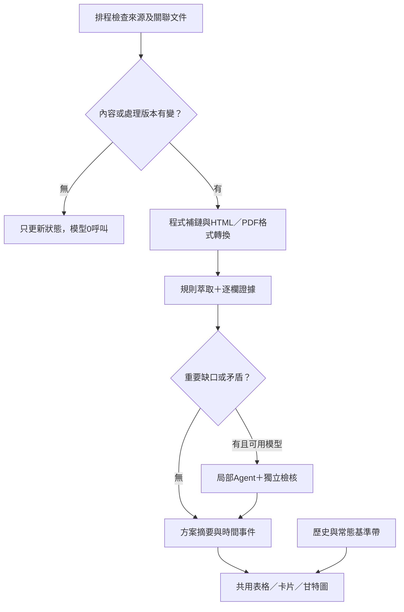

# 來源資訊鏈、低Token萃取與多層時間軸

2026-11-01使用者核可：PR28、29先合併，本輪開發放PR31；PR30的UI研究另行處理。原始19筆探索見[SOURCE-CHAIN-RESEARCH-2026-11-01.md](SOURCE-CHAIN-RESEARCH-2026-11-01.md)。

## 本輪方向

保留19筆候選與13組方案；正式pilot及人工台帳不改。新增共用文件、關係連結與時間事件資料，先用電信所、農化系、中研院政治所驗證。前台表格由結構化資料產生，不維護第二份真相。下方保留整體設計與後續驗收方向；已落地內容與未完成部分以「狀態」章節為準。

## 資料與流程

- documents：URL、實際格式、來源限制、revision、內容hash、定位；原始全文只在記憶體。
- relations：依據、轉知、地方收件、修訂、歷史版本；同文件共用，年度／梯次／單位分開。
- events：公布、受理起訖、補件、系院校送件、預定／實際核定與結果、報支／使用期間。每個事件帶年度、範圍與證據。
- baselines：官方常態、原年度歷史、投射年度估計分開。2期僅低信心，制度改變不跨制估計；無歷史不捏造。



## 低成本與合規

重用既有Fetcher、IR、證據與局部萃取。HTTP條件請求及語意hash避開重做；父頁與附件獨立檢查。同一份文件只準備一次；內容、解析規則、Schema、欄位範圍或來源限制改變須失效快取。相同host模板可重用選擇器，但新站不能假定任意內容均可信。

有限深度、文件／請求數及總時間；只跟允許的官方host及正文關聯，不執行任意onclick、不下載名冊、不繞過robots／登入。hash_only不可外送模型或持久化摘錄。排程模型off、無付費備援，來源與模型成本邊界不變。自動關聯不足、版本衝突與格式不支持保留例外，不靜默補值。

## 甘特圖

半透明淺色底帶：可比往年／常態季節；細流程線：公告至截止；上層實線：確認的申請期；標記：公布、補件、行政送件、核定／結果。公布不當申請起日；預定核定不等於實際結果公布。today是真實今天，歷史有年份／樣本數／估計標籤，可關閉。各標記提供文字表與鍵盤可用描述，不能只靠顏色。

使用者可切換地方收件範圍；預設校級／通用。職治所不得套用電信所／農化系日期。往年投射是估計，不改受理、資格或完整資料核准。固定附註：『往年／常態區間僅供準備參考；實際資格、申請起訖與程序，以及未竟事宜，以主辦及受理單位最新公告為準。』

## 驗收方向

- 電信所第一梯6/15–7/10 17:00與第二梯10/12截止分開，紙本／電子按分支。
- 農化系7/27截止與校級8/25參考分開；政治所1/2即日起及3/18截止有發布證據。
- 教育部11/9院送校、11/16排程核定、預計11/20報支不當學生截止。
- 不因日期變多放寬filter或核准資料；新資料有來源revision與定位，19筆仍pending。
- 無變更0模型呼叫；hash_only不存全文／摘錄，受阻保留原因；不將人工研究摘要假充自動萃取證據。

## 狀態

本PR已完成第一階段補鏈與時間軸：

- `scripts/source_chains.py`：沿用Fetcher、正文IR及PDF解析；公開WebForm先解開、JSON-LD發布日須對應當頁；安全解析window.open，不執行來源JS。
- `data/source-chain-sources.json`：6個明確年度／地方公告配置；3個地方範圍，官方host白名單、最多20請求／12讀取文件／180秒。純辦法不產生當期收件事件。
- `data/source-chains.json`＋`schema/source-chains.schema.json`：保留原19筆／17文件對應，新增共用文件、關係、hash定位、Asia/Taipei事件；無原始HTML／PDF及hash_only摘錄。
- 第一至三頁共用地方範圍及參考年度；實際收件條、公告流程線、半透明歷史底帶、來源格式及文字表同步。提供跳至時段及底帶開關；未知／歷史不改資格，純辦法仍非當期申請。
- 新增手動Actions `operation=source_chains`：無Secrets／模型，只輸出待審artifact；不改目前每週二／五的既有掃描排程，不自動回寫網站。

### 實測日期

| 範圍／方案 | 程式取得的實際區間 |
|---|---|
| 臺大電信所／115國科會博士獎學金 | 2026-06-15–07-10 17:00 |
| 臺大農化系／114研究生校長獎 | 2026-07-08–07-27 17:00 |
| 中研院政治所／115培育計畫 | 2026-01-02–03-18；即日起與當頁發布日雙證據 |
| 臺大電信所／教育部第二梯 | 2026-10-12 17:00截止；10/6發布不填為開始 |

6個公告（4個當期、2個歷史）產生17個待審日期事件。最後一輪15次HTTP（含robots）、實際讀取12份文件；圖共47個節點，含17份既有快照、此前讀取的辦法與尚未讀取入口，不能把47個都稱為本輪掃描成功。農化系／政治所2027底帶只用2025、2026，標低信心；2026底帶只有2025一個樣本，明標單年度參考。國科會新制暫不作跨制估計。

來源變更、IR／解析器／Schema／配置變更會使快取失效；父頁304仍檢查已知關聯；政策附件按未讀優先輪替，之前讀過的metadata保留，避免同一批永遠排不到。原候選、正式pilot及真人台帳未改，日期事件仍pending。資料、建置與Chrome結果見[機器紀錄](../data/audits/source-chains-2026-11-01.json)。

### 重現與使用

```powershell
# 新一輪有限補鏈；輸出到新檔，不能直接寫入正式資料目錄
python scripts/source_chains.py --previous data/source-chains.json --output work/chain-new/source-chains.json
python scripts/check_data.py
python scripts/build_site.py _site/chain-new
python scripts/build_review_workspace.py --output work/review-chain-new
```

網站先選「時程適用單位」，再切換2026／2027及往年底帶；選擇單位會切甘特圖並跳到實際／參考時段。這個選擇只補充相符方案，不判定使用者屬於該單位。第二、三頁沿用同一選擇，Issue仍只帶公開資料，不代送。

新CLI輸出經檢查後才可另行提交到`data/source-chains.json`；建置只讀repo快照，Actions artifact不會自動改公開頁。獨立核准與正式資料PR仍是另一流程。新增日期JSON不是新版完整候選Schema的替代品。

### 本輪邊界與下一步

1. 目前只自動展開政策連結；新的年度徵件／院系收件不可直接繼承父頁年度及範圍，需先建立明確配置。跨年度入口發現尚未完整接到既有來源解析器。
2. HTML及文字PDF已處理；ODT／DOCX／API、複雜跨頁表格與流程圖中分離的日期／標籤，仍保留延期。教育部第二梯流程圖的11/9、11/16、11/20未在本輪假稱已通用解析。
3. 未公告的職治所期限、FAOS校內路徑及新竹年齡疑點維持未知；本PR沒有完成全部19筆的資訊鏈閉合。
4. 沒有新增模型呼叫、通知、D1或自動發布。Agent例外派送是後續設計；目前是確定性日期組，不宣稱已完成各模型最佳欄位路由。
5. 後續先完善無硬編碼來源ID的年度／梯次解析、常態規則底帶與來源例外處理，再擴到其餘方案。人工研究僅作導引，不能冒充新萃取證據。

驗收：163項Python、46項Node；資料／來源配置、公開頁與19筆工作台建置通過；Chrome19筆既有操作與3個地方區間、跨頁、歷史開關及320px檢查通過，0錯誤／警告。數字是測試結果，不是全部來源的萃取準確率。

GitHub端亦已手動執行[source_chains](https://github.com/matt-ye/opengsa/actions/runs/41274222102)：15次HTTP、12份讀取、17個日期事件、模型0；已下載artifact通過Schema檢查。仍有4筆格式及4筆文件預算延期，工作成功不代表整條資訊鏈已完整。
