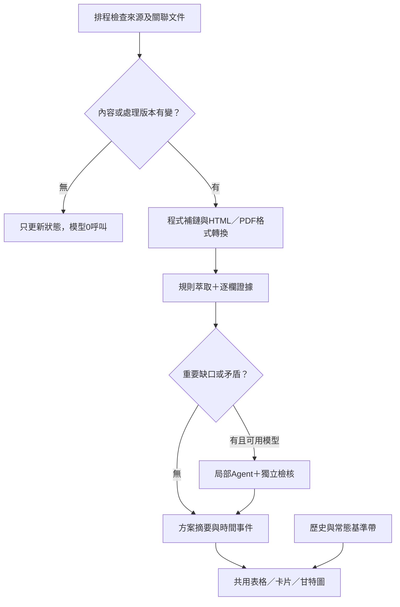

# 來源資訊鏈、低Token萃取與多層時間軸

2026-11-01使用者核可：PR28、29先合併，本輪開發放PR31；PR30的UI研究另行處理。原始19筆探索見[SOURCE-CHAIN-RESEARCH-2026-11-01.md](SOURCE-CHAIN-RESEARCH-2026-11-01.md)。

## 本輪方向

保留19筆候選與13組方案；正式pilot及人工台帳不改。新增共用文件、關係連結與時間事件資料，先用電信所、農化系、中研院政治所驗證。前台表格由結構化資料產生，不維護第二份真相。下列落地項目與驗收數字於本PR完成時補實測結果，不能將規劃稱為已支援。

## 資料與流程

- documents：URL、實際格式、來源限制、revision、內容hash、定位；原始全文只在記憶體。
- relations：依據、轉知、地方收件、修訂、歷史版本；同文件共用，年度／梯次／單位分開。
- events：公布、受理起訖、補件、系院校送件、預定／實際核定與結果、報支／使用期間。每個事件帶年度、範圍與證據。
- baselines：官方常態、原年度歷史、投射年度估計分開。2期僅低信心，制度改變不跨制估計；無歷史不捏造。

## 低成本與合規

重用既有Fetcher、IR、證據與局部萃取。HTTP條件請求及語意hash避開重做；父頁與附件獨立檢查。同一份文件只準備一次；內容、解析規則、Schema、欄位範圍或來源限制改變須失效快取。相同host模板可重用選擇器，但新站不能假定任意內容均可信。

有限深度、文件／請求數及總時間；只跟允許的官方host及正文關聯，不執行任意onclick、不下載名冊、不繞過robots／登入。hash_only不可外送模型或持久化摘錄。排程模型off、無付費備援，來源與模型成本邊界不變。自動關聯不足、版本衝突與格式不支持保留例外，不靜默補值。

## 甘特圖

半透明淺色底帶：可比往年／常態季節；細流程線：公告至截止；上層實線：確認的申請期；標記：公布、補件、行政送件、核定／結果。公布不當申請起日；預定核定不等於實際結果公布。today是真實今天，歷史有年份／樣本數／估計標籤，可關閉。各標記提供文字表與鍵盤可用描述，不能只靠顏色。

使用者可切換地方收件範圍；預設校級／通用。職治所不得套用電信所／農化系日期。往年投射是估計，不改受理、資格或完整資料核准。固定附註：『往年／常態區間僅供準備參考；實際資格、申請起訖與程序，以及未竟事宜，以主辦及受理單位最新公告為準。』

## 驗收方向

- 電信所第一梯6/15–7/10 17:00與第二梯10/12截止分開，紙本／電子按分支。
- 農化系7/27截止與校級8/25參考分開；政治所1/2即日起及3/18截止有發布證據。
- 教育部11/9院送校、11/16排程核定、預計11/20報支不當學生截止。
- 不因日期變多放寬filter或核准資料；新資料有來源revision與定位，19筆仍pending。
- 無變更0模型呼叫；hash_only不存全文／摘錄，受阻保留原因；不將人工研究摘要假充自動萃取證據。

## 狀態

設計已核可；本PR開始實作，測試及未完成部分於後續提交補記。
