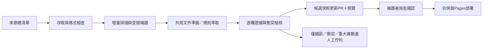

# OpenGSA 全來源擴展與資訊鏈補查計畫

日期：2026-11-01（臺北）。狀態：**使用者已確認開工；實際結果見SOURCE-EXPANSION-RUN.md**。

計畫盤點階段僅讀本機公開專案資料，當時來源HTTP請求0、模型呼叫0、上架動作0。執行階段的請求與成果另計。Obsidian退出正式維運流程；PR34保持原樣、不刪除、不合併。D槽專案繼續使用。PR32的來源JSON與網頁地圖仍可沿用；本計畫不包含自動合併任何既有PR。

## 1. 盤點範圍與數量

完整清單：[可搜尋HTML](source-expansion/catalog.html)、[逐項Markdown](source-expansion/SOURCE-INVENTORY.md)、[機器可讀JSON](../data/source-inventory.json)。具名／類型檢索詞另見[名稱清單](source-expansion/RESOURCE-KEYWORDS.md)及[JSON](../data/resource-search-targets.json)。

讀取目前分支的65份Markdown／JSON，以及既有收集器涵蓋的1份HTML。合併原184網址、規劃文件中的反引號／裸網址、所有已存audit中的來源與發現連結，依既有canonical_url去重，得到**485個已存公開URL**。沒有新搜尋485個網站，也沒有認定485個獎學金。

原來的184只是已建台帳與已配對資訊鏈文件，並未列盡舊規劃及下層連結。舊audit已保存200次子連結出現、去重148個URL；其中有相同頁面的導覽與無關規章，不能直接轉為候選。本次新增列管301個已存URL，也包含技術參考，不是新增301個方案。

此處URL去重沿用既有規則（主機／路徑編碼、fragment等），尚未認定不同query順序、www別名或轉址是否為同一文件；語義去重列入B0，485仍可能對應較少實際文件。登入狀態URL已移除臨時query參數，不作掃描目標。

| 處置 | URL數 | 意義 |
|---|---:|---|
| B1–B8本輪評估範圍 | 367 | 含主辦入口、公告、辦法、附件、子頁；先辨識再決定是否具名匯入 |
| 其中待查／補鏈 | 317 | 仍須本輪重新查robots、規格與公開存取條件；不保證皆能自動掃描 |
| 其中人工／存取疑點 | 50 | 舊受阻、登入、分享表單、HTTP等；不能因排入批次而解鎖 |
| H海外占位 | 13 | 維持暫緩外國獎學金全域探索；國內機關補助赴外仍照常查 |
| X技術／維運參考 | 86 | API文件、授權、爬取研究、GitHub部署及Obsidian說明等；不當學生獎項 |
| X不作獨立候選的連結 | 19 | 教師／行政委員會規章、SSO、追蹤端點及輔助圖片等 |
| 合計 | 485 | 每個URL有唯一主批次，跨方案共用引用不重複計數 |

另整理189項**檢索名稱／類型線索**，含已有方案、舊稱、疑似別名、來源機構及尚無網址的主題；不是189個去重後的有效獎學金。舊稿的金額、資格、機關歸屬和網址可能有錯，均不能直接搬成當期事實。分類依既存台帳與URL／引用脈絡，屬規劃分流，並非新一輪內容查核結果。

本盤點涵蓋當前checkout已存的來源；未納入其他尚未合併PR的新來源，也不代表全臺所有資源。網址未提供的教會／宮廟、學會、院系項目保留為檢索詞，後續才找官方入口。私人信件、登入內容與本地API資產不在盤點範圍。

## 2. 優先序與分批計畫

B0先完成基本管線及時效快篩，再依B1→B2→B3→B4→B5→B6→B7→B8執行。法律與權益不因排得較後而推定舊文正確；若新卡片引用給付／工資保障，對應B7查核必須先完成。已存資料若指向30日內期限，提前進B0重核；例如臺北／新竹AI的11月線索，不能未重查就宣稱仍受理。

| 批次 | 主分類URL數 | 內容與優先事項 | 本批交付 |
|---|---:|---|---|
| B0 管線與現有基線 | 不另計URL | 既有19候選／13方案回歸；將有用來源台帳／佇列脫離vault；補增量掃描→候選更新PR→網站快照路徑；先擋無關規章與登入／追蹤誤收 | 可中斷續跑的待辦、版本與來源限制；現有三頁及filter不退步；沒有自動核准 |
| B1 博士／候選人研究獎助 | 61 | 國科會甄選與核配、教育部博獎不同梯次、國科會人社撰論文、中研院候選人培育、TIGP、電資博士獎學金；修正舊法號／失效入口 | 主辦辦法＋當期徵件＋校內程序；臺大相關項目優先找1–2個有日期的系所範例 |
| B2 會議與赴外 | 61 | 國科會會議、FAOS、醫學院國際事務／研發分處、千里馬、遠學、學海系列、希望出航、交換／雙聯、青年百億；學會／大會補助先列具名線索 | 分開學生／院系／學校／機關期限、相對規則、補送接受函與紙本到達；不借用其他方案規則 |
| B3 院系入口與成果獎 | 79 | 論文／成果13＋院校入口66。先醫學院優秀著作獎與職治所，再理學、公衛、電資、社科、文、工、生農、管理、法、生科及舊稿跨域入口；校長獎、院長獎、斐陶斐、優秀青年 | 入口與具名項目分開；依實際組織層級校正；無關教師行政規章不產生卡片 |
| B4 生活與特定身分 | 18 | 生活／學費13＋身分5。學雜費、就貸、勵學、不利處境、急難、住宿；國際生Governing／Outstanding、僑陸支持。生輔組維持人工 | 支持性質、研究生適用、國籍／學籍／清寒限制及承辦來源；受阻項目交人工清單，不換代理繞過 |
| B5 基金會與企業 | 23 | 中技社、行天宮、吳健雄、潘文淵、徐有庠、宋作楠、台經／台綜院；台積電、聯發科線索、鴻海、台達、Google／Microsoft／NVIDIA、富邦／國泰／玉山／中信／元大；宗教／地方獎助 | 碩博適用與當期方案優先；企業全球獎助先查臺灣學生是否適用；未找到具名方案則停留入口 |
| B6 AI／算力／創業 | 55 | AI與培訓49＋創業6。既有17種AI線索、國網／TWCC、學生優惠、研究點數；FITI、U-start、TEC、創業天使與SBIR線索 | 現金、折抵、課程、研究點數、企業投資分流；購買期限、申請期限、經費用罄及個人相對期限另存 |
| B7 RA／TA與法規求助 | 48 | 國科會人力／增核、學校專兼任、研究生獎勵金、TA／EMITA／工讀；最低工資、勞僱與學習分流、工作許可、申訴／著作權 | 主管法源→適用給付／身分→校級補充→求助入口；金額只在適用條件與生效版本清楚時顯示 |
| B8 其他入口與待辨識 | 22 | 中央機關／其他研究入口19＋未辨識表單子頁3。確認機關、申請角色及可公開的固定入口；既有清大、陽明交大、成大、政大只建擴校模板線索 | 具名方案轉回對應類別；合作種子計畫／教師主持人資源獨立標示，不混進學生直接申請 |
| H 海外占位 | 13 | Fulbright、DAAD、Chevening、Erasmus、Campus France、日本交流與外國合作入口 | 本輪保留、校正類型；不展開全球獎學金爬取 |
| X 參考與排除 | 105 | 技術維運86＋非獨立候選19 | 保留出處及排除原因；不交模型、不灌網站獎學金清單 |

上表URL數不含後續新發現頁面；每批新發現的連結另記parent、角色、深度、是否已讀。不得以「子連結有申請／辦法兩字」當作學生獎助，例如目前已存的教師評審委員會辦法就是需排除的誤收。

## 3. 資訊鏈與資料結構

沿用既有JSON Schema與網頁檢視，不新增Graph資料庫，也不維護第二套Markdown資料庫。來源總清單只維護一份；scanner profile引用來源ID與必要抓取設定。結構化資料與生成檢視的責任分開。

```text
方案（穩定program_id；中英文名／舊稱別名）
├─ 辦法／法源：版本、生效日、歷史沿革
├─ 當期徵件：年度、梯次、公布及受理事件
├─ 校級／學院／系所流程：角色、範圍、各自起訖
├─ 附件／表單／申辦入口：HTML、PDF、DOCX、ODT等實際格式
├─ 承辦單位：角色、官方網址與公開聯絡資訊
└─ 歷史公告：同主辦／同範圍／同梯次，支援往年參考與估計

每個顯示欄位 → document_id＋revision＋定位＋擷取方法＋查核狀態
每個文件關係 → parent_id／child_id＋關係類型＋觀察來源
```

一份法源可被多個方案引用；文件只處理一次，避免重複消耗token。區分「原頁實際連結」「來源台帳配置脈絡」「尚待驗證關聯」。錯年度、錯領域或同公告中的另一方案不合併。

資訊鏈沒有找到就記`未找到／受阻／過期／衝突／未載明`及已查範圍，不無限探勘，也不要求每筆完整閉合才讓雷達顯示已確認的核心欄位。

## 4. 抓取與成本範圍（已核可）

- 本輪是手動可續跑的微批，不提高既有週二／五排程，也不啟用排程模型。
- 單微批維持最多20次HTTP（含robots）、至少3秒同站間隔、180秒；資訊鏈微批最多12文件，既有candidate scanner另維持原5份變更／24份pending限制。
- 具名方案最多補鏈2層、8份關鍵文件；每個索引先最多20個相關連結。達上限把其餘記入待辦，不假稱全部查完。
- 第一輪主批每批最多200次HTTP，整輪最多1200次HTTP，達上限交進度及剩餘清單。這是工作量上限，非要求打滿；不保證在此上限內讀完367個URL及新增附件。官方搜尋／人工瀏覽另計次並明示，不藏在HTTP數字外宣稱零成本。
- 預設模型呼叫0。先URL去重、內容hash、格式轉換、規則與增量處理；若確實需要外部模型，再提出具體來源、欄位、已確認的免費模型／預算，不在長任務中自行啟用付費備援。
- `hash_only`全文僅記憶體，不能送外部API或放入artifact。其他來源也只長存允許的結構化欄位、短摘錄、hash、URL及定位；不囤PDF／HTML全文。
- DOCX／ODT先評估本機記憶體轉換及必要防呆；舊DOC、掃描PDF／圖片若無可用轉換方式，明示延期或找官方HTML替代，不為少數附件先引入大型服務。圖片可能是必要公告附件，X只表示不作獨立卡片，必要時仍回父頁判斷。
- robots禁止、無法確認、登入／SSO、403／429與分享權限疑點保留處置原因；Defuddle只作已允許取得內容的正文整理，不當作繞過許可或存取限制的工具。

## 5. 萃取、日期與上架規則

核心先取：名稱、主辦／收件角色、官方來源、大致對象、年度／梯次、各層時間及申請入口。其他欄位支援filter，能確定才填，未知不當符合、不限、否或N/A。

日期盡量保留：首次公布、補充／修正公告、學生申請起日與截止、院系／校級／機關截止、紙本送達／郵戳、補件、結果公布、出國／會議活動日。公布日不自動當受理起日；預計接受論文日期不當補助結果日。推定日期、歷史原始日期與當期確定日期分開。

往年底帶先呈現有來源的實際舊年度。要推估常規區間，優先找至少2個同單位／同梯次年度樣本，保留樣本、方法及年份；不足時只給公告季節提醒，不造精確起訖。系所範例明示適用範圍，不套給職治所或其他系。

上架分三種：具名方案有可信核心資訊即可產生雷達草稿；首頁／索引列來源目錄；時間不明者留卡片與不明分區，不畫肯定的申請長條。不為補齊欄位而延後所有可用資訊，但錯年度／對象或重大矛盾先壓下受影響欄位。法律保障與工資主張需另核其適用依據。



這個長任務的交付是分批候選／程式／資料PR與預覽，不自動合併、代填真人核准或直接發布。你可以按一批摘要核可，不需逐筆展開每個結構化欄位。既有正式pilot與核准台帳保持原流程。

## 6. 每批回報與驗收

每批交付：來源清單與發現關係JSON、具名方案及別名對照、可顯示／未知／受阻欄位、當期／歷史／相對時間、工作台及前三頁預覽、資料差異PR、成本計數、待辦和需你決定的問題。

每個來源最後必有處置：已讀、已判斷為入口、具名候選、版本／別名重複、存取受阻、非目標、格式延期或預算內未及處理；不把HTTP200或已存URL稱為完成萃取。

執行相應Python／Node測試、資料／設定檢查、公開站與審查台建置；瀏覽器驗證第一至三頁同一版資料、filter未知分區、選取一致、Issue連回正確來源、甘特圖時段與歷史底帶。沿用P1臺大職治博士五年級候選人、一般碩士及外籍博士情境；不補猜年齡、戶籍、所得、聘僱或會議日期。

任何來源擴展都先用少量真實樣本驗證解析方法，再套同版型；調整後的校準樣本不宣稱盲測。重點指標是具名方案數、核心可顯示數、有證據日期數、來源版本與衝突數，不追求把未知欄位硬填滿的百分比。

## 7. 已確認的執行範圍

使用者已核可B0及B1–B8，依上列上限分批執行；H維持海外占位、X不作獎助擴張；模型0、受限來源不繞過、資料先PR預覽再逐批發布。PR34繼續掛著，Obsidian不再是工作流程或CI必要依賴。目前已在獨立開發分支實作；未修改公開網站或PR34。
